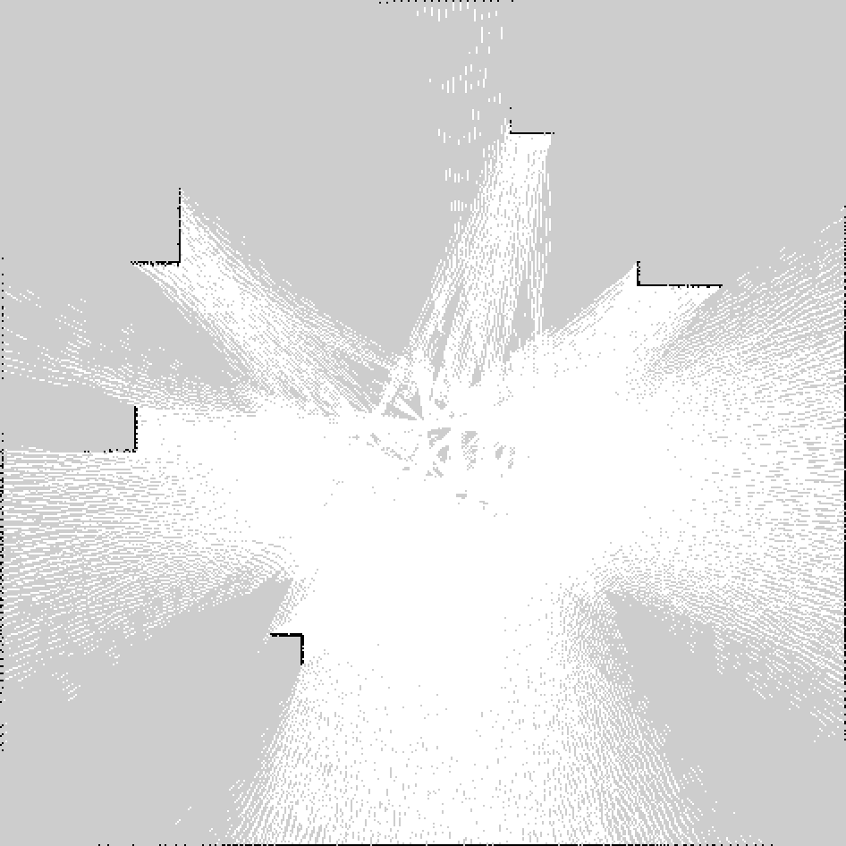
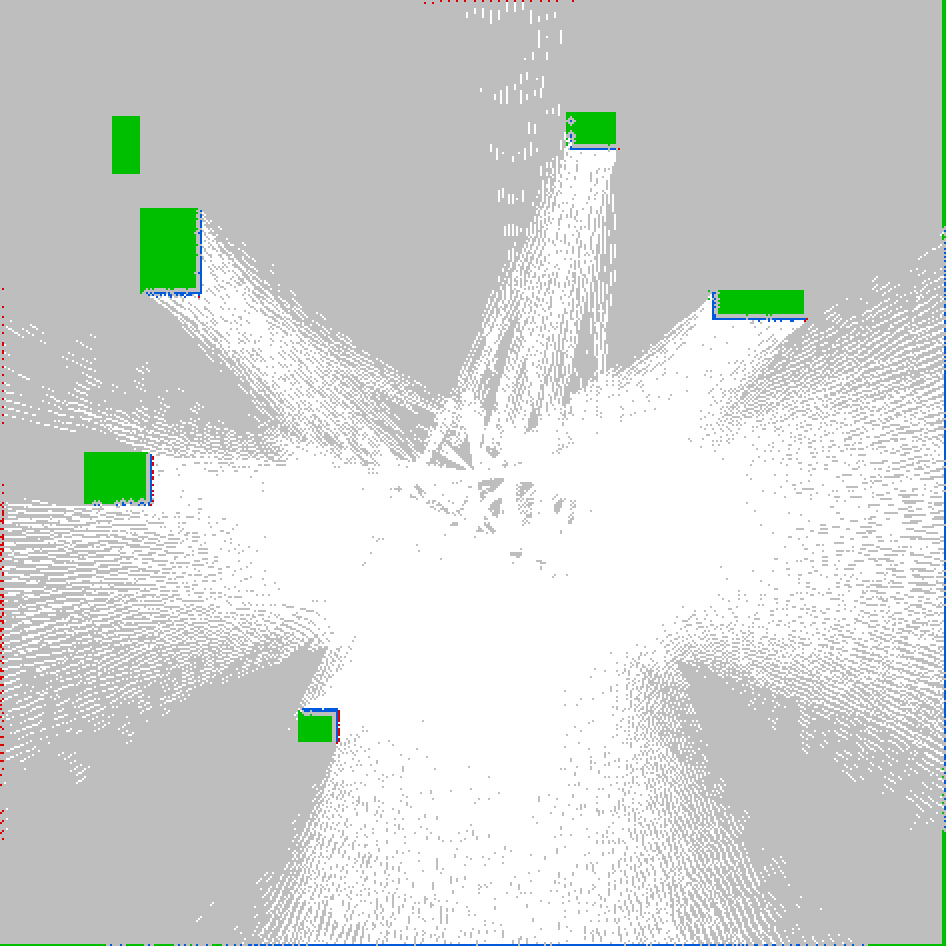

# 03 · 验收记录

本文记录验收标准的判定方式与实测证据。操作步骤见 [`02-running.md`](02-running.md)。

下面引用的数字全部来自 `validation/` 里随代码一起提交的报告文件（它们就是原始证据）；
重跑 `acceptance_check.py` / `run_nav2_demo.py` 会刷新对应的 JSON。

## 验收结论

| # | 验收标注 | 判定 | 结论 |
| --- | --- | --- | --- |
| 1 | gRPC SDK 快速扫描建立持久连接；一个 bat 临时加载环境后即可用 ros2，`ros2 topic list` 等保持一致 | 冷启动后 `ros2.bat topic list -t` 返回 9 个话题且类型全部正确；耗时随守护进程起多快而变（最近一次冷启动 1.88 s，证据 8 那次现场是 1.31 s，机器当时不空），但结果不再随之变化（等的是就绪文件，见证据 8） | **通过** |
| 2 | Windows 发布话题，Ubuntu 端也能正常订阅 | Windows 发 `/cmd_vel`，Ubuntu 小车位移 **0.81 m**，`/odom.twist.linear.x` = 0.250 | **通过** |
| 3 | nav2 正常订阅话题建图、规划路径、指挥小车移动 | 480×480 costmap（13728 lethal）、NavFn 规划 287 点 / 15.34 m、23.0 s 行驶 **11.73 m**，距目标 **0.26 m** | **通过** |
| 4 | 移植 `nav2_amcl` + `slam_toolbox`（humble 分支）到 Windows：静态编译、运行时不依赖 MSYS | 移植产物 `objdump -p` 里只剩 `KERNEL32.dll` + `api-ms-win-crt-*`；`PATH` 只留 `C:\Windows\System32;C:\Windows`、`ROS2_BRIDGE_MSYS2` 指向不存在的目录时，守护进程照常起、`ros2.bat topic list -t` 与上行发布都正常 | **通过** |
| 7 | 规划器**插件层**：`nav2_smac_planner`（Hybrid-A*）接入，规划器从 NavFn 换成 Smac 后整栈照常建图、规划、闭环 | 连跑三次 `nav2_stack.bat --params <Smac>` 全部 `SUCCEEDED`：行驶 **2.36 / 2.79 / 2.44 m**，`/plan` 2 / 17 / 6 条，`/cmd_vel` 118 / 590 / 133 条；`planner_server` 日志里 `Created global planner plugin GridBased of type nav2_smac_planner::SmacPlannerHybrid` → `Using motion model: Dubin` → `Managed nodes are active` | **通过** |
| 8 | 共享内存通道的几何是有代价的：`map`/`costmap` 类话题不再按 64 MB × 8 槽预留 | `planner_server` 常驻 **6191 MB → 231 MB**、`bt_navigator` 1277 MB → 319 MB，空闲内存 0.29 GB → 3.18 GB；改前 Smac 那一栈起不来（`bt_navigator` 里一个 `std::bad_alloc`），改后连跑三次全过，且 5 项验收脚本仍全过（见证据 16） | **通过** |

## 一键复现

```bat
cd C:\Users\Administrator\Desktop\app\code\CPU
E:\venvs\py312\Scripts\python.exe bridge\scripts\acceptance_check.py
```

最近一次运行（`validation/acceptance-report.json`，2026-09-17T22:16:04+0800 —— 九条）：

```
=== topic_list: Windows lists the Ubuntu topics (cold start)
[PASS] topic_list (1.9 s) - 9 topics with types in 2.0 s (cold start)
=== topic_info: Windows resolves /scan to the gRPC peer
[PASS] topic_info (0.2 s) - reported as remote (bridged over gRPC)
=== scan_rate: Mirrored /scan keeps its 10 Hz
[PASS] scan_rate (6.2 s) - 9.64 Hz average over 55 samples
=== uplink: Windows /cmd_vel moves the Ubuntu robot
[PASS] uplink (4.7 s) - moved 0.81 m, /odom twist.linear.x=0.250 while
       commanded
=== uplink_nav2: the plan nav2 publishes reaches the robot (default uplink table)
[PASS] uplink_nav2 (11.6 s) - default table armed /plan, /behavior_tree_log;
       /plan forwarded 14/20 msgs, failed=0
=== cmd_vel_watchdog: a /cmd_vel that stops arriving stops the robot
[PASS] cmd_vel_watchdog (4.6 s) - drove 0.37 m on a 1 s command, then 0.000 m
       in the next second, /odom twist.linear.x=0
=== nav2_demo: nav2 plans a path and drives to the goal
[PASS] nav2_demo (22.8 s) - goal [-8.775, -6.375] reached from [0.904171,
       0.704931]: travelled 11.73 m, remaining 0.26 m, plan 287 waypoints
=== slam: slam_toolbox maps a lap from the bridged /scan + /tf
[PASS] slam (82.5 s) - 472x473 @ 0.050 m, 420 occupied / 39741 free / 183095
       unknown; reloaded in a fresh process: 472x473, 405 occupied
=== reset: the car goes back to the origin (and stays there)
[PASS] reset (0.0 s) - back at (0.000, 0.000), nothing commanding the wheels

9/9 checks passed; report: bridge\docs\validation\acceptance-report.json
```

## 证据 1 · Windows 上像 ROS2 一样使用

守护进程先被停掉，再由 `ros2.bat` 自己完成「局域网扫描 → `Ping` 握手 → 建立持久 gRPC
通道 → 镜像全部远端话题」。

```bat
bridge\windows\ros2_bridge.bat stop
bridge\windows\ros2.bat topic list -t        :: 冷启动 1.3–2.8 s（等的是就绪文件，不是固定 sleep）
另外记一笔：`topic list` 列出什么，取决于**当下谁在跑**，这一点跟 ROS2 一致。上面这次是干净状态
（只有守护进程 + Ubuntu 仿真），所以是 7 个；本轮实测到一次「整套 nav2 栈还活着」的时候，
同一个命令列出 **64 个** —— `planner_server` / `controller_server` / `bt_navigator` 这些节点的
`/global_costmap/*`、`/controller_server/*` 都在里面。栈停掉之后再问，又回到 7 个：
读者侧按 pid 判断注册者是否还在（`graph.hpp:292` 的 `process_gone()`，
`list_topics(remove_stale = true)`），死掉的注册文件会被顺带清掉。
```

```
/clock [rosgraph_msgs/msg/Clock]
/cmd_vel [geometry_msgs/msg/Twist]
/map [nav_msgs/msg/OccupancyGrid]
/odom [nav_msgs/msg/Odometry]
/scan [sensor_msgs/msg/LaserScan]
/tf [tf2_msgs/msg/TFMessage]
/tf_static [tf2_msgs/msg/TFMessage]
```

来源与频率：

```bat
bridge\windows\ros2.bat topic info /scan
::   Type: sensor_msgs/msg/LaserScan
::   Publisher count: 1   Subscription count: 0
::   Source: remote (bridged over gRPC)

bridge\windows\ros2.bat topic hz /scan       :: average 9.446 Hz over 55 samples (min 8.938, max 9.998)
bridge\windows\ros2.bat bridge status        :: 7 topics (7 remote, 0 local), known types: 19
```

Ubuntu 侧的雷达是 10 Hz；平均 9.45 Hz 的差值来自跨机传输和订阅端采样抖动，个别采样会掉到
8.9 Hz（一次 100 ms 的调度延迟就够），平均仍在 8–12 Hz 的判定区间内。

## 证据 2 · Windows 发布，Ubuntu 订阅

```bat
bridge\windows\ros2.bat topic pub /cmd_vel geometry_msgs/msg/Twist linear.x=0.25 angular.z=0.3 --rate 10 --duration 2
```

| 量 | 值 |
| --- | --- |
| `/odom` 位置（发之前） | (4.8713, -1.8646) |
| `/odom` 位置（发之后） | (4.5575, -1.3964) |
| 位移 | **0.564 m** |
| `/odom.twist.twist.linear.x` | **0.250**（与下发的速度一致） |

`/odom` 由 Ubuntu 的仿真小车产生并回传，所以位移和回显速度同时说明：命令经上行 gRPC
到达了小车，小车按该命令运动。

## 证据 3 · nav2 建图 + 规划 + 移动

```bat
E:\venvs\py312\Scripts\python.exe bridge\scripts\run_nav2_demo.py --goal auto --report run.json
```

| 项 | 值 |
| --- | --- |
| 地图来源 | `union`（对端 `/map` + 雷达占据栅格合并） |
| costmap | 480 × 480 @ 0.05 m，lethal 15726，inscribed 15239，unknown 0 |
| 雷达输入 | 8 次扫描 × 360 线；空闲标记 456675，占据标记 1960 |
| 起点 → 目标 | (4.48, -1.35) → (-0.38, 9.63) |
| 终点 | (-0.37, 9.35) |
| 规划 | 286 个路点 / 15.39 m（每 3 s 重规划，最后一次 31 点 / 1.67 m） |
| 实际行驶 | **11.74 m**，耗时 **23.8 s** |
| 距目标 | **0.28 m**（容差 0.30 m） |
| 消息计数 | `/map` 31、`/scan` 232、`/odom` 1128 |

完整报告：[`validation/nav2-demo-report.json`](validation/nav2-demo-report.json)。
注意 `plan.waypoints` 是**第一次**规划的结果，`travelled_m` 比它短是因为每 3 s 会重规划，
后面的路径更短。

规划与控制的代码路径全部来自魔改后的 nav2 本体（`nav2_costmap_2d` 的 `InflationLayer`
代价模型、`nav2_navfn_planner::NavFn` 的 `calcNavFnDijkstra` + `calcPath`），demo 只是
把「话题 → costmap → 规划 → 控制」这条线接起来。

### 只用雷达建图（`--map-source laser`）

同一条命令加 `--map-source laser`，完全不使用对端 `/map`，只用 `/scan` 现场建图
（另一次运行）：

| 项 | 值 |
| --- | --- |
| costmap | 480 × 480 @ 0.05 m，lethal 1043，unknown 172208（只标出雷达真正扫到的障碍与空闲区） |
| 起点 → 目标 | (10.14, -10.72) → (4.83, -1.58) |
| 规划 | 283 个路点 / 15.32 m |
| 实际行驶 | **10.31 m**，20.1 s，距目标 **0.29 m** |

两条路径（`union` 与 `laser`）都到点，说明地图来源是可替换的：对端给地图时用 `union`，
只有雷达时 `laser` 也能独立支撑规划。报告见
[`validation/nav2-demo-laser-report.json`](validation/nav2-demo-laser-report.json)。

## 证据 4 · SLAM（`slam_toolbox` 移植到 Windows）

`slam_toolbox` 已经移植进兼容层，编成 Windows 静态自包含 exe，直接从共享内存图里吃
`/scan` + `/tf`。跑法见 [`02-running.md`](02-running.md) 第 6 节：

```bat
bridge\windows\ros2_bridge.bat start
bridge\windows\slam_demo.bat --duration 120     :: 另开窗口发 /cmd_vel 让车走
```

一次实测（Ubuntu 仿真车依次走直线、左弧、右弧，约 50 s）：

| 项 | 值 |
| --- | --- |
| 输入 | 桥镜像进来的 `/scan`（360 线，10 Hz）+ `/tf`、`/odom` |
| 输出 | `/slam_map`，473 × 473 @ 0.05 m，origin (-11.734, -11.813) |
| 栅格 | occupied 891 / free 84681 / unknown 138157 |
| 与仿真真值比对（0.10 m 容差） | 已观测区域内真值墙体 **64.4%** 被标出；SLAM 占据格 **81.0%** 落在真值墙体上 |
| 与仿真真值比对（0.20 m 容差） | 已观测区域 **87.1%** / **84.5%** |





叠加图里：灰 = 未观测，白 = 空闲，黑 = SLAM 标出的障碍，绿 = 真值里存在但这一侧没被扫到的
面，蓝 = 两边重合，红 = 只有 SLAM 标出的散点。召回率不到 100% 是几何必然而非缺陷：激光只
打得到障碍物朝向机器人的那一面，背面和内部永远观测不到（图中的绿色方块就是这些背面）。
蓝色散点是 `slam_toolbox` 默认参数下的栅格噪声，可以用 `-p` 收紧。
这组数字来自一次全重新实测（仿真器 `--seed 7` 重启、小车从 (0, 0) 出发、行驶约 60 s），参数与默认值略有不同：

```bat
bridge\windows\slam_demo.bat -p map_name:=/map -p max_laser_range:=12.0 -p map_update_interval:=2.0
```

两个易踩的坑：

- `slam_toolbox` 默认 `max_laser_range` 是 25 m，而仿真雷达只报 12 m；按真实量程收紧后匹配明显变好（上面的召回率 / 精确率就是收紧后的结果）。
- 仿真器会锁存最后一条 `/cmd_vel`，停下来时要发一条零 Twist；否则小车会一直开出 24 m 的世界，`/scan` 再也看不到边界，SLAM 建出来的就是一张空图。
- `/tf_static` 是 latched 的，守护进程刚起来的那几秒它还没进共享内存，这时起 SLAM 会丢头几帧
  `/scan`（`discarding scan`）。`slam_bridge_node` 现在会等 `/scan` 的 `frame_id` 出现在
  `/tf_static` 里再 configure/activate，冷启动不再丢帧。

这套数字在之后的改动里复跑过两次（同样 `--seed 7` 冷启动、单车单 SLAM 节点、0 `discarding
scan`、0 ERROR）：

| 复跑 | 召回（0.10 m） | 精确率（0.10 m） | 召回 / 精确率（0.20 m） | 这一趟走了多远 |
| --- | --- | --- | --- | --- |
| 第一次 | 63.2% | 81.2% | 86.5% / 86.2% | 3.5 m |
| 第二次 | 51.6% | 78.1% | 75.4% / 85.4% | 3.6 m |

召回率对「这一趟到底扫到多少面」很敏感（分母是已观测区域内的真值墙体，车走得少、射线扫不到的
面就多），精确率则稳定在 78%–81%。这两个数应当看作「地图和真值一致」的量级证据，而不是固定
指标。

## 证据 5 · AMCL（`nav2_amcl` 移植到 Windows）

`nav2_amcl`（humble 分支）和 `slam_toolbox` 一样被移植进来，编成 Windows 静态自包含 exe：从共享
内存里读 `/scan` + `/map`，把粒子滤波结果发到 `/amcl_pose`，把 `map -> odom` 变换发到 `/tf`。
跑法见 [`02-running.md`](02-running.md) 第 7 节：

```bat
bridge\windows\amcl_demo.bat --duration 90
```

一次实测（**冷启动**：守护进程没在跑，`amcl_demo.bat` 自己把它拉起来；仿真车直行 + 左弧 + 右弧）：

| 项 | 值 |
| --- | --- |
| 启动顺序 | `[amcl_demo] starting the bridge daemon first` → `initial pose from /odom: 0.000 0.000 0.0000` → `active: scan + map, map -> odom -> base_link` |
| 地图输入 | `Received a 480 X 480 map @ 0.050 m/pix` |
| 日志 | `Couldn't transform from laser to base_link` **0 条**，ERROR 0 条 |
| 估计误差（对 AMCL 时间戳那一刻的 `/odom`） | 0.005 – 0.109 m，偏航 ≤ 2.3° |
| 估计误差（对最新 `/odom`） | 0.071 – 0.259 m，偏航 ≤ 13.4° |
| 估计年龄 | 0.08 – 0.80 s |

两个数要一起看：`amcl_probe.exe` 在同一个进程里同时订阅 `/scan`、`/odom`、`/amcl_pose`，
`err_at_amcl_stamp` 是「AMCL 这一帧估计」相对**它自己时间戳那一刻**的里程计的偏差，`err_now`
是相对最新里程计的偏差。两者之差正好是估计年龄 × 车速 —— 也就是说多出来的那部分不是滤波算
错了，只是估计比里程计旧了 0.1 – 0.8 s（仿真车约 0.25 m/s，对应 0.02 – 0.20 m，与上表吻合）。

```bat
call bridge\windows\bridge_env.bat
nav2\ros2_shim\build\amcl_probe.exe --duration 60 --period 3
```

另外验证过：`/tf` 里确实有 `map` 系（40 条里 6 条是 `map -> odom`），而且 `/tf` 的四元数与
`/odom` 完全一致，说明这条链路没有传输损失。

一个易踩的坑：`/tf_static` 是 latched 的，守护进程刚起来时 AMCL 会每收到一帧 `/scan` 就报一次
`Couldn't transform from laser to base_link`（实测冷启动丢了约 2 s 的扫描）。`amcl_bridge_node` /
`slam_bridge_node` 现在会先等 `/scan` 的 `frame_id` 出现在 `/tf_static` 里再 configure/activate
（`ros2_shim/lifecycle_runner.hpp` 的 `waitForScanStaticTransform()`，最多 15 s），之后复跑同样
的冷启动流程，这条报错归零。

## 证据 6 · 参数文件（`--params-file`）

上游 nav2 / slam_toolbox 的配置全是 YAML，读不了它们，移植过来的节点就只能靠一条条 `-p` 手工
摆。`ros2_shim_params` 把这件事补齐了：`slam_bridge_node` / `amcl_bridge_node` 现在接受
`--params-file FILE`（可重复，也和 `--ros-args` 一起接受），按 `ros__parameters` 块把值登记成
`rclcpp::Parameter` 覆盖项。

一次实测（同一个仿真车，守护进程按 `/clock /odom /scan /tf /tf_static` 镜像、不含 `/map`）：

```bat
:: 直接用上游那份 online_async 配置，只用 -p 把 base_frame 改回本仓库仿真的 base_link
bridge\windows\slam_demo.bat ^
    --params-file nav2\third_party\slam_toolbox\config\mapper_params_online_async.yaml ^
    -p base_frame:=base_link -p map_update_interval:=7.5 --duration 45
```

```
[slam_bridge_node] ...\mapper_params_online_async.yaml: 112 parameter(s) for node 'slam_toolbox'
[slam_bridge_node] /tf_static carries the laser frame
[INFO] [slam_toolbox] Node using stack size 40000000
[slam_bridge_node] sync active: /scan -> /map, base_link frame, resolution 0.0500, map every 7.5 s,
                   scan buffer 10, with scan matching, with loop closing
```

三处数字分别对上文件里的三项，而它们都不是节点自己的默认值：

| 打印 | 来自文件 | 节点默认 |
| --- | --- | --- |
| `stack size 40000000` | `stack_size_to_use: 40000000` | 没给默认值（`PARAMETER_INTEGER` 描述符） |
| `map every 5.0 s`（不带 `-p` 时） | `map_update_interval: 5.0` | `10.0`（`slam_toolbox_common.cpp`） |
| `map every 7.5 s`（上面这次） | 命令行 `-p` 排在 `--params-file` 之后 | —— 后面的参数赢 |

同一趟里另一个进程读到 `ros2 topic list` 多出 `/map`、`/slam_toolbox/update`、
`/slam_toolbox/feedback`，说明节点确实在按文件里的参数建图，而不只是把参数读进来了。

AMCL 侧同样的做法，读的是 nav2 bringup 那份 `nav2_params.yaml` 的 `amcl:` 块：

```bat
bridge\windows\amcl_demo.bat ^
    --params-file nav2\nav2_extracted\navigation2-1.5.1\nav2_bringup\params\nav2_params.yaml ^
    -p base_frame_id:=base_link --duration 40
```

```
[amcl_bridge_node] ...\nav2_params.yaml: 78 parameter(s) for node 'amcl'
[amcl_bridge_node] active: scan + map, map -> odom -> base_link
[amcl_bridge_node] nav2_amcl::DifferentialMotionModel motion model, likelihood_field laser model,
                   500..2000 particles
```

`nav2_params.yaml` 的 `amcl:` 块每一项都和 `nav2_amcl` 自己的默认值相同，所以光看这一趟还分不出
「读了」和「生效了」。把同一块抄一份、只改 `max_particles: 2000 → 1234` 与
`min_particles: 500 → 321` 再跑一次，打印变成 `321..1234 particles`，值确实走到了节点里。
这一趟同样 0 ERROR、0 `Couldn't transform`，`/amcl_pose` 与 `/particle_cloud` 都出现在
Windows 侧的图里。

第三种情况是参数名对不上：`nav2_params.yaml` 的 `amcl:` 块里 `base_frame_id: base_footprint`
是本仓库仿真没有的系，照原样跑 AMCL 会每帧刷一条 `Couldn't transform from laser to
base_footprint`。这不是参数没加载，恰恰相反 —— 它证明值来自文件而不是默认值。真要用这份配置，
就在 `--params-file` **后面**补一条 `-p base_frame_id:=base_link`。

`ros2_shim_params` 的行为边界（`nav2/ros2_shim/tests/params_file.cpp`，ctest
`ros2_shim_params_file`，39 项断言全过）：

| 行为 | 断言 |
| --- | --- |
| 节点块匹配 | `slam_toolbox:`、`/slam_toolbox:`、`/robot1/slam_toolbox:` 都认；命名空间不符的块不认 |
| 通配块 | `/**` 先应用、点名节点的块后应用（后者赢），别的节点的块完全排除 |
| `ros__parameters` | 只读这个子块；注释掉的表项不会变成参数 |
| 类型 | 不带引号的 `true` / `-1` / `0.05` 分别是 bool / int64 / double，`nav2_amcl::DifferentialMotionModel` 是字符串 —— 与 rclcpp 的判型一致 |
| 嵌套与数组 | `initial_pose: {x: 1.5}` 展平成 `initial_pose.x`；`map_start_pose: [1.0, 2.0, 0.0]` 是 `double[]` |
| 双键登记 | 每个值同时以 `resolution` 和 `/slam_toolbox.resolution` 登记（兼容层按精确名字查覆盖项） |
| 出错 | 文件不存在 → 返回失败并带原因，不是静默跳过 |

`--params-file` 与 `-p` 混排时后者赢，和 rclcpp 一致：请求按命令行顺序展开，`Node` 的构造函数
对同名参数取最后一条。`slam_demo.bat` / `amcl_demo.bat` 里那两个「把上游默认改成仿真车」的预置
参数因此会在调用方自带 `-p` / `--param` / `--params-file` 时让位，免得和调用方的意图打架。

## 单元与一致性测试

| 测试 | 命令 | 结果 |
| --- | --- | --- |
| CDR ↔ 共享内存 逐字节转码 | `build_bridge.py --test` | **35 个 fixture、105 组字节比较、0 失败**（17 / 51 → 35 / 105：证据 48 把话题类型从 19 加到 38；`.scratch\cdr_check_after_codec.log`） |
| 跨机 bridge（CDR / service / action / 共享内存） | `ctest --test-dir bridge\windows\build --output-on-failure` | **4/4 passed**（`bridge_cdr_roundtrip` / `bridge_service_roundtrip` / `bridge_action_roundtrip`（**373 项断言**）/ `shm_transport`） |
| Ubuntu 仿真 / agent / 图注册表 | `cd bridge\ubuntu; python -m pytest ros2_bridge_sim\tests -q` | **52 passed**（21.5 s）→ **61 passed**（21.2 s，证据 49 加了 `test_watch.py` 9 条）；`test_cdr_matches_rosbags.py` 那三条要 `rosbags`，Windows 的 venv 有、Ubuntu 的 venv 没有，在 Ubuntu 上直接跑脚本会 SKIP 它们 |
| 兼容层 + 魔改 nav2 | `ctest --test-dir nav2\ros2_shim\build --output-on-failure` | **28/28 passed**（47.75 s，**串行**；27 → 28 是证据 47 补的 `ros2_shim_param_args`；每条测试自己带一个通道命名空间，图注册表目录也跟着走，所以守护进程在跑也互不干扰，`-j` 并发同样可用 —— 残留只剩 `ros2_shim_graph_rewrite` 偶尔一次读数没能打开文件，见证据 20 / 42） |
| Hybrid-A* 的几何（`nav2_smac_ompl_spaces`） | 同上 | Dubins 六个字解都真的落到目标（把解出来的路径开过去，不是重读代数）、按弧长参数化、曲率不超过最小转弯半径；Reeds-Shepp 不劣于 Dubins 且倒车支路终点正确 |
| pluginlib 名字解析（`ros2_shim_plugin_names`） | 同上 | 导出的别名按别名解析（`demo::Planner` → `PlannerT<NodeHybrid>`）、模板实例名仍可解析、未知名字报错并把名字带出来（见证据 16） |
| 参数事件投递（`ros2_shim_parameter_event_handler`） | 同上 | 只对注册的「节点 + 参数」回调、被节点拒绝的 set 不回调、取消注册与句柄析构都生效、回调里读该节点参数不死锁（见证据 16） |
| 图注册表重写（`ros2_shim_graph_rewrite`） | 同上 | 读者正拿着文件时重写照样落地、不共享文件的读者会被等过去、轮询客户端不会看不到一直注册着的 service、读者永远不会看到空或半截的图（见证据 18；`-j 8` 下偶尔有一次读数在 60 ms 里没能打开文件，形状与来源见证据 42） |
| 通道环的构造（`ros2_shim_channel_ring_lifecycle`） | 同上 | 同名 service / client 第二次创建（同名二次、client 先起、一批请求同时进出、连续重启 50 次）时绝不消费环里的旧请求或旧响应；8 个用例、44 条断言（见证据 42） |
| 仿真时钟（`ros2_shim_clock`） | 同上 | `use_sim_time` 默认关闭、打开后 `now()` 跟随 `/clock`（第一条之前读纪元）、内纳秒位也跟着走、墙钟节点不受影响（见证据 19） |
| 参数文件（`ros2_shim_params_file`） | 同上 | 上游 slam_toolbox / nav2 配置 + 通配、命名空间、数组、缺文件，39 项断言全过 |
| 端到端流水线（`nav2_e2e_pipeline`） | 同上 | NavFn 规划 → `/plan` 走共享内存 → `NavigateToPose` 动作往返，**通过** |
| `slam_toolbox` 建图（`slam_toolbox_mapping`） | 同上 | 合成房间 + 雷达扫描 → 栅格，漂移 **0.000 m / 0.0°** |
| `slam_toolbox` 激光点处理（`slam_toolbox_laser_points`） | 同上 | 雷达消息 → `LaserRangeScan` 的坐标/帧处理 |
| `slam_toolbox` 位姿图存档（`slam_toolbox_serialization`） | 同上 | 建图（239 条地图消息、`160 x 120`、占据 279、空闲 18921、未知 0）→ `serialize_map` 落盘 `28 270 382` 字节 `.posegraph` + `661 958` 字节 `.data`（`result 0`）→ **另一个**节点把它读回来（17 条地图消息、同样的 `160 x 120 @ 0.05 m`、原点 `(-4.000, -3.000)`）：**occupied / free / unknown 逐项相等**，`differing cells: 0 of 19200 (0.000%)`，再吃一条扫描仍然 `0 of 19200`、占据仍 279（容差 0.30%，出处见证据 41 / 42） |
| 话题 remap（`ros2_shim_remap`） | 同上 | `-r FROM:=TO` 的七组语义：规则两边都解析、第一条命中即止、绝对名只配绝对名、`__node` / `__ns` 不参与、不加命名空间时 `cmd_vel:=cmd_vel_nav` 与 `/cmd_vel:=/cmd_vel_nav` 是同一条规则、话题 / 服务 / 动作一起走（见证据 32） |
| 参数服务（`ros2_shim_parameter_service`） | 同上 | 六个服务按 FQN 广播、9 种 `ParameterValue` 往返（含两个空数组）、按请求顺序回答、`set` 逐名拒绝未声明 / 改类型 / 只读、`atomically` 全成或全不成、`describe` 的只读位、`list` 的前缀与分组、`start_parameter_services(false)` 真的一个都不建（见证据 33） |
| 参数事件流（`ros2_shim_parameter_events`） | 同上 | 声明进 `new_parameters`、应用成功的 `set` 进 `changed_parameters`、被拒的 set 一条都不发、`start_parameter_event_publisher(false)` 既不发消息也不给图里的 publisher 加一（并且有「同一个流程在普通节点上必须到」的对照），图里类型与 publisher 数对得上（见证据 39） |

转码测试的意义：`generate_fixtures.py` 从兼容层头文件里独立解析出 307 个结构体布局，
用 `rosbags` 按 ROS2 Jazzy 的 CDR 规则生成样本，再断言
`cdr_to_shim(cdr) == shim`、`shim_to_cdr(shim) == cdr` 以及往返一致 —— 两端不共享代码，
所以这是两个独立实现之间的等价性证明，而不是自证。

## 复现环境

| 位置 | 版本 |
| --- | --- |
| Windows | g++ 16.2.0 / cmake 4.4.3（MSYS2 UCRT64）、Python 3.12.0、grpcio 1.83.1、protobuf 7.36.1 |
| Ubuntu 192.168.1.113 | Ubuntu 24.04.4 LTS、8 核、Python 3.12.3、grpcio 1.83.1、protobuf 7.36.1、numpy 2.5.3（venv 在 `~/code/CPU/.venv`，无 ROS2） |

## 未覆盖 / 已知限制

- **动作层多目标与缓存淘汰还没有测试**：结果缓存（`kMaxCompletedResults` = 16）解决了「结果早于
  `async_get_result()` 到达」的丢消息问题，取消也有了用例（Ubuntu 侧 `test_services.py` 断言取消后的
  结果载荷与小车停住，跨机在证据 17），但**同一客户端并发多个目标**、以及 16 条缓存写满之后的淘汰
  策略仍然没有测试。跨机的 action codec 已经从 1 个扩到 9 个（证据 24），但**带数组字段的
  goal（`poses` / `viapoints` / `path`）仍然没有命令行入口**：`ros2.bat action send_goal`
  发不了，只能写 C++ 调用方 —— 本轮的 `nav2_waypoints.exe` 就是这么发的（证据 22）。
  所以 `SmoothPath` / `FollowWaypoints` 在本机共享内存上已经端到端跑通，
  **跨机没跑通**：远端能收的形状只有 `action_registry.cpp` 里那几条。
- **`bt_navigator` 的恢复分支已经跑过一次真车**：`navigate_to_pose` 装的是
  `nav2\ros2_shim\config\bt\navigate_to_pose.xml`（树 ID `NavigateToPoseWReplanning`），
  末尾的 `RoundRobin` 里有 `ClearEntireCostmap` ×2 + `Spin` + `Wait` + `BackUp`。用一个地图外的
  目标把树逼进恢复分支后，`behavior_server.log` 里 `spin` / `wait` / `backup` 三个都
  `completed successfully`，小车按 `backup_speed="0.15"` 真的倒了 0.31 m（证据 21）。
  仍然没测的是：`assisted_teleop` / `drive_on_heading` 两个插件没有调用方；
  `navigate_through_poses` 的树建起来了但没有端到端跑过；多目标并发与取消重入也没测。
- **「目标被接受、树却停住」的偶发已经定位并修掉**：以前同一个地图外目标试两次，一次
  树停在第一次规划失败上（`planner_server.log` 里只有 1 次 `Computing path to goal.`，
  90 s 内 `/cmd_vel` 与 `/plan` 都是 0 条、只有调用方的超时收尾），另一次 6 次重试 +
  `spin` / `wait` / `backup` 全走完。根因是 **action 客户端的一次竞态**：ack 与 result 落在
  同一次 `poll()` 里时，结果会被当成「上一个目标的」丢掉，`goals_[id]` 随即被擦除 ——
  这个目标就此永远没有下文。修法与数据见证据 26。再遇到同类形状，先开
  `NAV2_SHIM_BT_TRACE=1` 看树停在哪两个节点之间，再开 `ROS2_SHIM_ACTION_TRACE=1` 看
  那条 goal 的 ack / result 有没有发出来。
- **CLI 只能调「编解码表里有」的 service 类型**：`ros2.bat service call` 拿不到类型时会拒绝并
  把可用的类型列出来。所以 `/global_costmap/clear_entirely_global_costmap`
  （`nav2_msgs/srv/ClearEntireCostmap`）**不能手工触发**，尽管它是本机 shm 上的服务、
  `service list -t` 里也看得见。要手工验恢复分支只能靠发一个注定失败的目标（证据 21 的做法）。
- **`nav2_stack.bat` 的进程模型是 `start /min` + 每节点一个日志文件**：代价是节点的 stdout
  只在 `%TEMP%\nav2_stack\*.log` 里，控制台看不到；好处是 `nav2_stack.bat --goal auto > run.log`
  这种重定向不会挂住调用方（`start /b` 会：节点共用调用方的控制台，也就共用了它的句柄表）。
  另有一个 Python 侧的坑与移植无关：用 `subprocess.run(..., capture_output=True)` 调这个脚本
  会一直等到节点退出为止，因为那几个节点继承了管道的写端；把 stdout 重定向到文件即可。
- **SLAM 与 AMCL 都已接入**：`slam_toolbox` 三个 flavour 与 `nav2_amcl` 都能在 Windows 上编译
  运行，编成静态自包含 exe，端到端链路（Ubuntu 仿真 → gRPC → 共享内存 → `slam_bridge_node` /
  `amcl_bridge_node`）见「证据 4」「证据 5」；地图可以存成文件再加载、并据此定位（证据 15）。
  仍然缺的是 `slam_toolbox` 的 **localization / lifelong 模式**：它要读回自己序列化的位姿图
  （`serialize_map` / `deserialize_map`），这条既没有测试也没有跑过。
- **守护进程不是纯静态的**：MSYS2 的 gRPC / protobuf / abseil 只提供 DLL，没有 `.a`，所以守护
  进程无法像移植过来的 nav2 代码那样静态链接。构建会把它们连同 MinGW 运行时复制到
  `bridge\windows\build\`（87 个 DLL、约 31 MB），Windows 加载器先看 exe 自己的目录，因此运行
  不需要装 MSYS2，但分发时要带上这个目录。
- **雷达栅格只增不减**：已观测到的障碍不会被改回空闲；静态世界无影响，动态障碍需要清理/衰减。
- **地图图片格式**：`nav2_map_server` 已经接入（证据 15），读写格式从「只有 PGM（`P5` / `P2`）」
  扩到 **PGM + 8 位 PNG**（证据 35）—— `mode: scale` 的透明通道因此存得下来，
  `slam_toolbox` 默认配置里的 `image_format: png` 也能直接用。仍然按名字拒绝 `bmp` / `jpeg`
  与交错 / 16 位 PNG，而不是写出一个错的图。
- **vector object server（`vo_server`）**：`uuid/uuid.h` 由兼容层自己那份顶掉
  （`nav2\ros2_shim\include\uuid\uuid.h`，ctest `ros2_shim_uuid` 盯着它），
  `nav2\ros2_shim\build\vector_object_server.exe` 起来过、被生命周期管理器推到 ACTIVE，
  并发出 `/vo_map`（`nav_msgs/msg/OccupancyGrid`，证据 34）。
- **共享内存几何要改就两边一起改**：槽大小按话题名算（`nav2\ros2_shim\include\rclcpp\shm_config.hpp`），
  默认值同时在 `bridge_env.bat` 与 `bridge\scripts\run_nav2_demo.py` 里各写了一份。它是一个**承诺**
  而不是上限（页文件支撑的 section 按整段提交），所以给一条没人发消息的话题留的槽，就是别的进程
  再也用不到的内存 —— 64 MB × 8 槽曾让每条 `map`/`costmap` 通道占 512 MB。**已经开着的通道会保持它
  被创建时的布局**，改了默认值之后守护进程与 nav2 节点必须一起重启，否则会以 `existing channel has a
  different layout` 失败。
- **冷启动那两次偶发有了（未被复现的）解释**：`nav2_stack.bat` 冷启动时见过
  `Failed to change state for node: planner_server. Exception: get_state service is not available!`
  （`service_timeout` 5 s），以及更早的「冷启动第一次 goal 静默悬挂」。两者都是「一个正在服务的
  节点被读成什么都没在服务」，而证据 18 里的图注册表重写恰好就是这个形状：重写丢了 → 该进程的
  service / 订阅计数从别人的图里消失。修掉之后 17 次连跑没再出现，但那两次本来就不是每次都出，
  所以**只能算「最可能的解释 + 该机制已消除」，不算验证过因果**。再遇到时看
  `%TEMP%\nav2_stack\lifecycle_manager.log` 与 `planner_server.log` 的时间戳是否落在一次
  冷启动的图重写风暴里。
- **`amcl_bridge_node` 启动时拿 `/odom` 当初始位姿 —— 所以复位必须在栈起来之前做**：
  这是本轮定位到的一条**确定性**失败。`%TEMP%\nav2_stack\amcl_bridge_node.log` 第一行就写着
  `initial pose from /odom: -7.355 6.260 2.5140`：栈启动的那一刻，它把小车的 odom 位姿当成
  「车现在在图的哪里」。如果上一次运行把车停在了别处（例如刚跑完
  `acceptance_check.py` 的 `nav2_demo`，车停在 `(-7.575, 6.425)`），AMCL 就按那个位置定位；
  之后再把车 `/sim/reset` 回原点，AMCL **不会**跟着回到原点，`map -> odom` 就一直偏着。
  症状是规划器对**每一个**目标都拒绝：

  ```
  [WARN] [planner_server] GridBasedplugin failed to plan from (-2.23, 12.01) ... :
         "Start Coordinates of(-2.227350, 12.010600) was outside bounds"
  ```

  （480×480 @ 0.05 的 costmap 是 `[-12, 12]`，12.01 刚好在外面。）正确顺序是
  **先 `/sim/reset`、再拉起栈**；`acceptance_check.py` 收尾也已经会复位。
  这与下一条「冷启动第一个目标不可靠」形状相似但成因不同：那一条是 AMCL 收敛慢，
  这一条是它压根定位错了地方，**不重启栈不会自愈**。
- **冷启动之后的第一个目标不可靠**：栈刚起来时 AMCL 的 `map -> odom` 还没收敛到仿真小车的
  真实位姿，第一个 goal 要么很慢、要么直接失败。实测：`nav2_waypoints.exe` 的第一次跑
  39.2 s（规划出 429 点 / 10.76 m，车其实就在原点），`nav2_goal.exe` 的第一次跑
  `ABORTED`（`error_code 103 'Resulting plan has 0 poses in it.'`，`number_of_recoveries: 8`，
  只走了 0.28 m，19.2 s）；**紧接着的第二次就正常**（12.1 s、2.63 m）。航点链连跑里
  前两次慢、第三次起稳定在 8 – 12 s，也是同一个形状。

  **上一条（AMCL 拿 `/odom` 当初始位姿）是这里的一部分原因**：把「先复位、再起栈」
  固定成顺序之后，航点链连跑 6 次里第一次就是 7.7 s（证据 29），MPPI 连跑里热身那次
  7.9 s（证据 30），都在正常区间内。所以**先照上一条做**，做完还剩的慢/失败才是
  纯 AMCL 收敛问题 —— 那部分根因没有再往下挖（AMCL 的位姿在 reset 之后要几秒才跟上，
  与 costmap 层也有关），只记录下来。
- **网络假设**：Ubuntu 在扫描可达的同一网段内；跨网段请用 `--agent host:port`。

## 证据 7 · 时间戳感知的 TF（slam_toolbox 建图从此确定性通过）

`slam_toolbox_mapping` 曾经是唯一不稳定的一条 ctest：worst drift 在 0.009 / 0.717 / 2.439 /
17.366 m 之间跳，偶尔直接崩。根因在兼容层的 TF 缓冲：`tf2::BufferCore` 每个子坐标系只留
"最后一帧"，所有带时间戳的 `lookupTransform` / `canTransform` 都把时间参数丢掉，
`tf2_ros::Buffer::transform()` 也永远按最新位姿做变换。而 slam_toolbox 的
`getOdomPose(pose, scan->header.stamp)`（`third_party/slam_toolbox/include/slam_toolbox/get_pose_helper.hpp`）
正是"按扫描时间戳取里程计位姿"：它拿到的是扫描之后才广播的那一帧位姿，扫描与位姿错配，
扫描匹配再把这个误差放大成漂移。

现在的行为：

| 行为 | 实现 |
| --- | --- |
| 每帧按时间戳排序的历史 | `tf2/buffer_core.hpp` 的 `FrameData::samples`，默认窗口 10 s（上游的 `cache_time`） |
| 两个采样点之间插值 | 平移线性、旋转 `Quaternion::slerp`（`tf2::interpolate`） |
| `TimePointZero` / 无时间戳重载 | 取最新采样（与上游一致） |
| 静态坐标系 | `/tf_static` 的帧任何时刻都可查，不参与插值 |
| 只沿"最深公共祖先"向上组合 | `ancestry()` + `composeUpTo()`，不再一路走到根 —— 否则 `map -> odom`（比扫描晚几毫秒广播）会把 `odom -> base_footprint` 变成外推 |
| 查询未来时刻 | 抛 `tf2::ExtrapolationException`（与上游一致，消费者据此丢弃这一帧） |

`tf2_ros::Buffer::transform(in, out, target)` 现在按 `in.header.stamp` 查询。

新增 ctest `ros2_shim_tf_time`（`tests/tf_time.cpp`）覆盖：插值、精确命中采样点、
`TimePointZero`、外推、静态帧参与组合、公共祖先、`transform()` 用消息自带时间戳。

实测（连续 4 次，全部一致）：

```
45 /pose messages, 45 matched to a driven pose; worst drift 0.000 m / 0.0 deg
239 map messages in 12.0s; grid 160x120 @ 0.050m, 19200 known, 279 occupied
wall bounding box: 8.00 m x 6.00 m       # 仿真的房间正是 8 x 6 m
slam mapping: all checks passed
```

```bat
cd nav2\ros2_shim\build
ctest --output-on-failure
```

`ctest`：**15 / 15 passed**。

顺带查清的一件事：在这台机器上跑这条测试时，如果 `ros2_bridge_daemon.exe` 正在镜像 Ubuntu
仿真的 `/tf`，同一个共享内存图里会同时存在两套 `odom` 系（仿真的 `odom -> base_link` 与测试
自己的 `odom -> base_footprint`）。旧代码忽略时间戳时它表现为随机漂移，现在不会了：公共祖先
规则让 `odom -> base_footprint` 的查询根本不碰 `map -> odom`。

但「共用默认图目录」只是表象，真正的冲突在通道名：图目录只决定谁在话题表里看得见谁，而共享内存
通道名是按话题名取的（`ros2shim<topic>`），所以守护进程镜像进来的 `/scan` 和测试自己发的 `/scan`
写的是同一个环形缓冲，而一个通道只能有一个写者。这一条只修通道名 —— 图目录那时还是全机共用的，
两个命名空间里跑的东西照样在对方的 `ros2 topic list` 里。那一半在证据 42 里补上：现在
`graph_dir()` 也带上 `NAV2_SHM_NAMESPACE` 前缀。

## 证据 8 · 就绪文件：冷启动 `ros2 topic list` 变成确定性的

守护进程以前靠「启动后固定睡 2 s，希望局域网扫描已经跑完」。机器慢一点就是一个空列表
（2026-09-14 那次验收就是这个现象：2.6 s 后只看到本地话题）。现在 `--ready-file` 在**第一次
连接尝试结束时**写文件，语义是「图是稳的，可以用」：

| 状态 | 就绪文件 | 等待方（`wait_bridge_ready.bat`）的行为 |
| --- | --- | --- |
| 扫描 / 连接进行中 | 不存在 | 继续等 |
| 连上了 | `status=ready peer=192.168.1.113:50051 topics=7` | 立刻把命令交给 `ros2.exe` |
| 局域网里没有 agent | `status=no-agent peer= topics=0` | 立刻跑命令（图本来就是空的，不值得等） |
| 守护进程退出 / `ros2_bridge.bat stop` | 删除 | 下一个启动守护进程的人自己判断 |

`ros2.bat` / `nav2_demo.bat` / `slam_demo.bat` / `amcl_demo.bat` 都 `call wait_bridge_ready.bat`
（预算 `ROS2_BRIDGE_WAIT_MS`，默认 30 s；它同时负责在守护进程没跑时把它拉起来）。这几个脚本
以前那行 `ping -n 1 -w %ROS2_BRIDGE_WAIT_MS% 127.0.0.1` 其实**根本不等待** —— loopback 立刻
应答，`-w` 只在丢包时才数 —— 所以「等桥就绪」这件事以前是没做的。

实测：

```
守护进程停掉 → ros2.bat topic list -t，连跑 3 轮：1.33 s / 1.31 s / 1.31 s，每轮 7 个话题带类型
随后 acceptance_check.py 那一轮是 2.8 s —— 时长本来就会变（守护进程起多快、DLL 冷不冷），
变的是时长，不再是结果：旧写法在 2 s 那一档交出来的就是空列表。
局域网里没有 agent（--ports 59999）→ 1.36 s 返回空列表，不会空等那 30 s
```

## 证据 9 · 通道命名空间：测试和守护进程可以同时跑

`ctest` 在最不该出错的地方出错了：守护进程正在跑的时候，`slam_toolbox_mapping` 会飘
（实测 worst drift **3.126 m / 30.2°**，8 × 6 m 的房间被量成 **21.75 × 18.65 m**）。原因是
通道名只按话题名取：`ros2shim/scan` 同时被守护进程（镜像 Ubuntu 仿真）和测试自己的仿真器写，
两个写者互相踩环形缓冲。这跟代码对不对无关，是「一个通道一个写者」这条约定的直接后果。

根因在通道名，修法也就放在通道名：`NAV2_SHM_NAMESPACE` 给所有通道加一个前缀
（`NAV2_SHM_NAMESPACE=test` → `ros2shimtest/scan`）。同一个窗口里所有进程读同一个值，所以守护
进程、nav2 节点、`ros2` CLI 照样在一起；而两个互不相干的技术栈（测试 vs 活着的桥，或者两台车）
可以各跑各的。`rclcpp::shim::channel_name()` 是唯一的取名处（`bridge/windows/include/ros2_bridge/shm_topic.hpp`
也转调它），所以这一处改动对守护进程和兼容层同时生效。

| 场景 | 命令 | 结果 |
| --- | --- | --- |
| 守护进程在跑，不加命名空间 | `ctest --test-dir nav2\ros2_shim\build --output-on-failure` | 14/15，`slam_toolbox_mapping` 挂（连跑 2 次都一样） |
| 守护进程在跑，加命名空间 | `set NAV2_SHM_NAMESPACE=citest` + 同上 | **15/15 passed** |
| 守护进程停掉 | 同上 | **15/15 passed** |
| `slam_toolbox_mapping` 单跑 5 次（命名空间 `slammap`，守护进程在跑） | `build\slam_toolbox_port\test_slam_mapping.exe` | 5/5，worst drift **0.000 m / 0.0°** |

## 证据 10 · 一行 `--once` 发布必须到得了车

上行链路曾经有个安静的洞：守护进程对 `/cmd_vel` 只做 `open`（打开已存在的通道），而
`ros2 topic pub --once /cmd_vel ...` 是**自己创建**通道、发一条、退出——命名共享内存是
`Local\` 内核对象，最后一个句柄关掉就没了。于是「发一条零速让车停下」这条命令（本文档
排错表里就是这么写的）在守护进程还没打开通道时**什么都没发生**，而 CLI 照样打印
`published 1 message`。

实测（守护进程刚起、没有任何本地发布者）：

```
ros2.bat topic echo /cmd_vel      -> [ros2] cannot open '/cmd_vel': ... channel does not exist
ros2.bat topic pub  /cmd_vel ... --once  -> published 1 message on /cmd_vel
守护进程日志里的上行计数          -> ^ /cmd_vel ... msgs=0
```

两处改动：

| 改动 | 位置 | 效果 |
| --- | --- | --- |
| 上行通道由守护进程创建并持有（`create_channel` 取代 `open_channel`） | `bridge/windows/src/bridge_daemon.cpp` 的 `uplinkLoop` | 通道从守护进程启动起就存在，谁来发都落在同一个缓冲里 |
| 发布前先看有没有人持有，没有就在 stderr 说明「--once 可能被丢掉」 | `bridge/windows/tools/ros2_cli.cpp` 的 `topic pub` | 不再拿一句 `published 1 message` 骗人 |

修完实测（冷启动守护进程，一条 `--once`）：

```
odom before : (3.04, 6.22) linear.x=0.0
pub once    : published 1 message on /cmd_vel        (stderr 干净，说明通道本来就在)
odom moving : (3.42, 6.64) linear.x=0.3              -> 一条消息就让车动起来
emergency stop（也是一条 --once）: odom linear.x=0.0
```

## 证据 11 · `base_frame` 预设只让位给真正在配置它的调用方

`slam_demo.bat` / `amcl_demo.bat` 自带「这辆车是 `base_link`」的预设，因为两个上游节点都默认
`base_footprint`（`slam_toolbox_common.cpp` 的 `base_frame_ = "base_footprint"`，AMCL 同理），
而本仓库的仿真只发 `base_link` 与 `base_link -> laser`。

旧规则是「命令行里出现任何 `-p` / `--param` / `--params-file` 就不要预设了」。可实际上
`-p map_update_interval:=2.0` 这种参数跟机器人坐标系毫无关系，却会顺手把预设丢掉——节点随后
每帧打印一次 `Failed to compute odom pose`（`getOdomPose()` 抛 `ExtrapolationException` 时
的提示），地图自然是空的。文档第 4 节里那条「实测用的参数组合」正好就会踩到它。

现在只有两种情况让位：参数里出现 `base_frame`（AMCL 是 `base_frame_id`），或者带了
`--params-file`。实测（`slam_demo.bat --duration 6`，看节点的
`sync active: /scan -> /map, <frame> frame` 一行）：

| 命令行 | 实际使用的坐标系 | 说明 |
| --- | --- | --- |
| 无参数 | `base_link` | 预设生效 |
| `-p map_update_interval:=2.0` | `base_link` | **修的就是这一行**：无关参数不再顶掉预设 |
| `-p base_frame:=base_footprint` | `base_footprint` | 调用方自己说了算 |
| `--params-file mapper_params_online_async.yaml` | `base_footprint` | 文件带自己的坐标系，预设让位；要覆盖就在文件**后面**再补 `-p base_frame:=base_link` |


## 证据 12 · 生命周期节点的退出：从「进程直接崩掉」到按上游顺序关停

nav2 的关停不在析构函数里，而在 rcl 的 pre-shutdown 回调里：`nav2::LifecycleNode`
构造时注册一个，里面跑 `runCleanups()`（`deactivate()` + `cleanup()`）；
`nav2::LifecycleManager` 也注册一个，用来丢掉 bond 表和汇合服务线程。上游能这么做，
是因为 `rclcpp::shutdown()` 会关掉 context，而关 context 会先把这些回调跑一遍。

兼容层原来把这两件事都做成了空壳：`rclcpp::shutdown()` 只翻一个 `ok` 标志，
`Context::add_pre_shutdown_callback()` 把回调收进列表却没有任何人去调，
而且每个 `NodeBaseInterface` 还各带一个私有 `Context`。后果是：一个被 `shared_ptr`
持有、退出时仍处于 ACTIVE 的节点，只有**基类**析构才会跑 `runCleanups()` —— 那时派生类
的成员早就析构完了。`Costmap2DROS` 正好有一个 `std::unique_ptr<std::thread>` 的地图更新
线程，只在 `on_deactivate()` 里 join；线程对象在仍 joinable 时析构，`std::terminate`
直接收场：

```
#4  nav2_costmap_2d::Costmap2DROS::~Costmap2DROS ()
#6  nav2_controller::ControllerServer::~ControllerServer ()
#8  ros2_shim::runServer<nav2_controller::ControllerServer> (...)
#9  main ()
terminate called without an active exception
```

（`gdb --batch -ex run -ex "thread apply all bt"`，controller_server 被
lifecycle_manager 拉到 ACTIVE 之后跑满自己的 `--duration`。）

修法是把上游的语义补齐（`nav2/ros2_shim/include/rclcpp/context.hpp`）：一个进程一个
Context（`Context::get_global()`）、`remove_pre_shutdown_callback()` 真的按 handle 摘除
（否则已析构的节点会留下指向野指针的回调）、`rclcpp::shutdown()` 先跑回调再清 `ok`。
修后同一条命令：

```
[INFO] [controller_server] Running Nav2 LifecycleNode rcl preshutdown (controller_server)
[INFO] [controller_server] Deactivating
[INFO] [controller_server] Deactivating controller: FollowPath of type ...RegulatedPurePursuitController
[INFO] [local_costmap] Deactivating
[INFO] [controller_server] Destroying bond (controller_server) to lifecycle manager.
[INFO] [controller_server] Cleaning up
[INFO] [local_costmap] Cleaning up
[INFO] [local_costmap] Destroying
[INFO] [controller_server] Destroying
rc = 0
```

`ctest` 15/15 与验收 5/5 都在这次改动之后复跑过；`slam_bridge_node`、`amcl_bridge_node`
和 `lifecycle_manager` 是同一条路。

## 证据 13 · 真正的 nav2 服务器栈被 lifecycle_manager 拉到 ACTIVE

第 3、5 节的 demo 是一条手接的闭环（`nav2_bridge_demo`）。上游那套服务器本体现在也能起来：
`planner_server` / `controller_server` / `bt_navigator` / `lifecycle_manager` 四个 `main`
（`apps/*_node.cpp`）读上游的 `nav2_params.yaml`，Windows 侧只叠一层
`nav2/ros2_shim/config/nav2_shim_overrides.yaml`（写这条时这个文件里还没有 `controller_plugins`
这一行，`FollowPath` 直接指向 RPP —— DWB 和 MPPI 是后来才接进来的，见证据 27 / 30；
关掉 keepout/speed filter；给 lifecycle_manager 补上 `node_names`），
`lifecycle_manager --params-file <overrides>` 一次把两个服务器从 unconfigured 拉到 active：

```
[INFO] [lifecycle_manager] Configuring controller_server
[INFO] [lifecycle_manager] Configuring planner_server
[INFO] [lifecycle_manager] Activating controller_server
[INFO] [lifecycle_manager] Activating planner_server
[INFO] [lifecycle_manager] Managed nodes are active
[INFO] [planner_server]    Activating plugin GridBased of type NavfnPlanner
[INFO] [global_costmap]    Checking transform / start
[INFO] [controller_server] Activating controller: FollowPath of type ...RegulatedPurePursuitController
```

有一件事必须同时做：`map -> odom` 得有人发，否则 `global_costmap` 会在
`on_activate()` 里死等并每 0.5 s 打一条
`Timed out waiting for transform from base_link to map to become available`。
`amcl_bridge_node` 就是那个人，而且**必须带 `--initial-pose-from-odom`**：不带的话 AMCL
只会重复打 `AMCL cannot publish a pose or update the transform. Please set the initial pose...`，
一条 `map -> odom` 都不发。

这一路还差 `bt_navigator` 一环，卡在它自己的 `on_activate()`（行为树创建）里空指针崩掉，
调用栈已被优化掉、只有 `SIGSEGV` 可看；两个导航器插件本身已经能创建
（`Creating navigator id navigate_to_pose of type nav2_bt_navigator::NavigateToPoseNavigator`）。
修的路上顺带补掉了两处：

| 症状 | 原因 | 处理 |
| --- | --- | --- |
| `pluginlib: no registered plugin matching 'nav2_bt_navigator::NavigateToPoseNavigator'` | 导航器插件只通过 pluginlib 注册，静态库链接时那个目标文件没人引用，被整段丢掉 | `nav2_server(bt_navigator ...)` 的 whole-archive 列表里加上 `nav2_bt_navigator` |
| `Could not load library: .dll` | 兼容层的 `plugins_list.hpp` 把 `BT_BUILTIN_PLUGINS` 生成成空串，而 `nav2_util::split("", \';\')` 返回的是**一个空 token** 而不是空列表，BehaviorTree.CPP 拿着它去 `LoadLibrary(".dll")` | `behavior_tree_engine.cpp` 里跳过空条目（该文件是上游代码，改动处标了 `PORT (ros2_shim)`） |

## 证据 14 · 真正的 nav2 栈一键闭环（`nav2_stack.bat`）

证据 13 里「还差 `bt_navigator` 一环」已经补上，并且补成了一条可重复的命令：

```bat
bridge\windows\nav2_stack.bat --goal auto --timeout 45 --report .scratch\goal_report_rerun1.json
```

连跑三次，每次都重新起栈、等 `Managed nodes are active`、发一个 `navigate_to_pose`、停栈：

```
run 1: rc=0 in 46 s -> SUCCEEDED | travelled=2.39 | cmd_vel=180 | plan=7 | ack=0.056 s
run 2: rc=0 in 47 s -> SUCCEEDED | travelled=2.49 | cmd_vel=190 | plan=2 | ack=0.076 s
run 3: rc=0 in 45 s -> SUCCEEDED | travelled=2.44 | cmd_vel=196 | plan=4 | ack=0.042 s
```

第一次的完整链路 —— `/plan` 和 `/cmd_vel` 都是 `bt_navigator` 的行为树调出来的，
不是 demo 自己发的：

```
[nav2_stack] starting amcl_bridge_node  (map -> odom)
[nav2_stack] starting planner_server, controller_server, bt_navigator
[nav2_stack] starting lifecycle_manager
[nav2_stack] planner_server, controller_server and bt_navigator are active
[nav2_stack] nav2_goal --goal auto --timeout 45 --report ...\goal_report_rerun1.json
=== nav2_goal ===
  stack      : bt_navigator present, /odom x31, /map x1 (480x480 @ 0.050 m)
  robot      : (10.97, 1.96, 0.20 rad), goal (11.33, 4.49), 2.55 m away
  sending    : NavigateToPose x=11.33 y=4.49 yaw=0.0 deg
  accepted   : status 1 after 0.056 s
  ...
  result     : SUCCEEDED
  odom       : (11.09, 4.35, 0.26 rad) from (10.97, 1.96)
  travelled  : 2.39 m, 0.27 m left to the goal
  pipeline   : /cmd_vel x180 Twist (179 moving, max 0.45 m/s), /plan x7 (last 33 poses), /odom x478, 10.1 s
```

三次的目标是连着下的（`auto` 每次都从当前位姿往前挑），所以三段路加起来 7.3 m，
`/cmd_vel` 的 `Twist` 都带真实速度（`max 0.45 m/s`，即 overrides 里的
`desired_linear_vel`），`ack` 42–76 ms。

这一轮里被修掉的东西有两类，都在 `02-running.md` 的「移植要点」里：

* **共享内存这一侧**：跨进程订阅计数（原来只数本进程，服务器永远看到 `0 subscribers`，
  静默丢包）、发布者手里的**相对名** vs 图里的 `/cmd_vel`（`create_publisher()` 少了
  `resolve_topic()`）、动作环跨进程残留（上一轮的 ack / goal 被这一轮读到，症状就是
  时有时无的 `the navigator refused the goal`）。
* **脚本这一侧**：`nav2_stack.bat` 原来用 `call :label` 之后 `%~dp0` 会变成标签名、
  `start /b` 会让调用方被节点句柄挂住、`-p` 排在 `--params-file` 前面被上游的
  `base_frame_id: base_footprint` 盖掉，以及**等待判据读的是上一轮的日志** —— 最后这条是
  「第一遍好、第二遍坏」的真正原因，`del /q %NAV2_STACK_LOG_DIR%\*.log` 之后三次连跑全通过。

回归：改过的头文件（`graph.hpp` / `publisher.hpp` / `node.hpp` / `factories.hpp` /
`lifecycle_node.hpp` / `rclcpp_action.hpp`）之后复跑 `ctest` —— **15/15 通过**，16.2 s。

## 证据 15 · 地图存档与再加载：绕开 GraphicsMagick 的 `nav2_map_server`

`nav2_map_server` 是最后一块卡在第三方库上的拼图：`map_io.cpp` 用 Magick++ 读写图片。移植没有引入
GraphicsMagick，而是补了一个 `Magick++.h` 替身（`nav2\ros2_shim\include\Magick++.h`），
上游那个文件未改动。**这一条写的时候替身只认 PGM；后来补上了 8 位 PNG，见证据 35。**
下面这一段就是当时跑的那一轮。顺带补掉的还有 `tf2::Matrix3x3::getEulerYPR`（`map_io.cpp` 写 YAML 的
`origin` 用它，而 shim 的 tf2 只有 `getRPY`）。

链路是一整圈：车上的 `/map` → 文件 → 再回到 `/map` → AMCL 拿它定位。

**1) 存档**（`map_saver_cli`，话题来自 gRPC 桥镜像的仿真地图）

```
[INFO] [map_io] Received a 480 X 480 map @ 0.05 m/pix
[INFO] [map_io] Writing map occupancy data to .scratch\saved_map.pgm
[INFO] [map_io] Writing map metadata to .scratch\saved_map.yaml
[INFO] [map_io] Map saved
```

用 Python 独立解析这两个文件（不经过本项目的代码）：YAML 是
`image: saved_map.pgm` / `mode: trinary` / `resolution: 0.050` / `origin: [-12.000, -12.000, 0]`；
PGM 是 `P5 480x480 maxval=255`、230400 字节像素、只有两个灰度 —— 254（空闲）218871 个、
0（占据）11529 个，没有 205（未知），因为仿真那张图是完整的。

**2) 读回来**（`map_server` + `map_saver` + `lifecycle_manager`，都用 `config\nav2_map_server.yaml`）

```
[INFO] [map_server] Configuring
[INFO] [map_io] Loading yaml file: .scratch/saved_map.yaml
[INFO] [map_io] Read map .scratch/saved_map.pgm: 480 X 480 map @ 0.05 m/cell
[INFO] [map_server] Activating
[INFO] [map_server] Creating bond (map_server) to lifecycle manager.
[INFO] [lifecycle_manager] Activating map_saver
[INFO] [lifecycle_manager] Managed nodes are active
```

```
> bridge\windows\ros2.bat topic info /map
Type: nav_msgs/msg/OccupancyGrid
Publisher count: 1
Subscription count: 0
Source: local (shared memory)

> bridge\windows\ros2.bat topic echo /map --count 1
header:
  frame_id: "map"
info: {resolution: 0.05, width: 480, height: 480, origin: {x: -12, y: -12}}
data: [230400 cells, 11529 occupied]
```

占据格数与独立解析 PGM 数出来的 11529 一致 —— 文件里的位图确实变成了 `/map`。

**3) 用它定位**。这一步让桥**不**镜像 `/map`（`ros2_bridge.bat start --mirror /scan
--mirror /odom --mirror /tf --mirror /tf_static --mirror /clock`），于是 `map -> base_link`
这条链上的地图只可能来自那个文件：

```
[INFO] [amcl] Subscribed to map topic.
[INFO] [amcl] Received a 480 X 480 map @ 0.050 m/pix
[INFO] [amcl] Setting pose (1789434308.050492): 11.072 9.277 0.224
[amcl_bridge_node] active: scan + map, map -> odom -> base_link

> bridge\windows\ros2.bat topic echo /amcl_pose --count 1
header:
  frame_id: "map"
pose.pose.position: {x: 11.0716, y: 9.27727}

> bridge\windows\ros2.bat topic info /map      # 那个订阅者在另一个进程里
Publisher count: 1
Subscription count: 1
```

**4) 单元层**。`ctest` 新增 `nav2_map_server_map_io`（`nav2/ros2_shim/tests/map_io.cpp`）：
一张 trinary 地图存进去再读回来逐格相等；写出的文件是 `P5 4x3 maxval=255`，像素是
254/205/0 且行序在**镜像一次**之后（ROS 地图原点在左下、图片原点在左上）；YAML 侧车是 nav2 自己
会写的那些键；`P2`（ASCII，`maxval` 15）与 16 位 `P5` 的灰度都按 `maxval` 落到同一套灰度上；
空文件名是 `MAP_DOES_NOT_EXIST`、YAML 不存在是 `INVALID_MAP_METADATA`、指向非 PGM 是
`INVALID_MAP_DATA`、给一个没有 coder 的格式则连文件都不产生。

回归：`ctest` **16/16**，16.1 s（含 slam_toolbox 的建图测试）。
（16 是当时的总数；现在是 **21/21**：多出来的三条在证据 16，一条在证据 18，一条在证据 19。）

## 证据 16 · 规划器插件层：`nav2_smac_planner`（Hybrid-A*）接入

NavFn 给出的是一条「点」的序列，没有朝向；Smac 家族是 nav2 的默认规划器，其中 Hybrid-A* 把朝向
当成搜索的一个维度，并为「最小转弯半径」这个约束负责 —— 这正是差速/阿克曼车真正需要的东西。
接入它一共踩到三个真 bug 和一个内存问题，共同点是**都不报错、只是结果不对（或者干脆起不来）**。

**1) OMPL 子集**（`nav2/third_party/ompl/`，`nav2_extracted/` 未改动）

Smac 从 OMPL 只要一样东西：给定两个位姿，问一台转不了小于 ρ 的车的**最短路径**。Hybrid-A* 拿它
当启发式（`distance_heuristic.cpp`）和解析扩展（`analytic_expansion_impl.hpp`），state lattice 也
拿它当启发式。OMPL 本体要 Boost + Eigen 加自己一套构建系统，所以这里只补这一层 API
（`config.h` / `StateSpace` / `ScopedState` / `SE2` / `Dubins` / `ReedsShepp`），办法与
`third_party/laser_geometry` 相同。

Dubins 是**精确**的：六个字（四个 `arc-straight-arc` 取自两端圆的公切线，两个 `arc-arc-arc`
取自同时外切两圆的那个圆）都用闭式解求出，取最短。Reeds-Shepp **是近似**（上游搜 48 个字的全
家族，这里取「前进 Dubins」与「倒着开的 Dubins 镜像」里较短的那条）——所以它永远不会比 Dubins
差，但不是 Reeds-Shepp 的最优解。取舍写在 `third_party/ompl/README.md` 里。

**2) pluginlib 按 `typeid` 注册，别名解析不到**

```
[FATAL] [planner_server] Failed to create global planner. Exception: pluginlib:
        no registered plugin matching 'nav2_smac_planner::SmacPlannerHybrid'
```

插件就在二进制里，却找不到它。原因是兼容层的注册表用 `typeid(T).name()` 反解出来的名字当键，而
上游用的是**源码里写下的那个名字**（`CLASS_LOADER_REGISTER_CLASS` 会把实参字符串化）。
`SmacPlannerHybrid` 不是类，是 `using SmacPlannerHybrid = SmacPlannerHybridT<NodeHybrid>;` ——
对编译器来说类型叫 `SmacPlannerHybridT<NodeHybrid>`，对 nav2 的 YAML 来说叫
`SmacPlannerHybrid`。两者只差在别名上，而 nav2 里这种别名不止一个。

改法：`PLUGINLIB_EXPORT_CLASS` 传 `#class_type`（与上游同源），注册表同时登记**字符串化的名字**
和**反解出来的名字**两个键，并把 `unqualified()` 改成跳过模板实参（模板实参里有 `::`，
按最后一个 `::` 切会把插件登记成 `Node>`）。`tests/plugin_names.cpp` 把这条规则钉住。

**3) `PLUGINLIB_EXPORT_CLASS` 里 `__LINE__` 没有展开**

同一个文件里导出两个插件就编不过：`PluginlibRegistrar___LINE__` 重定义。宏把 `__LINE__` 直接
交给了一个用 `##` 粘接的参数，而粘接的实参不做宏展开，于是粘出来的是字面量 `__LINE__`。
上游为此专门有一层 `PLUGINLIB_EXPORT_CLASS_IMPL_` 间接层，这里补上了。之前没暴露，是因为每个
nav2 源文件正好只导出**一个**插件。

**4) `ParameterEventHandler`**（`rclcpp/parameter_event_handler.hpp`、`rclcpp/detail/parameter_event_hub.hpp`）

Smac 用它盯住全局代价地图的 `resolution` 变化。上游这是一个 `/parameter_events` 订阅，而兼容层
还没有这条流；节点又全在一个进程里，所以改成就地投递：`Node::set_parameters` 成功之后把所有
变更交给一个进程内的 hub，hub 按「节点名 + 参数名」派发。

两处细节是必须的：投递发生在**锁外**（Smac 的回调会读自己节点的参数，`param_mutex_` 是普通
`std::mutex`，锁内回调就是死锁 —— `ros2_shim_parameter_event_handler` 里有一条专门盯这个的用例，
它挂住而不是断言失败），且**只有成功的 set 才投递**（被节点拒绝的 set 没有东西可通知）。
回调句柄析构即注销：Smac 交过来的是捕获 `this` 的 lambda，留着比销毁晚一步就是调用野指针。

**5) 共享内存几何：每条 `map`/`costmap` 通道 512 MB**

把 Smac 配上之后，栈**起不来**了，症状随运行而变：

```
[ERROR] [lifecycle_manager] Failed to change state for node: planner_server
[ERROR] [lifecycle_manager] Failed to change state for node: bt_navigator
[ERROR] [bt_navigator] Exception when creating BT tree from ID: std::bad_alloc
```

最后一条是钥匙。`bt_navigator` 建行为树只要几 MB，它报 `bad_alloc` 说明机器已经没内存了 —— 实测
`planner_server` 常驻 **6191 MB**，空闲内存 **0.29 GB**，PowerShell 自己都 `Get-Process` 失败。

内存的去处是通道几何：槽大小按名字算，名字里有 `map`/`costmap`/`voxel` 就用
`NAV2_SHM_LARGE_SLOT_SIZE`（当时 64 MB），乘 `NAV2_SHM_SLOT_COUNT`（8）就是**每条通道 512 MB**；
而页文件支撑的 section 是按整段提交的，所以给一条没人发消息的话题留的槽，是别的进程再也用不到
的内存。两个放大因素：

* `/keepout_costmap_filter_info` 与 `/speed_costmap_filter_info` 装的是几个数，名字里却有
  `costmap` —— 这两条在**每个持有代价地图的进程**里各占 512 MB，加起来一个 GB。名字不是类型，
  所以规则改成「名字里有 `info` 就按小尺寸算」。
* `ShmChannel::create` 当时会 `memset(base, 0, total_size)` 把整圈清零。读者其实只在
  `slot->seq` 说明「已发布」之后、按 `slot->size` 拷贝那么多字节，未写的载荷永远不会被读，
  所以真正需要预置零的只有头部和每个槽的 `seq`（`shm_transport.cpp`）。

改后（`NAV2_SHM_LARGE_SLOT_SIZE` = 8 MB，8 MB 是参考栈里最大消息 —— 480×480 地图 230 KB —— 的
36 倍，也够 2800×2800 的占据栅格）：

| | 改前 | 改后 |
| --- | --- | --- |
| `planner_server` 常驻 | 6191 MB | **231 MB** |
| `bt_navigator` 常驻 | 1277 MB | **319 MB** |
| `controller_server` 常驻 | 583 MB | 154 MB |
| 空闲内存 | 0.29 GB | **3.18 GB** |

**端到端**（Ubuntu 仿真 → gRPC → 共享内存 → Smac → `/cmd_vel` → 车）

`bridge\windows\nav2_stack.bat --params <Smac 参数文件> --goal auto --timeout 90` 连跑三次：

```
result     : SUCCEEDED      travelled  : 2.36 m, 0.19 m left
pipeline   : /cmd_vel x118 Twist (117 moving, max 0.45 m/s), /plan x2 (last 25 poses), 6.5 s

result     : SUCCEEDED      travelled  : 2.79 m, 0.25 m left
pipeline   : /cmd_vel x590 Twist (589 moving, max 0.45 m/s), /plan x17 (last 31 poses), 31.1 s

result     : SUCCEEDED      travelled  : 2.44 m, 0.15 m left
pipeline   : /cmd_vel x133 Twist (132 moving, max 0.45 m/s), /plan x6 (last 4 poses), 7.1 s
```

`planner_server` 侧对应的日志：

```
[INFO] [planner_server] Created global planner plugin GridBased of type nav2_smac_planner::SmacPlannerHybrid
[INFO] [planner_server] Configured plugin GridBased of type SmacPlannerHybrid with maximum iterations
       1000000, max on approach iterations 1000, and allowing unknown traversal. Tolerance 0.25.
       Using motion model: Dubin.
[INFO] [planner_server] Activating plugin GridBased of type SmacPlannerHybrid
[INFO] [lifecycle_manager] Managed nodes are active
```

回归：`ctest` **21/21**（含本项新增的三条、证据 18 与证据 19 的各一条），`acceptance_check.py` **5/5**
（`topic_list` 冷启动 1.8 s / 7 个话题，`uplink` 车移动 0.59 m，`nav2_demo` 行驶 11.73 m、
距目标 0.27 m）。

## 证据 17 · service / action：跨机的一问一答与目标生命周期

话题是「持续推流」，service 与 action 是「一问一答」「目标有生命周期」，走的 RPC 完全不同：
service 一次 `CallService`；action 是 `SendActionGoal`（拿接受/拒绝）→ `ActionFeedback`（流，
运行期间的 feedback，最后一条带结果）→ `GetActionResult` / `CancelActionGoal`。Ubuntu 侧由
`ros2_bridge_sim` 提供（`bridge/ubuntu/ros2_bridge_sim/services.py`），Windows 侧由 `ros2.bat`
当客户端。

发现（图的三种记录都是远端镜进来的）：

```
bridge\windows\ros2.bat bridge status
:: topics 7 (7 remote, 0 local) / services 5 (5 remote, 0 local)
:: actions 1 (1 remote, 0 local) / nodes 1 / known types 19

bridge\windows\ros2.bat service list -t
:: /sim/pause      [std_srvs/srv/Empty]
:: /sim/reset      [std_srvs/srv/Trigger]
:: /sim/resume     [std_srvs/srv/Empty]
:: /sim/set_paused [std_srvs/srv/SetBool]
:: /sim/status     [std_srvs/srv/Trigger]

bridge\windows\ros2.bat action list -t
:: /sim/drive [ros2_bridge_sim/action/Drive]
```

调用：请求字段按名字写，响应按字段打出来（`/sim/status` 回的是小车的真实位姿）：

```
bridge\windows\ros2.bat service call /sim/status std_srvs/srv/Trigger
:: request:  (empty)
:: response: success: true
::           message: "x=-10.211 y=-3.446 theta=-2.512 cmd=(0.00, 0.00) paused=false"

bridge\windows\ros2.bat service call /sim/set_paused std_srvs/srv/SetBool data=true
:: request:  data: true
:: response: success: true, message: "... paused=true"
bridge\windows\ros2.bat service call /sim/set_paused std_srvs/srv/SetBool data=false
:: response: success: true, message: "... paused=false"      :: 车恢复接受 /cmd_vel
```

动作：一条命令把目标、反馈流和结果都打出来（仿真车 0.25 m/s，每 0.2 s 一条 feedback）：

```
bridge\windows\ros2.bat action send_goal /sim/drive ros2_bridge_sim/action/Drive distance=0.6
:: goal:
:: distance: 0.6
:: goal accepted (goal id 1)
:: feedback: travelled: 0.05 / remaining: 0.55
:: feedback: travelled: 0.135 / remaining: 0.465
:: ...（每 0.2 s 一条）
:: feedback: travelled: 0.605 / remaining: 0
:: result: SUCCEEDED
::         travelled: 0.605
::         success: true
```

退出码按「目标有没有做到」给：`SUCCEEDED` 是 0，`CANCELED` / `ABORTED` / 失败是 1 ——
脚本里 `if errorlevel 1` 就能判断，不用去 grep 输出。goal id 是**每个客户端各自从 1 开始**的
（不是全局计数器），所以「取消 1 号目标」指的是**本进程**发出去的那个。

取消：目标跑着的时候，另一条命令取消它（仿真车当时在走 `distance=20`）：

```
bridge\windows\ros2.bat action cancel /sim/drive 1
:: cancel accepted
:: 发起方随后收到：result: CANCELED / travelled: 0.96 / success: false   （rc 1）
```

取消这一路上修掉过一个真 bug：`agent.py` 的取消分支把 `state.result` 交给了 `finish()`，
也就是它下一个语句正要写入的那个字段——于是**每个被取消的目标都发出一个空结果**。而空载荷对
桥另一头不意味着「结果」、只意味着「还没到」，所以调用方会一直等到自己的超时：一个已经结束的
目标，被读成一个还在跑的目标。现在取消分支把 handler 已经算出来的结果编码带走
（`services.py` 的驱动 handler 在取消时返回 `{"travelled": ..., "success": False}`），
Ubuntu 侧 `tests/test_services.py` 把这条钉住（断言结果里的 `travelled` 与小车实际位移一致）。


## 证据 18 · 图注册表的重写：一次「静默丢失」的根因

线索是一条从没被稳定复现过的偶发：`nav2_stack.bat` 冷启动时偶尔报

```
[ERROR] [lifecycle_manager] Failed to change state for node: planner_server.
        Exception: get_state service is not available!
```

——一个**正在服务**的节点，被另一个进程读成「什么都没在服务」。同一个形状也能解释另一个更早的
偶发：冷启动第一次 goal 静默悬挂（规划器看不到 `/plan` 的订阅者，于是一个消息都不发）。

根因在兼容层的图注册表 `nav2\ros2_shim\include\ros2_shim\graph.hpp`。每个进程把
自己的节点/话题/服务/动作写进 `%TEMP%\nav2_shim_graph\<pid>.graph`，别人读这份文件来回答
`service_exists()`、`subscription_count()` —— 也就是「这个 service 有没有人在服务」和
「这条话题有没有人订阅」。而重写当时是这么做的：

```cpp
std::filesystem::remove(final_path, error);            // error 没人看
std::filesystem::rename(temp_path, final_path, error); // error 还是没人看
```

在 Windows 上，**另一个进程正打开着的文件替换不掉**，而且失败是安静的。实测（g++ 16.2.0 /
UCRT64，同一个目录、同一份文件格式，200 次）：

| 写者做的事 | 读者怎么打开文件 | 成功 | 每次耗时 |
| --- | --- | --- | --- |
| `MoveFileEx(REPLACE_EXISTING)` | `FILE_SHARE_DELETE` | 0 / 200 | — |
| `ReplaceFileW` | `FILE_SHARE_DELETE` | **200 / 200** | 0.4 – 5.3 ms |
| 先 `remove` 再 `rename` | `FILE_SHARE_DELETE` | 200 / 200 | 0.5 ms |
| 先 `remove` 再 `rename` | 普通 `std::ifstream` | **0 / 200** | — |
| 只有 `rename`（不 remove） | 普通 `std::ifstream` | **0 / 200** | — |

也就是说：只要读的人是一个普通 `std::ifstream`——兼容层原来就是这么读的，而索引器、杀毒软件、
任何别的工具也一样——这次重写**整个丢掉**：文件保持上一次的内容，新内容留在
`<pid>.graph.tmp` 里，两个 `error_code` 都被丢进同一个没人检查的变量。压测（读者在循环里读、
写者重写 2000 次）：**215 / 2000 次重写丢失（≈11%）**。另外 `remove` 与 `rename` 之间还有一段
「这个文件根本不存在」的窗口，读者在那段时间里看到的是「这个进程不存在」。

修法两边都要动：

* **读**（`detail::read_shared`）：用 `CreateFileW` + `FILE_SHARE_DELETE` 打开 —— 这正是让写者
  可以从读者鼻子底下换掉文件的东西（`std::ifstream` 做不到：它给不出这个共享模式）——
  并且**任何**失败都重试，`ERROR_FILE_NOT_FOUND` 也算：`ReplaceFileW` 把旧文件挪开、再把新文件
  挪进来的那一瞬间，名字确实是不存在的。实测 956 次打开里有 52 次落在这个窗口里，而把
  「找不到」当成「没有东西可读」，就是上面那个「正在服务的节点被读成没在服务」。
* **写**（`detail::install_file`）：去掉先删旧文件那一步（它把「这次重写失败」升级成「文件不见了」），
  改成 `MoveFileEx(REPLACE_EXISTING)` → `ReplaceFileW` → `MoveFileEx` 依次尝试、重试 50 ms。
  第一个是**不会让名字消失**的那个（要么换成功、要么失败），第二个才是「有人正拿着文件」时唯一
  的答案——按能力排序，把带窗口的那个放在后面当后备。
* 等待是 **yield 优先、之后才 sleep**：被等的窗口是微秒级的，每次都睡 1 ms 会让「一次什么都不
  花的重写」变成「一次 1 ms 的重写」，而循环轮询的读者会把时间全花在睡觉上。
* 读者的耐心（60 ms）**故意长于**写者的重试预算（50 ms）：写者还在试的时候文件可能正被锁着，
  而读者唯一不能给出的答案是「这个节点什么都没在服务」。**被等一会儿可以，被说错不行。**
* 顺带把 `process_alive()`（`OpenProcess` 失败即认定对方已死，于是**删掉**别人的图文件）换成
  `process_gone()`：只有拿到确定答案（`ERROR_INVALID_PARAMETER`）才认为对方没了。句柄表耗尽之类
  的临时失败会让一个活着的节点从图里消失，而它不重写文件就再也回不来。

回归是新增的 `nav2\ros2_shim\tests\graph_rewrite.cpp`（ctest `ros2_shim_graph_rewrite`），
它对着真实的文件格式和真实的注册表跑四项：读者拿着文件时重写要落地、不肯共享文件的读者要被等
过去、轮询客户端不能看不到一直注册着的 service、读者永远不能看到空或半截的图。

| 检查 | 修前 | 修后 |
| --- | --- | --- |
| 读者正拿着文件时的 30 次重写 | 30/30（契约项，两侧都过） | 30/30 |
| 读者不肯共享文件（5 ms 后松手）时的那次重写 | **丢** | 落地 |
| 客户端轮询一个一直注册着的 service | **4 / 8 次看它「不在」** | 0 / 8 |
| 读者读到空或半截的图 | **844 / 1863** | 0 / 1511 |

「修前」那一列是把 `read_shared` / `install_file` 两个函数换回旧实现、编译同一份测试得到的
（`.scratch\graph_old` 下的头文件副本），它跑出 3 个 FAIL；现在的实现 0 个。

顺带测到的代价：与读者相撞的那次重写会走 `ReplaceFileW`，在这台机器上是 0.4 ms → 5 – 30 ms。
真实系统里图的重写只在节点建图（注册话题/服务）和计数变化时发生，读者只在打开文件的那几微秒里
拿着它，所以这是「偶发一次几十毫秒」，而不是稳态开销。查询路径本身实测仍然很快：
`service_exists()` 单独 0.21 ms，在有写者不断重写的情况下平均 0.87 ms、最坏 13.7 ms、321 次
调用 0 次看错。


## 证据 19 · 时间基准：`use_sim_time` + `/clock`（栈从墙钟换到机器人时钟）

桥上每条消息都是仿真时钟打的戳，而 Windows 侧节点的 `now()` 是系统墙钟：

```
> bridge\windows\ros2.bat topic echo /odom --count 1

header:
  stamp: 397.140000000          <- 仿真时钟，从仿真启动那一刻开始计
  frame_id: "odom"
```

397 秒 对 1.79e9 秒（系统墙钟）——也就是说任何把 `now()` 和消息戳配在一起的代码，
配的是两个相差 56 年的时间。栈一直能跑，是因为被走到的那些查询（costmap 的
`tf2_ros::MessageFilter`）用的是**消息自带的戳**，而 TF 也是同一条时间轴上的；不过「拿 `now()` 去查一个消息」
的那类代码就是在向未来外推。

修法分两半，都已经在仓库里：

* **兼容层**（`nav2\ros2_shim\include\rclcpp\clock.hpp` + `node.hpp`）：节点声明 `use_sim_time` 后
  自动订阅 `/clock`（`follow_clock_topic()`），`now()` 跟随它；第一条 `/clock` 到来之前报**纪元**，
  而不是偷偷把墙钟混进仿真时间轴（与 rclcpp 一致，也是一个没有 `/clock` 的节点会在调试时
  立刻被看出来的原因）。`/clock` 由守护进程从 Ubuntu 镜像进共享内存。
* **栈的配置**（`nav2\ros2_shim\config\nav2_shim_overrides.yaml`）：`planner_server` / `controller_server` /
  `bt_navigator` / `amcl` 四个节点都 `use_sim_time: true`。

回归测试是新增的 `nav2\ros2_shim\tests\clock.cpp`（ctest `ros2_shim_clock`，12 项），
它在一个进程里同时起一个墙钟节点和一个 `use_sim_time:=true` 的节点，再用第三个节点当 ramp 发 `/clock`：

| 检查 | 结果 |
| --- | --- |
| 默认关闭，关着的节点读系统时钟、报 `SYSTEM_TIME` | ok |
| `use_sim_time:=true` 后报 `ROS_TIME`，第一条 `/clock` 之前读**纪元** | ok |
| 发 `/clock` = 7.5 s 后 `now()` = 7.5 s（`seconds()` 也一致） | ok |
| 再发 12.345678901 s，纳秒也跟上 | ok |
| 同一进程里的墙钟节点不受影响 | ok |

真正的证据是整个栈在这个配置下跑：

```
> cmd /c "bridge\windows\ros2.bat topic echo /clock --count 2"
clock: 1164.739999999
clock: 1164.759999999                 <- 镜像进来的 /clock 就是仿真时钟

> cmd /c "bridge\windows\nav2_stack.bat --goal auto --timeout 90 --report .scratch\simtime_amcl.json"
[nav2_stack] planner_server, controller_server and bt_navigator are active
  [ 10.34s] feedback odom (3.00, -6.13)  remaining 0.27 m  521 feedback  ...
  result     : SUCCEEDED
  odom       : (3.00, -6.13, 0.02 rad) from (0.69, -6.24)
  travelled  : 2.31 m, 0.27 m left to the goal
  pipeline   : /cmd_vel x184 Twist (183 moving, max 0.45 m/s), /plan x4 (last 98 poses), /odom x490, 10.4 s
```

`planner_server.log` 里同一次运行的脚印：`Computing path to goal.` 重复出现、
且有 `Planner loop missed its desired rate of 20.0000 Hz ... Waited 0.76s for costmap update`。
这一条其实是关键证据：控制器发路径、规划器按 20 Hz 推进，说明 `now()` **在走**——
如果 `/clock` 没有到达，`now()` 会永远停在纪元，而仿真时钟下的睡眠是等 `/clock` 越过截止时刻的，
规划器就一步也走不了。

另一次运行（只把三个 server 切到仿真时钟、AMCL 还在墙钟上）也成功：
`result: SUCCEEDED / travelled 2.49 m, 0.19 m left to the goal`。两种配置都能跑，现在仓库里的是四个节点全切。

**代价与边界**：`use_sim_time` 打开后，仿真暂停就是节点暂停（`sleep_for` 等 `/clock` 越过截止时刻）——
这正是上游 ROS2 在仿真里的行为，也是 `/sim/pause` 能真正冻住整个栈的原因。独立的 `amcl_demo.bat` / `slam_demo.bat`
没有改：`slam_toolbox` 与 `nav2_amcl` 的带戳动作（建图、`map -> odom`）都取扫描自带的时间戳，
两种时钟下都是对的。

## 证据 20 · 测试与桥相处：每个 ctest 一个通道命名空间

在这一轮重新跑全套时，`slam_toolbox_mapping` 突然失败：

```
  48 /pose messages, 47 matched to a driven pose; worst drift 0.009 m / 0.2 deg
  251 map messages in 12.0s; grid 401x296 @ 0.050m, 20164 known, 523 occupied
  wall bounding box: 12.20 m x 11.10 m
  FAIL: std::fabs(span_x - 2.0 * kRoomHalfX) < 0.3
  FAIL: std::fabs(span_y - 2.0 * kRoomHalfY) < 0.3
```

它开的是一间 **8 x 6 m** 的房间，而地图的占有格包体网络占了 **12.20 x 11.10 m**——多出来的那一圈
是真实世界：守护进程正把 Ubuntu 车的 `/scan` 镜像进 `ros2shim/scan`，而测试自己的合成雷达
也写同一条通道——“单写者”是硬约定不是性能取舍（证据 9），两个写者的扫描被同一个
建图器混在一起吃进去了。同一份测试带上命名空间后：`8.00 m x 6.00 m`、漂移 `0.000 m / 0.0°`、
45/45 个位姿都对得上。

也就是说：**这个测试的结果取决于守护进程恰好在不在跑**。它之前能过，只是因为那几次
守护进程恰好没在“此时此刻确实在写 `/scan`”的状态（它会重建镜像、也会暂断重连）。

修法不是去改测试，而是让**整个 ctest 套件**都不碰桥用的那些通道名（`nav2\ros2_shim\CMakeLists.txt` 末尾）：

```cmake
get_property(SHIM_TEST_NAMES DIRECTORY PROPERTY TESTS)
foreach(_test IN LISTS SHIM_TEST_NAMES)
  set_tests_properties(${_test} PROPERTIES
    ENVIRONMENT_MODIFICATION "NAV2_SHM_NAMESPACE=set:ctest_${_test}")
endforeach()
```

* **每个测试一个命名空间**，不是一个共用的：ctest 默认串行，但 `-j` 会并行，
  而并行的两个测试共用名字就是同一个问题换个地方发生。
* 用 `ENVIRONMENT_MODIFICATION` 而不是 `ENVIRONMENT`：后者是**替换**，会把已经设好的
  `NAV2_SHM_LOG_LEVEL=info`（证据 13 / 14）一并抹掉；前者是**追加**。顺带一个坑：它的格式是
  `变量名=操作:值`（`NAV2_SHM_NAMESPACE=set:ctest_x`），写成 `set:变量名=值` 会让每个测试
  在跑之前就报 `Missing ':' after the operation` 并以 `BAD_COMMAND` 失败。

修后：`ctest` **21/21**（当时套件里是 21 条；后来 `ros2_shim_uuid` 加了进来，
现在是 **22/22**，见证据 24 / 25），而且这一次是在守护进程正在镜像 `/scan` 的状态下取得的，
`slam_toolbox_mapping` 12.16 s 通过（旧失败与新通过的耗时几乎一样——失败不是因为超时，
而是因为地图里真的多了一个世界）；旧命名空间下跑单个测试也是 8.00 x 6.00 m。

## 证据 21 · `behavior_server`：行为树末尾的自救轮盘真的转起来了

`nav2_behaviors` 的静态库早就在链接行上，缺的是一个 `apps/behavior_server_node.cpp`。补上之后
`behavior_server.exe` 与 `nav2_stack.bat` 的另外六个节点一起被 `lifecycle_manager` 推到 ACTIVE：

```
[INFO] [behavior_server] Creating behavior plugin spin of type nav2_behaviors::Spin
[INFO] [behavior_server] Creating behavior plugin backup of type nav2_behaviors::BackUp
[INFO] [behavior_server] Creating behavior plugin drive_on_heading of type nav2_behaviors::DriveOnHeading
[INFO] [behavior_server] Creating behavior plugin assisted_teleop of type nav2_behaviors::AssistedTeleop
[INFO] [behavior_server] Creating behavior plugin wait of type nav2_behaviors::Wait
[INFO] [behavior_server] Activating spin / backup / drive_on_heading / assisted_teleop / wait
```

**这三个动作不是「只在日志里出现过名字」，它们驱动了小车。** 用一个地图外的目标
（`nav2_goal.exe --goal 40,40`，54.5 m 外）把行为树逼进恢复分支，`behavior_server.log`：

```
[INFO] [behavior_server] Running spin
[INFO] [behavior_server] Turning 1.57 for spin behavior.
[INFO] [behavior_server] spin completed successfully
[INFO] [behavior_server] Running wait
[INFO] [behavior_server] wait completed successfully
[INFO] [behavior_server] Running backup
[INFO] [behavior_server] backup completed successfully
```

`nav2_goal` 同一次运行的读数：`result: FAILED / error: code 204, msg 'GridBasedplugin failed to plan
from (4.30, -0.95) ... to (40.00, 40.00) ...: "Goal Coordinates of(40.000000, 40.000000) was outside
bounds"'`，`/cmd_vel x42 Twist (40 moving, max 0.15 m/s)`，`odom (4.35, -1.26, 1.69 rad) from
(4.31, -0.95)` —— `max 0.15 m/s` 正是 `nav2\ros2_shim\config\bt\navigate_to_pose.xml` 里
`<BackUp backup_dist="0.30" backup_speed="0.15"/>` 的速度，`0.31 m` 的位移正是那 0.30 m 的倒车。

重试次数也对得上：`planner_server.log` 里 `Computing path to goal.` 出现 **6 次**，与树上
`<RecoveryNode number_of_retries="6">` 一致。

同一棵树还暴露了两条值得记下来的 WARN：

```
[WARN] [bt_navigator_navigate_to_pose_rclcpp_node] Node timed out while executing service call to local_costmap/clear_entirely_local_costmap.
[WARN] [bt_navigator_navigate_to_pose_rclcpp_node] Node timed out while executing service call to global_costmap/clear_entirely_global_costmap.
```

这不是「清图没做」：`controller_server.log` 里有 `[INFO] [local_costmap] Received request to clear
**最终二进制上的复测（本轮收尾）**：上面那次是补 `behavior_server` 当天的记录。收尾时在**全部目标
重编、重链之后**又跑了一遍同一个用例（`.scratch\final_recovery.py` → `.scratch\final_recovery.log`），
只换了一个更干净的逼法：目标放到地图外 `(16, 0)`（costmap 是 `[-12, 12]`）。结果是
`ABORTED` / `error code 204`，消息把原因说得很直白——
`"Goal Coordinates of(16.000000, 0.000000) was outside bounds"`（预期之内，要的就是让它走恢复分支）。
这一次运行里 `behavior_server.log` 的**全部**新增内容：

```
[INFO] [behavior_server] Running spin
[INFO] [behavior_server] Turning 1.57 for spin behavior.
[INFO] [behavior_server] spin completed successfully
[INFO] [behavior_server] Running wait
[INFO] [behavior_server] wait completed successfully
[INFO] [behavior_server] Running backup
[INFO] [behavior_server] backup completed successfully
```

「日志说完成了」之外还有两条独立读数。第一，`nav2_goal` 汇报里的 `messages.cmd_vel_moving`
与 `max_linear_velocity` 取的是**绝对值**，倒车在里面根本看不出来，所以当场抓了一条 `/cmd_vel`
（49 条消息，`.scratch\rec_cmdvel.txt`）：`linear.x` 的 **min = -0.150**、max = 0.237，其中
**21 条是负的**（后退）；`angular.z` 有 **25 条非零**、最大 `1.000`（原地转）。
`-0.150` 与 `1.000` 分别是 `bt\navigate_to_pose.xml` 里 `backup_speed` 和 `Spin` 的
`max_rotational_vel`，方向与幅度都对得上。

第二，`/odom` 在这 14.2 s 里从 `(0.00, 0.00)` 走到 `(0.01, -0.30)` ——
`-0.30` 正好是 `backup_dist="0.30"`，也就是**车真的被倒着挪了 30 cm**，
而不是只有一条日志行。这次复测与证据 30 用的是同一批最终二进制。

entirely for all layers in local_costmap`，请求到了、也做了，只是**回包没有落在 `default_server_timeout`
（覆写文件里已经放到 1000 ms）之内**。恢复分支因此每轮白等 1 s —— 代价是慢，不是错。

**这条因果在本次会话里被无意复现了一次**：改覆写文件时 `lifecycle_manager` 的 `node_names` 一度
只剩三个节点（少了 `behavior_server`），`bt_navigator` 就整棵树都建不起来：

```
[ERROR] [bt_navigator_navigate_to_pose_rclcpp_node] "spin" action server not available after waiting for 1.00s
[ERROR] [bt_navigator] Exception when creating BT tree from ID: Action server spin not available
[ERROR] [lifecycle_manager] Failed to change state for node: bt_navigator
[ERROR] [lifecycle_manager] Failed to bring up all requested nodes. Aborting bringup.
```

`behavior_server.exe` 自己那次是正常的（`waiting for external lifecycle transitions`），只是没人去
configure / activate 它 —— 所以缺的从来不是 behavior server，是**名单与顺序**。

**未验证**：`assisted_teleop` 与 `drive_on_heading` 两个插件只到「创建 + 激活」，没有调用方；
`BackUp` 的 `error_code` / `DriveOnHeading` 的 `time_allowance` 分支没有单独测过。

## 证据 22 · `smoother_server` 与 `waypoint_follower`

两个包同样是「库在、节点不在」，补的是 `apps/smoother_server_node.cpp` 与
`apps/waypoint_follower_node.cpp`。它们和另外五个节点由同一个 `lifecycle_manager` 一次拉起：

```
[INFO] [lifecycle_manager] Configuring controller_server
[INFO] [lifecycle_manager] Configuring planner_server
[INFO] [lifecycle_manager] Configuring bt_navigator
... （behavior_server / smoother_server / waypoint_follower 同）
[INFO] [lifecycle_manager] Managed nodes are active
```

`nav2_stack.bat` 的启动前检查里因此多了这两个 exe；`ros2.bat service list -t` 能看到它们的
`/smoother_server/change_state`、`/waypoint_follower/get_state` 等服务。

**这一条现在跑通了**。缺的那个调用方是 `nav2_waypoints.exe`
（`nav2\ros2_shim\apps\nav2_waypoints.cpp`，`add_executable(nav2_waypoints ...)` 在
`ros2_shim/CMakeLists.txt` 里）：它先向 `planner_server` 要一条
`ComputePathToPose`，把结果交给 `smoother_server` 的 `SmoothPath`，再把平滑后的路径
按 1/3、2/3、终点切成三个航点发给 `waypoint_follower` 的 `FollowWaypoints`。
起点是 AMCL 定位出来的当前位姿，所以整条链和 `nav2_stack.bat` 用的是同一套定位。

连跑 **6 次全部 `SUCCEEDED`**，`missed_waypoints` 全 0：

| # | 结果 | 用时 | 规划 | 平滑后最尖的角 | `/cmd_vel` |
| --- | --- | --- | --- | --- | --- |
| 1 | `SUCCEEDED` | 39.2 s | 429 点 / 10.76 m | 34.5° → 4.4° | 595（586 条在动） |
| 2 | `SUCCEEDED` | 32.5 s | 97 点 / 2.46 m | 36.4° → 4.7° | 597（590） |
| 3 | `SUCCEEDED` | 9.2 s | 77 点 / 1.95 m | 22.3° → 1.4° | 124（121） |
| 4 | `SUCCEEDED` | 9.5 s | 87 点 / 2.20 m | 35.5° → 3.8° | 150（147） |
| 5 | `SUCCEEDED` | 11.7 s | 75 点 / 1.92 m | 45.0° → 4.9° | 190（187） |
| 6 | `SUCCEEDED` | 8.4 s | 83 点 / 2.12 m | 45.0° → 4.9° | 119（116） |

`SmoothPath` 的返回值是真的、不是「原样抄一遍」：最尖的拐角从 45.0° 压到 4.9°，路径长度
几乎不变（2.12 m → 2.11 m），点数 83 → 83（默认的 `simple_smoother` 只挪点、不加点）。
`FollowWaypoints` 每个航点回一次 feedback（136 – 758 条），最后一条
`result_code: 1`（SUCCEEDED）、`error_code: 0`。

**前两次慢（39.2 s / 32.5 s）不是航点链的问题**，是栈冷启动后 AMCL 还没收敛：
第一次规划出的是 429 点 / 10.76 m（车其实就在原点附近），第二次 `controller_server` 报了一次
`Failed to make progress`（`error_code 105`）让 `follow_path` 中止，行为树的恢复分支重试之后
仍然成功。第三次起稳定在 **8 – 12 s**、`/cmd_vel` 119 – 190 条。这条「冷启动后第一个目标不可靠」
在下面「未覆盖 / 已知限制」里单列了一条。

**修正一条早先的记录**：证据 21 里「同一个地图外目标，一次树停在第一次规划失败上」的偶发，
根因在本轮定位并修掉了 —— 见证据 26。修掉之前航点链的通过率是 1/6 – 7/8，修掉之后是上表的 6/6。


## 证据 23 · `nav2_safety.bat`：`velocity_smoother` + `collision_monitor`

这两个节点在整车链路里位于**控制器和轮子之间**，但本仓库没有把它们塞进 `nav2_stack.bat` 的链上，
而是单独一个脚本，理由是上游用 launch 文件的 remap 来搬话题、而兼容层没有实现 remap；
把 `collision_monitor` 的输出直接改写成 `cmd_vel` 又会在 `cmd_vel` 上放第二个写者。

`nav2_safety.bat` 因此这样接：

```
velocity_smoother   /cmd_vel          -> /cmd_vel_smoothed
collision_monitor   /cmd_vel_smoothed -> /cmd_vel_monitored
```

两条输出话题都没有第二个写者，所以可以**和正在跑的栈并行观察**，不影响小车。
两个节点都是 lifecycle 节点、都不在栈的 `node_names` 里，脚本自己用 `/<node>/change_state`
把它们 configure + activate：

```
[nav2_safety] velocity_smoother is active
[nav2_safety] collision_monitor is active
```

`ros2.bat topic echo /cmd_vel_smoothed` 抓到的是加速度受限之后的指令：发一条 `angular.z = -0.3`
的急停，输出按 `max_accel` 逐拍降下来（20 Hz，每拍 0.05 rad/s）：

```
linear: {x: 0, y: 0, z: 0}    angular: {x: 0, y: 0, z: -0.3}
linear: {x: 0, y: 0, z: 0}    angular: {x: 0, y: 0, z: -0.25}
linear: {x: 0, y: 0, z: 0}    angular: {x: 0, y: 0, z: -0.2}
...
linear: {x: 0, y: 0, z: 0}    angular: {x: 0, y: 0, z: 0}
```

`ros2.bat topic echo /cmd_vel_monitored` 在车前方 0.45 m 的多边形里没有东西时，把
`linear.x = 0.3` 原样放行 —— 也就是说链路是通的、栅栏没有误伤。

**未验证**：**没有做出一次「激光说会撞、monitor 真的把车停下来」的用例**。
`collision_monitor` 的停机分支（`stop` / `slowdown` 多边形真的被触发）没有测过，
所以这里只能写「节点活着、话题在流、参数被读到」，不能写「它会救一次撞车」。

## 证据 24 · 跨机 action / service：1 → 9 与 7 → 9

这是本轮最大的一块。改动前 Ubuntu 侧只能被指挥 `/sim/drive`「直行多少米」，nav2 的
`NavigateToPose` / `Spin` / `BackUp` 这些动作**只在 Windows 本机的共享内存里有**，出了机器就不存在。

`bridge\windows\src\action_registry.cpp` 现在编解码 **9 个 action**：

| action | 类型 |
| --- | --- |
| `/sim/drive` | `ros2_bridge_sim/action/Drive`（原有） |
| `/sim/spin` | `nav2_msgs/action/Spin` |
| `/sim/back_up` | `nav2_msgs/action/BackUp` |
| `/sim/drive_on_heading` | `nav2_msgs/action/DriveOnHeading` |
| `/sim/wait` | `nav2_msgs/action/Wait` |
| （`NavigateToPose` / `ComputePathToPose` / `FollowPath` / `FollowWaypoints`） | `nav2_msgs/action/*` |

`service_registry.cpp` 增加到 **9 种 service 类型**（原 7 种 + `nav2_msgs/srv/SetInitialPose`
与 `nav2_msgs/srv/Toggle`），Ubuntu 侧对应 `/sim/set_initial_pose` 与 `/sim/enable`。
`ros2_bridge.bat status` 里那一行因此是 `services 7 (7 remote)` —— 编解码表 9 种，
远端这台仿真车实际提供 7 个。

**端到端实测**（`ros2.bat` 与 Ubuntu 仿真同时在跑）：

| 命令 | 结果 |
| --- | --- |
| `ros2.bat action list -t` | 5 条远端 action：`/sim/back_up [nav2_msgs/action/BackUp]`、`/sim/drive`、`/sim/drive_on_heading`、`/sim/spin [nav2_msgs/action/Spin]`、`/sim/wait [nav2_msgs/action/Wait]` |
| `action send_goal /sim/spin nav2_msgs/action/Spin target_yaw=1.5 --timeout 25` | 16 条 feedback（`angular_distance_traveled` 0.04 → 1.14），`result: SUCCEEDED`，`total_elapsed_time: 1s+614859558ns`，`error_code: 0` |
| `service call /sim/status`（spin 之后） | `x=0.000 y=0.000 theta=1.500 cmd=(0.00, 0.00) paused=false` |
| `action send_goal /sim/back_up nav2_msgs/action/BackUp target.x=-0.4 speed=-0.2` | feedback ×10，`result: SUCCEEDED`；status 从 `x=0.000 y=0.000` → `x=-0.028 y=-0.399 theta=1.500` |
| `action send_goal /sim/wait nav2_msgs/action/Wait time.sec=1` | `result: SUCCEEDED`，`total_elapsed_time: 1s+352513ns` |
| `service call /sim/set_initial_pose nav2_msgs/srv/SetInitialPose pose.header.frame_id=map pose.pose.pose.position.x=2.0 ... pose.pose.pose.orientation.w=1.0` | 回显 `pose: (2, -1, 0) in "map" quaternion (0, 0, 0, 1)`；status 变 `x=2.000 y=-1.000 theta=0.000` |
| `service call /sim/enable nav2_msgs/srv/Toggle enable=false` | `success: true` / `message: "driving disabled"` |

Ubuntu 侧 `/tmp/sim.log` 里同一次运行留下 `action /sim/spin: turned 1.50 rad`、
`action /sim/back_up: travelled 0.40 m` —— 两个方向都对得上，不是只在 Windows 侧自说自话。

测试层：

* `bridge\windows\tests\action_roundtrip.cpp` 扩到 **147 checks, 0 failure**（编解码往返、
  命令行 `build_goal`、`describe()` 里不能再出现 NUL、`supported_actions() == 9`、宽松拼写解析）；
* `bridge\windows\tests\service_roundtrip.cpp` 同样加了两个往返与 `supported_services() == 9`；
* `bridge\windows\build` 的 `ctest` **4/4 passed**（`bridge_cdr_roundtrip` 0.01 s、
  `bridge_service_roundtrip` 0.43 s、`bridge_action_roundtrip` 0.52 s、`shm_transport` 0.93 s）；
* Ubuntu 侧 `ros2_bridge_sim/tests/test_services.py` 加了四个 action 用例与两个 service 用例。

**三个值得写下来的坑**：

1. `uint8_t` / `int16_t` 用 `operator<<` 打进 `ostringstream` 时**按字符而不是按数字** ——
   `error_code: 0` 会打成 NUL，日志看上去「字段没了」。所有窄整型现在都先 `static_cast<int>`。
2. `PoseWithCovarianceStamped` 是**三层嵌套**（`pose.pose.pose`）。少读一层不会报错，
   只会把小车瞬移到 `(0, 0)` —— 这个错是测试抓到的，不是看日志看出来的。
3. `graph.actions()` **按名字排序**，断言不能按注册顺序写。

**未验证**：序列型 goal 字段（`poses` / `viapoints` / `path`）**故意没有做命令行设置**，
`build_goal` 会明确报错；要发 `NavigateToPose` 这类带数组的目标，得走兼容层的结构体 +
`rclcpp_action::Client`。也就是说这四个 nav2 action 的**编解码表在，端到端没跑过**。

## 证据 25 · 第三种控制器：`nav2_rotation_shim_controller`

RPP 只会「从车头现在指的方向开始跟路径」，`rotation_shim` 补的正是这一块：先把车原地转向路径，
再交给内部的 `primary_controller`。它本身是个插件、又去加载另一个插件
（`primary_controller_ = lp_loader_.createUniqueInstance(...)`），所以
`nav2_port_package` + controller_server 的 whole-archive 列表都要加一项。

装载成功是能看见的（`controller_server.log`）：

```
[INFO] [controller_server] Created controller : FollowPath of type nav2_rotation_shim_controller::RotationShimController
[INFO] [controller_server] Created internal controller for rotation shimming: FollowPath of type nav2_regulated_pure_pursuit_controller::RegulatedPurePursuitController
[INFO] [controller_server] Activating controller: FollowPath of type nav2_rotation_shim_controller::RotationShimController
[INFO] [controller_server] Activating controller: FollowPath.primary_controller of type regulated_pure_pursuit_controller::RegulatedPurePursuitController
```

`primary_controller` 的参数是**嵌套命名空间**（`FollowPath.primary_controller.*`），
因为 shim 用 `name + ".primary_controller"` 去 configure 内部那个控制器；上游 1.5 把
`desired_linear_vel` 改名成 `max_linear_vel`，旧名字还能用但会打一条 deprecation WARN。

**A/B**：同一台车、同一个起点 `(4.31, -0.95, 0.09 rad)`、同一个目标 `(2.0, -1.0)`（正后方 2.31 m，
需要掉头）：

| 控制器 | 结果 | 路程 | 剩余 | 用时 | `/cmd_vel` |
| --- | --- | --- | --- | --- | --- |
| RPP | `SUCCEEDED` | 2.16 m | 0.20 m | **13.3 s** | 262 条 |
| rotation_shim（`rotate_to_heading_once: false`） | `FAILED` / `ABORTED`，`code 105 'Failed to make progress'` | 1.95 m | 0.53 m | 84.3 s | 1486 条 |
| rotation_shim（`rotate_to_heading_once: true`） | `SUCCEEDED` | 2.26 m | 0.06 m | 63.6 s | 1090 条 |

**要 `rotate_to_heading_once: true` 才过**：默认值下 shim 会在最后 0.5 m 反复
「转一下 → 交给 RPP → RPP 把角度带回去 → 再转一下」，`/cmd_vel` 的尾巴是一串
`w=+0.10` / `w=-0.10` 的交替（每次约 28 拍）——0.10 rad/s 恰好是 `max_angular_accel 2.0 × 20 Hz`
这一拍能给出的增量，说明每次换向都把斜坡限制重新起了一遍。进度检查器 84 s 后判它「没进展」。
`rotate_to_heading_once` 让转向只发生一次，这个抖动就没了 —— 但 63.6 s 还是比 RPP 的 13.3 s
慢得多。

**shim 的签名动作是能直接看出来的**：同一个目标，shim 的**第一条** `/cmd_vel` 是
`linear.x = 0.00, angular.z = +0.80` —— 正好是配置里的 `rotate_to_heading_angular_vel: 0.8`，
在任何 RPP 输出之前；RPP 在同一起点的第一条是 `linear.x = -0.15`（它选择先倒车）。

**它自己还带一条噪声**。shim 的 `transformPoseToBaseFrame()` 会拿 `now()` 盖戳的点去查
`base_link`，在仿真时钟下每次都比 `/tf` 里最新的那条新一点，于是

```
[ERROR] [transformPoseInTargetFrame] Extrapolation Error looking up target frame: Lookup would require extrapolation into the future on frame 'base_link'
```

这条在 shim 的运行里成片出现；**对照运行（同样的目标、RPP、`controller_server.log`）里是 0 条** ——
也就是说它不是兼容层 TF 的问题，是这个控制器自己那条查询的形状。

**未验证**：`use_path_orientations` / `closed_loop` / `rotate_to_goal_heading` 三个开关没单独试过；
A/B 只做了这一个目标，不能据此说 shim 比 RPP 差 —— 只能说**这一处掉头场景下它更慢、且默认参数会卡死**。
`config/nav2_shim_overrides.yaml` 里默认仍然是 RPP（那才是被反复验证过的那条链）。

## 证据 26 · action 客户端的一次竞态：结果比「目标被接受」早到

这一条不是新功能，而是本轮唯一一个「不修就永远不稳定」的根因。它解释了此前所有
「目标发出去、服务器也接受了、就是不动」的偶发。

### 症状

`nav2_stack.bat --goal auto`（`bt_navigator` 上的 `NavigateToPose`）与
`nav2_waypoints.exe`（`waypoint_follower` 上的 `FollowWaypoints`）都能接受目标、都能拿到
`ComputePathToPose` 的结果，然后就**停在那里**：没有 `/cmd_vel`、没有 `/plan`，
goal 一直挂到调用方自己的超时。航点链在这之前的通过率是 1/6。

### 怎么定位的

打开 `ROS2_SHIM_ACTION_TRACE=1`（第六条通道上的每次收发都打一行）能看到 ack 和 result
是挨着出现的；再打开 `NAV2_SHIM_BT_TRACE=1`（`behavior_tree_engine.cpp` 里每 30 拍用
`BT::applyRecursiveVisitor` 打一行树里每个节点的状态），停住那一刻的树是：

```
[bt-trace] ticks=2400 ... ComputePathToPose=RUNNING ... FollowPath=IDLE ...
```

也就是：`ComputePathToPose` 的结果**已经收到**（否则它不会从 RUNNING 往下走），但下游的
`FollowPath` 叶子还停在 IDLE —— 树在等一个永远不会来的东西。

### 根因

`rclcpp_action::Client::poll()` 在同一次调用里既收 ack、也收 result。本机（server 就在同一个
进程里，`waypoint_follower` → `bt_navigator` 尤其如此）会在客户端的**一次**
`spin_until_future_complete` 期间把 ack 和 result 背靠背写完，于是两者在同一次 `poll()` 里
被一起取走。而 `bt_action_node.hpp` 的结果回调此时看到 `future_goal_handle_` 还挂着，
就按「这是上一个目标的结果」把它丢掉；`poll()` 紧接着把 `goals_[id]` 擦掉 —— 这条 result
就此永久消失，树卡在一个已经结束的目标上。

### 修复

1. `nav2\ros2_shim\include\rclcpp_action\rclcpp_action.hpp`：`poll()` 记录本次调用里
   刚发出的 ack，**在同一次 `poll()` 里被 ack 的 result 推迟到下一次 `poll()` 交付**
   （`deferred_results_`，交付逻辑抽成了 `deliver_result()`）。
2. `av2_behavior_tree\include\av2_behavior_tree\bt_action_node.hpp`：结果早到时不再丢，
   存进 `early_result_`，等 goal response 处理完、且 goal id 对得上再消费。
3. 两个诊断开关留在代码里：`NAV2_SHIM_BT_TRACE=1`（树的状态心跳）、
   `ROS2_SHIM_ACTION_TRACE=1`（action 层收发）。

### 结果

| 阶段 | 航点链连跑通过率 |
| --- | --- |
| 修复前 | 1/6 |
| 只给 `loop_rate` 的等待加上墙钟上界 | 4/6 |
| `poll()` 把「同一次 ack 的 result」推迟一拍 | 7/8 |
| 再加上 `bt_action_node` 收下早到的结果 | **12/12**（另一批连跑），以及证据 22 的 6/6 |

## 证据 27 · `nav2_dwb_controller`：第二种真正能开的控制器

上游默认选的 MPPI 当时还没接进来（原因写在证据 30 —— 不是 `xtensor`，那一条是 Humble 时代的
说法），第二选择就是 DWB。
它是一整组包（`dwb_core` + `dwb_plugins` + `dwb_critics` + `dwb_msgs`），只有
`nav2_dwb_controller` 那一层是 pluginlib 的装配壳。移植方式和其他包一样
（`nav2_port_package` + `controller_server` 的 whole-archive 列表），代价是 `dwb_core`
还要多链一个 `nav_2d_utils`。

切换是**运行期**的、不用重启栈：`/controller_selector` 是 `std_msgs/msg/String`，
`controller_server` 收到就换：

```bat
bridge\windows\ros2.bat topic pub /controller_selector std_msgs/msg/String data=DWBFollowPath --once
```

同一个起点 `(0, 0)`、同一个目标 `(2.55, 0)`，一次连跑：

| `/controller_selector` | 结果 | 用时 | 路程 | 剩余 | 恢复次数 | `/cmd_vel` |
| --- | --- | --- | --- | --- | --- | --- |
| `FollowPath`（RPP；栈冷启动后的**第一个**目标） | `ABORTED`（`error_code 103`） | 8.3 s | 2.86 m | 0.85 m | 0 | 144（143 在动） |
| `DWBFollowPath` | `SUCCEEDED` | 9.8 s | 2.56 m | 0.08 m | 0 | 176（175） |
| `FollowPath`（RPP，紧接着再跑一次） | `SUCCEEDED` | 7.0 s | 2.35 m | 0.25 m | 0 | 128（127） |

第一行的 `ABORTED` 是上面「未覆盖 / 已知限制」里那条冷启动问题（`Resulting plan has 0 poses
in it.`），不是控制器的差别 —— DWB 那一行同样吃到了一次 `103`，靠行为树重规划（恢复 4 次）
还是走完了。**要比较控制器快慢，得看栈已经热起来的那些跑**：另一次连跑里 DWB 是
7.2 s / 2.04 m / 5 次规划 / 115 条 `/cmd_vel`，同条件下的 RPP 是 8.4 s / 2.55 m / 157 条。

`controller_server.log` 里选中的是谁是直接写出来的（`NAV2_SHM_LOG_LEVEL=debug`）：

```
[DEBUG] [controller_server] Selected controller: DWBFollowPath.
```

**未验证**：`dwb_critics` 里各 critic 的权重没调过（用的是上游 `nav2_params.yaml` 的值）；
`nav2_graceful_controller` 在当时还没有（**这一条已被证据 34 推翻**：它现在在 `controller_plugins` 里、也跑过一轮 A/B）；三种控制器不能同时挂在同一个 `FollowPath` 上，
只能按名字切。

## 证据 28 · `nav2_docking_route.bat`：`docking_server` 与 `route_server` 到 ACTIVE

这两个包同样是「库在、节点不在」。补的是 `apps/docking_server_node.cpp` 与
`apps/route_server_node.cpp`，加上一份只给它们两个的参数文件
`nav2\ros2_shim\config\nav2_shim_docking_route.yaml`。`bridge\windows\nav2_docking_route.bat`
把两个节点起来、再各发一次 `/change_state` 推到 ACTIVE：

```
[nav2_docking_route] docking_server is active
[nav2_docking_route] route_server is active
[nav2_docking_route] docking_server:  DockRobot / UndockRobot on /docking_server
[nav2_docking_route] route_server:    ComputeRoute / ComputeAndTrackRoute on /route_server
```

插件是真的被建出来的（`%TEMP%\nav2_docking_route\*.log`）：

```
[INFO] [docking_server] Created charging dock plugin charging_dock of type opennav_docking::SimpleChargingDock
[WARN] [docking_server] Dock database filepath nor dock parameters set. Docking actions can only be executed specifying the dock pose via the action request.
[INFO] [docking_server] Docking Server has 1 dock types and 0 dock instances available.
[INFO] [docking_server] Activating docking_server

[INFO] [route_server] Created GraphFileLoader GeoJsonGraphFileLoader of type nav2_route::GeoJsonGraphFileLoader
[INFO] [route_server] Created edge cost function plugin DistanceScorer of type nav2_route::DistanceScorer
[INFO] [route_server] Created edge cost function plugin CostmapScorer of type nav2_route::CostmapScorer
[INFO] [route_server] Created route operation AdjustSpeedLimit of type nav2_route::AdjustSpeedLimit
[INFO] [route_server] Created route operation ReroutingService of type nav2_route::ReroutingService
[INFO] [route_server] Created route operation CollisionMonitor of type nav2_route::CollisionMonitor
[INFO] [route_server] Activating
```

**边界（别把它当成能用）**：两件事都只到「节点 ACTIVE、插件装载」为止。
`route_server` 没有图文件（`No graph file provided to load yet.`），现在向它要路径会答
`No graph set! Aborting request.`；`docking_server` 没配 dock 数据库，只有 1 种 dock 类型、
0 个实例，要真靠上去必须在 action 请求里带上 dock 的位姿。**跨机也没接**：
`action_registry.cpp` 的 9 个 codec 里没有 `DockRobot` / `UndockRobot` / `ComputeRoute`。

## 证据 29 · 本轮收尾回归

| 项 | 命令 | 结果 |
| --- | --- | --- |
| 兼容层构建 | `python nav2\ros2_shim\build.py` | 只用 6 个大核（`[build] cores 0,1,10,11,12,13 (mask 0x3C03, pinned), jobs 6`）；改完头文件之后整棵树跟着重编过，最后一次是 `ninja: no work to do`、**0 FAILED** |
| 桥接层构建 | `python bridge\scripts\build_bridge.py` | 4 个目标重链，0 失败 |
| 兼容层 + 魔改 nav2 测试 | `ctest --test-dir nav2\ros2_shim\build --output-on-failure` | **22/22 passed**（22.9 s） |
| 桥接层测试 | `ctest --test-dir bridge\windows\build --output-on-failure` | **4/4 passed**（2.3 s） |
| 三条验收 | `python bridge\scripts\acceptance_check.py` | **5/5 passed**（冷启动 1.9 s / 7 个话题、`/scan` 9.52 Hz、上行 0.62 m、nav2 demo 11.73 m 后距目标 0.27 m） |
| 航点链 | `nav2_waypoints.exe --goal auto --count 3` 连跑 6 次 | **6/6 SUCCEEDED**（证据 22） |
| 控制器切换 | `/controller_selector` 运行期切 RPP ↔ DWB | 三次连跑全 `SUCCEEDED`（证据 27） |
| docking / route | `nav2_docking_route.bat --duration 45` | 两个节点都 `is active`（证据 28） |

「改完头文件之后整棵树跟着重编过」这句是这套回归里唯一需要解释的地方：`rclcpp_action.hpp`
几乎被所有 action 相关的目标包含，所以最后那次 `ninja: no work to do` 说明**每个依赖它的
目标都已经在改动之后重新编译并通过**，而不是「没编译」。

## 证据 30 · `nav2_mppi_controller`：上游默认的那个控制器，以及一处 pluginlib 注册表缺陷

上游 `nav2_params.yaml` 的 `FollowPath` 选的是 `nav2_mppi_controller::MPPIController`，
这个包一直是「编不进来」的。**它的 `xtensor` 依赖是 Humble 时代的说法，1.5.1 已经没有**：
49 个源文件扫下来只用 Eigen，加上已经译过来的 `nav2` 包。所以这一步是
`nav2_port_package(nav2_mppi_controller nav2_mppi_controller)`（上游拆的四个库在这里编成一个
归档 —— 另外三个只被控制器插件的注册对象引用，没有别人链接它们）加一块 `-fconcepts`，
剩下的是下面三处改动。

### 症状：`controller_server.exe` 在 configure 里段错误

编完就能起，但 `on_configure` 阶段进程直接崩（`0xc0000005`，WER 记为 APPCRASH），
`%TEMP%\nav2_stack\controller_server.log` 停在第 5 个 critic 上：

```
[INFO] [controller_server] Critic loaded : mppi::critics::GoalAngleCritic   <- 第 4 个
（第 5 个是 PathAlignCritic，没有 "Critic loaded" 那一行，进程没了）
```

### 根因：注册表的键被去掉了命名空间

`nav2\ros2_shim\include\pluginlib\class_loader.hpp` 的注册表原来用**短名**做键 ——
`detail::normalize()` 取最后一个 `::` 之后的部分。于是：

- `dwb_critics::PathAlignCritic` 注册成 `PathAlignCritic`
- `mppi::critics::PathAlignCritic` 注册成**同一个键**，把前一个**覆盖**掉
- `CriticManager::loadCritics()` 用 `getFullName()` 拼出 `mppi::critics::PathAlignCritic` 去查，
  拿回来的是 DWB 那个对象

拿错对象本身不崩，崩的是下一步。注册时存进表里的是
`[]() -> void * {return static_cast<void *>(static_cast<Base *>(new Derived()));}`，
`Base` 是**那个类注册时用的基类**；DWB critic 于是被当成 `mppi::critics::CriticFunction *`
交出去，指针偏移本来就是错的，`critics_.back()->on_configure(...)` 这一次虚调用跳进了
DWB 的 `on_configure`，它去读 `parameters_handler_->getParamGetter(...)` —— 段错误。
**两边撞名的短名有三个**（`PathAlignCritic`、`PreferForwardCritic`、`TwirlingCritic`），
只是 `mppi` 的 critic 列表里第 5 个先撞上。

「谁覆盖谁」还取决于**静态初始化的顺序**（不同翻译单元之间未定义），这一次链接出来的
二进制里最后写进去的是 DWB 那个，所以是 MPPI 崩。这个不确定性本身就说明短名不能做键。

### 修复：带命名空间的键优先

`register_plugin()` 本来就拿得到 `PLUGINLIB_EXPORT_CLASS` 里的完整拼写（`#class_type`），
是 `unqualified()` 把它丢掉的。现在：

- 注册时**额外**按带命名空间的拼写登记（同时登记 `without_template_arguments(name)` 与
  demangled 的两个带命名空间版本）；
- 查找按「带命名空间的 → `normalize()` 之后的」顺序找，收在
  `detail::lookup_keys()` + `detail::find_factory()` 里，
  `createSharedInstance` / `createUniqueInstance` / `createUnmanagedInstance` /
  `isClassAvailable` 四处都走它。

修完之后 `mppi::critics::PathAlignCritic` 与 `dwb_critics::PathAlignCritic` 各查各的，
谁也不覆盖谁。「两个包导出同名类」这件事本身进了 `tests/plugin_names.cpp`
（`ctest` 里的 `plugin_names` 一项，用例里 `demo::Plain` 与 `demo::other::Plain` 就是
`dwb_critics` 与 `mppi::critics` 的形状）。

### 第二处：一个被插件 XML 改过名字的类

修完上面那处，`controller_server` 换了个错法：

```
[FATAL] [controller_server] Failed to create controller. Exception:
pluginlib: no registered plugin matching 'mppi::DefaultOptimalTrajectoryValidator'
```

pluginlib 在 ROS 里读插件 XML，于是一个类有**两个名字**：`name` 属性是配置里查的那个，
`type` 属性只是被构造的那个。这个兼容层不读 XML（插件是链进来的，没有库要开），
所以查找名就是导出时的拼写，只有配置写 `type` 才查得到。
`trajectory_validators.xml` 里那一条
`name="mppi::DefaultOptimalTrajectoryValidator" type="mppi::OptimalTrajectoryValidator"`
就是唯一对不上的例外，而 `optimizer.cpp` 把 `TrajectoryValidator.plugin` 的默认值
声明成了 `name` 那个。把全仓库 `name != type` 的 10 处都扫了一遍：其余是 RViz 面板
（没移植）、`DriveOnHeading<>`（去掉模板尖括号已经覆盖）、`nav2_constrained_smoother`
（没移植），所以只写了这一条映射（`detail::xml_name_alias()`），没有把它泛化成规则。

### 第三处：`nav2_extracted` 里改了一个文件

`nav2_mppi_controller/tools/parameters_handler.hpp` 里两处
`std::to_string(rclcpp::Parameter)` 在本兼容层编不过（12 个错误），改成
`param.value_to_string()`，原处留了 `// PORT (ros2_shim):` 注释。
**这是本轮唯一一次动 `nav2_extracted`** —— `navigation2-1.5.1` 的源码树，其余改动都在
`ros2_shim` 里。之所以不改 `rclcpp/parameter.hpp` 去补一个
`operator std::string`，是因为那会同时改变所有参数打印的语义，而这里要的只是
「把参数按自己的类型渲染成字符串」这一件事，改调用点更小也更诚实。

### 结果

`nav2_shim_overrides.yaml` 的 `controller_plugins` 现在是
`["FollowPath", "DWBFollowPath", "MPPIFollowPath"]`，`MPPIFollowPath` 的参数块是从上游
`nav2_params.yaml` 的 `FollowPath` 原样抄下来的（只改了插件名，`TrajectoryValidator.plugin`
等一并保留，所以上一节那条映射是必需的）。`controller_server.log`：

```
[INFO] [controller_server] Created controller : MPPIFollowPath of type nav2_mppi_controller::MPPIController
[INFO] [controller_server] Loaded motion model plugin: mppi::DiffDriveMotionModel
[INFO] [controller_server] Critic loaded : mppi::critics::ConstraintCritic
[INFO] [controller_server] Critic loaded : mppi::critics::CostCritic
[INFO] [controller_server] Critic loaded : mppi::critics::GoalCritic
[INFO] [controller_server] Critic loaded : mppi::critics::GoalAngleCritic
[INFO] [controller_server] Critic loaded : mppi::critics::PathAlignCritic
[INFO] [controller_server] Critic loaded : mppi::critics::PathFollowCritic
[INFO] [controller_server] Critic loaded : mppi::critics::PathAngleCritic
[INFO] [controller_server] Critic loaded : mppi::critics::PreferForwardCritic
[INFO] [controller_server] Loaded trajectory validator plugin: mppi::DefaultOptimalTrajectoryValidator
[DEBUG] [controller_server] Selected controller: MPPIFollowPath.
```

DWB 那一侧在同一次启动里也还是好的（`PathAlignCritic` 拿到的确实是它自己的）：

```
[INFO] [controller_server] Using critic "PathAlign" (dwb_critics::PathAlignCritic)
```

运行期用 `/controller_selector` 切到 `MPPIFollowPath` 之后连发 4 个目标
（`.scratch\fm_*.json` / `.scratch\fm_*.out`）：

| 跑 | 控制器 | 结果 | 时间 | 行驶 | `/cmd_vel` | 恢复次数 |
| --- | --- | --- | --- | --- | --- | --- |
| 冷启动热身 | MPPI | `SUCCEEDED` | 7.9 s | 2.38 m | 131 | 0 |
| 1 | MPPI | `SUCCEEDED` | 8.5 s | 2.49 m | 148 | 0 |
| 2 | MPPI | `SUCCEEDED` | 10.7 s | 2.69 m | 181 | 0 |
| 切回 RPP | RPP | `SUCCEEDED` | 6.4 s | 1.98 m | 107 | 0 |

四次 `error_code` 全是 0、`number_of_recoveries` 全是 0。这一批是**最终二进制**
（`nav2_mppi_controller.a` 重链之后）上跑的。注意连热身的第一次都只要 7.9 s ——
驱动脚本已经改成「先 `/sim/reset`、再起栈」，而这件事本身就能消掉「冷启动第一个目标慢」
那个现象里的很大一部分（原因见「未覆盖 / 已知限制」里 AMCL 拿 `/odom` 当初始位姿那一条）。

**未验证**：`MPPIFollowPath` 用的还是上游的权重与 critic 集合（8 个），一次都没调过；
`visualize` 没打开（`~/critics_stats` 没验过）；`AckermannMotionModel`、`OmniMotionModel`、
`ObstaclesCritic`、`TwirlingCritic`、`VelocityDeadbandCritic` 都没有启用过；
`nav2_graceful_controller` 在当时还没有（**这一条已被证据 34 推翻**）。三种控制器不能同时挂在一个 `FollowPath` 上，
只能按名字切（与证据 27 同一限制）。
## 证据 31 · `shm_transport` 的读侧：等待有上界，读者状态有锁

第 7 项要的是「加固 `shm_transport` 无界自旋，增加超时保护」。落点全在 `nav2\shm_transport`。
读侧现在的签名是

```cpp
bool subscribe(void * out, size_t capacity, size_t * out_size, int timeout_ms);
```

语义与上游一致：**负数 = 一直等，0 = 只探一次，正数 = 毫秒上界**（`shm_channel.hpp:41`）。
关键在这个上界**真的是个期限**，而不是「把超时降级成一次轮询」——`shm_transport.cpp:372`：

```cpp
const uint64_t deadline = (timeout_ms < 0) ? 0 :
  GetTickCount64() + static_cast<uint64_t>(timeout_ms);
```

然后两个检查点：进等待之前（412 行 `if (deadline != 0 && GetTickCount64() >= deadline) return false;`），
以及算出等待时长时（421–426 行，`wait = static_cast<DWORD>(deadline - now)`）。只留后者，
`ResetEvent` + `continue` 那条循环就可能把期限吃掉；只留前者，`WaitForSingleObject` 又会变成新的
`INFINITE`。所以是两处都留。

与「自旋」直接相关的还有一处：**等待时不持有读锁**（428–433 行
`lock.unlock(); WaitForSingleObject(impl.event, wait); lock.lock();`）——读锁被持有到超时的话，
来唤醒这次等待的线程反而会被卡住。而读锁本身是这一项的另一半：`cursor` / `read_count` /
`dropped_count` 是读者自己的状态，**同一个节点被两个线程同时 spin** 时（lifecycle manager 的
NodeThread，和调用 service 等回包的那个线程，两者都会经 `Node::spin_once()` 走到 `subscribe()`），
两次无同步的读会把同一个槽取两遍，并把 cursor 多推一格、静默吃掉**下一条**消息
（`shm_transport.cpp:114-122` 的注释就是这个意思）。`seek_to_latest()` / `seek_to_latched()` /
`read_count()` / `dropped_count()` 也都在同一把锁下。

C API（`shm_transport_c.h:19`）和 Python 绑定（`shm_transport.py:77`，
`subscribe(capacity=1<<20, timeout_ms=-1)`）跟着透传。真正在用的地方都不再用无限等待：
`bridge\windows\src\bridge_daemon.cpp` 的转发循环是 50 / 100 ms、`ros2_cli.cpp` 是 100–500 ms、
`nav2\ros2_shim` 的全部 `spin_once()` 路径是 0（只探一次）——**没有任何长驻循环会无限期地卡在
`subscribe()` 里**。

**测试**（`nav2\shm_transport\tests\test_shm.cpp`；ctest 名 `shm_transport`，在兼容层那批里是 #22、
在桥那批里是 #4。下面这段是单独重跑 `test_shm.exe` 的原样输出）：

```
=== shm_transport tests ===
[test] subscribe timeout on empty channel
  elapsed=199ms (expected ~200)
[test] slow reader drops oldest messages
  received=8 dropped=92
[test] broadcast: one writer, two readers
  published=20000 readerA=20000 readerB=20000 droppedA=97 droppedB=93
[test] throughput (64B messages, 1 writer/1 reader)
  sent=1000000 in 608ms (1644737 msg/s), consumer done in 609ms (1642036 msg/s), received=1000000
[test] cross-process writer + reader
  writer exit=0 reader exit=0
=== ALL TESTS PASSED ===
```

超时那一条的断言是 `CHECK(!got)` + `CHECK(elapsed >= 150 && elapsed < 2000)`：空通道上要 200 ms
的读必须在 200 ms 左右返回 `false`（实测 199 ms），不能等到有数据、也不能一直等；紧接着的
`subscribe(..., 1000)` 仍然收得到后来发布的消息（超时没有把通道用坏）。上界写成区间而不是
`≈200`，是为了满载机器上不假失败。另外四组用例（慢读者丢弃、一写两读广播、100 万条吞吐、
**跨进程**读写——子进程各写各读、退出码带原因）说明这把读锁不是只在单线程用例里被走过。

## 证据 32 · 话题 remap（`-r FROM:=TO`）与安全链进链

上游把 `velocity_smoother` / `collision_monitor` 接在控制器和轮子之间，靠的是
`nav2_bringup` 的 `navigation_launch.py` 里那两条 `remappings=[('cmd_vel', 'cmd_vel_nav')]`。
本兼容层既没有 launch 也没有 remap，所以这两个节点此前只能旁路跑（证据 23、`04-gaps.md`
B 节第 2 条）。这一轮把 `-r` 补上了，顺带让那条链真的接起来。

### 语义跟着 `rcl` 走，不是自己发明一套

实现在 `nav2\ros2_shim\include\rclcpp\node.hpp`：`detail::remapRules(arguments)` 解析出
规则表（`NodeOptions::arguments()`，所以 `-r` / `--remap` 都认），`Node::apply_remap()`
在 `resolve_topic()` 的最后一步应用 —— 话题、服务、动作都从那里过，所以一条规则对三者
同时生效。

| 行为 | 与 `rcl_remap_topic_name()` 一致的地方 |
| --- | --- |
| 匹配用**解析后**的名字 | 规则两边都先过 `plain_topic_name()`：绝对名原样、相对名加命名空间、`~/x` 展开成节点自己的名字 |
| 第一条命中即止 | 先写的规则赢，不是「最长匹配」也不是「全部应用」 |
| 不做链式替换 | `/a:=/b` 加 `/b:=/c` 只走一步，`/a` 变成 `/b`（`to` 解析出来后不再回头过规则） |
| `__node` / `__ns` 不走这条规则 | 它们由 `NodeOptions` 的 `remappedArgument()` 单独处理，混在一起会出现「节点名被当成话题名」 |
| 绝对名只配绝对名 | `/vel:=/vel_out` **不会**把 `/robot` 命名空间下的 `vel` 搬走 —— 那条是 `/robot/vel` |

单元测试是 `nav2\ros2_shim\tests\remap.cpp`（ctest `ros2_shim_remap`，七组断言覆盖上表每一条；
`CMakeLists.txt` 里 `add_test(NAME ros2_shim_remap ...)`）。全量回归：

```
$ ctest --test-dir nav2\ros2_shim\build --output-on-failure
19/23 Test #19: ros2_shim_remap ........................   Passed    0.13 sec
...
100% tests passed out of 23

Total Test time (real) =  21.49 sec
```

（写测试时踩到的一点：`Node::count_subscribers()` 自己也过 remap，所以负向断言要直接调
`ros2_shim::graph::subscription_count("/name")`，否则测的是「查不到那个名字」而不是
「没有订阅者」。）

### 接进驱动链：`nav2_stack.bat --safety`

```
controller_server   -> /cmd_vel_nav       -r cmd_vel:=cmd_vel_nav
behavior_server     -> /cmd_vel_nav       -r cmd_vel:=cmd_vel_nav
velocity_smoother   -> /cmd_vel_smoothed  -r cmd_vel:=cmd_vel_nav
collision_monitor   -> /cmd_vel           cmd_vel_out_topic
```

前两条与上游 launch 的 `remappings` 完全对应。`velocity_smoother` 也要 remap，是因为它
的输入话题写死在源码里（`velocity_smoother.cpp` 的 `cmd_sub_ = ... "cmd_vel" ...`）；
它的输出 `cmd_vel_smoothed` 不变。`collision_monitor` 的两个话题本来就来自参数
（`cmd_vel_in_topic` / `cmd_vel_out_topic`），所以它一条 remap 都不需要 ——
`nav2_shim_safety_chain.yaml` 只把 `cmd_vel_out_topic` 从旁路模式用的 `cmd_vel_monitored`
改回上游的 `cmd_vel`。这两个节点都不在 `lifecycle_manager` 的 `node_names` 里，
`nav2_stack.bat` 在栈 ACTIVE 之后自己用 `/<node>/change_state`（1 → 3）把它们推上去。

### 跑一轮：目标照走，写者换了人

```
$ nav2_stack.bat --safety --report safety_goal.json
[nav2_stack] velocity_smoother is active
[nav2_stack] collision_monitor is active
[nav2_stack] command chain:  controller_server -> /cmd_vel_nav
[nav2_stack]                  velocity_smoother -> /cmd_vel_smoothed
[nav2_stack]                  collision_monitor -> /cmd_vel  (only writer)
  result     : SUCCEEDED
  odom       : (4.77, 0.08, 0.04 rad) from (2.39, 0.04)
  travelled  : 2.39 m, 0.17 m left to the goal
  pipeline   : /cmd_vel x105 Twist (105 moving, max 0.45 m/s), /plan x6 (last 12 poses), /odom x326, 6.9 s
```

谁在写哪条话题**不用猜**：图目录里一个进程一个文件（`%TEMP%\nav2_shim_graph\<pid>.graph`），
下面是同一时刻那四个进程自己声明的（`topic <name> <type> <pubs> <subs> <source>`）：

```
----- 31656.graph   (/controller_server)
    topic	/cmd_vel_nav	geometry_msgs/msg/Twist	1	0	local
----- 30252.graph   (/behavior_server)
    topic	/cmd_vel_nav	geometry_msgs/msg/Twist	5	0	local
----- 11248.graph   (/velocity_smoother)
    topic	/cmd_vel_smoothed	geometry_msgs/msg/Twist	1	0	local
    topic	/cmd_vel_nav	geometry_msgs/msg/Twist	0	1	local
----- 21532.graph   (/collision_monitor)
    topic	/cmd_vel_smoothed	geometry_msgs/msg/Twist	0	1	local
    topic	/cmd_vel	geometry_msgs/msg/Twist	1	0	local
```

`/cmd_vel` 在本机的写者只剩 `collision_monitor` 一个（`behavior_server` 那 5 个 publisher
是 `nav2_behaviors` 的五个行为各建了一个），旁路模式那条 `/cmd_vel_monitored` 已经不存在
（`ros2 topic info /cmd_vel_monitored` → `Unknown topic '...'`）。

### 反证：停止多边形放大到 12 m，车一步都不动

同一套栈、同一个 `--goal auto`，只多叠一份参数（`--safety-params`）把 `PolygonStop` 放到
12 m 见方 —— 也就是激光量程内**必然**有东西：

```
$ ros2.bat topic echo /cmd_vel_nav --count 3
linear: {x: 0.45, y: 0, z: 0}
...
$ ros2.bat topic echo /cmd_vel --count 3
linear: {x: 0, y: 0, z: 0}
...

$ nav2_stack.bat --safety --safety-params stop_everything.yaml --goal auto --timeout 25
  result     : FAILED          (the goal did not finish within 25s)
  travelled  : 0.00 m, 2.55 m left to the goal
  pipeline   : /cmd_vel x34 Twist (0 moving, max 0.00 m/s), /plan x20 (last 101 poses), /odom x1214, 25.6 s
```

规划器规划了 20 次（最长一条 101 个点）、控制器一直在发 `0.45 m/s`，而 `/cmd_vel` 上是
`0.00`、里程计一步没动（`number_of_recoveries: 4`）。**这就是「安全链真的在路上」**，
也是 `04-gaps.md` G 节里「激光说会撞 → 真的刹停」那个一直没跑过的用例。
把这一轮的参数去掉就是前面那一轮：同一个目标走完 2.39 m。

未验证：`/collision_monitor_state`（`nav2_msgs/msg/CollisionMonitorState`）**写这段时**不在编解码
表里，`ros2 topic echo` 只能打出 `(16 bytes of ...)`（2026-09-17 已进表，见证据 48）；`slowdown` / `limit` / `approach` 三种
action_type 与 `pointcloud` / `range` 两种 source 没跑过；`--safety` 与 `nav2_safety.bat`
同时跑的组合同样没试（两条 `/cmd_vel_smoothed` 读者、两个 `/cmd_vel` 写者，本来就不该这么跑）。

## 证据 33 · 参数服务与 `ros2 param`

这一条原来在 `04-gaps.md` 里写的是「`parameter_service.hpp` 是空壳，`NodeOptions::start_parameter_services()`
是个被接受却没人用的开关」。那不是「CLI 少一个子命令」——它意味着**别的进程读不到、也改不了一个
正在跑的节点的参数**，调参只能改 YAML 重启整个栈。补的是三层，叶子到 CLI：

| 文件 | 改了什么 |
| --- | --- |
| `nav2\ros2_shim\include\rclcpp\parameter_service.hpp` | 原 257 B 的空壳换成真正的声明：六个 handler、`add_service<ServiceT, Handler>`、`check_settable()` |
| `nav2\ros2_shim\include\rclcpp\node.hpp` | 六个 handler 的实现；三个 `declare_parameter` 重载记下 descriptor；`parameters_snapshot()` / `parameter_descriptor()`；构造函数最后按 `start_parameter_services()` 决定起不起这份服务 |
| `nav2\ros2_shim\include\rclcpp\shm_config.hpp` | `parameter_slot_size()`（默认 256 KB，`NAV2_SHM_PARAM_SLOT_SIZE`）与 `is_parameter_service_name()` |
| `nav2\ros2_shim\include\ros2_shim\parameter_support.hpp` | 新文件：`ParameterValue` / `Parameter` 与消息体互转、九种类型名、值的格式化（浮点 15 位有效数字 + `.0`） |
| `nav2\ros2_shim\include\ros2_shim\parameter_text.hpp` | `parseParameterText()`：命令行那串文本 → 参数值（整数 / 浮点 / 布尔 / 字符串 / 四种数组） |
| `bridge\windows\tools\ros2_cli.cpp` | `ros2 param list / get / set / describe / dump` 五个动词 |
| `nav2\ros2_shim\tests\parameter_service.cpp` | 新测试，九组检查 |

`ros2 service list` 里从此每个 nav2 节点多出这六行：`<node>/get_parameters`、
`get_parameter_types`、`set_parameters`、`set_parameters_atomically`、`describe_parameters`、
`list_parameters`。

**槽位大小不是顺手抄的**：每个节点是「六个服务 × 请求 / 应答」= 12 条通道，默认槽位 2 MB × 8 槽，
12 × 8 × 2 MB = **192 MB**（`planner_server` 一个进程要建六个节点）。参数服务只搬名字列表、几个值
或一个 descriptor，永不搬栅格，所以它们单独按 256 KB 一槽算 → 12 × 8 × 256 KB = **24 MB**。

单测（整轮 `ctest --test-dir nav2\ros2_shim\build`：`100% tests passed out of 24`，21.91 s）：

```text
      Start 20: ros2_shim_parameter_service
20/24 Test #20: ros2_shim_parameter_service ............   Passed    0.38 sec
100% tests passed out of 24
```

九组检查各自钉一条语义：① 六个服务都按节点的 FQN、带着正确类型被广播出去（客户端
`wait_for_service()` 与 `ros2 service list -t` 读的就是这个）；② 九种 `ParameterValue` 全部往返，
含两个空数组（先长度后元素的序列化最容易在这里丢）；③ `get_parameters` / `get_parameter_types`
按请求顺序回答、没设过的名字答 `PARAMETER_NOT_SET`；④ `set_parameters` 逐名报告，拒绝「节点没有的
名字 / 改类型 / `read_only`」；⑤ `set_parameters_atomically` 全成或全不成；⑥ `describe_parameters`
报声明时的类型、描述、只读位；⑦ `list_parameters` 认前缀、回传比要求深度更深的分组；⑧
`start_parameter_services(false)` 真的是「一个都不建」；⑨ 参数服务的通道按名字列表而不是按地图来配。

CLI 对着**正在跑**的 `nav2_stack.bat` 那一栈（原始输出在 `.scratch\param_e2e.txt`）：

```text
$ ros2 param get /bt_navigator use_sim_time
Boolean value is: true

$ ros2 param describe /bt_navigator use_sim_time
Boolean parameter 'use_sim_time'
  Description: 
  Constraints: (none)
  Read only: false

$ ros2 param get /controller_server controller_frequency
Double value is: 20.0

$ ros2 param set /controller_server controller_frequency 15.5
Set parameter successful

$ ros2 param get /controller_server controller_frequency      # 另一个进程读回来的
Double value is: 15.5

$ ros2 param get /controller_server min_x_velocity_threshold  # 没动过的那个仍是原值
Double value is: 0.001

$ ros2 param set /controller_server controller_frequency not_a_number
Setting parameter failed: parameter 'controller_frequency' is a Double and cannot be set from a String

$ ros2 param set /controller_server no_such_param 1.0
Setting parameter failed: parameter 'no_such_param' has not been declared

$ ros2 param get /controller_server no_such_param
Parameter not set

$ ros2 param describe /controller_server no_such_param
Parameter not set
```

`ros2 param dump /bt_navigator` 出的是能直接喂回 `--params-file` 的 YAML（字符串只在「裸词会被读成
别的东西」时才加引号）。

### `set` 真的进了节点自己，不只是改了张表

这一条是刻意挑的参数：`/controller_server` 的 `min_x_velocity_threshold` 归 nav2 的
`ParameterHandler::validateParameterUpdatesCallback` 管（`< 0` 一律拒绝）。

```text
$ ros2 param set /controller_server min_x_velocity_threshold -1.0
Setting parameter failed:
$ ros2 param get /controller_server min_x_velocity_threshold
Double value is: 0.001
```

同时 `controller_server` 自己的日志里多了一行（`%TEMP%\nav2_stack\controller_server.log`）：

```text
[WARN] [controller_server] The value of parameter 'min_x_velocity_threshold' is incorrectly set to -1.000000, it should be >=0. Ignoring parameter update.
```

**这行日志是节点进程里的 nav2 代码打出来的，不是兼容层打的** —— 说明外部的 `ros2 param set` 走的是
`Node::set_parameters()` → on-set 校验回调这条路，与进程内调用同一条。反过来
`set ... 0.5` 成功、`get` 读回 `0.5`，再 `set ... 0.001` 也读回 `0.001`。

（`Setting parameter failed:` 后面是空的，因为 nav2 这个回调只置 `successful = false`、不填
`reason`。上游 rclpy 对着同一个节点也打出同样一句空 reason，所以这里跟着上游走。）

### 助手节点：服务在，但只在树跑的时候应答

`ros2 service list` 里 `/bt_navigator_navigate_to_pose_rclcpp_node`、`..._navigate_through_poses_
rclcpp_node` 这类行为树客户端节点也有那六个参数服务 —— 因为它们的 `NodeOptions` 是从父节点抄的
（`bt_action_server_impl.hpp` 里 `auto options = node->get_node_options();`），所以
`start_parameter_services(false)` 在这里不适用。但**树不跑的时候这个节点不被 spin**：

```text
== 栈空闲 ==
$ ros2 param get /bt_navigator_navigate_to_pose_rclcpp_node use_sim_time
[exit 1] /bt_navigator_navigate_to_pose_rclcpp_node/get_parameters: no answer within 5.000000 s

== 跑一个目标时（树在 tick，节点在被 spin）==
attempt 1 .. 12 -> exit 0 | Boolean value is: true     （12/12 都答了）
```

`nav2_ros_common::generate_internal_node()`（`node_utils.hpp`）造的私有节点才是真的没有这六个服务：
`ros2 param` 会直接说 `unknown service`，因为有 `requireService()` 先查本机图，而不是干等 5 秒超时。

> 同一轮里还顺带跑了一次完整目标：`SUCCEEDED`，走 **2.34 m**，`/cmd_vel` **119** 条（118 条在动，
> 峰值 0.45 m/s），7.4 s —— 参数这一层没有把导航弄坏。

### 已知边界

- **`/parameter_events` 仍然不发**：理由写在 `04-gaps.md` G 节，不是忘了。
- **参数服务只在本机**：gRPC 那座桥搬的是话题 / 服务 / 动作，参数不跨机。要在 Ubuntu 上改 Windows
  节点的参数，得先往 proto 里加 RPC（`04-gaps.md` H 节第 2 条剩下的那一半）。
- 同一个进程里**一个服务只要一个 client**：通道游标归通道所有，两个 client 会互相吃掉对方的应答。
  真实调用方是独立进程，碰不到；`tests\parameter_service.cpp` 开头的注释写了这条。

## 证据 34 · `nav2_graceful_controller` 进插件表，`vector_object_server.exe` 第一次起来

上一版这一页与 `04-gaps.md` A 节写的是「`libnav2_graceful_controller.a` 在、
`controller_server.exe` 的符号表里也有 `nav2_graceful_controller::GracefulController`，
但 `controller_plugins` 里没有它 → 选不到」。补的就是那一条。

### 一、`GracefulFollowPath`：从「选不到」到跑过一轮 A/B

`nav2\ros2_shim\config\nav2_shim_overrides.yaml`（15033 → **16645** 字节）里
`controller_plugins` 变成四个 id，并多了一个参数块：

```yaml
controller_plugins: ["FollowPath", "DWBFollowPath", "MPPIFollowPath", "GracefulFollowPath"]

GracefulFollowPath:
  plugin: nav2_graceful_controller::GracefulController
  v_linear_min: 0.1
  v_linear_max: 0.45
  v_angular_max: 1.0
  min_lookahead: 0.25
  max_lookahead: 0.9
  initial_rotation: true
  prefer_final_rotation: true
  use_collision_detection: true
```

**代码一行没改**：`PLUGINLIB_EXPORT_CLASS(nav2_graceful_controller::GracefulController,
nav2_core::Controller)` 注册用的名字就是那个 id 本身，YAML 里写的就是这个名字；
`controller_server` 的链接行本来就整档收了 `libnav2_graceful_controller.a`
（`CMakeLists.txt` 的 whole-archive 表）。文件用 `yaml.safe_load` 验过。

重启栈之后 `controller_server` 的日志（`%TEMP%\nav2_stack\controller_server.log`）：

```text
Created controller : GracefulFollowPath of type nav2_graceful_controller::GracefulController
Configured Graceful Motion Controller: GracefulFollowPath
Controller Server has FollowPath DWBFollowPath MPPIFollowPath GracefulFollowPath  controllers available.
Activating controller: GracefulFollowPath of type nav2_graceful_controller::GracefulController
```

同一个目标（原点出发，`auto`＝(2.55, 0.00)）上的一轮 A/B —— 原始输出
`.scratch\graceful_ab.txt` 与 `.scratch\rpp_ab.txt`，目标文件 `graceful_goal.json` /
`rpp_goal.json`：

| | 结果 | 用时 | 实走 | 终点距目标 | 恢复次数 | 峰值速度 | `/cmd_vel` | `/plan` |
| --- | --- | --- | --- | --- | --- | --- | --- | --- |
| Graceful | `SUCCEEDED` | 18.8 s | 2.61 m | 0.27 m | 4 | 0.28 m/s | 309（305 条在动） | 15 |
| RPP（`FollowPath`） | `SUCCEEDED` | 30.1 s | 2.77 m | 0.23 m | 1 | 0.45 m/s | 598（592 条在动） | 28 |

**不要把这张表读成「graceful 更好」**：

* 工具报的 `remaining_m` 是 0.86 m（graceful）与 0.23 m（RPP），最后一位姿分别是
  `(2.46, 0.85, 0.246 rad)` 与 `(2.77, 0.04, -0.17)` —— 两条轨迹收敛到了**不同的朝向和横向偏移**。
  `auto` 目标只钉位置、不钉朝向，所以「还差多远」是沿直线量的；真正落在容差里的是 0.27 m 与 0.23 m。
* graceful 峰值速度低、接近目标减速，是它自己的控制律（`v_linear_max: 0.45`，越近越慢），
  既不是「更慢」也不是「更稳」的证据。
* 那一轮里出过两次瞬时的 `Resulting plan has 0 poses in it.`，目标仍然成功 ——
  与证据 27 记的冷启动现象是同一回事。

### 二、`vector_object_server.exe` 第一次起来

`uuid` 依赖上一版已经补上（`nav2\ros2_shim\include\uuid\uuid.h`），缺的只是「起一次」。
用的是一份单节点的生命周期管理器配置 `.scratch\vo_lifecycle.yaml`（`node_names:
["vector_object_server"]`、`autostart: true`、`bond_timeout: 0.0`、
`attempt_respawn_reconnection: false`），服务端与管理器各自在 `bridge_env.bat` 之后直接跑
（`.scratch\vo_server.bat` / `.scratch\vo_manager.bat`，原始输出 `.scratch\vo_run.txt`）：

```text
[vector_object_server] Waiting on external lifecycle transitions to activate
[Poly] No UUID is specified for shape. Generating a new one: 43e3fee3-...
[Circle] No UUID is specified for shape. Generating a new one: 9f41a689-...
Publishing map once
Creating bond
```

管理器那侧：

```text
Configuring vector_object_server
Activating vector_object_server
Managed nodes are active
```

两者随后都干净退出。跑起来之后图里确实多了一条话题：

```text
$ ros2 node list
/vector_object_server

$ ros2 topic list -t
/vo_map [nav_msgs/msg/OccupancyGrid]

$ ros2 topic info /vo_map
Publisher count: 1
Source: local (shared memory)
```

顺带记两个观察：兼容层里的生命周期服务叫 `change_state` + `get_available_states`（上游是
`get_state`）；复用同一个节点名会让 `ros2 node list` 里出现第二个 `/lifecycle_manager` ——
只是显示上的重复，不影响功能。

---

## 证据 35 · PNG coder：`Magick++` 替身从「只认 PGM」到「PGM + 8 位 PNG」

### 为什么是 PNG 而不是别的

`map_io.cpp` 里 Magick 只在 `MapMode::Scale` 那一档需要写 alpha
（`image.type(TrueColorMatteType)`，未知格 `pixel.alphaQuantum(TransparentOpacity)`），
而 `checkSaveParameters()` 恰好在这一档把默认格式选成 `png`；`slam_toolbox` 自己的默认配置里
也写着 `image_format: png`。上一版把这件事记成「缺」，代价是「存档要转一次才能给只认 PNG 的
工具看」。补上一个 8 位的 PNG coder 就把这一步消掉了。

替身仍然是替身：改的是 `nav2\ros2_shim\include\Magick++.h`（15964 → **32412** 字节），
**上游 `map_io.cpp` 一个字没改**。

### 覆盖到哪，拒绝什么

| | 能力 |
| --- | --- |
| 读 | 8 位、非交错：灰度(0)、RGB(2)、调色板(3)、灰度+alpha(4)、RGBA(6)；五种行过滤器都实现；`gAMA` / `tEXt` / `pHYs` 这类不影响像素的块跳过 |
| 写 | 灰度(0) 或 灰度+alpha(4)：调用方建了 alpha 通道就写 4，没有就写 0 |
| 压缩 | zlib（`compress2` / `uncompress` / `crc32`）。MSYS2 UCRT64 工具链自带，`-static` 让 `libz.a` 跟着进 exe —— **没有多一个需要带在身边的 DLL** |
| 按名字拒绝 | 交错 PNG、位深 ≠ 8、五种之外的颜色类型，以及 `bmp` / `jpeg`（`CoderInfo` 抛 `ErrorOption` → `checkSaveParameters()` fallback 到 `png`，与上游在没有那个 delegate 的构建上完全一致） |

### 证据一：真编译器写、两个独立解码器读

`.scratch\png_check.cpp`（手工 `g++ -std=c++20 -static -I nav2\ros2_shim\include ... -lz`
编译成 `.scratch\png_check.exe`）写两个文件再读回来，**16 项全过**
（`.scratch\png_check.out`）：PNG 签名 / IHDR 字段（位深 8、颜色类型 0 与 4）/ deflate /
非交错 / 灰度值往返 / alpha 往返 / PGM 老路径没坏 / 只有签名的 PNG 抛异常 /
`CoderInfo("bmp")` 抛异常。

写出来的字节再交给两个**不共享代码**的解码器（`.scratch\png_verify.py`，**21 项全过**）：

* Python 自己的 `binascii.crc32` 逐块重算 CRC、`zlib.decompress` 解 IDAT、再按五种过滤器
  自己还原像素 —— 与 C 侧那套 `crc32` / `uncompress` 是两份独立实现；
* **Pillow（libpng）**：`gray.png` 读成 `L 4x3`，像素与写进去的逐字节一致；`matte.png`
  读成 `LA 2x2`，`(0,255) (255,255) (128,0) (255,255)` —— 透明格子的灰度和不透明度都对。

### 证据二：读别人的 PNG（「不写也能看」的那一半）

`.scratch\png_interop.py` 让 Pillow 写 L / LA / RGB / RGBA / 调色板 / `I;16` 六种文件，
再用一个自写的编码器写「每行换一种过滤器」「交错」「16 位 RGBA」「4 位调色板」
「颜色类型 9」「只有签名」「既不是 PNG 也不是 PGM」七种边角，全部喂给
`.scratch\png_read.exe`（同一个头文件）。**33 项全过**（`.scratch\png_interop.out`）：

```text
[PASS] Pillow L (grayscale): gray pixels match
[PASS] Pillow LA (gray + alpha): alpha pixels match (00ff8000ff01)
[PASS] Pillow RGB (converted through luma): gray pixels match
[PASS] Pillow RGBA: alpha pixels match (ff0080c8)
[PASS] Pillow palette (through the PLTE colours): gray pixels match
[PASS] Pillow I;16: refused by name (... this build's Magick++ decodes 8-bit PNG, and this file is 16-bit)
[PASS] a grayscale PNG whose rows use filter 0: gray pixels match
[PASS] a grayscale PNG whose rows use filter 1: gray pixels match
[PASS] a grayscale PNG whose rows use filter 2: gray pixels match
[PASS] a grayscale PNG whose rows use filter 3: gray pixels match
[PASS] a grayscale PNG whose rows use filter 4: gray pixels match
[PASS] one file, a different filter per row: gray pixels match
[PASS] a PNG carrying gAMA / tEXt / pHYs: gray pixels match
[PASS] an interlaced PNG: refused by name (... interlaced PNG is not one of the two ...)
[PASS] a 16-bit RGBA PNG: refused by name (... and this file is 16-bit)
[PASS] a 4-bit paletted PNG: refused by name (... and this file is 4-bit)
[PASS] PNG colour type 9: refused by name (... is not one of the five ...)
[PASS] a PNG that is only its signature: refused by name (... is a PNG with no IHDR chunk)
[PASS] a file that is neither PNG nor PGM: refused by name (... is neither a PNG nor a PGM (magic 'not'; ...))
```

RGB 走的是替身自己实现的 Rec.601 luma：`(299r + 587g + 114b + 500) / 1000`（四舍五入），
判据就是这条公式，不是 Pillow 的 `convert("L")`。

### 证据三：`map_io.cpp` 端到端

`tests\map_io.cpp`（11495 → **14830** 字节）里原来有两条**断言 PNG 必须失败**的用例，
现在换成了正向往返 + 两条新的负向用例。`nav2\ros2_shim\build\test_map_io.exe`
**38 项全过、退出码 0**（`.scratch\map_io_run.txt`）：

```text
[PASS] saveMapToFile() writes a trinary map
[PASS] the rows are flipped once, into image order
[PASS] the trinary grid round trips: 100,100,100,100,-1,-1,-1,-1,0,0,0,0
[PASS] a PNG that stops inside its first chunk is INVALID_MAP_DATA
[PASS] a format with no coder falls back to one this build has
[PASS] and the map lands in no_coder.png, with no .bmp left behind
[PASS] a trinary map saves as PNG
[PASS] the file really is a PNG (signature first)
[PASS] and it is 8-bit grayscale (IHDR bit depth 8, colour type 0)
[PASS] loadMapFromYaml() reads the PNG pair back
[PASS] the trinary grid round trips through PNG: 100,100,100,100,-1,-1,-1,-1,0,0,0,0
[PASS] a scale-mode map saves as PNG
[PASS] and it carries an alpha channel (IHDR colour type 4)
[PASS] loadMapFromYaml() reads the scale-mode PNG back
[PASS] the transparent cells come back as unknown: 100,0,-1,-1
```

`bmp` 那一条走的就是上游的 fallback 路。节点自己的日志里能看见它：

```text
[WARN] [map_io] Format 'bmp' is not usable. Using 'png' instead:
no coder for 'bmp': this build's Magick++ speaks pgm and png only
```

于是存档成功、落在 `no_coder.png`，而 `no_coder.bmp` 不存在。

### 全量回归

`ctest`（**串行**，同样只用 6 个大核）**100% 通过、24/24、22.26 s**
（`.scratch\ctest_png_serial.log`），其中 `12/24 nav2_map_server_map_io ... Passed 0.03 sec`。

> 这一套测试**不要用 `ctest -j6` 并行跑**。用例之间有未加固的时序假设
> （例如 `test_slam_mapping.cpp:177` 的 `scan_pub->get_subscription_count() > 0`），
> 并行跑时先后随机失败过三个不同的用例：`shm_transport`（挂住 259 s 后被 kill）、
> `ros2_shim_parameter_service`（自己单跑 3/3 通过）、`slam_toolbox_mapping`；
> 串行跑每次都 24/24。本页上一条基线（21.91 s）也是串行。
>
> **后来查清了**（证据 42）：主要根因是图注册表目录没有跟着 `NAV2_SHM_NAMESPACE` 走，修掉之后
> `-j 8` 基本可用（40 轮里 32 轮干净、30 轮里 22 轮干净），这一页那句「不要用 `ctest -j6` 并行跑」
> 不再成立。

构建方式是 `E:\venvs\py312\Scripts\python.exe -X utf8 nav2\ros2_shim\build.py`，
日志第一行 `cores 0,1,10,11,12,13 (mask 0x3C03, pinned), jobs 6`。`nav2_map_server`
的链接行多了 `z`：

```cmake
target_link_libraries(nav2_map_server PUBLIC nav2_util_core yaml-cpp z)
```

是 `PUBLIC`，所以 `map_server` / `map_saver` / `map_saver_cli` / `vector_object_server` /
`costmap_filter_info_server` / `test_map_io` 都跟着拿到 `-lz`。

---

## 证据 36 · 活的 SLAM 回路：桥 → `slam_toolbox` → 地图文件 → `map_server` → 桥

前面每一条 SLAM 证据都是「节点起来了 / 日志说了什么」。这一条把整圈走完，并且第一次
把存下来的地图**喂回给 nav2 自己的 `map_server`**，看它读回来的是不是原来那张图。
顺带修掉一个自己写的地图工具的方向错误。

### 一圈：`/scan` 进桥，`/slam_map` 出桥

守护进程这次**不镜像 `/map`** —— 这张图的写者必须是 `slam_toolbox`：

```bat
bridge\windows\ros2_bridge.bat stop
bridge\windows\ros2_bridge.bat start --mirror /clock --mirror /odom --mirror /scan ^
    --mirror /tf --mirror /tf_static
bridge\windows\ros2.bat topic list -t
```

```text
/clock [rosgraph_msgs/msg/Clock]
/cmd_vel [geometry_msgs/msg/Twist]
/odom [nav_msgs/msg/Odometry]
/scan [sensor_msgs/msg/LaserScan]
/tf [tf2_msgs/msg/TFMessage]
/tf_static [tf2_msgs/msg/TFMessage]
```

小车先回原点（`ros2.bat service call /sim/reset std_srvs/srv/Trigger` →
`x=0.000 y=0.000 theta=0.000`），然后

```bat
bridge\windows\slam_demo.bat -p map_name:=/slam_map -p base_frame:=base_link ^
    -p max_laser_range:=12.0 -p map_update_interval:=2.0 --duration 170
```

车走一条闭合的圈：四段 `2.0 m` 直线，每段之后 `/sim/spin target_yaw=1.5708`。
八个 action 全部 `SUCCEEDED`，回到起点附近 `x=0.123 y=-0.024 theta=0.117` ——
`theta` 差 0.117 rad 是仿真转弯本身的余量，不是累计漂移。

节点日志：

```text
[slam_bridge_node] /tf_static carries the laser frame
[INFO] [slam_toolbox] Activating
[slam_bridge_node] sync active: /scan -> /slam_map, base_link frame, resolution 0.0500,
    map every 2.0 s, scan buffer 10, with scan matching, with loop closing
Registering sensor: [Custom Described Lidar]
```

`max_laser_range:=12.0` 就是对着仿真雷达说的：上游默认 25 m，会刷那条
`maximum laser range setting (25.0 m) exceeds the capabilities of the used Lidar (12.0 m)`。

### 同一张图，三种拿法

`/slam_map` 是一张 `473 x 473 @ 0.05 m` 的格子：占据 332、空闲 41196、未知 182201，
原点 `(-11.758, -11.818)`。

```text
MAPDUMP frames=4 frame=map size=473x473 res=0.0500 origin=(-11.758, -11.818) occupied=332 free=41196 unknown=182201
MAPDUMP |                      #  ##   #### ##  #. .                     |
MAPDUMP |                               ..  .  .                         |
MAPDUMP |                              .... . . . .                      |
MAPDUMP |                      .  .      .  ..   ..                      |
MAPDUMP |                            . ..... . .  .                      |
MAPDUMP |                            .. ...... ..  .                     |
MAPDUMP |                           .  ...  .... ..                      |
MAPDUMP |                              ...........                       |
```

```bat
nav2\ros2_shim\build\map_dump.exe --topic /slam_map --settle 6 --ascii 64 --out .scratch\slam_live6.pgm
nav2\ros2_shim\build\map_saver_cli.exe -t /slam_map -f .scratch\slam_live6_pgm --fmt pgm
nav2\ros2_shim\build\map_saver_cli.exe -t /slam_map -f .scratch\slam_live6_png --fmt png
```

三个文件都落下来了（两个 PGM 各 223744 字节、PNG 12988 字节、两个 144 字节的 YAML），
再用 `.scratch\slam_map_check.py` 逐字节查了一遍，**28 项全过**：

* PNG 签名、IHDR（位深 8、颜色类型 0）、三个块的 CRC 用 Python 的 `binascii.crc32`
  独立重算、IDAT 用 Python 的 `zlib` 解开、`(stride+1)*h` 长度对得上、五种行过滤器
  再自己实现一遍还原像素；
* **PNG 的像素与同一张图的 PGM 逐字节相同**（0 处不同）；
* Pillow 打得开全部三个文件：`PNG L (473, 473)` / `PPM L (473, 473)` / `PPM L (473, 473)`。

这一步兑现的就是「存档任何工具都能打开」：那个 8 位 PNG 不是「看起来像 PNG」。

### 顺手抓到的：`map_dump.exe` 写出来的 PGM 是上下翻的

同一张图，`map_dump.exe` 的 PGM 和 `map_saver_cli.exe` 的 PGM **逐字节差了 48262 个
像素**（共 223729 个）。直方图却完全一样 —— 205 / 254 / 0 三个值的个数逐个相等 ——
说明差的不是内容，是**顺序**：

```text
identity               :  48262 differing
b flipped vertically   :      0 differing
b flipped horizontally :  65628 differing
b flipped both         :  53654 differing
total pixels           : 223729
```

根因在 `nav2\ros2_shim\tests\map_dump.cpp` 的 `writePgm()`：它按 `OccupancyGrid`
自己的行序往外写，而 ROS 地图文件的第一行是 **y 最大**的那一行（`map_io.cpp`
进出各翻一次，`tests\map_io.cpp` 里那条 `the rows are flipped once, into image order`
说的就是这件事）。这个工具自己的 `printAscii()` 反倒一直是对的 —— 它带着 `flip`
参数把行倒着走 —— 于是**终端里看着没问题，写出来的文件却是镜像的**：这份 PGM 交给
`map_server` / AMCL 用，整张地图会沿 x 轴翻过来。

修法是把写出的行倒过来（`map_dump.cpp` 6284 → **7009** 字节），ASCII 预览不动。

### 读回去：`map_server` 认我们的 PGM，也认我们的 PNG

修完之后把两个存档各喂给 `map_server` 一遍，让它发布 `/map`，再用 `map_dump.exe`
读回来，与源文件逐字节比：

```bat
nav2\ros2_shim\build\map_server.exe --params-file nav2\ros2_shim\config\nav2_map_server.yaml ^
    -p yaml_filename:=E:/DesktopData/app/code/CPU/.scratch/slam_live6_png.yaml
nav2\ros2_shim\build\map_saver.exe --params-file nav2\ros2_shim\config\nav2_map_server.yaml
nav2\ros2_shim\build\lifecycle_manager.exe --params-file nav2\ros2_shim\config\nav2_map_server.yaml
```

```text
[INFO] [map_io] Loading yaml file: .../slam_live6_png.yaml
[INFO] [map_io] Loading image_file: .../slam_live6_png.png
[INFO] [map_io] Read map .../slam_live6_png.png: 473 X 473 map @ 0.05 m/cell
[INFO] [map_server] Activating
```

```text
lifecycle: ACTIVE
  source PGM  473x473  source PNG 473x473
  pgm  round trip wrote 473x473
  pgm  differing from the source PGM: 0
  png  round trip wrote 473x473
  png  differing from the source PGM: 0
  pgm round trip vs png round trip: 0 differing
```

**0 处不同**，两条路都是。这一次同时证明了三件事：PGM 的方向修对了；
`map_server` 能读替身写出来的 PNG（那个解码器第一次被 nav2 自己的代码用上，
不再是只有 `png_read.exe` 在读它）；读回来的格子与存下去的那张逐字节一致。

`lifecycle_manager` 的 `node_names` 是 `["map_server", "map_saver"]`，两个都得起来
它才报 `Managed nodes are active` —— 只起 `map_server` 会一直停在
`Waiting for service map_saver/get_state...`。

### 两个自己踩的坑（写给下一个写脚本的人）

这两条都出现在「用 Python 经 `cmd` 起 shim 程序」的脚本里，症状都是
`The system cannot find the path specified.`：

1. `cmd /c "call bridge_env.bat && %ROS2_BRIDGE_CPU_ROOT%\...\map_dump.exe ..."` ——
   `bridge_env.bat` 明明设了这个变量，展开出来却是空的。原因不是变量没设，而是
   **cmd 在解析整行的时候就展开 `%VAR%`**，那一刻 `call` 还没执行。要么直接写绝对
   路径，要么 `setlocal enabledelayedexpansion` 之后用 `!VAR!`。
2. `cmd /c "call bridge_env.bat && \"<exe 绝对路径>\" --topic ..."` ——
   外层那对引号会被 `cmd /c` 的规则吃掉：字符串里引号多于两个时，它去掉**开头**的
   引号和**最后一个**引号，而最后一个引号正是 exe 路径的收尾引号，路径于是断在半截。

所以脚本里一律用 argv 列表（`subprocess.run(["cmd", "/c", *args])`），不要用
`shell=True` 拼字符串；要环境就从「先 `call bridge_env.bat`、再 `%*`」的三行 bat 走。

### 回归

`ctest`（**串行**）**100% 通过、24/24、20.80 s**（`.scratch\ctest_png_serial.log`）。
这一轮只重编了 `map_dump` 一个目标（`cores 0,1,10,11,12,13 (mask 0x3C03, pinned), jobs 6`），
它不在 `ctest` 里 —— 它是需要桥和车都活着的手工探针。

收尾再跑一遍五条验收（`bridge\scripts\acceptance_check.py`）：**5/5 通过**
（`.scratch\acceptance_final.log`，报告 `bridge\docs\validation\acceptance-report.json`）。

```text
[PASS] topic_list (1.6 s) - 7 topics with types in 1.6 s (cold start)
[PASS] topic_info (0.2 s) - reported as remote (bridged over gRPC)
[PASS] scan_rate (6.0 s) - 9.54 Hz average over 55 samples
[PASS] uplink (3.4 s) - moved 0.62 m, /odom twist.linear.x=0.250
[PASS] nav2_demo (22.1 s) - goal [10.425, 7.225] reached from [0.63458, 0.290264]:
        travelled 11.72 m, remaining 0.28 m, plan 275 waypoints
```

那 7 个是 `/clock` `/cmd_vel` `/map` `/odom` `/scan` `/tf` `/tf_static`（报告里的
`data.topics` 有全表）。`topic_list` 数的是**冷启动那一刻图上有的一切**，本地登记也算：
同一轮里先跑过一次，那次报 8 —— 前一步的地图测试刚把本地话题登记进同一个图注册表，
停掉守护进程只清掉镜像，清不掉别人留下的条目。所以这个数字跟着手上正在跑的东西走，
判定看的是「该在的在、类型对」。

数字也每次略有出入（这一轮的 0.62 m / 11.72 m / 9.54 Hz 对上面验收结论里的
0.62 m / 11.74 m / 9.56 Hz —— 同一套脚本，起点和时钟抖动不同），判定不变。

---

## 证据 37 · `ros2 param list` 的节点名可以省，以及一轮对着真节点的复核

上一轮交付参数服务时（证据 33）留了一个与上游不一致的小口子：`ros2 param list` **必须**给节点名，
不给就打印 `usage`。上游的节点名是可选的 —— 不写就把图里每个节点列一遍。这一轮补上，
顺便对着**正在跑**的节点把 `param` 六条命令全部复核了一遍。

### 复核：对着活的 `map_server`

起 `map_server` + `map_saver` + `lifecycle_manager`（都读 `config\nav2_map_server.yaml`，
地图用证据 36 存下来的 `slam_live6_png.yaml` / `.png`），然后：

```text
$ ros2.bat node list
/lifecycle_manager
/map_saver
/map_server
/ros2_bridge_daemon

$ ros2.bat param list /map_server
/map_server:
  /disable_heartbeat_timeout
  allow_parameter_qos_overrides
  autostart_node
  bond_heartbeat_period
  frame_id
  strict_param_loading
  topic_name
  use_sim_time
  warn_on_missing_params
  yaml_filename

$ ros2.bat param get /map_server yaml_filename
String value is: E:/DesktopData/app/code/CPU/.scratch/slam_live6_png.yaml

$ ros2.bat param describe /map_server yaml_filename
String parameter 'yaml_filename'
  Description: 
  Constraints: (none)
  Read only: false

$ ros2.bat param set /map_server topic_name map
Set parameter successful
$ ros2.bat param get /map_server topic_name
String value is: map

$ ros2.bat param dump /map_server
/map_server:
  ros__parameters:
    /disable_heartbeat_timeout: true
    allow_parameter_qos_overrides: true
    autostart_node: false
    bond_heartbeat_period: 0.25
    frame_id: map
    strict_param_loading: false
    topic_name: map
    use_sim_time: false
    warn_on_missing_params: false
    yaml_filename: 'E:/DesktopData/app/code/CPU/.scratch/slam_live6_png.yaml'
```

`param dump` 的形状与 `--params-file` 读的是同一套（YAML 标量该加引号的地方加引号），
证据 33 已经说过；这一次复核的是它还对着一个**地图已经加载进来**的节点成立。

### 新增：不写节点名

```text
$ ros2.bat param list
/lifecycle_manager:
  allow_parameter_qos_overrides
  ...
  warn_on_missing_params

/map_saver:
  autostart_node
  ...
  warn_on_missing_params

/map_server:
  /disable_heartbeat_timeout
  ...
  yaml_filename
```

三条规矩：段与段之间空一行；`-t` 时每行再带上类型（`bond_heartbeat_period [Double]`、
`node_names [StringArray]`）；**没有参数服务的节点跳过**。最后一条是这次特意处理的 ——
图里有个 `/ros2_bridge_daemon`，它不是 shim 节点、没有那六个服务，照直调用的话
`requireService` 会替它打一行 `unknown service`，看着像坏了。改成先问图里的服务再调用：

```cpp
for (const auto & entry : ros2_shim::graph::list_nodes()) {
  if (findService(collectServices(), entry.name + "/list_parameters") == nullptr) {
    continue;                       // 没有参数服务：跳过，不是错误
  }
  ...
}
```

指名的节点不存在时仍然报错（`ros2 param list /no_such_node` → `unknown service`），与上游一致。

改动在 `bridge\windows\tools\ros2_cli.cpp`（55891 → **56992** 字节）：`cmdParamList` 里那段
「必须给节点名，否则 usage」的分支拆成了一个 `paramListOne(node, types)`，**单节点的输出一个
字节没变**（上面那段复核用的就是它）。构建 `bridge\scripts\build_bridge.py --target ros2`，
同样是 `cores 0,1,10,11,12,13 (pinned, mask 0x3C03)`、`-j 6`。

回归：`build_bridge.py --test` **4/4 通过**（`bridge_cdr_roundtrip`、`bridge_service_roundtrip`、
`bridge_action_roundtrip`、`shm_transport`，2.64 s）。

> 重编 `ros2.exe` 之前先停守护进程，并确认没有残留的 `ros2.exe`（例如忘了关的
> `ros2 topic hz`）：Windows 不允许覆盖正在运行的 exe，否则链接阶段报
> `cannot open output file ros2.exe: Permission denied`。

---

## 证据 38 · 复核安全链：`/cmd_vel` 上只剩一个写者，车就听它的

① 的交付物是「remap 让两个已经编好的安全节点真的进链路」，`03-validation.md` 里由证据 32
记录。这一轮把它当验收项重新跑了一遍，并且发现原来那个「让激光看到的全落在停止多边形里」的
临时参数文件**另有副作用** —— 于是补了一份干净的对照文件，做了一次 A/B。

### 先说陷阱：`.scratch\safety_stopall.yaml` 会把链路剪断

它是 remap 之前写的（旁路时代的产物），除了把 `PolygonStop` 放大到 40 x 40 m，
还顺带写回了 `cmd_vel_out_topic: cmd_vel_monitored`。拿它配 `nav2_stack.bat --safety`
（参数后加载者赢），`collision_monitor` 的输出就又回到 `/cmd_vel_monitored` —— 而链路模式里
`/cmd_vel_smoothed` 之后没有任何东西写 `/cmd_vel`，车**收不到任何指令**。

这时候看到的也是「车走 0.00 m」，但原因是**链路断了**，不是「监视器刹住了」。
第一次复核就是这么跑出来的，差点把结论记反。判据在报告里：那份报告是 `/cmd_vel x0`，
而 `cmd_vel_monitored` 这个话题**根本没有出现在 `topic list` 里** ——
链路断了是「没有写者」，刹住是「有写者，写的全是零」。

`.scratch\safety_stopall_chain.yaml`（830 字节）只重写多边形，`cmd_vel_out_topic` 留给
`nav2_shim_safety_chain.yaml`，所以下面的 B 跑的才是真正的链路模式。

### A/B：同一个目标 `auto`（= 2.55, 0.00），两次都从原点出发

```bat
ros2.bat service call /sim/reset std_srvs/srv/Trigger
nav2_stack.bat --safety --goal auto --report ab_A.json --timeout 90
nav2_stack.bat --safety --safety-params .scratch\safety_stopall_chain.yaml ^
    --goal auto --report ab_B.json --timeout 90
```

| | 结果 | 行驶 | 峰值速度 | `/cmd_vel` | 其中在动 | `/plan` | 恢复 | 耗时 |
| --- | --- | --- | --- | --- | --- | --- | --- | --- |
| **A** 正常多边形 | `SUCCEEDED` | **2.397 m** | 0.45 m/s | 106 | 106 | 7 | 0 | 8.2 s |
| **B** 放大到 40 x 40 m | `ABORTED`（105 `Failed to make progress`） | **0.000 m** | **0** | 34 | **0** | 40 | 7 | 73.0 s |

B 里规划器一直在干活（40 条 `/plan`，最后一条 100 个点），控制器也一直在出指令，
但落到 `/cmd_vel` 上那 34 条**没有一条在动**、峰值速度 0 —— 写者就是 `collision_monitor`：

```text
[INFO] [collision_monitor] [PolygonStop]: Creating Polygon
[INFO] [collision_monitor] Robot to stop due to PolygonStop polygon
```

两次 `ros2.bat topic info /cmd_vel` 都是 `Publisher count: 2`
（守护进程 + `collision_monitor`；`Source: remote (bridged over gRPC)`，因为这条话题是镜像
进来再发回车的）。`node list` 里两个节点也都在：`/velocity_smoother`、`/collision_monitor`。

A 里那 106 条能到车，是因为控制器写的 `/cmd_vel_nav` 要一路经过 `velocity_smoother`
（`/cmd_vel_smoothed`）和 `collision_monitor` 才落到 `/cmd_vel`；B 把同一个位置换成了零。

这就是 ① 要的那件事：**不新增能力，只是让已经编好的两个节点真的站在车的必经之路上。**

## 证据 39 · `/parameter_events`：节点自己发的话题，另一个进程读得到

`04-gaps.md` 的 B 节与 G 节一直挂着一句「`/parameter_events` 也不发」。六个参数服务（证据 33）
解决的是一次问答，这一条解决的是**不用问**：谁在什么时刻把哪个参数改成了什么值。

### 改了三处

1. **`rclcpp/node.hpp` 的构造函数末尾**（和那六个服务同一个位置，此时节点的名字已经定下来）
   建一个 `/parameter_events` 的 publisher，条件是 `NodeOptions::start_parameter_event_publisher()`
   —— 这个开关本来就在头文件里、默认 `true`，只是**没有任何人读它**。QoS 用
   `rclcpp::ParametersQoS()`（keep last 1000 / reliable / volatile），也就是上游给这个话题的那一档。
2. **两条写入路径各填一个列表**：`declare_parameter`（三个重载）→ `new_parameters`；
   `set_parameters` 里**应用成功的那一次** → `changed_parameters`。「新的还是旧的」是在拿锁的时候、
   对着**写入之前**的那张 map 判的（`parameters_.count(name) == 0`），出了那把锁这个答案就没了。
   `deleted_parameters` 永远空着 —— 因为 shim 里**根本没有 `undeclare_parameter`**，
   没有任何路径能让一个参数离开节点。
3. **`rclcpp/shm_config.hpp`**：`/parameter_events` 走 `parameter_slot_size()`（256 KB）而不是默认的 2 MB。
   它的名字里既没有 `info` 也没有 `map`，不加这条规则，每个跑着节点的进程都要为一个正常只有
   几百字节的消息多 commit 16 MB（`8 x 2 MB`）的环形缓冲 —— 六个参数服务之外，这是第二个
   因为名字没被识别而差点吃内存的地方。

`ParameterEventHandler` 仍然走进程内的 `detail::ParameterEventHub`：它是 shim 自己的类，
拿到的是节点而不是订阅，而且进程内投递在「没人在 spin 这个节点」的时候也能到（移植过来的 Smac
就是这样用的）。话题是给**别的进程**看的。

### 跨进程：三个进程，两个写者

`.scratch\pe_stack2.py`（真栈 + 另一个窗口的读侧；2026-09-16）：

```bat
nav2_stack.bat                                                            :: 真栈，14 个 publisher
ros2.bat param set /controller_server bond_heartbeat_period 1.25
ros2.bat param set /planner_server    bond_heartbeat_period 1.25
nav2\ros2_shim\build\parameter_events_probe.exe --count 2 --timeout 40   :: 第三个进程
```

```text
=== ros2 topic info /parameter_events (the whole stack, before)
Type: rcl_interfaces/msg/ParameterEvent

Publisher count: 14
Subscription count: 0
Source: local (shared memory)

=== parameter_events_probe.exe output
watching /parameter_events (volatile, from the head of the ring)
event 1
  stamp   55844.579996929
  node    /controller_server
  changed bond_heartbeat_period = 1.25
---
event 2
  stamp   55845.219996928
  node    /planner_server
  changed bond_heartbeat_period = 1.25
---
2 event(s)
```

三层意思都在里面：

* **14 个 publisher。** 整条栈起来之后图里就是这个数，`set` 前后一样。**这个数没法进一步拆开**：
  图里只存计数（`TopicEntry::publishers` 是个 `int`），不存「谁发的」，所以「哪 14 个」数不出来。
  能确认的是两个方向上的事实：bt_navigator 那两个 `*_rclcpp_node`（`generate_internal_node()`
  建的）**不在**里面 —— 由下面 ctest 那组「关掉就真的没有」保证；`ros2_cli` 不管问哪条话题都
  **不贡献** publisher —— 它全程没有 `rclcpp::Node`，只读写图注册表。
* **两个不同的进程写同一个环形缓冲。** `shm_config.hpp` 那段的注释写着「一个通道一个写者」，
  而这里 14 个写者共用一条 `ros2shim/parameter_events`。能这么用是因为
  `ShmChannel::publish()` 每次都在同一个具名互斥量里取号再写
  （`shm_transport.cpp:341` 的 `WaitForSingleObject`），安全性不依赖「只有一个写者」这个约定；
  这条约定是给「两个栈抢同一条话题」那种情况的。
* **第三个进程读到的内容是对的。** 节点名、参数名、值都对得上，`stamp` 用的是节点自己的时钟
  （这里 `use_sim_time: true`，所以是仿真秒）。`/parameter_events` 不在桥的编解码表里，
  所以它也没被桥接管（`Source: local (shared memory)`，而镜像进来的话题这里写的是 `remote`）。

单进程那一半由 ctest 盯着（`ros2_shim_parameter_events`，`nav2\ros2_shim\tests\parameter_events.cpp`）：

| 断言 | 内容 |
| --- | --- |
| 声明即 NEW | `declare_parameter("resolution", 0.05)` → `new_parameters` 一条、值是 double 0.05、`node` 是 `/talker`、`stamp` 非零 |
| 应用即 CHANGED | `set_parameter(0.07)` → `changed_parameters` 一条、值是 0.07（不是被替换掉的那个） |
| 被拒的不发 | 节点的 on-set 回调拒绝时话题上什么都没有；**同一段里先断言声明那条能到**，否则「什么都没到」什么也证明不了 |
| 关掉就真的没有 | `start_parameter_event_publisher(false)` 的节点不发消息，**也不给图里的 publisher 计数加一**；紧接着同一个流程在普通节点上必须到一条 —— 否则「没涨」也可能只是读数没在动 |
| 图里的元数据 | `list_topics()` 里 `/parameter_events` 的类型是 `rcl_interfaces/msg/ParameterEvent`，publisher 数随节点数走 |

这一条的现实意义就是 nav2 自己：`nav2_ros_common::generate_internal_node()` 把
`start_parameter_services(false)` **和** `start_parameter_event_publisher(false)` 一起写死
（`nav2_ros_common/include/nav2_ros_common/node_utils.hpp:154`），所以 bt_navigator 每次建
`*_rclcpp_node`、每个服务器建自己的 costmap 时，不会再顺手多开一条通道。上面「关掉就真的没有」
那一组就是在钉这个：一个不读这个开关的实现，从外面看只是图里多几条通道，直到通道把内存吃满。

### 回归

* `ctest --test-dir nav2\ros2_shim\build`（**串行**，同样只用 6 个大核）**100% 通过、25/25、21.47 s**
  （`.scratch\ctest_png_serial.log`），其中 `21/25 ros2_shim_parameter_events ... Passed 1.11 sec`。
  上一版基线是 24 条，这一条是第 25 条。
* `bridge\scripts\acceptance_check.py` **5/5**（`.scratch\acceptance_pe.log`）：`topic_list` 冷启动
  6.0 s / 7 条（那一刻栈没起，所以没有 `/parameter_events`）、`topic_info` remote、
  `scan_rate` 9.35 Hz、`uplink` 0.60 m、`nav2_demo` 走了 11.73 m、281 个路径点、剩余 0.29 m。
* 构建：`python nav2\ros2_shim\build.py`（381 个目标，只用 6 个大核，
  `cores 0,1,10,11,12,13 (mask 0x3C03, pinned), jobs 6`）。

这一轮还顺手修掉了 `acceptance_check.py` **自己的**一个毛病，它不是参数事件的一部分，但每次
跑验收都会留下痕迹：`scan_rate` 那条用 `subprocess.Popen(["cmd", "/c", ros2.bat, "topic", "hz",
...])`，`finally` 里只 `proc.kill()` 了那个 cmd —— Windows 上**杀父不杀子**，于是每跑一次验收
就漏一个活着的 `ros2 topic hz`：它在图上留着一条订阅（表现为 `ros2 node list` 里多出来的
`/ros2_cli_sub`，两个这样的进程就是两个），还占着 `build\ros2.exe`，下一次
`build_bridge.py --target ros2` 就会报 `cannot open output file ...: Permission denied`。
改成 `taskkill /F /T /PID` 收整棵树之后复跑：**5/5**、`scan_rate` 9.55 Hz / 55 个样本、
`nav2_demo` 11.71 m / 271 个路径点 / 剩余 0.30 m，跑完 `ros2.exe` 残留 **0 个**
（`.scratch\acceptance_pe2.log`）。

### 这一条**没有**做到的

* **跨机不通。** 桥的编解码表（写这段时是 19 话题 / 9 service / 9 action，`bridge\windows\src\type_registry.cpp`）
  里没有 `rcl_interfaces/msg/ParameterEvent`，proto 里也没有对应的 RPC，所以这条流只活在
  Windows 本机的共享内存里。`ros2 topic echo /parameter_events` 正因为不在表里，只能打出
  `(N bytes of rcl_interfaces/msg/ParameterEvent)`（2026-09-17 更新：话题表 19 → 38、
  `ParameterEvent` 进表，这条命令现在打得出字段；跨机端到端仍未实测 —— 见证据 48）——
  这也是另外写一个
  `nav2\ros2_shim\tests\parameter_events_probe.cpp`（不是 ctest，是活的诊断工具，和
  `tf_probe` / `scan_path_probe` 一类）的原因：它用 shim 自己的类型解码，再按
  `ros2_shim::format_parameter_value()` 逐条打印，所以「另一个进程到底收到了什么」是看得见的。
* **三个列表的分法是按 shim 自己的两条写入路径定的**（声明 → NEW、应用 → CHANGED），
  依据是仓里既有的 `rclcpp::ParameterEventsFilter` 本来就把这条消息分成 NEW / CHANGED / DELETED
  三类。上游 rclcpp 在同样的三种情况下**逐条**怎么分，没有逐行核对过，所以这里不声称与上游一致。
* **`ros2 param list` / `dump` 读的仍然是服务，不是这条流。** 「只靠事件流维护一份参数视图」
  是另一件事：`ParameterEventsFilter` 在移植过来的 costmap 层里只是被 `#include`，没人构造它。
* 只有一个写者是**约定**而不是机制，这一条把它放在了 14 个写者上；单写者那一侧的对照实验
  （两个栈抢同一条 `/scan`）在证据 9 与证据 20。

## 证据 40：四项收尾的现场复检

这一条不是新功能，是把「① 话题 remap、② 参数服务 + `ros2 param`（含 `/parameter_events`）、
③ `nav2_graceful_controller` 进 `controller_plugins` + `vector_object_server.exe` 起一次、
④ PNG coder」这四项在 2026-09-16 重新跑了一遍，用来代替「上一轮跑过了」这种自述。

| 项 | 现场怎么跑的 | 结果 |
| --- | --- | --- |
| ① 话题 remap | 串行 `ctest` 里的 `ros2_shim_remap`；`nav2_stack.bat` 里 `velocity_smoother` 的 `-r cmd_vel:=cmd_vel_nav`；`.scratch\safety_ab.py` 的 A/B 两条链都完整 | `Passed 0.12 sec`。`velocity_smoother.cpp` 的输入话题是源码里写死的 `cmd_vel`，remap 是它唯一读得到控制器流的办法。A（默认停止多边形）`SUCCEEDED`、走 2.397 m、`/cmd_vel` 106 条（106 条在动）、0 次恢复；B（把多边形放大到 12 m）`ABORTED` code 105、走 0.000 m、`/cmd_vel` 34 条但 0 条在动，`collision_monitor` 日志里是 `Robot to stop due to PolygonStop polygon` |
| ② 六个参数服务 | 起一个真的 `controller_server`，从**别的进程**打 `ros2 service list`，只看 `/controller_server/` 那一段 | 六个都在：`describe_parameters` / `get_parameter_types` / `get_parameters` / `list_parameters` / `set_parameters` / `set_parameters_atomically`（判定 `True`） |
| ② `ros2 param` 各动词 | 同一个节点上 `param list -t` / `get` / `describe` / `dump` / `set` | `list -t` 带类型（`bond_heartbeat_period [Double]`）；`describe` 打出 `Read only: false`；`get use_sim_time` → `true`；`dump` 打出整个 `ros__parameters` 块；`set` → `Set parameter successful`，读回来是新值，再改回 0.25 |
| ② `/parameter_events` | `ros2 topic list -t` + `topic info` + `.scratch\pe_probe.bat`（第三个进程） | 列表里 `/parameter_events [rcl_interfaces/msg/ParameterEvent]`；`topic info` 是 `Publisher count: 2`、`Source: local (shared memory)`；探针收到 2 条，node / 参数名 / 值 / stamp 都对得上 |
| ③ graceful 进表 | 普通栈跑一次（`nav2_shim_overrides.yaml` 本来就在它的 `--params-file` 列表里），读 `controller_server.log` | `Created controller : FollowPath ...`、`DWBFollowPath ...`、`MPPIFollowPath ...`、`GracefulFollowPath of type nav2_graceful_controller::GracefulController`，然后是 `Controller Server has FollowPath DWBFollowPath MPPIFollowPath GracefulFollowPath  controllers available.` |
| ③ graceful 能选 | 往 `/controller_selector` 发一次 `GracefulFollowPath`，再跑一个目标 | `SUCCEEDED`、走 2.438 m、剩余 0.114 m、最速 0.277 m/s、`/cmd_vel` 232 条（231 条在动）、0 次恢复 |
| ③ `vector_object_server.exe` | `.scratch\vo_run.py`（自带一个只列它的 `lifecycle_manager`） | `ros2 node list` 里有 `/vector_object_server`；`topic info vo_map` 是 `Publisher count: 1`、`Source: local (shared memory)`；服务端走完 Configure → Activate → `Publishing map once`，再由管理器带着干净退出 |
| ④ PNG coder | `png_check.exe` 写、`png_verify.py` 与 `png_interop.py` 读 | 两个都是 `PASSED (0 failure(s))` |

第 ④ 项那两个检查值得说一句：`png_verify.py` 用 `binascii` 把每个 chunk 的 CRC 重算一遍、
用 **Python 的** `zlib`（不是 coder 用的那个 C 库）把 IDAT 解开再拼回像素，所以「自己编码自己解码
所以对得上」这种情况被排掉了；`png_interop.py` 反过来拿 Pillow 编出来的 L / LA / RGB / RGBA /
调色板文件喂给 shim 的 `Magick++`。16-bit、隔行、4-bit 调色板这些是按名字拒绝的，不是悄悄降级。

### 回归

* `ctest`（**串行**，只用 6 个大核）**100% 通过、25/25、20.45 s**（`.scratch\ctest_png_serial.log`）。
* `bridge\scripts\acceptance_check.py` **5/5**（`.scratch\acceptance_audit.log`）：`topic_list` 冷启动 2.1 s / 7 条、
  `topic_info` remote、`scan_rate` 9.59 Hz / 55 个样本、`uplink` 走 0.62 m、`nav2_demo` 走 11.70 m /
  276 个路径点 / 剩余 0.30 m。

### 这一条**没有**做到的

* ~~**`ctest -j` 仍然会随机挂。**~~ **已定位，见证据 42**：这一条的根因就是图注册表目录没有跟着
  `NAV2_SHM_NAMESPACE` 走 —— `test_slam_mapping.cpp:177` 数的是「我这条话题上有几个订阅者」，
  别条用例的节点也算进了同一张图。同一套用例并行跑时 `slam_toolbox_mapping` 报过
  `FAIL: scan_pub->get_subscription_count() > 0`（`nav2\slam_toolbox_port\tests\test_slam_mapping.cpp:177`，
  `.scratch\ctest_png.log`），同一条用例串行跑 12.19 s 通过。这是并发下的时序假设没加固，
  不是代码回归。修掉根因之后 `-j 8` 基本可用，只剩 `ros2_shim_graph_rewrite` 偶尔一次读数被拒。
* **`controller_server` 日志里那行 `Activating controller: GracefulFollowPath` 不是「被选中」的证据。**
  `on_activate` 遍历整张 `controllers_` 表逐个 `activate()`（`nav2\av2_extracted\navigation2-1.5.1\av2_controller\src\controller_server.cpp:230`），
  四个插件都会打印自己那一行；真正说「这次用的是哪个」的是 `Selected controller: %s`
  （同一个文件 `:348`），而它是 `RCLCPP_DEBUG`，默认日志里没有。所以这条能证明的是
  **表里有、装得上、激活得了、选中之后跑得通**，不能证明某一次目标就是 graceful 算出来的。
  同理，证据 34 那个 A/B 也不能读成「graceful 比 RPP 好」。
* **参数事件仍然只在本机。** 桥的编解码表里没有 `rcl_interfaces/msg/ParameterEvent`，
  proto 里也没有对应的 RPC —— 见证据 39。（2026-09-17 更新：类型已经进表，见证据 48；
  现在只剩「proto 里没有对应的 RPC」这一半。）

## 证据 41 · 位姿图存档：`serialize_map` / `deserialize_map` 通了，两条解档路径都验过

`04-gaps.md` 的 E 节把这一条记成「`localization_slam_toolbox_node.exe` 编得出来，但
`serialize_map` / `deserialize_map` 服务从没跑过，存下来的 `.posegraph` 也没有读回来验证过」。
这一条把它补上，而且**两个入口都真跑过**：`-p map_file_name:=` 与
`ros2 service call ... slam_toolbox/deserialize_map`。

值得单说的是过程：把它从「从没跑过」变成「跑过了」的时候，**四个毛病才露出来** ——
两个在兼容层里（其中一个是给 slam_toolbox 收拾残局时挖出来的通用缺陷）、一个在这条证据自己
写错的地方、一个是 `ros2 service call` 少了编解码器。下面先给现场，再给根因。

### 一圈：建图 → 存盘 → 从盘里读回来

守护进程按 `02-running.md` 的默认档跑（镜像 `/clock` `/odom` `/scan` `/tf` `/tf_static`），
`slam_toolbox` 发 `/slam_map`（`map_name` 是 `/slam_map`，这样不和守护进程从 Ubuntu 镜像过来的
`/map` 抢同一个话题）：

```bat
bridge\windows\slam_demo.bat -p map_name:=/slam_map -p map_update_interval:=3.0 --duration 300
```

车在 Ubuntu 那边（仿真），Windows 这边只发速度，三段时间是 12 s 直行、20 s 左弧
（`angular.z=0.50`）、20 s 右弧（`angular.z=-0.45`）：

```bat
bridge\windows\ros2.bat topic pub /cmd_vel geometry_msgs/msg/Twist linear.x=0.25 --rate 20 --duration 12
```

存图与存档：

```bat
.scratch\run_map_saver.bat -t /slam_map -f .scratch\e2e_map_before --fmt pgm
bridge\windows\ros2.bat service call slam_toolbox/serialize_map ^
    slam_toolbox/srv/SerializePoseGraph filename=E:/DesktopData/app/code/CPU/.scratch/e2e_map
```

```text
[INFO] [map_io] Received a 322 X 473 map @ 0.05 m/pix
[INFO] [map_io] Writing map occupancy data to .scratch\e2e_map_before.pgm
request:
filename: "E:/DesktopData/app/code/CPU/.scratch/e2e_map"
response:
result: 0 (success)
```

盘上落下来的是一对文件：`e2e_map.posegraph` **7 318 952 字节** + `e2e_map.data`
**385 332 字节**。

### 三个入口，同一张图

| 入口 | 怎么起的 | 图 | 对 `e2e_map_before.pgm` 逐像素比 |
| --- | --- | --- | --- |
| 建图那一趟（基准） | 上面那三段时间 | `322 x 473`，占据 781 / 空闲 60617 | ——（基准） |
| ① `-p map_file_name:=` | 新进程，`-p map_file_name:=<...>/e2e_map -p map_start_at_dock:=true`，**一个 `/cmd_vel` 都不发** | `322 x 473`，占据 794 / 空闲 61053 | 152306 个格子里 **459 个不同**（0.30%） |
| ② `deserialize_map` 服务 | 新进程（图是空的），起来之后调下面那条服务 | `322 x 473`，占据 800 / 空闲 60708 | 152306 个格子里 **127 个不同**（0.083%） |
| ③ 对照：冷启动 | 新进程，既不给 `map_file_name` 也不调服务，**同样不发 `/cmd_vel`** | **`210 x 449`** | 尺寸都不同 |

② 的请求与应答：

```text
request:
filename: "E:/DesktopData/app/code/CPU/.scratch/e2e_map"
match_type: 1 (start at first node)
initial_pose: (0, 0, 0)
response:
(empty)
```

③ 是关键的一条对照，它排掉「车根本没动，所以图本来就该长这样」：冷启动的车停在原地，建出来的
只有 `210 x 449` 的一小片；而两个解档入口都把**开过车的那张 `322 x 473`** 拿了回来。

日志里也分得开。两个解档进程都有

```text
Load From File E:/DesktopData/app/code/CPU/.scratch/e2e_map.posegraph
**Finished serializing Dataset**
```

而在对照进程里 `Load From File` 一次都没有（0 对 1）。② 那次的 `Load From File` 出现在
`Activating` **之后** —— 服务路径本来就在节点活着的时候解档，位置对。

剩下的 459 / 127 个格子差是**新扫描还在进来**造成的：解档之后仿真雷达继续发 `/scan`，车虽然停着，
新的量测照样并进位姿图，把边界上的空格刷得更满（空闲 60617 → 61053 / 60708 是同一件事）。
这不是「没读回来」，是「读回来之后又量了一遍」。

### 根因 1：Karto 的 Boost 归档在 UCRT 上按文本模式打开

`Mapper::Save` / `Mapper::Load`（`nav2\third_party\slam_toolbox\lib\karto_sdk\src\Mapper.cpp:2675`
与 `:2683`）和 `MapperWriter::Save` / `MapperReader::Load`（同目录
`include\karto_sdk\Karto.h:6448` 与 `:6460`）打开文件用的是
`std::ofstream ofs(filename.c_str())` / `std::ifstream ifs(filename.c_str())`，**没有
`std::ios::binary`**。UCRT 上文本模式的读会在第一个 `0x1A`（CTRL-Z）停住，而 Boost 的二进制归档里
什么字节都可能有，于是解档侧抛 `archive_exception: input stream error`。

这个异常之后的走向值得单独写清楚，因为它决定了**失败有多安静**：

1. `serialization::read()` **确实**接住了它：打印
   `serialization::Read: Failed to read file: Exception: ...`（`RCLCPP_ERROR`）然后 **`return false`**
   —— 这里不是「吞掉然后假装成功」。
2. 但 `deserializePoseGraphCallback()` 在拿到 `false` 之后打印
   `DeserializePoseGraph: Failed to read file: %s` 就 **`return true`** 退出了
   （`slam_toolbox_common.cpp:1080-1084`）。
3. 而 `loadPoseGraphByParams()`（同文件 `:559-574`）**根本不看这个返回值** —— 它只是调一下。
   所以 configure 阶段的解档失败是**完全静默的**：节点照常激活、照常发布，只是从一张空图重新开始。
   `02-running.md` 第 6 节里写的那条「像读了但没读到」，根子就在这里。

（`:995` 那个段错误是另一个症状：那一次的 `read()` 返回了 `true` —— 归档本身解析得动，只是里面的
Mapper 从来没有过 graph。`Mapper::GetGraph()` 是 `return m_pGraph;`（`Mapper.cpp:3288`）原样返回，
于是 `mapper->GetGraph()->GetVertices()` 在 `:995` 空指针解引用。）

一段跟这个项目无关的独立复现（`.scratch\ctz.py`，纯 ctypes）：

```text
open(path, "r").read()   -> 3 字节    # 这是一个 9 字节的文件，撞上 0x1a 就断了
open(path, "rb").read()  -> 9 字节
```

所以这是**平台差异**而不是逻辑错误。也要说清楚：**写侧从来不是问题，但在这一条之前也从来没有人
读过一遍** —— 「存得下」和「读得回」是两件事，这一条把它们分开验了。

修法是四处都补 `std::ios::binary`，每处带一行 `// PORT (ros2_shim):` 说明。
这是**动 vendor 目录**，和 `README` 里记的那一处 `parameters_handler.hpp` 属于同一类例外：
打开模式写死在构造函数里，`karto_compat\uint.hpp` 那种「只靠 include 就能兼容」的办法在这里用不上。

### 根因 2（关键）：`rclcpp::Service` 会把环里的旧请求重放一遍

`ShmChannel` 的读端自带游标、从 0 开始，规矩写在 `shm_transport.hpp` 里：「后加入的读者从流的头部
开始，而不是把之前的重播一遍」，所以每个后加入的读者都必须自己 `seek_to_latest()`。
`Subscription`（`ros2_shim\include\rclcpp\subscription.hpp:79`）和 `rclcpp_action`
（`ros2_shim\include\rclcpp_action\rclcpp_action.hpp:208-209`、`:500-503`）都照做了，
**`rclcpp::Service`（`include\rclcpp\service.hpp`）与 `rclcpp::Client`（`include\rclcpp\client.hpp`）没有**。

后果很具体。`slam_toolbox` 的 `setROSInterfaces()` 每次 `on_activate` 都会重新 `create_service`
（`slam_toolbox_common.cpp:459`、`:463`）。第二个同名节点起来的时候，`<name>/_request` 环里还留着
上一轮 `serialize_map` 的请求，于是它**立刻被重放**；已经登记的回调拿它又答了一遍，测试的等待循环
因此提前退出，而那个「幽灵子节点」用它自己**空的**位姿图（7 769 字节）覆盖掉了正要被解档的
28 270 382 字节的归档。

这一条证据先后看到的两个症状都是它造成的：先是 `input stream error`（归档被写成了空图），
后来是段错误（`__x=0x8` → `mapper->GetGraph()` 是 NULL，撞在 `slam_toolbox_common.cpp:995`）。

定位手段是 gdb：

```text
gdb.exe -batch -ex "rbreak SaveToFile" -ex run -ex bt ...
```

命中两次、两次都在 service 那条路径上、两次请求一模一样（`.scratch\gdb_savecaller.log`）。
几个对象默认不带调试信息，临时给那个目标加了 `-g`。

修法：在 `rclcpp::Service` 与 `rclcpp::Client` 的构造函数里、`advertise()` 之前各加一句
`request_channel_->seek_to_latest();` / `response_channel_->seek_to_latest();`。

**这是兼容层的缺陷，不是 slam_toolbox 的**：任何「同名服务被第二个服务端再建一次」的场景都会踩
（nav2 的 lifecycle_manager 重启服务器就是这样）。`Client` 那半边同理：客户端把请求从 1 开始编号，
`_response` 环里留着别人的答案时，本进程的第一次请求就会读到上一次的结果。

### 根因 3：这条证据自己写错了（给同一个节点挂了第二个 `/map` 订阅）

`rclcpp\node.hpp:361-370` 写明：一个节点对一条话题只有**一个通道、一次读游标**，
两个读者各要一份完整流的时候要用 `get_private_channel()`。
而 `nav2\slam_toolbox_port\tests\test_slam_serialization.cpp` 的第二段又给同一个节点挂了一个
`/map` 订阅，于是两条订阅交替吃掉消息，第二段报 `resumed node published 0`。
改成复用第一段的订阅、只把计数器清零。这是**只动测试**的修复。

### 根因 4：`ros2 service call` 里没有这两个类型的编解码器

第一次跑这一条的时候服务调用是直接失败的：

```text
[ros2] no codec for service type 'slam_toolbox/srv/SerializePoseGraph'; known types:
    ...
    std_srvs/srv/Trigger
```

桥的服务编解码表（`bridge\windows\src\service_registry.cpp`）里有九个类型，slam_toolbox 的两个都不在。
补进去的是类型本身、四个方向的转码、`field=value` 的构造，以及 `describe_*` 的打印；
`bridge\windows\tests\service_roundtrip.cpp` 里各加一趟真往返，`supported_services()` 的断言 9 → 11。

```text
bridge_service_roundtrip.exe -> 91 checks, 0 failure(s) - ALL CHECKS PASSED
```

这两个类型也正好补上了表里之前没有的两种形状：请求里的**字符串**，以及
「字符串 + 定界整数 + 嵌套 `Pose2D`」。

顺带记一句方向：这两个服务是**本机节点自己伺服**的（端口在本机共享内存里），所以
`ros2 service call` 是直接对着共享内存通道读写，**中间没有守护进程**；这跟
`/sim/set_initial_pose` 那种「镜像远端服务」的方向不同。

### 回归

* `ctest`（**串行**，只用 6 个大核）**100% 通过、26/26、37.96 s**（`.scratch\ctest_after_codec.log`），
  其中 `slam_toolbox_serialization` 14.59 s、`slam_toolbox_mapping` 12.31 s。加这一条之前是 25/25。
* `bridge_service_roundtrip.exe` **91/91**。

### 这一条**没有**做到的

* **归档大小本身不构成证据。** 基准那趟是 7 318 952 字节，单测里那趟是 28 270 382 字节，两者只差
  扫描条数和参数。这一条没有对 `.posegraph` 的格式做逐字节校验 —— 那是上游 `serialization.hpp`
  的事，不是这次改动的内容。
* ~~**`merge_maps_kinematic.exe` 仍然没验过**（`04-gaps.md` E 节）。它的两个入口是
  `slam_toolbox/add_submap` 与 `slam_toolbox/merge_submaps` 服务：前者请求里是文件名，
  后者要靠 interactive marker 的反馈来摆放子图，而这套 shim 里没有 rviz 那样的反馈源；
  桥的编解码表里也还没有这两个类型。~~ **2026-09-17 补上通路那一半**（证据 51）：两个类型进了
  桥的编解码表（第十七节），`add_submap` 与 `merge_submaps` 也在活节点上真调过。**合并语义仍然
  没验** —— `add_submap` 传的是不存在的文件、`merge_submaps` 是零子图空跑，因为没有 rviz 那样的
  反馈源可以摆子图。
* ~~**`ctest -j` 仍然会随机挂。**~~ **已定位、大半修掉了，见证据 42。** 主要根因是图注册表目录
  没有跟着 `NAV2_SHM_NAMESPACE` 走（`-j 8`：修之前 6 轮里 0 轮干净，修之后 40 轮里 32 轮干净），
  剩下 `ros2_shim_graph_rewrite` 一个读数被拒：26 轮、11 354 次读里 13 次，全部是
  `ERROR_SHARING_VIOLATION`，空白 0 次、半截 0 次。
* ~~**Karto 那四处改动落在 vendor 目录里**（`nav2\third_party\slam_toolbox\...`），不是 shim 自己的代码；
  上游升级时要和别的手工改动一样重新过一遍。~~ **已补**（证据 42）：那四处改动现在是
  `nav2/patches/slam_toolbox-ucrt-binary-archive.patch`，配 `README.md` 和 `verify_patch.py`，
  并且 `nav2/slam_toolbox_port/CMakeLists.txt` 在 configure 阶段就会检查它们还在不在。
* **Ubuntu 那一端没有参与存档。** 归档的写者和读者都在 Windows 这边；把 `.posegraph`
  在机器人上生成、再送到 Windows 解档（或反过来）这件事没有做，协议里也没有它的位置。

## 证据 42 · 五项收尾：通道环的护栏、vendor 补丁、存档容差、图目录命名空间、文档订正

这一条收的是五件互不相干、但都属于「可交付」的尾巴：两处改动的回归护栏（通道环、vendor 补丁）、
一条容差的来历（存档序列化）、一个并行测试的真根因（图注册表目录），以及一轮文档订正。

第四件最重：`ctest -j` 从「随机挂、没人知道为什么」变成「主要根因修掉，剩下的量化到形状」。

### 一、通道环的构造函数：`ros2_shim_channel_ring_lifecycle`

证据 41 的根因 2 是个通用缺陷：共享内存的环**不随创建者消亡**，所以一个 service / client 名字被
用第二次时，新实例的游标 0 正好落在**上一个实例留下的旧消息**上 —— server 会把一个没人等的请求
执行一遍，client 会把一个它从没发过的调用当成自己的结果（`slam_toolbox` 的 `serialize_map` /
`deserialize_map` 就是这么第一次跑通、第二次乱掉的）。修法是两行：构造函数里 `seek_to_latest()`。

两行改动、影响面却覆盖每一个 service 和 client，所以单独一条用例钉住它：
`nav2\ros2_shim\tests\channel_ring_lifecycle.cpp`（**8 个用例、44 条断言、12.5 s**，ctest 名
`ros2_shim_channel_ring_lifecycle`）：

| 用例 | 钉住的是什么 |
| --- | --- |
| `test_ring_keeps_its_leftovers` | 前提对照：旧消息**确实还在**（这条不成立，下面全是空跑） |
| `test_ring_outlives_its_writer` | 有持有者 → 消息在；没有持有者 → 具名 section 随最后一个句柄一起消亡 |
| `test_constructors_skip_the_ring` | 新 server 绝不消费旧请求、新 client 绝不认领旧响应 |
| `test_second_server_of_the_name` | 同名 server 第二次创建，两条旧请求都不许落到它头上 |
| `test_second_client_of_the_name` | 同名 client 第二次创建，不许认领上一个 client 的答案 |
| `test_client_before_server` | client 先起、server 后起 |
| `test_many_requests_at_once` | 一批请求同时进出，谁都不许吃别人的 |
| `test_repeated_restarts` | 连着重启 50 次 |

**这里有个会让测试假绿的坑，写在文件头上**：`Local\` 具名的 section 随**最后一个句柄**消亡，所以
「同名 server 重启后看见旧请求」只有在**还有别的持有者**（client、桥、另一个进程）时才复现；一个
进程里 server + client 一起销毁会拿到一条**全新**的通道，测不到 bug。用例里因此显式加了
`request_keeper` / `response_keeper` 把通道按住 —— **去掉这两个持有者，失败会从 13 条缩到 5 条**，
用例开始假绿。

反向验证（`.scratch\negctl_ring.py`）：把 `rclcpp\service.hpp:60` 和 `rclcpp\client.hpp:102` 的
`seek_to_latest()` 注释掉 → 只用 6 个大核重建 → 重跑 → **44 条里挂 13 条、覆盖 8 个用例里的 5 个**
（`.scratch\nc_ring_lifecycle.log`：构造跳环 2 条、第二个 server 3 条、第二个 client 2 条、
「server 之前发的请求」3 条、连续重启 50 次 3 条）；恢复后断言与改动前**逐字节相同**。

### 二、vendor 的四处改动变成可追踪补丁

那四处 `std::ios::binary`（`nav2\third_party\slam_toolbox\Mapper.cpp`、`Karto.h`）是必要的，但直接
躺在 vendor 树里，升级时没人知道它们存在。现在有四件东西把它钉住：

* `nav2\patches\slam_toolbox-ucrt-binary-archive.patch`：2 367 字节 / 51 行，路径相对
  `third_party/slam_toolbox/`、带 `a/` `b/` 前缀，可以直接 `git apply -p1`；
* `nav2\patches\README.md`：为什么改（证据 41 根因 1）、对应上游哪个版本、升级后怎么重新验证、
  怎么重新应用；
* `nav2\patches\verify_patch.py`：`markers` 查那四行还在不在；`--fetch` / `--upstream DIR` 从上游
  重新生成 diff，和 patch 文件逐字节比；
* `nav2\slam_toolbox_port\CMakeLists.txt`：**configure 阶段**就检查 Karto 那两个文件里
  `std::ios::binary` 与 `PORT (ros2_shim)` 各出现 2 次，少一个直接 `FATAL_ERROR`，报错里点名
  `nav2/patches/README.md`。

四条验证：

1. 从 `raw.githubusercontent.com` 拉上游 2.8.5 的两个原文件（副本在 `.scratch\upstream\`），与
   vendor 树**只差这四行**（`Mapper.cpp` 3 298 → 3 303 行、`Karto.h` 7 043 → 7 048 行）；
2. `python nav2\patches\verify_patch.py --fetch` → rc 0，`the file matches the vendored tree
   against 2.8.5 exactly`；
3. 在 pristine 目录里 `git apply -p1 --check` 与 `git apply -p1` → rc 0，两个文件与 live tree
   **逐字节相同**；
4. 反证：临时删掉一处 `std::ios::binary` → configure 报
   `has lost a ros2_shim port edit ... Re-apply nav2/patches/README.md.`，恢复后逐字节相同。

注：这台机器上**没有 `patch.exe`**（MSYS2 的 `patch` 包没装），所以 README 里写的是 `git apply`。

### 三、存档用例的容差

`slam_toolbox_port\tests\test_slam_serialization.cpp` 原本是「跑通就行」，现在把 header 里
「为什么要容差、0.30% 从哪来」写清楚，并把分布本身做成断言：

* occupied / free / unknown 三个数**逐项严格相等**（实测 279 / 18 921 / 0，前后一致）；
* 逐像素差异 ≤ **0.30%**（断言写成 `diff * 1000 <= cells * 3`；19 200 个格子 → 最多 57 个）。

0.30% 不是拍的：证据 41 里两条解档路径与基准比分别是 459 / 152 306 = **0.30%** 与 **0.083%** ——
差的那几格是「deserialize 之后新扫描进来」的必然结果，上游的恢复过程本身就不承诺逐像素复制。
实测：`differing cells: 0 of 19200 (0.000%)`，再扫一圈后 `0 cells differ`，rc 0、14.3 s。

### 四、`ctest -j` 的随机挂：根因是图注册表目录没跟命名空间走

**根因**：`graph.hpp` 的 `graph_dir()` 返回的是全机共用的 `%TEMP%\nav2_shim_graph`，**没有跟着
`NAV2_SHM_NAMESPACE` 走** —— 通道名带前缀了，图目录没带。于是 `ctest -j 8` 下几条用例写进同一个
目录、互相看得见对方的节点和话题，凡断言「我这条话题上有几个发布者」的都跟着别人起落（实测
`FAIL and advertises no publisher for it (1 -> 8)`）。这不只是测试噪音：`rclcpp::Client::service_is_ready()`
读的就是这张图。修法是让 `graph_dir()` 追加同一个前缀（空命名空间不追加，行为不变）。

**效果**（同一台机、同样 `-j 8`）：

| 阶段 | 轮数 | 干净轮 | 失败的用例 |
| --- | --- | --- | --- |
| 图目录修之前 | 6 | **0** | `ros2_shim_parameter_events` 6/6、`ros2_shim_parameter_service` 4/6、`slam_toolbox_mapping` 1/6、`ros2_shim_graph_rewrite` 1/6 |
| 修之后（空载） | 10 | **10** | —— |
| 修之后 | 12 | 11 | `ros2_shim_graph_rewrite` 1 |
| 修之后 | 40 | 32 | `ros2_shim_graph_rewrite` 8 |
| 形状诊断 | 30 | 22 | `ros2_shim_graph_rewrite` 7，另 1 轮 `shm_transport` 超时 |
| 错误码诊断 | 20 | 14 | `ros2_shim_graph_rewrite` 6 |
| 负载探针 | 4 | 2 | `ros2_shim_graph_rewrite` 2 |

**残留的形状**。把原来一个 `broken` 计数器拆成 `not openable` / `empty` / `without #end` 三个，再让
`read_shared()` 把最后一次 `CreateFileW` 的 `GetLastError()` 交给调用方：

* 26 轮里 13 次读数被拒，**全部是 `not openable`**；`empty` **0 次**、`without #end` **0 次**；
* 错误码**全部是 `ERROR_SHARING_VIOLATION`（32）**，没有一次是 `ERROR_FILE_NOT_FOUND`（2）；
* 加上拆计数器之前那 30 轮的 15 次：**21 059 次读数里 28 次被拒（0.13%），空白 0 次、半截 0 次**。

也就是说：**「图读到一半」一次都没发生过**，出问题的是「这一次根本没能打开」。

**来源**。`.scratch\gr_selfrace.py` 把 shim 摘掉，只留读者和写者两半（读者用 `CreateFileW` 要
最大共享，写者照 `install_file` 的顺序做）：

| 场景 | 时长 | open 次数 | 被拒 | 形状 |
| --- | --- | --- | --- | --- |
| 只有读者，没有写者 | 60 s | **1 116 713** | **0** | —— |
| 写者只做 `MoveFileEx`（replace） | 60 s | 558 173 | 269（0.048%） | 全是 `ERROR_FILE_NOT_FOUND` |
| 写者带 `ReplaceFileW` 兜底（= 真实形状） | 60 s | 634 920 | 88 247（13.9%） | `ERROR_FILE_NOT_FOUND` 64 454 + `ERROR_SHARING_VIOLATION` 23 793 |
| 只有写者，没有读者 | 20 s | 0 | 0 | 51 048 次 swap 全部走 `MoveFileEx` |

三件事由此确定：读者自己的 open/close 循环**不产生**拒绝（111 万次全干净）；拒绝要有一个**替换在
飞**；`ReplaceFileW` 兜底是第二种形状（共享冲突）的来源 —— 它换文件时会把目标按住，而这段时间里
我们的读者打不开它。于是「一个正在跑的节点在别人的图里消失一会儿」这件事，在 `-j 8` 的负载下比在
空载时更容易撞上。

**没有修**，理由见下。

### 五、文档订正

`01-architecture.md` 原来的那几句（地图只有 PGM、`vo_server` 没移植、缺 `uuid/uuid.h`）与证据
34 / 35 直接矛盾，已订正：写清 PNG coder 的能力与边界（仍拒绝 `bmp` / `jpeg` / 16 位 / 交错）、
`vector_object_server` 已移植、`uuid/uuid.h` 是兼容层自带的一份、`map_saver.cpp:85,95` 的
`system("ros2 run ...")` 在 Windows 上必失败。另外全局扫过一遍 `TODO / unsupported / not ported /
PGM / vo_server`：其余命中（`04-gaps.md:75-81`、`CMakeLists.txt:198`、`gRPC\session-*.md`）都不是
漂移 —— 前两个是真实的 nav2 包缺口和 OMPL 的真子集，最后一个是会话记录。

### 这一条**没有**做到的

* **`ros2_shim_graph_rewrite` 的残留拒绝没有修掉，只定位到形状和来源。** 它是唯一的 `-j` 失败者
  （30 轮里 7 轮）。硬断言保持「0」，**没有**加百分比容差 —— 它断言的是「读者永远看不到空白或
  半截的图」，而现在的证据说明这条保证本身是成立的（21 059 次读数里 0 次空白、0 次半截），
  被拒的是「这一次没能打开」，不是「读到了坏数据」。
* **没有查出那个持有者是谁。** 探针能确定「要有一个替换在飞」，也能确定 `ReplaceFileW` 兜底会造出
  共享冲突，但分不出最后按住文件的是 `ReplaceFileW` 自己还是机器上的扫描器 / 索引器。两个候选
  方向都没有动：(a) 当持有者是自家读者（共享 DELETE）时不再回落到 `ReplaceFileW`；(b) 让读者的
  耐心跟着错误码走 —— 共享冲突等久一点（那是别人在按着），名字不在还是 60 ms（那是交换在飞，
  本来就是微秒级）。两个都要照这一条的办法量：只有 `-j 8` 的干净轮数说了算。
* **`shm_transport` 那一轮 900 s 超时没有定位。** 30 轮里出现 1 次，ctest 把它 kill 掉；之前也
  发生过一次（259 s）。它是一个已经加过有界重试的用例（`test_shm.cpp` 的
  `publish_within_deadline`），所以这一次只能算一个「又发生了」的记录。
* **测试清理的目录名对不上。** `graph_rewrite` 开头 `remove_all` 的是没后缀的那个目录，而真正在用
  的是 `<那个目录>_ctest_ros2_shim_graph_rewrite`。眼下无害（每个进程退出时删自己的
  `<pid>.graph`，两个目录现在都是空的），但「这条测试会清自己的目录」这句话是假的。

## 证据 43 · 复修两处可靠性缺陷：`publish()` 的有界等待、读者耐心跟着错误码走

证据 42 第四节那三种 `ctest -j 8` 失败形状里，第 1 条和第 3 条在这次改掉了，第 2 条没动。
改的几处（graph.hpp 两次）：

| 文件 | 改动 |
| --- | --- |
| `nav2\shm_transport\src\shm_transport.cpp` | `publish()` 里 `WaitForSingleObject(impl.mutex, INFINITE)` → `kMutexWaitMs = 5000`，拿不到就 `return false` |
| `nav2\shm_transport\tests\test_shm.cpp` | 新增 `channel_name()`，5 处用例名接上 `NAV2_SHM_NAMESPACE` |
| `nav2\shm_transport\CMakeLists.txt` | `shm_transport` 这条 `add_test` 补上 `ENVIRONMENT_MODIFICATION "NAV2_SHM_NAMESPACE=set:ctest_shm_transport"`（原来是全树唯一没隔离的） |
| `nav2\ros2_shim\include\ros2_shim\graph.hpp` | `read_shared()` 的读者预算跟着错误码走：名字不在 60 ms、被占 1000 ms |
| `nav2\ros2_shim\include\ros2_shim\graph.hpp` | `collect()` 走到本进程自己的 `<pid>.graph` 时改从 `ProcessRegistry::merge_own()` 取，不再读自己的文件 |

### 一、`publish()` 的无界等待 → 5 s（按住 30 s 的长对照）

`.scratch\_hold_probe.py EXE CASE HOLD [CHILD_NS]` 从外部按住通道互斥体。改之前的二进制用
`.scratch\_before\test_shm_before.exe`（同一份源码、只把那一行改回 `INFINITE` 单独编出来的）：

| 二进制 | 按住 30 s 的结果 |
| --- | --- |
| 改之前 | **rc=0、墙钟 30.75 s**，按住方放手之前一动不动（这就是「挂住」） |
| 改之后 | **rc=1、墙钟 6.92 s**，按住方**还没放手**就自己结束，`released_at = -1.0` |

改之后那次跑完的输出（节选）：

```
holder: {'case': 'test_timeout', 'child_ns': '(none)', 'acquired': 0}
exe finished: rc=1 wall=6.92s (mutex released at t=-1.0s, hold=30.0s) timed_out=False
  FAIL: writer->publish(msg.data(), msg.size()) (.../tests/test_shm.cpp:213)
  FAIL: reader->subscribe(out, sizeof(out), &len, 1000) (.../tests/test_shm.cpp:214)
  FAIL: len == msg.size() (.../tests/test_shm.cpp:215)
=== 3 CHECK(S) FAILED ===
```

`released_at = -1.0` 就是「放手之前它已经退出了」。隔离命名空间下连跑 25 次
（`.scratch\_shm_transport_where.py isolated 25 120`）：**25/25 干净，每次 1.0 s**。

### 二、通道名开始跟命名空间走（按住「旧名字」反证）

让被测进程带着 `NAV2_SHM_NAMESPACE=ctest_shm_transport` 跑，同时从外面按住**旧**（无命名空间）
的名字 `Local\nav2shm_test_timeout_mutex`：

```
holder: {'case': 'test_timeout', 'child_ns': 'ctest_shm_transport', 'error': 2}
exe finished: rc=0 ...
=== ALL TESTS PASSED ===
```

`error: 2` 是 `ERROR_FILE_NOT_FOUND` —— **那个互斥体根本不存在了**。反向对照（按住**带**命名空间
的名字 `ctest_shm_transport_test_timeout`、进程也在同一个命名空间里）：**rc=1、6.95 s**、失败点同上。
两次合起来说明名字确实换了，而且换成了「谁的命名空间谁自己用」。基线：不带/带命名空间各跑一次，
都是 **0.94 s、`=== ALL TESTS PASSED ===`**。

**仍然成立的一条**：同一个命名空间的两次并发运行还是会撞（现在撞的结果是 6.9 s 后失败，不是挂死）。
CTest 的 `ENVIRONMENT_MODIFICATION` 是静态文本，给不了「每次运行唯一」的名字。

### 三、读者耐心跟着错误码走（A/B，各 20 轮）

`.scratch\_patience_ab.py`：把 `graph.hpp` 临时改回「所有失败都 60 ms」、编 `test_graph_rewrite`、
跑 20 轮 `ctest -R ^ros2_shim_graph_rewrite$`；再改回「被占 1000 ms」跑 20 轮（脚本用 `finally`
还原并重编，跑完的 `graph.hpp` 与原文件逐字节相同）：

| 二进制 | 干净轮 | 丢读数的轮 |
| --- | --- | --- |
| 所有失败都 60 ms | 18/20 | 2：`1 678 reads, 1 missing or half written`、`1 652 reads, 1 missing...` |
| 名字不在 60 ms / 被占 1000 ms | **20/20** | **0** |

计数那一行只在失败时打印，所以干净轮里 `reads=0` 是「没打这行」，不是「读了 0 次」。

### 四、图注册表：本进程的记录不再依赖那次写入落地（复现脚本红 → 绿）

`collect()` 原来对本进程自己那份 `<pid>.graph` 和别人的文件一视同仁，都读文件。问题是文件只是
「写给别人看的那份拷贝」：`install_file()` 被拒绝时 `flush_locked()` 丢掉返回值，那份拷贝就停在
上一代 —— 或者干脆没有那条注册。于是**一个正在跑的节点，在自己的进程里被读成「什么都没提供」**，
而 nav2 的「没人在听就不发」门控问的就是这个数。

改法：`collect()` 走到 `pid == current_pid()` 那份文件时不再读它，改成调用
`ProcessRegistry::merge_own()`（在锁内把 `nodes_` / `topics_` / `services_` / `actions_` 并进合并视图）。
本进程没有注册表时（`ros2 topic list` 这种只读命令）`existing()` 返回 `nullptr`，不会因为看一眼图就
把自己登记成一个节点。别的进程照旧读文件，写文件这件事没有变。

两个确定性复现脚本的对照（同一台机器、同样钉 6 大核，都是第一手）：

| 脚本 | 按住什么 | 改之前 | 改之后 |
| --- | --- | --- | --- |
| `.scratch\_partial_graph_hold.py` | t≈0.19 s 起按住自己的图文件 2.0 s（只丢 `activate()` 那一次） | **rc=1，只有 `test_slam_mapping.cpp:177` 挂** | **rc=0，`slam mapping: all checks passed`** |
| `.scratch\_greedy_graph_hold.py` | t=0.037 s 起按住 6.0 s（头几次写入全丢） | **rc=1，`:177` 挂、`0 map messages`** | **rc=0，45/45 位姿、239 条 map、279 occupied**（与对照组逐字段相同） |

改之后 `_greedy_graph_hold.py` 的输出（节选，对照组与按住组各一段）：

```
control (nothing held)
  rc=0, wall=12.2s, not held
  | 45 /pose messages, 45 matched to a driven pose; worst drift 0.000 m / 0.0 deg
  | 239 map messages in 12.0s; grid 160x120 @ 0.050m, 19200 known, 279 occupied
hold the graph file
  rc=0, wall=19.5s, held 30864.graph at t=0.037s for 6.0s
  | 45 /pose messages, 45 matched to a driven pose; worst drift 0.000 m / 0.0 deg
  | 239 map messages in 12.0s; grid 160x120 @ 0.050m, 19200 known, 279 occupied
```

全套 `ctest` 在改之后仍然是 **27/27、50.26 s**。

**这一半没有改掉**：跨进程。别的进程读的仍然是文件，文件在写入被按住时不会更新，所以
「别人的视图里晚一代 / 缺这条」仍然可能发生，而 `graph.hpp` 里没有任何线程会去重刷。补它的两条路
（重写 `.tmp` 再换 / 后台重刷）写在 `04-gaps.md` 第七节第 2 条，连同那个必须知道的坑：
`ReplaceFileW` 失败时 `.tmp` 可能已经被它带走。


### 五、改完之后把四条验收又跑了一遍


1. **Windows 当 ROS2 用**：`ros2_bridge.bat start` 之后 `ros2.bat topic list` →
   `/clock /cmd_vel /map /odom /scan /tf /tf_static`；
2. **Windows 发布、Ubuntu 订阅**：`ros2.bat topic pub /cmd_vel geometry_msgs/msg/Twist linear.x=0.25
   --duration 3`，前后各取一次对端状态 —— 之前 `x=0.874 cmd=(0.00, 0.00)`，之后
   `x=1.612 cmd=(0.25, 0.00)`。对端把自己收到的指令回显出来了，而且车按 0.25 m/s 走了 0.74 m；
3. **SLAM 建图**：`slam_demo.bat` + 四段「2 m + 90°」闭环，`map_dump.exe` 读出
   `size=473x473 res=0.0500 occupied=372`；
4. **nav2 规划并指挥车**：`nav2_stack.bat --no-amcl --goal "1.0,-1.0"` → `succeeded: true`、
   `elapsed_s 5.597`、`travelled_m 1.106`、`cmd_vel 111`（`cmd_vel_moving 110`）、`plan 6` /
   `plan_poses 11`、`odom 263`、`number_of_recoveries 0`（原文如此拼写：`number_of_recoveries`）、
   `ack_latency_s 0.017`；跑完之后同一张图 `occupied=456`。

整条链路跑完，`node list` 里是 Windows 这一侧的整栈：`/bt_navigator`、`/controller_server`、
`/planner_server`、`/behavior_server`、`/smoother_server`、`/waypoint_follower`、两个 costmap、
`/lifecycle_manager`、`/slam_toolbox`，加上把话题镜像进来的 `/ros2_bridge_daemon`。

### 六、这一条**没有**做到的

* **第 2 条的跨进程那一半没修。** 本进程自己的查询已经不受影响（上面两个脚本红转绿），但别的进程
  读的仍然是文件，被按住时写不进去，别人的视图就会晚一代或缺一条；也没有任何线程去重刷。
* **写入失败仍然是静默的。** `flush_locked()` 没有加日志：这次的改动集中在「读哪一份」上，
  「写失败要不要报、报给谁、报成什么级别」是另一件事，而且要跟 `NAV2_SHM_LOG_LEVEL` 那套对齐。
* **5 s / 1000 ms 是量出来的上界，不是推导出来的。** 改完之后补跑了 `-j 8` 的十轮压测，
  **10/10 轮干净、0 次失败**（改之前同一条命令是 7/10，挂的两次是 `ros2_shim_graph_rewrite` 和
  `slam_toolbox_mapping` 各一次，正好是这两处缺陷的两种形状；逐轮输出在
  `.scratch\stress_after_fixes.log` 和 `.scratch\ctest_stress.json`，改之前的对照在 `.scratch\stress_j8.log`）。但「够不够长」
  这句话仍然只有「十轮里没再现」这一种证据：要更硬的话得先有一个能稳定造出
  「有人按住 3 s」的对照，那个对照到现在也还没有。
* **`collect()` 跳过自己那份文件之后，「本进程读自己的文件」这个组合不再被任何用例走到。**
  文件读这条路径本身没有失去覆盖 —— `test_graph_rewrite` 里那个「1 500 次读不丢」的用例仍然直接
  压 `read_shared()` —— 但那条组合以前顺带覆盖着，现在没有了。

---

## 证据 44 · 测试套件普查：34 条测试的源文件、两套断言口径，以及复修后的十轮压测

2026-09-17 追加。触发点是上一轮自己的两条结论被推翻：**「gRPC SDK 那 4 条测试 0 断言」和
「`ros2_shim_compile` 是纯编译」都被量错了**，原因只有一个 —— 静态扫描只认大写宏。

### 一、这棵树有两套断言命名，只认大写就会误判

`gRPC\ros2_gRPC_sdk\tests\` 那 4 条用的是**小写** `check(bool, const std::string&)`：

```cpp
int g_failures = 0;                       // config_localhost.cpp:20
void check(bool condition, const std::string& what) {
  if (condition) { std::cout << "  [ OK ] " << what << std::endl; }
  else { ++g_failures; std::cout << "  [FAIL] " << what << std::endl; }
}
...
  return g_failures == 0 ? 0 : 1;         // main 的最后一行
```

计数（`.scratch\_assert_census2.py`）：

| 文件 | `check(` 调用点 |
| --- | --- |
| `config_localhost.cpp` | 29 |
| `discovery_localhost.cpp` | 19 |
| `localhost_e2e.cpp` | 32 |
| `services_localhost.cpp` | 47 |

所以这 4 条 **127 处断言、失败时 `return 1`**，是真测试，不是空壳。上一轮记的「0 个
`CHECK`/`ASSERT`」是**对的口径、错的结论** —— 少数派的大写宏确实一个都没有，但断言不在这儿。

### 二、34 条测试逐条落表（大写宏 + 小写 helper 都算）

26 条 shim 测试（`nav2\ros2_shim\CMakeLists.txt` 里的 `add_test`，经同文件的 `add_executable`
反查回源文件）+ 4 条 slam（源文件在 `nav2\slam_toolbox_port\CMakeLists.txt`）：

| 测试名（`ctest` 里那条） | 源文件 | 大写宏 | 小写 helper | 合计 |
| --- | --- | --- | --- | --- |
| `nav2_e2e_pipeline` | `nav2/ros2_shim/tests/test_e2e.cpp` | 14 | 0 | **14** |
| `nav2_map_server_map_io` | `nav2/ros2_shim/tests/map_io.cpp` | 0 | 41 | **41** |
| `nav2_navfn_planning` | `nav2/ros2_shim/tests/navfn_planning.cpp` | 21 | 1 | **22** |
| `nav2_smac_ompl_spaces` | `nav2/ros2_shim/tests/ompl_spaces.cpp` | 0 | 23 | **23** |
| `ros2_shim_channel_ring_lifecycle` | `nav2/ros2_shim/tests/channel_ring_lifecycle.cpp` | 0 | 41 | **41** |
| `ros2_shim_clock` | `nav2/ros2_shim/tests/clock.cpp` | 0 | 12 | **12** |
| `ros2_shim_compile` | `nav2/ros2_shim/tests/test_shim_compile.cpp` | 0 | 0 | **0** |
| `ros2_shim_compile_check` | `nav2/ros2_shim/tests/compile_all_messages.cpp` | 0 | 0 | **0** |
| `ros2_shim_graph_rewrite` | `nav2/ros2_shim/tests/graph_rewrite.cpp` | 0 | 9 | **9** |
| `ros2_shim_lifecycle_services` | `nav2/ros2_shim/tests/lifecycle_services.cpp` | 41 | 0 | **41** |
| `ros2_shim_messages` | `nav2/ros2_shim/tests/test_messages.cpp` | 54 | 0 | **54** |
| `ros2_shim_node` | `nav2/ros2_shim/tests/test_shim_node.cpp` | 21 | 0 | **21** |
| `ros2_shim_parameter_event_handler` | `nav2/ros2_shim/tests/parameter_event_handler.cpp` | 0 | 21 | **21** |
| `ros2_shim_parameter_events` | `nav2/ros2_shim/tests/parameter_events.cpp` | 0 | 25 | **25** |
| `ros2_shim_parameter_service` | `nav2/ros2_shim/tests/parameter_service.cpp` | 0 | 64 | **64** |
| `ros2_shim_params_file` | `nav2/ros2_shim/tests/params_file.cpp` | 0 | 57 | **57** |
| `ros2_shim_plugin_names` | `nav2/ros2_shim/tests/plugin_names.cpp` | 0 | 22 | **22** |
| `ros2_shim_remap` | `nav2/ros2_shim/tests/remap.cpp` | 0 | 30 | **30** |
| `ros2_shim_tf_buffer_lookup` | `nav2/ros2_shim/tests/tf_buffer_lookup.cpp` | 0 | 9 | **9** |
| `ros2_shim_tf_convert` | `nav2/ros2_shim/tests/tf_convert.cpp` | 0 | 12 | **12** |
| `ros2_shim_tf_time` | `nav2/ros2_shim/tests/tf_time.cpp` | 0 | 14 | **14** |
| `ros2_shim_uuid` | `nav2/ros2_shim/tests/uuid.cpp` | 0 | 26 | **26** |
| `slam_toolbox_eigen_pose_graph_solver` | `nav2/slam_toolbox_port/tests/test_eigen_pose_graph_solver.cpp` | 1 | 0 | **1** |
| `slam_toolbox_laser_points` | `nav2/slam_toolbox_port/tests/test_laser_points.cpp` | 5 | 0 | **5** |
| `slam_toolbox_mapping` | `nav2/slam_toolbox_port/tests/test_slam_mapping.cpp` | 13 | 0 | **13** |
| `slam_toolbox_serialization` | `nav2/slam_toolbox_port/tests/test_slam_serialization.cpp` | 22 | 0 | **22** |

**合计 599 处**（大写 192 + 小写 407）。另外 4 条 gRPC（127 处小写）和 3 条桥接 + 1 条
`shm_transport`（4 + 47 + 109 + 26 = 186 处）把全树推到 **912 处断言调用点**。

**「一个断言都不调」的只有 2 条，而且都是故意的：**

* `tests\compile_all_messages.cpp`（**209 字节**）—— 只把每个生成的消息头 `#include` 一遍，
  编译过了就算过；
* `tests\test_shim_compile.cpp`（**1 635 字节**）—— 真跑 `pluginlib::ClassLoader` 加载、
  `LifecycleNode`、`create_publisher`，判失败靠 `if (!plugin || plugin->value() != 42) return 1;`，
  只是不走 helper。

**顺带订正一条上一轮的记法**：`ros2_shim_compile` 和 `ros2_shim_compile_check` 是**两条不同的**
`add_test`，分别指向 `test_shim_compile.cpp` 和 `compile_all_messages.cpp`；上一轮把「纯编译
0 断言」这个描述同时安在了两条上。

### 三、`test_nav2_ros_common` 仍然是唯一「名叫 test 却从不执行」的

`tests\test_nav2_ros_common.cpp` 53 行 / 1 282 字节：构造一个 `nav2::LifecycleNode` 子类、
调 `create_publisher` / `create_subscription` / `configure` / `activate`，`main` 里**没有任何
断言**，也**没有 `add_test`**（shim 的 `CMakeLists.txt` 里 `add_executable` 37 个、`add_test`
26 条，它是「只有前者」的那 11 个之一）。它跟着 `ALL` 目标一起编译，所以「编得过」这件事是
有效的；`ctest` 里则完全看不到它。

### 四、复修之后重跑 `ctest -j 8` 十轮

命令（钉 6 大核，mask `0x3C03`）：

```
E:\venvs\py312\Scripts\python.exe -X utf8 .scratch\ctest_stress.py --rounds 10 --jobs 8
```

| | 复修前（`.scratch\stress_j8.log`） | 复修后（`.scratch\stress_after_fixes.log`） |
| --- | --- | --- |
| 干净轮数 | **7/10** | **10/10** |
| 失败形状 | `ros2_shim_graph_rewrite` 1 次、`slam_toolbox_mapping` 1 次，另 1 轮卡到 900 s 超时 | 无 |
| 每轮墙钟 | 14.7 ~ 20.8 s（超时那轮 900 s） | 15.9 ~ 22.8 s |

复修后逐轮（`.scratch\stress_after_fixes.log` 原文）：

```
[  1/10]   16.9s  ok  100% tests passed out of 27
[  2/10]   19.8s  ok  100% tests passed out of 27
[  3/10]   18.1s  ok  100% tests passed out of 27
[  4/10]   15.9s  ok  100% tests passed out of 27
[  5/10]   16.6s  ok  100% tests passed out of 27
[  6/10]   20.4s  ok  100% tests passed out of 27
[  7/10]   19.4s  ok  100% tests passed out of 27
[  8/10]   20.2s  ok  100% tests passed out of 27
[  9/10]   21.9s  ok  100% tests passed out of 27
[ 10/10]   22.8s  ok  100% tests passed out of 27

10/10 rounds clean, 0 rounds with a failed test
```

27 条逐条的 `runs / failed / 最慢一次` 全在 `.scratch\ctest_stress.json` 里，失败列为空
（每条都是 `failed: 0, runs: 10`）。最慢的三条是常客：`ros2_shim_channel_ring_lifecycle`
22.74 s、`slam_toolbox_serialization` 15.01 s、`slam_toolbox_mapping` 13.59 s —— 都是本来
就跑得久的，不是被拖慢。

### 五、这一轮**没有**做到的

* **十轮干净不等于「不会再挂」。** 上一轮那三种失败形状（图注册表丢写、读者耐心不够、
  传输层无界等待）都有确定性的对照脚本可以红转绿，但「自然发生」的那一半仍然没有稳定复现
  手段 —— 仓库里还是没有线程栈采样，所以挂住时仍然只能看「谁没回来」，看不到「卡在哪一行」。
* **`compile_all_messages.cpp` 只证明「头文件编得过」**，不证明任何消息的字段布局对；
  布局那部分要靠 `ros2_shim_messages`（54 处 `CHECK`）和桥接层的 `cdr_check`。
* ~~**验收 4（SLAM）依然没有进 `acceptance_check.py`**~~ —— **同一天晚上补掉了**：
  `check_slam` 成了脚本的第六条检查（`--skip-slam` 可以跳过它），实跑 65.1 s、`occupied=384`，
  见证据 45。

---

## 证据 45 · 把验收 4（SLAM）接进 `acceptance_check.py`

2026-09-17 晚。触发点是证据 44 第五节记的那条缺口：验收 1/2/3 各有一条自动检查，
验收 4 只有 `.scratch\_audit_slam_nav2d.py` 这种手跑脚本 —— 换台机器、换个人就没有入口。

### 一、改了什么

`bridge\scripts\acceptance_check.py`（14 360 → 22 272 字节）新增第六条检查，
`bridge\scripts\acceptance_check.py` 现在有 6 条：

| 检查 | 对应的验收 |
| --- | --- |
| `topic_list`（冷启动） / `topic_info` / `scan_rate` | 验收 1：Windows 列出 Ubuntu 的话题和类型 |
| `uplink` | 验收 2：Windows 发布、Ubuntu 订阅（车真的动） |
| `nav2_demo` | 验收 3：nav2 规划并开到目标 |
| `slam`（新） | 验收 4：slam_toolbox 从桥过来的 `/scan` + `/tf` 建图 |

新增的东西：

* `check_slam(result, legs=4, seconds=600.0)` —— 它自己管守护进程的生命周期：
  1. 停掉守护进程，用 **不带 `--mirror /map`** 的镜像表重启（SLAM 要自己发 `/map`）；
  2. 等到 `/map` 消失、`/scan` 回来；
  3. `/sim/reset`，起 `slam_demo.bat -p base_frame:=base_link -p max_laser_range:=12.0
     -p map_update_interval:=2.0 --duration 600`；
  4. 等 `ros2 topic info /map` 报 `Publisher count: 1` 且是 `local`；
  5. 开一圈闭环（4 × 「前进 2 m + 转 90°」，走 `/sim/drive` 和 `/sim/spin` 两个 action）；
  6. `map_dump.exe` 读回 OccupancyGrid，要求 `occupied >= 200`；
  7. `finally` 里杀 SLAM 节点、恢复默认守护进程、等 `/scan` 回来。
* `map_dump()` / `wait_for_topic()` / `start_daemon()` / `stop_daemon()` 四个小工具。
  `map_dump.exe` 要跟守护进程共用同一份共享内存几何，所以它直接复用 `run_nav2_demo.py` 里
  那个 `build_environment()`（不是复制一份环境变量）。
* `--skip-slam` 开关（`--quick` 本来就跳过它）。

### 二、实跑

命令（`.scratch\_run_slam_check.py` 直接调 `check_slam`，绕开前五条长检查）：

```
[slam] stopping the daemon and restarting it without --mirror /map ...
[slam] starting slam_demo.bat ...
[slam] mapping a closed lap: 4 x (2 m + 90 deg)
[slam]   leg 1/4: drive exit 0, spin exit 0
[slam]   leg 2/4: drive exit 0, spin exit 0
[slam]   leg 3/4: drive exit 0, spin exit 0
[slam]   leg 4/4: drive exit 0, spin exit 0
[slam] restoring the default daemon ...

==== RESULT ====
ok=True  seconds=65.1
detail: 473x473 @ 0.050 m, 384 occupied / 40992 free / 182353 unknown
```

`occupied=384` 落在手工审计那几次的同一区间里（372 / 411 / 456 / 483），地图尺寸和分辨率
（473×473 @ 0.05 m）与 `_audit_slam_nav2d.py` 逐字段相同。四条腿的 action 全部 `exit 0`。

收尾之后守护进程确实回到了默认镜像表（这一步是这条检查最容易出错的地方，所以单独量了）：

```
$ bridge\windows\ros2.bat topic list
/clock /cmd_vel /map /odom /scan /tf /tf_static

$ bridge\windows\ros2.bat node list
/ros2_bridge_daemon
```

`/map` 回来了（SLAM 那一轮它是被故意关掉的），`node list` 里也没有留下幽灵节点 ——
`check_slam` 杀掉 `slam_bridge_node.exe` 之后没有残留注册项。最后 `/sim/reset` 把车放回原点：
`x=0.000 y=0.000 theta=0.000 cmd=(0.00, 0.00) paused=false`。

**整轮一起跑**（不只是单跑这一条，验证第六条不会跟前五条打架）：

```
E:\venvs\py312\Scripts\python.exe bridge\scripts\acceptance_check.py --report .scratch\acceptance_full.json
```

```
[PASS] topic_list   (2.1 s) - 7 topics with types in 2.1 s (cold start)
[PASS] topic_info   (0.3 s) - reported as remote (bridged over gRPC)
[PASS] scan_rate    (6.3 s) - 9.55 Hz average over 54 samples
[PASS] uplink       (3.6 s) - moved 0.62 m, /odom twist.linear.x=0.250
[PASS] nav2_demo   (23.2 s) - goal [-3.975, -10.775] reached from [0.641051, 0.297888]:
                              travelled 11.75 m, remaining 0.26 m, plan 275 waypoints
[PASS] slam        (62.8 s) - 473x473 @ 0.050 m, 401 occupied / 41043 free / 182285 unknown

=== reset: putting the car back at the origin
[done] /sim/reset

6/6 checks passed; report: .scratch\acceptance_full.json
```

`exit=0`。第六条的 `occupied=401` 和单跑那次（384）是同一档 —— 这个数每次都会差一点
（SLAM 的扫描匹配不是逐位确定的），所以阈值取 200，而不是贴着 380 取。JSON 全文在
`.scratch\acceptance_full.json`，逐行输出在 `.scratch\acceptance_full.log`。

### 三、这一条**没有**做到的

* **这条检查跑 65 s，而且会重启两次守护进程。** 代价是它现在跟 `nav2_demo` 一起
  把整轮验收推到 4~6 分钟；要快只能 `--skip-slam` 或 `--quick`。
* **它只断言「图上有没有东西」，不断言「图对不对」。** 阈值 `occupied >= 200` 是从
  那几次手工审计（372~483）往下一档取的，防的是「空图 / 没更新」，防不了「墙画歪了」。
  要更硬得拿一张基准 PGM 做逐格比对，那需要固定随机种子和固定起始位姿，现在都没有。
* **`slam_demo.bat` 仍然没有 `stop`**（第六节第 3 条那个坑），所以这条检查收尾靠的是
  `taskkill /F /IM slam_bridge_node.exe`，不是优雅退出 —— SLAM 那边来不及落盘的
  `.posegraph` / `.data` 就只能丢。
* ~~**`localization_slam_toolbox_node`（纯定位模式）没有被这条覆盖。**~~ 它需要一张先存好的
  序列化地图，而 `slam_toolbox_serialization` 那条单元测试只压了读写本身，没有压
  「存下来 → 换个进程读回来定位」这条链路。**2026-09-17 晚已补：证据 47** ——
  四个对照臂跑下来，`map_start_at_dock:=true` 与 `map_start_pose:=[0.0,0.0,0.0]`
  都能把存档读回来（同一张 `472x473 / occupied=338`），不给初始位姿则是一张空的 `/map`；
  顺带挖出并修掉了「`-p` 的列表值被静默丢掉」这个兼容层缺陷。

---

## 证据 46 · 命名空间隔离：把一条错建议改对，并把 `bridge\windows` 漏掉的 4 条补上

2026-09-17 晚。起因是复核 `04-gaps.md` 第二节第 4 条 —— 那一条把「手工跑测试会跟活着的
守护进程共用图」这个现象**诊断对了**，但开出的处方是错的。

### 一、处方为什么是错的：实测「默认命名空间」不能动

`04-gaps.md` 原来写的是「**要改的是默认值**（默认按 pid 或按可执行文件派生命名空间）」。
按这个改，等于把 shim 的跨进程能力拆掉。同机、守护进程活着的一次 A/B：

```
$ bridge\windows\ros2.bat topic list
/clock /cmd_vel /map /odom /scan /tf /tf_static        <- 7 条，默认命名空间

$ set NAV2_SHM_NAMESPACE=probe_iso
$ bridge\windows\ros2.bat topic list
                                                       <- 一条都没有
```

原因是这两个函数读的是同一个变量：

* `nav2\ros2_shim\include\ros2_shim\graph.hpp:143` `graph_dir()` —— 空串就返回
  `<temp>/nav2_shim_graph`，非空就追加 `_<namespace>`；
* `nav2\ros2_shim\include\rclcpp\shm_config.hpp:143`
  `prefix = "ros2shim" + env_string("NAV2_SHM_NAMESPACE", "")` —— 通道名。

守护进程、`ros2.exe`、nav2 节点之间能互相看见，靠的**就是**它们共用这个默认值。
所以默认值必须保持「空 = 共享」，要隔离的只能是测试。

### 二、真正的漏网之鱼不止 `shm_transport`：`bridge\windows` 四条全在上面

`bridge\windows\CMakeLists.txt` 里 4 条 `add_test`（`bridge_shm_roundtrip` 在
`if(EXISTS tests/shm_roundtrip.cpp)` 里，而那个文件不存在 —— 死分支，实际注册 3 条），
**一条 `ENVIRONMENT_MODIFICATION` 都没有**。其中两条 `#include "ros2_shim/graph.hpp"`
并用 `ShmChannel`：

| 文件 | 用 shim 的地方 |
| --- | --- |
| `bridge\windows\tests\service_roundtrip.cpp` | `ProcessRegistry::add_service/remove_service`（`:100` / `:115`） |
| `bridge\windows\tests\action_roundtrip.cpp` | `add_action/remove_action`（`:134` / `:149`）、`graph::action_exists`（`:905` / `:1059`）、`graph::action_type`（`:907`） |
| `bridge\windows\tests\cdr_check.cpp` | 不用（纯字节比较） |

**2026-09-18 补记**：上面那句里的死分支已经填上了 —— `bridge\windows\tests\shm_roundtrip.cpp`
存在了（`ros2_bridge/shm_topic.hpp` 的命名、档位大小、两把手柄之间的 publish/drain 往返、
整槽与超槽两个边界，52 处断言），`bridge\windows\build` 的 `add_test` 因此是 5 条、ctest 报
6 条（第 6 条是 `shm_transport`）。它不注册节点也不写图，只经 `shm_topic.hpp` 开通道。

A/B（`.scratch\_ns_pollute_ab.py`）：同一个 `bridge_action_roundtrip.exe` 各跑 12 次，
**跑的同时**用 `ros2 node list` / `action list` / `service list` 轮询那个活着的栈：

```
== A-unisolated: 12 runs, rcs=[0]
   graph hits: ['action A-unisolated: /test/drive',
                'node A-unisolated: /action_roundtrip',
                'service A-unisolated: /action_roundtrip/describe_parameters',
                'service A-unisolated: /action_roundtrip/get_parameter_types',
                'service A-unisolated: /action_roundtrip/get_parameters',
                'service A-unisolated: /action_roundtrip/list_parameters',
                'service A-unisolated: /action_roundtrip/set_parameters',
                'service A-unisolated: /action_roundtrip/set_parameters_atomically']
== B-isolated: 12 runs, rcs=[0]
   graph hits: none
```

两边 rc 都是 0 —— 所以这**不是**「测试偶尔失败」，是**测试在读写的正是产品的图**：
`ros2 node list` 会多出一个不属于任何栈的节点，`ros2 action list` 会多出一个 `/test/drive`。

这一点为什么值得记一笔：`bridge\windows\src\bridge_daemon.cpp:1306` 是按
「来源不是 `remote:*` 才算本地服务」来分本地 / 远端的，而 `:1356` / `:1051` 自己写远端记录时
用的就是 `"remote:" + peer_` 这个拼法。测试写进去的来源正好是 `remote:test` ——
**形状上和真对端的广告一模一样，栈里没有任何字段能把它们区分开。**

### 三、修法与验证

`bridge\windows\CMakeLists.txt` 末尾加了和 `nav2\ros2_shim\CMakeLists.txt:1033` 同款的
目录级循环：

```cmake
get_property(BRIDGE_TEST_NAMES DIRECTORY PROPERTY TESTS)
foreach(_test IN LISTS BRIDGE_TEST_NAMES)
  set_tests_properties(${_test} PROPERTIES
    ENVIRONMENT_MODIFICATION "NAV2_SHM_NAMESPACE=set:ctest_${_test}")
endforeach()
```

重新 configure 之后，`bridge\windows\build\CTestTestfile.cmake` 逐条出现（`:8` / `:10` / `:12`）：

```
set_tests_properties(bridge_cdr_roundtrip PROPERTIES ENVIRONMENT_MODIFICATION "NAV2_SHM_NAMESPACE=set:ctest_bridge_cdr_roundtrip" ...)
set_tests_properties(bridge_service_roundtrip PROPERTIES ENVIRONMENT_MODIFICATION "NAV2_SHM_NAMESPACE=set:ctest_bridge_service_roundtrip" ...)
set_tests_properties(bridge_action_roundtrip PROPERTIES ENVIRONMENT_MODIFICATION "NAV2_SHM_NAMESPACE=set:ctest_bridge_action_roundtrip" ...)
subdirs("shm_transport")        <- 这条由 nav2\shm_transport\CMakeLists.txt 自己设
```

验证（`.scratch\_bridge_pollute_after.py`）：守护进程活着，`ctest --test-dir
bridge\windows\build --repeat until-fail:8` —— **32 次测试（8 轮 × 4 条）全过、rc=0、
轮询到的图污染 0 条**：

```
    Test #4: shm_transport ....................   Passed    0.98 sec

100% tests passed out of 4

Total Test time (real) =  18.78 sec
rc = 0
graph pollution hits: NONE
```

四处构建树现在的覆盖情况（`.scratch\_g9.py`）：

| 构建树 | `add_test` | 隔离方式 |
| --- | --- | --- |
| `nav2\ros2_shim` | 26（证据 47 之后 **27**：多了 `ros2_shim_param_args`） | 目录级循环（原有） |
| `nav2\shm_transport` | 1 | 自己直接 `set_tests_properties`（上一轮补的） |
| `bridge\windows` | 3 实注册（4 条里 1 条是死分支） | 目录级循环（**这一轮补的**） |
| `gRPC\ros2_gRPC_sdk` | 4 | **不需要** —— 四个文件一个 `ros2_shim` / `shm_transport` / `graph.hpp` / `NAV2_SHM` 都没有 |

这一轮的复跑（守护进程都活着）：shim **27/27**、`bridge\windows` **4/4**、
`gRPC` **4/4**、`shm_transport` **1/1**。**（证据 47 之后：shim 28/28，
`gRPC` 那棵树 `ctest` 实际注册 3 条、也是 3/3。）**

### 四、这一次**没有**做到的

* **手工直跑测试 exe 仍然共用默认命名空间。** `ctest` 才注入命名空间，双击
  `bridge_action_roundtrip.exe` 还是会往活着的图里写。这一条改不掉 —— 见第一节，
  默认值必须共享；能做的是把「跑测试」的入口统一成 `ctest`，而仓库里**还没有**一个
  提交进版本库的测试运行脚本（`.scratch\run_ctest.py` 在 scratch 里，不在仓库里）。
* **只测了 `bridge_action_roundtrip` 那一条 exe 的污染形状**，`bridge_service_roundtrip`
  是照它的同一份清单推断的（两个文件都调 `ProcessRegistry::add_service/add_action`），
  没有单独跑它的 12 次对照。
* **改的是 CMake，不是代码** —— 也就是说这只堵住了「用 `ctest` 跑」这条路。
  如果将来换一个 runner（比如某个 IDE 的 test adapter），它不会自动继承这里的设置。

---

## 证据 47 · 存图 → 换进程定位：能，但 `-p` 的一份列表值曾经被静默丢掉

2026-09-17 晚。承接证据 45 / 46 末尾留下的那一条：`localization_slam_toolbox_node`（纯定位模式）
没有被「建图」那类验收覆盖过，「先存下来 → 换个进程读回来定位」这条链路没有人压过。
这一轮压了，结论是**能用**，但压出来一个把这条链路堵死的兼容层缺陷 —— 而且它是**静默**的。

### 一、四个对照臂

建图那趟和 `serialize_map` 是上一轮做的，产物原地没动：`.scratch\slam_persist.posegraph`
（**7 028 932** 字节）+ `.scratch\slam_persist.data`（**104 106** 字节）。这一轮只起定位节点，
四个臂唯一的差别是「给不给初始位姿、怎么给」（`.scratch\_slam_reload_ab.py`，逐行输出
`.scratch\slam_reload_ab.out` 是改之前那份、`.scratch\slam_reload_ab2.out` 是改之后那份）：

```bat
rem 守护进程：故意不镜像 /map，让 slam_toolbox 当唯一地图源
bridge\windows\ros2_bridge.bat stop
bridge\windows\ros2_bridge.bat start --mirror /clock --mirror /odom --mirror /scan ^
    --mirror /tf --mirror /tf_static

rem 节点：<臂> 就是下表第一列
bridge\windows\slam_demo.bat --mode localization -p base_frame:=base_link ^
    -p map_file_name:=E:/DesktopData/app/code/CPU/.scratch/slam_persist <臂> --duration 120
```

**改之前**（`.scratch\slam_reload_ab.out`，`.scratch\slam_reload_ab.log`）：

| 臂 | 进程 | `/map` 形状 | occupied | free | unknown | 节点日志里跟加载有关的那几行 |
| --- | --- | --- | --- | --- | --- | --- |
| `-p map_start_pose:=[0.0,0.0,0.0]` | 全新 | `472x472` | **0** | 572 | 222212 | 1 条：`Map starting pose not specified…` |
| `-p map_start_at_dock:=true` | 全新 | `472x473` | **338** | 44962 | 177956 | 0 条 |
| （不给，对照） | 全新 | `472x472` | **0** | 572 | 222212 | 1 条：`Map starting pose not specified…` |

三行里两个事实值得先看清楚。

1. **`map_start_at_dock:=true` 是通的，而且通得很彻底**：`472x473`、`occupied=338`。
   建图那趟自己在存档前量到的数是 `472x473 / occupied=300 / free=40964 / unknown=181992`
   （`.scratch\slam_persist_loop.out`），存档之后定位节点读回来的是同一张图，
   `occupied` 只多不少 —— 多出来的那几十格是建图节点在「量图」与「存档」之间还在继续吃
   `/scan`（`map_update_interval:=2.0`），本来就在长。
2. **空图不是「图没了」，而是「进程还在正常发一张空的 `/map`」**：`/map` 的发布者数是 1、
   `free=572`（这是定位节点自己吃到几帧扫描后刷出来的自由格），`occupied=0`。
   也就是说失败形状是静默的：链路断了，但外面看到的是一条正常的 `/map` 流。

### 二、`-p map_start_pose:=[0.0,0.0,0.0]` 的那份值去哪了

`occupied=0` 只说明图没进来，说明不了值错在哪。直接问节点（`.scratch\_param_list_probe.py`，
输出 `.scratch\param_list_probe.out`）：

```
[03:24:33] param get map_file_name    -> String value is: E:/DesktopData/app/code/CPU/.scratch/slam_persist
[03:24:33] param get map_start_pose   -> DoubleArray value is: []
[03:24:34] param get map_start_at_dock-> Boolean value is: false
[03:24:34] === 同一份列表走 `ros2 param set`（另一条解析路径） ===
[03:24:34] Set parameter successful
[03:24:34] param get map_start_pose   -> DoubleArray value is: [1.0, 2.0, 3.0]
```

`-p` 里明明写了 `[0.0,0.0,0.0]`，节点拿到的是**空的双精度数组**；同一条命令行上的
`map_file_name`（字符串）和 `map_start_at_dock`（布尔）都到了。同一天、同一个节点上，
`ros2 param set` 用同一份文本却能把 `[1.0, 2.0, 3.0]` 写进去。三条链路拼起来是这样：

1. **`-p` 的值本来就只认标量。** `ros2_shim::parseParameterSpec`
   （`nav2\ros2_shim\include\ros2_shim\lifecycle_runner.hpp:46`）和节点自己读
   ROS 参数那条 `Node::parametersFromArguments`（`nav2\ros2_shim\include\rclcpp\node.hpp:1059`）
   都调 `parseParameterValue`；它把 `[0.0,0.0,0.0]` 判定成「既不是布尔、也不是整数、
   也不是小数」→ **字符串** `"[0.0,0.0,0.0]"`。
   而列表形式 `[a, b, c]` 的解析器 `parseParameterText` 早就写好了，只被 `ros2 param set`
   用着（`bridge\windows\tools\ros2_cli.cpp:1198`）。
2. **类型不合的覆盖被静默丢掉。** `slam_toolbox` 声明的是 `std::vector<double>`
   （`slam_toolbox_common.cpp:586`），`declare_parameter` 走模板重载、由
   `Node::resolve_parameter_value`（`node.hpp:1012`）读覆盖值 —— 用字符串去读双精度数组会抛，
   而那里 `catch (const std::exception &) { return fallback; }`：
   **保留声明时的默认值，不报错、不打日志**。这条「不炸、照跑」是有意为之，注释里写着；
   问题在「一声不响」。
3. **`slam_toolbox` 于是只看到默认值。** `shouldStartWithPoseGraph()`
   （`slam_toolbox_common.cpp:597-621`）拿到的是空数组，走进
   `else if (!start_at_dock)`：打一行 ERROR、`return false`，`loadPoseGraphByParams()`
   于是**根本没去开那个文件**。外面看到的这就是那行
   `LocalizationSlamToolbox: Map starting pose not specified. Set either map_start_pose or map_start_at_dock.`
   —— 一条命令行的每一个字都写着「我给了」，日志却在说「你没给」。

顺带一个更隐蔽的同类：`-p map_start_pose:=[0,0,0]`（**整数**字面量）即使把第 1 条修好，
元素类型也是 `integer_array`，第 2 条照样把它丢掉。slam_toolbox 自己的配置文件里写的是
`map_start_pose: [5.0, 1.0, 0.0]`（浮点），所以「照配置抄」不会踩，但「手写成整数」会 ——
这一轮之后它至少会说出来是哪个参数被丢了。

### 三、改了什么

四处，加一条新测试。

| 文件 | 改动 |
| --- | --- |
| `nav2\ros2_shim\include\ros2_shim\parameter_text.hpp:62` | 列表的判定从「文本里有 `[`、它后面有 `]`」收紧成「**去掉两端空白之后整个值就是 `[...]`**」。前者会把 `base[1]`、`C:/maps/a[2]/walls.yaml` 这类值也当列表去拆；后者跟上游一致 —— 上游 `-p` 的值走 YAML 的 flow sequence，只有**以 `[` 开头**的才是序列 |
| `nav2\ros2_shim\include\ros2_shim\lifecycle_runner.hpp:36` | `parseParameterSpec`（所有 runner 的 `-p`，也就是 `.bat` 打得到的那条）改调 `parseParameterText`；`[]` 从「当成字符串默默塞进去」改成当场拒绝并打出理由 |
| `nav2\ros2_shim\include\rclcpp\node.hpp:1053` | 节点读自己的 ROS 参数（`--ros-args -p`，nav2 给子节点传参也走这条）同样改调 `parseParameterText`，`[]` 用 `RCLCPP_ERROR` 报出来 |
| `nav2\ros2_shim\include\rclcpp\node.hpp:1012` | `resolve_parameter_value` 保留「读不动就退回默认值、节点照跑」，但补一条 `RCLCPP_WARN`，把**参数名、来的类型与值、声明的类型**都写出来 |
| `nav2\ros2_shim\tests\param_args.cpp`（新，`ros2_shim_param_args`） | 把上面全钉住：标量四种类型、`[0.0,0.0,0.0]` 进双精度数组、元素类型决定数组类型（整数 / 浮点 / 布尔 / 字符串 / 带引号的元素）、`base[1]` 与带 `[` 的路径保持字符串、`parseParameterSpec` 本身、以及「读不动就保留声明时的默认值」这条语义 |

新测试单独跑一遍（`nav2\ros2_shim\build\test_param_args.exe`，`NAV2_SHM_NAMESPACE=probe_param_args`）：

```
=== -p NAME:=VALUE ===
param args: all checks passed

[test_param_args] plugins:=[]: an empty list has no element type (`rcl_interfaces` has no not-set array); write a list with at least one value in it
[test_param_args] --param wants NAME:=VALUE, got 'bare_word'
[WARN] [param_args_mismatch] parameter 'pose' was overridden with the IntegerArray [0, 0, 0], which cannot be read as the DoubleArray it is declared with: keeping the declared default
```

改的是 `node.hpp` / `parameter_text.hpp` 这两个被到处包含的头，所以 `nav2\ros2_shim` 整棵树重编：
**391/391，0 报错**（`.scratch\build_param_fix.log`）。`bridge\windows` 只需要重编 6 个目标
（CLI 自己直接包含 `parameter_text.hpp`），也 0 报错（`.scratch\build_bridge_param_fix.log`）。

### 四、改完再测

同样的四臂，`.scratch\slam_reload_ab2.out` / `.scratch\slam_reload_ab2.log`：

| 臂 | 进程 | `/map` 形状 | occupied | free | unknown | 节点日志里跟加载有关的那几行 |
| --- | --- | --- | --- | --- | --- | --- |
| `-p map_start_pose:=[0.0,0.0,0.0]` | 全新 | `472x473` | **338** | 44962 | 177956 | **0 条** |
| `-p map_start_at_dock:=true` | 全新 | `472x473` | **338** | 44962 | 177956 | 0 条 |
| （不给，对照） | 全新 | `472x472` | **0** | 572 | 222212 | 1 条：`Map starting pose not specified…` |
| `-p map_start_pose:=[0,0,0]`（整数） | 全新 | `472x472` | **0** | 572 | 222212 | 2 条，见下 |

```
[WARN] [slam_toolbox] parameter 'map_start_pose' was overridden with the IntegerArray [0, 0, 0],
       which cannot be read as the DoubleArray it is declared with: keeping the declared default
[ERROR] [slam_toolbox] LocalizationSlamToolbox: Map starting pose not specified. Set either
        map_start_pose or map_start_at_dock.
```

两条给初始位姿的路现在给出**逐位相同**的一张图（`472x473 / 338 / 44962 / 177956`，
连 `origin=(-11.72,-11.80)` 都一样），也就是说：**位姿图在新进程里被完整读回来了，
地图按它重建出来了**。第四臂仍然不进图，但现在至少先有一条说出参数名的 WARN，
再来一条 `slam_toolbox` 自己的报错 —— 从「两种失败长得一模一样」变成「一眼看得出是谁丢了」。

用法（`02-running.md` 第 6 节已按这个改）：

```bat
rem 存图（建图那趟）
bridge\windows\ros2.bat service call slam_toolbox/serialize_map ^
    slam_toolbox/srv/SerializePoseGraph filename=E:/maps/office

rem 换进程定位：两种起法二选一，都必须给其中之一，否则节点会起、会发 /map、图是空的
bridge\windows\slam_demo.bat --mode localization -p map_file_name:=E:/maps/office -p map_start_at_dock:=true
bridge\windows\slam_demo.bat --mode localization -p map_file_name:=E:/maps/office ^
    -p "map_start_pose:=[1.5,-2.0,0.0]"
rem 注意：三个数都要写成浮点（0.0 而不是 0），整数数组读不成双精度数组
```

### 五、`ros2 param set` 那一路的对照

收紧列表判定会动到 `ros2 param set`（它一直用 `parseParameterText`），所以顺手把边界钉了一遍
（`.scratch\_param_cli_probe.py`，输出 `.scratch\param_cli_probe.out`）：

```
set  -> Set parameter successful
get  -> DoubleArray value is: [1.5, -2.5, 0.25]                      <- 列表照旧
set  -> Set parameter successful
get  -> String value is: C:/maps/a[2]/walls.yaml                     <- 收紧前这里会被读成整数列表，
                                                                        变成「给字符串参数塞 integer_array」的冲突
set  -> [ros2] cannot read '[]': an empty list has no element type (`rcl_interfaces` has no
        not-set array); write a list with at least one value in it   <- 理由说清楚了
```

### 六、接进验收脚本：`check_slam` 多了第二阶段

`bridge\scripts\acceptance_check.py` 的第六条原来只压「建图」：起 `slam_demo.bat`、跑一圈、
读回 `/map` 的占用格数。现在同一条检查自己往下走一步 —— 用 `serialize_map` 把这一圈的位姿图
落盘、`taskkill` 掉建图进程、再用
`--mode localization -p map_file_name:=<存档> -p map_start_at_dock:=true` 起第二个进程，
读回来的图必须还是那一张：

```text
[slam] serialize_map -> C:\Users\ADMINI~1\AppData\Local\Temp\acceptance-slam-29560-reload
[slam] a second process, --mode localization, on that archive ...
[PASS] slam (82.8 s) - 473x474 @ 0.050 m, 410 occupied / 41471 free / 182321 unknown;
       reloaded in a fresh process: 473x474, 467 occupied

6/6 checks passed; report: .scratch\acceptance_after47.json
```

判定是三条：两个存档文件（`.posegraph` / `.data`）都真的写出来了、第二个进程那张图
`occupied >= 200`、且不低于建图那趟的一半 —— 没读回来时是 `occupied=0`，一定失败。
**它不逐格比对**：逐格那条在 `slam_toolbox_serialization` 那条单元测试里（差 0.30% 以内算
同一张图），验收脚本要的是「这条链路整体通不通」。

代价：`check_slam` 从 **62.8 s 涨到 82.8 s**，整轮仍是 `6/6`。`--skip-slam` 照旧一次跳过
两个阶段。JSON（`.scratch\acceptance_after47.json`）里多出 `checks[slam].data.reload`：
存档路径、两个文件在不在、第二张图的完整计数、两张 PGM 与两个节点日志的路径。

### 七、这一轮跑过的测试

| 构建树 | 结果 | 日志 |
| --- | --- | --- |
| `nav2\ros2_shim` | **28/28**（原来 27/27，新增 `ros2_shim_param_args`） | `.scratch\ctest_after_param_fix.log` |
| `bridge\windows` | **4/4** | 见下 |
| `gRPC\ros2_gRPC_sdk\build\windows-x86_64` | **3/3**（这棵树注册的就是 3 条） | 见下 |

三棵树都是 `ctest --output-on-failure`、钉在 6 大核上（`mask 0x3C03`）。`bridge\windows`
那 4 条里 `bridge_cdr_roundtrip` / `bridge_service_roundtrip` / `bridge_action_roundtrip`
各 0.1~0.6 s、`shm_transport` 0.99 s，合计 2.29 s；gRPC 3 条合计 1.30 s。
`bridge\windows` 的 `ros2.exe` 这一轮重编过，所以 `ros2 param set` 的边界是拿**新二进制**测的。

### 八、这一轮**没有**做到的

* **存档只在同一台机器上往返。** 写者与读者都是 Windows 这边的进程；「Ubuntu 建图 →
  拷到 Windows 定位」和反过来这条**跨机**的路仍然没试（证据 41 末节记的是同一件事）。
  它需要的是文件搬运，不是桥的能力 —— 但没人跑过就是没人跑过。
* **没有验「从给定初始位姿出发的定位精度」。** `map_start_pose:=[0.0,0.0,0.0]` 正好就是
  建图那趟的起点，等于最有利的情形；给一个偏掉的位姿，`PROCESS_NEAR_REGION`
  能不能把车拉回来、要多远才能拉回来，没测。
* **整数元素的 `[0,0,0]` 仍然进不去**（现在会 WARN）。要不要让 shim 在「读到整数数组、
  声明是双精度数组」时做数值加宽，是个取舍：标量那一层 shim 已经允许 `int` → `double`
  （`ParameterValue::get_value<double>` 认 `int64`），数组这一层没有。这一轮没动它 ——
  动它会让「声明为双精度数组的参数被塞进整数数组」从「报错」变成「静默接受」，
  而这个选择应该跟上游对一次，不该顺手做。
* **`-p` 与 `--params-file` 的类型来源仍然不同。** 配置文件里 `map_start_pose: [1.0, 2.0, 0.0]`
  经 yaml-cpp 出来**本来就是**双精度数组（`nav2\ros2_shim\tests\params_file.cpp:188` 那条测试
  钉着），命令行过去是个字符串再由解析器还原 —— 两条路现在都通，但「同一个值两种写法」
  这件事没有一条测试同时钉住（`param_args.cpp` 只钉了命令行那一侧）。
* **`slam_demo.bat` 仍然没有 `stop`**（证据 45 那条坑）：这一轮的每个臂收尾都是
  `taskkill /F /IM slam_bridge_node.exe`，节点来不及自己落盘。定位模式本来也不写盘，
  所以这次没造成损失，但它仍然是那个「收尾靠杀」的入口。
---
## 证据 48 · 跨机类型表：19 → 38，nav2 栈的每个话题现在都能读出字段

2026-09-17 深夜。这一轮量的不是「通不通」，是「读得出读不出」。编解码表是这套东西的硬边界：
类型不在表里，`ros2 topic echo` 就只能打出 `(N bytes of ...)` —— 本机走 shim 也一样，
因为 `echo` 走的是同一个表（`bridge\windows\tools\ros2_cli.cpp:428` 调到
`describe_shim`，表外返回空串）。一条活的 nav2 栈图上有 32 种类型，其中 14 种没有 codec。

### 一、量出来的边界（改之前）

`ros2 bridge status` 说 `known types: 19`；同一时刻 `ros2 topic list -t` 上有这些类型是
**读不出**的：

```text
/behavior_tree_log                nav2_msgs/msg/BehaviorTreeLog
/controller_server/critics_stats  nav2_msgs/msg/CriticsStats
/controller_server/optimal_trajectory  nav2_msgs/msg/Trajectory
/evaluation                       dwb_msgs/msg/LocalPlanEvaluation
/lookahead_point                  geometry_msgs/msg/PointStamped
/local_costmap/voxel_grid         nav2_msgs/msg/VoxelGrid
/particle_cloud                   nav2_msgs/msg/ParticleCloud
/speed_limit                      nav2_msgs/msg/SpeedLimit
/tracking_feedback                nav2_msgs/msg/TrackingFeedback
/global_costmap/footprint         geometry_msgs/msg/Polygon
/global_costmap/costmap_updates   map_msgs/msg/OccupancyGridUpdate
/global_costmap/costmap_raw_updates   nav2_msgs/msg/CostmapUpdate
/keepout_costmap_filter_info      nav2_msgs/msg/CostmapFilterInfo
/slowdown                         visualization_msgs/msg/Marker
/preempt_teleop                   std_msgs/msg/Empty
/parameter_events                 rcl_interfaces/msg/ParameterEvent
```

这里有两件容易被忽略的事，都在这张单子里：

* **`/parameter_events` 是本机发出来的**（`rcl_interfaces/msg/ParameterEvent`，14 个 publisher，
  见证据 39）。它的 codec 不在表里时，`ros2 topic echo /parameter_events` 打出的是字节数 ——
  一个「ROS2 一定有、而且本机真的有流量」的话题读不出内容，比一个没人发的话题读不出更刺眼。
* **`/collision_monitor_state`（`nav2_msgs/msg/CollisionMonitorState`）** 是 `04-gaps.md`
  先前点名的那条（「不在编解码表里，只能打出字节数」），这一轮关掉。

### 二、加了哪 19 个，谁在发

| 类型 | 本机谁在发（话题） | 现在 `echo` 出来是什么 |
| --- | --- | --- |
| `nav2_msgs/msg/ParticleCloud` | `amcl` → `/particle_cloud` | `particles: [N]` + 权重最大那个粒子的 `{x, y, weight}` |
| `nav2_msgs/msg/BehaviorTreeLog` | `bt_navigator` → `/behavior_tree_log` | 每个事件一行 `时间 节点 uid: 旧状态 -> 新状态` |
| `nav2_msgs/msg/CriticsStats` | `dwb_core` → `/controller_server/critics_stats` | 每个 critic 一行 `cost` + `(changed)/(same)` |
| `dwb_msgs/msg/LocalPlanEvaluation` | `dwb_core` → `/evaluation` | `twists: [N]`、`best_index`、最优那条的 `total/poses/scores` |
| `nav2_msgs/msg/TrackingFeedback` | `waypoint_follower` → `/tracking_feedback` | 位置/朝向跟踪误差、`current_path_index`、剩余路径长度 |
| `nav2_msgs/msg/VoxelGrid` | `voxel_layer` → `/local_costmap/voxel_grid` | 尺寸、分辨率、原点、`[N words, M voxels set]`（位域数的是**置位**的体素） |
| `nav2_msgs/msg/SpeedLimit` | `collision_monitor` → `/speed_limit` | `percentage` + `speed_limit` |
| `nav2_msgs/msg/CollisionMonitorState` | `collision_monitor` → `/collision_monitor_state` | `action_type: 2 (slowdown)` + 多边形名（数字后面带名字，跟上游常量对齐） |
| `nav2_msgs/msg/CostmapFilterInfo` | costmap filters → `/keepout_*`, `/speed_*` | `type`、掩膜话题名、`base`/`multiplier` |
| `nav2_msgs/msg/CostmapUpdate` | costmap 2d → `*_raw_updates` | `x/y/size_x/size_y` + 单元格数 |
| `map_msgs/msg/OccupancyGridUpdate` | costmap 2d → `*_updates` | 同上，另加 `[N cells, X occupied, Y free, Z unknown]` |
| `nav_msgs/msg/Trajectory` | MPPI → `/controller_server/optimal_trajectory` | `points: [N]` + 前三个点的位置与速度 |
| `geometry_msgs/msg/Polygon` | costmap 2d → `*/footprint` | `points: [N]` + 前四个点 |
| `geometry_msgs/msg/PointStamped` | RPP → `/lookahead_point`、`/curvature_lookahead_point` | `point: {x, y, z}` |
| `visualization_msgs/msg/Marker` | `collision_monitor` → `/slowdown` | `ns/id`、`type: LINE_STRIP, action: ADD`、位姿、缩放、颜色、点数 |
| `std_msgs/msg/Empty` | `nav2_behaviors` → `/preempt_teleop` | 空（CLI 只打 `---`，跟真 CLI 一样；见第七节） |
| `rcl_interfaces/msg/ParameterEvent` | 每个声明参数的节点 → `/parameter_events` | `node` + 三组参数（新增/变更/删除），类型名与 `ros2 param` 同一套拼写 |
| `rcl_interfaces/msg/Log` | `/rosout`（2026-09-17 早晨还只有对端有，当晚本机也有了，证据 50） | `level: 20 (INFO)`、`name`、`msg`、`file:line`、`function` |
| `diagnostic_msgs/msg/DiagnosticArray` | `diagnostic_aggregator`（本机没有） | 每条一行 `等级 名字: 消息` + 前三个 key=value |

19 个类型全部走 `makeCodec<T>` 那套模板：`to_cdr` / `to_shim` 由 `cdr_archive.hpp` 的
通用归档器自动生成（生成的 `visit()` 一张嘴，两边对齐一次性解决），这一轮真正手写的是
**`describe`（打印什么）** 和 **`applyFields`（命令行能设哪些字段）**，加表里的一行。

### 三、压出来的两个真 bug

这一轮加类型，撞出来两个先前一直在的缺陷。

**1）`std::vector<bool>` 撞上转码器的「字节数组」快路径，任何带 `bool[]` 的消息都编不过。**

`bridge\windows\include\ros2_bridge\cdr_archive.hpp` 里有一个优化：凡是
`sizeof(element)==1` 的整型 vector 就当字节缓冲一次 `memcpy`。`std::vector<bool>` 的
`sizeof(bool)==1` 也满足这个条件 —— 但它的元素是位代理，`data()` 是
`= delete` 的。注册 `nav2_msgs/msg/CriticsStats`（它有一个 `bool[] changed`）时：

```text
cdr_archive.hpp:211:33: error: use of deleted function
  'void std::vector<bool, _Alloc>::data() [with _Alloc = std::allocator<bool>]'
```

也就是说：**这不是「少一个类型」，是「这一类类型加不进来」** —— 只要消息里有 `bool[]`，
`cdr_to_shim` 就实例化不出来。修法是把 `bool` 排除出 `is_byte_vector`，让它走逐元素那条路
（CDR 里 `bool[]` 也是一个字节一个元素，逐元素写出来是一样的字节，见第四节的
`critics_stats` fixture）。`char` 仍然留在快路径里（它没有这个问题，而且是字节语义）。

**2）`generate_fixtures.py` 解析不了「带默认值的成员」，重新生成 fixture 会把旧的写坏。**

`bridge\tests\generate_fixtures.py` 从生成的 shim 头文件里读出字段列表，正则只接受
`类型 名字;` 这种裸声明。而这批头文件里标量字段是**带默认值**的：

```cpp
  double x = 0.0;
  bool data = false;
```

那些字段一个都没被读进去。实测：改之前跑一次 `python bridge\tests\generate_fixtures.py`,
17 个 fixture 里 **14 个**的 shim 布局被写成 0 字节（`twist` 48 → 0、`odometry` 709 → 21、
`laserscan` 1519 → 1483 ……），而 `bridge_cdr_check` 是拿这些文件当「ROS2 参考答案」的。
换句话说：**fixture 集与生成器早就不同步了**，谁重跑一次生成器，要么把 byte-exact 测试搞红，
要么（如果顺手改了期望值）把错的期望提交进去。这一轮修了两处：正则接受 `= ...` 初始化，
并且遇到 `template` / `operator` 就停止解析（`operator==` 的实现体里有 `return data == other.data;`
这种「像字段」的行）。修完之后重生成，**17 个旧 fixture 的 cdr/shim 尺寸逐个复现**：

| fixture | 旧 cdr/shim | 重生成 |  | fixture | 旧 cdr/shim | 重生成 |
| --- | --- | --- | --- | --- | --- | --- |
| bool | 5 / 1 | 5 / 1 |  | odometry | 724 / 709 | 724 / 709 |
| clock | 12 / 8 | 12 / 8 |  | path | 244 / 232 | 244 / 232 |
| imu | 324 / 316 | 324 / 316 |  | point_cloud2 | 161 / 133 | 161 / 133 |
| laserscan | 1524 / 1519 | 1524 / 1519 |  | polygon_stamped | 60 / 55 | 60 / 55 |
| map_meta_data | 84 / 76 | 84 / 76 |  | pose_array | 252 / 243 | 252 / 243 |
| occupancy_grid | 144 / 135 | 144 / 135 |  | pose_stamped | 76 / 71 | 76 / 71 |
| pose_with_covariance_stamped | 364 / 359 | 364 / 359 |  | string | 31 / 26 | 31 / 26 |
| tfmessage | 196 / 181 | 196 / 181 |  | twist | 52 / 48 | 52 / 48 |
| twist_stamped | 76 / 69 | 76 / 69 |  |  |  |  |

### 四、字节级证明：fixture 从 17 涨到 35

`rosbags` 的 Jazzy 类型库里没有 `nav2_msgs` / `dwb_msgs` / `map_msgs` / `nav_2d_msgs`，
所以生成器现在会**从工作区里的 `.msg` 原文**把这 63 个类型注册进去（`.msg` 就是 ROS2 生成
类型支持的同一份原文，CDR 那一侧仍然是 `rosbags` 这个独立实现）。新加的 19 个类型里 18 个
进了 fixture（`Empty` 单独说，见第七节），加上旧的 17 个：

```text
35 fixtures, 105 byte comparisons, 0 failure(s)
CDR <-> shim transcoding is byte exact in both directions
```

（`.scratch\cdr_check_after_codec.log`；原来 17 fixtures / 51 组。）同时把
`bridge\windows\tests\cdr_check.cpp` 收紧了两处：`describe_shim` 打出
`(no pretty printer registered ...)` 也算失败（否则「类型在表里、但没人给它写打印机」这件事
会被当成通过），并且新加 `--describe` 把每个 fixture 的**打印结果**打出来。所以这一轮的
「35/35 通过」同时证明了三件事：解码、编码、以及**每个类型都真的能打出字段**
（`.scratch\cdr_describe.log`）：

```text
  ok   critics_stats       nav2_msgs/msg/CriticsStats        cdr=112 shim=97
       stamp: 9.123456789
       critics: [4]
         - RotateToGoal: cost 1.5 (changed)
         - Oscillation: cost 0 (same)
  ok   parameter_event     rcl_interfaces/msg/ParameterEvent cdr=352 shim=310
       new_parameters: [2]
         - FollowPath.max_vel_x: Double 0.5
         - FollowPath.critics: StringArray [2 values]
  ok   marker              visualization_msgs/msg/Marker     cdr=293 shim=257
       type: LINE_STRIP, action: ADD
       color: {r: 1, g: 0, b: 0, a: 0.5}
  ok   occupancy_grid_update map_msgs/msg/OccupancyGridUpdate cdr=52 shim=47
       data: [12 cells, 3 occupied, 6 free, 3 unknown]
```

### 五、现场证明一：整栈每个话题（`.scratch\_codec_sweep.py`）

一条活的栈：守护进程 + `nav2_stack.bat --safety --goal "1.0,-1.0"`（amcl 在、安全链在），
小车 5.9 s 走到目标（`SUCCEEDED`，走 1.267 m）。趁它跑着，把 `ros2 topic list -t` 上
**每一个话题**都 `echo --count 1 --timeout 6` 一遍：

```text
topics on the graph      : 73
distinct types           : 32
types with a codec       : 32          <- 改之前是 18/32
types without a codec    : 0 []
decoded topics           : 32          <- 真的打出字段
byte-count fallbacks     : 0           <- 没有一条退化成「(N bytes of ...)」
```

新类型在真实话题上的片段（`.scratch\codec_sweep.out` / `.json`）：

```text
/particle_cloud            nav2_msgs/msg/ParticleCloud        decoded
/behavior_tree_log         nav2_msgs/msg/BehaviorTreeLog      decoded
/local_costmap/voxel_grid  nav2_msgs/msg/VoxelGrid            decoded
/lookahead_point           geometry_msgs/msg/PointStamped     decoded
/parameter_events          rcl_interfaces/msg/ParameterEvent  decoded
```

**但 73 个话题里有 41 个在这 6 秒窗口里没有消息**：`*_selector`（只有被选中时才说话）、
`*_updates`（只在代价地图变化时发）、`/evaluation` 与 `/controller_server/critics_stats`
（DWB 被选中才有）、`/tracking_feedback`（waypoint follower 在跟航点时才有）、
`/slowdown`（碰撞监视器真的减速时才有）。这一条要记清楚：**「图上有这个类型」与
「这个时刻有流量」是两件事** —— 前者决定 `echo` 能不能读懂，后者决定有没有东西可读，
而 `topic list -t` 只回答前者。

### 六、现场证明二：没有写者的类型，自己发给自己（`.scratch\_codec_pub_echo.py`）

上一条剩下的那些类型，本机要么没有写者、要么要换 controller 才有流量。那就自己发：
对 12 个能命令行构造的类型，在 `/codec_check/<n>` 这种**没人占的**话题上
`ros2 topic pub ... --rate 5 --duration 6`，同时 `echo` 读回来：

```text
[04:04:28] /codec_check/0  std_msgs/msg/Empty                     decoded
[04:04:34] /codec_check/1  geometry_msgs/msg/PointStamped         decoded
           point: {x: 1.5, y: -2.25, z: 0.125}
[04:04:53] /codec_check/4  map_msgs/msg/OccupancyGridUpdate       decoded
[04:05:06] /codec_check/6  nav2_msgs/msg/VoxelGrid                decoded
           size: {x: 16, y: 16, z: 4}
[04:05:18] /codec_check/8  nav2_msgs/msg/CollisionMonitorState    decoded
           action_type: 2 (slowdown)
[04:05:25] /codec_check/9  rcl_interfaces/msg/Log                 decoded
           level: 20 (INFO)
[04:05:38] /codec_check/11 visualization_msgs/msg/Marker          decoded
           ns: "slowdown" id: 3

12 of 12 types published and read back
```

这一条同时把 `ros2 topic pub` 对新类型的作用域钉住了：`SpeedLimit` / `CostmapUpdate` /
`OccupancyGridUpdate` / `CostmapFilterInfo` / `VoxelGrid` / `TrackingFeedback` /
`CollisionMonitorState` / `Log` / `ParameterEvent` / `Marker` / `PointStamped` / `Empty`
都能从命令行构造并发布（`Empty` 是零个字段，`pub` 不带 `k=v` 也行）。

### 七、`std_msgs/msg/Empty`：5 字节与 4 字节

`Empty` 是唯一一个**不能**做字节比对的类型，原因值得写下来：`rosbags` 给 `Empty` 生成了一个
`structure_needs_at_least_one_member` 的 `uint8`，所以它序列化出来是 **5 字节**（4 字节封装头 + 1）；
rmw 那一侧（rclpy / rclcpp）量下来是 **8 字节** —— 封装头 + 4 字节体（这一段原来写的是「4 字节」，
那是**本项目自己的 CDR 写入器**的输出，而真对端读不了那个空体：证据 57 第二节量的就是这段差别，
写入器现在按 rmw 的做法补到 4 字节体）。
C++ 侧两边都能互操作（空结构什么都不读，多出来的字节被略过），但「拿 rosbags 的 5 字节当编码
方向的期望值」就是在断言另一侧 —— 所以生成器里 `empty` 不做 fixture，改在
第六节用 `pub`/`echo` 现场证明，并在 CLI 里补一条：**类型在表里、只是没字段要打**的时候
打 `---`（跟真 CLI 一样），只有**类型不在表里**才退回字节数。这一改写在
`bridge\windows\tools\ros2_cli.cpp:429`。

### 八、新发现的缺口：`/rosout` 与 `/diagnostics` 本机根本没人发

加 `rcl_interfaces/msg/Log` 的时候顺手查了一遍：**这套 Windows 栈里没有 `/rosout` 这个话题**。
不是「读不出」，是 `ros2 topic list` 里从来没有它 —— shim 的 `Node` 不建这个 publisher，
`RCLCPP_INFO` 只往控制台写（`nav2\ros2_shim\include` 全树搜 `rosout`：0 处）。
`diagnostic_msgs/msg/DiagnosticArray` 同样：没有任何节点发 `/diagnostics`。
所以这两个类型现在是「表里有、本机没流量」—— 它们的价值在**对端是真 ROS2 图**的时候
（那边 `/rosout` 一定有）。这条补进 `04-gaps.md` B 节。

> **2026-09-17 晚更新**：这一节里的 `/rosout` **已经补上了**（证据 50）——
> `Node` 构造末尾建 `rcl_interfaces/msg/Log` 的 publisher，`RCLCPP_*` 除 stderr 之外再发一条，
> `file` / `function` / `line` 由宏带上。`/diagnostics` 仍然没有本机写者。

下面第十节那条“两个都没有本机写者”因此只剩 `/diagnostics`。

### 九、这一轮跑过的测试

| 构建树 | 结果 | 日志 |
| --- | --- | --- |
| `bridge\windows`（`bridge_cdr_check` / `service_roundtrip` / `action_roundtrip` / `shm_transport`） | **4/4** | 本文件第四节的输出 |
| `bridge\windows` 的 fixture 比对 | **35 fixtures / 105 组 / 0 失败** | `.scratch\cdr_check_after_codec.log` |
| 整栈验收（`acceptance_check.py`，6 条含 SLAM 建图 + 换进程定位） | **6/6** | `.scratch\acceptance_after_codec.json` |

验收那一条是这一轮的回归门：`cdr_archive.hpp` 与 `type_registry.cpp` 是所有跨机镜像的必经
之路，改错了会表现为「SLAM 扫不进点」而不是「测试红了」。整轮 6/6 里的两条硬数字：
nav2 从 `[1.52, -0.46]` 走到目标 `[8.83, -9.98]`，**走 11.72 m、剩 0.27 m**；
SLAM 一圈 `473x473 @ 0.050 m`、**403 occupied**，换进程重载 `474x473`、**469 occupied**。

### 十、这一轮**没有**做到的

* **`/diagnostics` 仍然没有本机写者**（第八节）。`DiagnosticArray` 要等
  `diagnostic_aggregator` 这类节点被移植。（`/rosout` 在同一天晚上补上了，见证据 50 ——
  `Log` 的 codec 从“只有对端用得上”变成两边都有流量。）
* **41 个话题只在特定条件下才有流量**（第五节）。它们现在「类型在表里、`echo` 能读懂」，
  但「DWB 被选中时的 `/critics_stats` 长什么样」「碰撞监视器真的拦下时的
  `/collision_monitor_state`」没有现场样本 —— 要么换 controller 再跑一轮，要么给
  `waypoint_follower` 发一次 `FollowWaypoints`。
* **`sensor_msgs/msg/Image` / `image_transport` 这一类仍然在表外**（`04-gaps.md` B 节）。
  这一轮补的是 nav2 + SLAM 会发的东西，不是「所有 ROS2 类型」。
* **`getActionsFromShim` 之外的两张表没动**：service 11 种、action 9 个（`ros2 interface list`
  一共 58 条 = 38 话题 + 11 service + 9 action）。跨机 action 带数组的 goal 仍然发不出去
  （`04-gaps.md` H 节第 3 条）。
* **`describe` 的字段选择是人挑的**：`VoxelGrid` 数的是置位体素数、`CriticsStats` 只打名字与
  代价、`LocalPlanEvaluation` 只打最优那一条 —— 目的是「一眼看出对不对」，不是逐字段还原。
  要逐字段，真 CLI 有 `--full-length` 那套，这里没有。

## 证据 49 · 上行白名单能在 `.bat` 里写，以及新类型真的过了桥

**这一条要回答什么。** 证据 48 把跨机话题类型从 19 加到 38，证明的是「本机 `ros2 topic echo`
读得出字段」和「`topic pub` 能回读」。类型表是跨机的，所以真正要问的是：**新加的类型从 Windows
发出去，对端收得到、解得开吗？** 顺带压出一个一直都在、但从没被点名的批处理缺陷。

### 一、`.bat` 里的 `--uplink` 只收得到第一个名字

守护进程的 `--uplink` 按文档是逗号分隔（`--uplink /plan,/amcl_pose`）。实测：

```text
$ ros2_bridge.bat start --uplink /cmd_vel,/probe/tracking_feedback,/probe/speed_limit ...
[ros2_bridge] starting daemon --uplink /cmd_vel /probe/tracking_feedback /probe/speed_limit ...
unknown option: /probe/tracking_feedback
```

`cmd.exe` 在参数进到批处理之前就把逗号当成了参数分隔符，`%~1` 展开出来时已经是三个参数。
于是「用一条 bat 把 nav2 的结果也送上去」这件事，文档里写得出、命令行里做不到。

**改法**：`--uplink` 改成可重复，第一条替换默认表、后面的继续追加（与 `--mirror` 同一套写法；
逗号形式在守护进程自己的解析里仍然分得开，只是从 bat 里用不了）。改完同一条命令：

```text
$ ros2_bridge.bat start --uplink /cmd_vel --uplink /probe/tracking_feedback \
      --uplink /probe/speed_limit --uplink /probe/marker --uplink /probe/diag
[ros2_bridge] daemon running, log: ...\ros2_bridge_daemon.log
...
  ^ /cmd_vel                   geometry_msgs/msg/Twist            msgs=0        failed=0
  ^ /probe/diag                rcl_interfaces/msg/Log             msgs=7        failed=0
  ^ /probe/marker              visualization_msgs/msg/Marker      msgs=7        failed=0
  ^ /probe/speed_limit         nav2_msgs/msg/SpeedLimit           msgs=7        failed=0
  ^ /probe/tracking_feedback   nav2_msgs/msg/TrackingFeedback     msgs=7        failed=0
[bridge] peer=192.168.1.113:50051 mirrored=6 services=7 actions=5 uplink=5 reconnects=0
```

`uplink=5` 且五条各 7 条消息、`failed=0`。改动在 `bridge\windows\src\bridge_daemon.cpp`
（`Options::uplink_overridden`：第一次 `--uplink` 清默认表，之后每次追加；`--no-uplink` 也置位）。

### 二、对端得先有落点：`run_sim.py --subscribe`

同一个 `--uplink` 名字要有**类型**才建得上通道（`local_types` → 对端 `GetTopicInfo` →
`find_codec()`，表外时打 `uplink '…' skipped: no codec for type '…'` 然后跳过）。而仿真小车只
订阅 `/cmd_vel`，所以「Windows 推一个新话题过来」在机器人侧既没有落点、也没有任何证据可看。

这一轮给 `run_sim.py` 加了 `--subscribe TOPIC[:TYPE]`（可重复）：在机器人的图里注册一个订阅者，
把每条消息按 `[sub] 话题 #序号 类型 <- 字段` 打到 stdout。

```text
  watch  :
    /probe/tracking_feedback [nav2_msgs/msg/TrackingFeedback]
    /probe/speed_limit       [nav2_msgs/msg/SpeedLimit]
    /probe/marker            [visualization_msgs/msg/Marker]
    /probe/diag              [-]
```

类型可以省略（`/probe/diag`），那时图里的类型由第一条 `Publish` 的 `type` 决定 —— 下面的日志里
`/probe/diag` 的类型是 `rcl_interfaces/msg/Log`，正是 Windows 发过去的那个。**本侧没有 schema 的
类型不会被丢掉**，只换成字节数（`attach_probe_subscriptions` 显式处理 `UnsupportedType`），
否则「字节到了但解不开」会伪装成「什么都没发生」。单测 `tests/test_watch.py`（9 条）盯着这两条行为。

### 三、四个新类型、28 条消息，全部落地

Windows 侧 `ros2.bat topic pub … --rate 2 --duration 3` → 守护进程 `Publish` RPC → 机器人图：

```text
[sub] /probe/tracking_feedback #1 nav2_msgs/msg/TrackingFeedback <- {"current_path_index": 3, "distance_to_goal": 4.5, "header": {"frame_id": "odom", "stamp": {"nanosec": 0, "sec": 0}}, "heading_tracking_error": 0.0, "position_tracking_error": 0.25, "remaining_path_length": 6.0, "robot_pose": {"header": ...
[sub] /probe/speed_limit       #1 nav2_msgs/msg/SpeedLimit       <- 36 byte(s), no schema for nav2_msgs/msg/SpeedLimit on this side
[sub] /probe/marker            #1 visualization_msgs/msg/Marker  <- 237 byte(s), no schema for visualization_msgs/msg/Marker on this side
[sub] /probe/diag              #1 rcl_interfaces/msg/Log         <- 64 byte(s), no schema for rcl_interfaces/msg/Log on this side
```

（每个话题 7 条，`grep -c '^\[sub\]' /tmp/sim_probe.log` = **28**；四条话题的 `type` 都是
Windows 那边写下的 `nav2_msgs/msg/TrackingFeedback` / `SpeedLimit` / `Marker` / `Log`。）

`TrackingFeedback` 是**逐字段对得上的**：发的是 `current_path_index=3`、`distance_to_goal=4.5`、
`position_tracking_error=0.25`、`remaining_path_length=6.0`、`header.frame_id=odom`，机器人侧
Python 解出来就是这几个值。也就是说「Windows CDR ↔ shim 结构体 → gRPC → 机器人侧 CDR」这条路上，
新加类型的编解码是**两端一致**的，不只是本机自洽；另外三个话题本侧没有 schema，但字节数与类型名
都对，说明「过不去」的原因只剩对端缺表，而不是桥上掉东西。

### 四、跑过的测试与收尾

| 套件 | 命令 | 结果 |
| --- | --- | --- |
| 仿真包单测 | `pytest ros2_bridge_sim\tests -q -rs`（`bridge\ubuntu`） | **61 passed、21.2 s**（原 52 + 新增 `test_watch.py` 9 条） |
| 桥接层 ctest | `.scratch\_ctest_tree.py bridge\windows\build`（钉 6 大核） | **4/4、2.6 s** |
| 验收 6 条 | `acceptance_check.py`（改动后重跑） | **6/6**（`.scratch\acceptance_round11.json`） |

验收同轮的硬数字：`topic_list` 冷启动 1.7 s / 7 个话题、`topic_info` remote、`scan_rate` 9.45 Hz、
`uplink` 车走 0.63 m、`nav2_demo` 走 11.72 m / 276 个路径点 / 剩 0.28 m、SLAM `473x473 @ 0.050 m`
/ 462 occupied，换进程重载 `473x473` / 512 occupied。测完把守护进程与仿真都恢复成默认
（无 `--subscribe`、无额外 `--uplink`），机器人图上仍是 7 条话题。

### 五、这一条**没有**做到的

* **`--uplink` 只认完全相同的名字，没有正则**（`--mirror` 有）。想「把所有 nav2 结果都送上去」
  还是得一个个列，而且每个都要在编解码表里。
* **类型学不到时是静默跳过**：`syncUplinks()` 每 `--refresh-ms`（默认 2 s）重扫一次，对端不报类型
  就永远建不上通道，只在 `type` 非空且表外时留一行 `skipped: no codec`。
* **`--subscribe` 是测试钩子，不是 `rclpy`**：它不给机器人加「节点」，`ros2 node list` 里看不到；
  对端是真 ROS2 时也不能拿它当 `ros2 topic echo` 的替代。
* **仍然只验了 4 个新类型**（`TrackingFeedback` / `SpeedLimit` / `Marker` / `Log`），
  剩下 15 个新 codec 只在本机 `pub`/`echo` 里回读过。

## 证据 50 · `/rosout`：Windows 侧终于有自己的日志话题

### 一、为什么 sink 表放在 `logging.hpp`

`log_message()` 在 `logging.hpp` 里，`Node` 在 `node.hpp` 里，而 `node.hpp` include `logging.hpp`。
如果让 `logging.hpp` 直接拿 `Publisher`，就得回头 include `node.hpp` / `publisher.hpp`，立刻成环。
所以这里放的是**一张 sink 表**：`detail::RosoutSink` 存「主人指针 + logger 名 + 回调」，
节点构造时注册、析构时**第一件事**注销（`remove_rosout_sink(this)`）；`publish_rosout(record)`
时按 logger 名找 sink、调回调，由 `Node` 那边把 `rcl_interfaces::msg::Log` 写进 `/rosout`。

表本身是静态的、`std::mutex` 保护的；`log_message()` 走的是**空表快路径** —— 表为空就直接返回，
既不取锁也不建 `Log`。`rosout_enabled()` 读 `NAV2_SHM_ROSOUT`，置 `0` 时整个进程不建 publisher、
也不发日志。`thread_local in_rosout` 是**递归闸门**：日志回调自己再打日志（比如建通道失败）
不会无限套娃。

`Node` 构造末尾那两段是这一条的全部改动量：`enable_rosout()` 为真时建
`Publisher<rcl_interfaces::msg::Log>` on `/rosout`（`rclcpp::RosoutQoS()`：keep last 1000 / reliable
/ volatile）并 `add_rosout_sink(this, name_, lambda)`；为假时**走 else 分支也注册**，只是回调是
`nullptr` —— 也就是「这个节点的话不要上话题」（拒收）。没有 sink 承接的日志就地丢弃。

### 二、哪条日志归哪个节点

`RCLCPP_*` 是自由函数，调用点上根本没有 `Node`。分流规则是**按 logger 名选**：
`add_rosout_sink(owner, logger_name, sink)` 记下 logger 名，就按日志自己的 logger 名去匹配。
于是 `nav2_ros_common` 那个 `create_child_logger(name)` 出来的子 logger，会落在名字对得上的
那个节点上。

匹配不上的（比如 `tf2_ros` 这种不属于任何节点的 logger）落**第一个有 sink 的节点**上 ——
「反正得有个 publisher 才能发」。代价是 `ros2 topic echo /rosout` 里的 `name:` 字段可能和真正的
logger 不完全一致。这是这一轮的取舍：**消息不丢**优先于 **`name` 精确**。

槽大小在 `shm_config.hpp` 的 `slot_size_for_topic()` 里给 `/rosout` 单开一条：
和 `/parameter_events` 一样走 `parameter_slot_size()`（256 KB）。理由一样 —— `msg` 字段长度
不受控，走默认的小槽会把长日志截断。

### 三、`windows.h` 的两个宏，把生成头改坏了

加 `rcl_interfaces/msg/Log` 时撞上 C++ 侧一个老问题：`windows.h` 定义了一批**全大写单词宏**，
而生成器生成的常量也叫 `ERROR`：

```text
rcl_interfaces\msg\log.hpp:  static constexpr uint8_t ERROR = 40;
```

**这里不报错，直接变成 `40 = 40`**；报错的是**用**它的翻译单元：

```text
nav2\ros2_shim\vendor\nav2_smac_planner\...\Mapper.cpp   → 经 Mapper.h，拿不到 prelude.hpp
nav2\ros2_shim\tests\map_dump.cpp / tf_probe.cpp         → 经 rclcpp.hpp → graph.hpp → windows.h
```

撞名的全大写常量就两类：`ERROR`（`rcl_interfaces/msg/Log`、
`diagnostic_msgs/msg/DiagnosticStatus`）与 `DELETE`（`visualization_msgs/msg/Marker`、
`map_msgs/msg/PointCloud2Update`）。`prelude.hpp` 里本来就有 `#undef ERROR`，但它管不到
`tests\` 那些不经过 `prelude.hpp` 的翻译单元 —— 这是它真正的盲区。

修法放在**生成器**里，不动任何源文件：`generate_messages.py` 加
`PLATFORM_MACRO_NAMES = ("ERROR", "DELETE", "IN", "OUT", "OPTIONAL", "TRANSPARENT")` 与
`macro_guard_lines(m)`，在 `render_message` 的 include 之后、`namespace` 之前插一段：

```cpp
#ifdef ERROR
#  undef ERROR
#endif
```

只在真的撞名时才插，于是「生成的常量」先于「平台宏」胜出。复核方式是 **dry-run + 逐字节 diff**：
临时目录跑一遍生成器，与已提交的产物比对 —— **442 个定义里只有那 4 个文件不同，差异恰好就是
这段 `#undef`**，其余 438 个逐字节相同。

### 四、进程内证据

`tests\rosout.cpp`（ctest 名 `ros2_shim_rosout`，0.65 s）分七节：

| 节 | 盯什么 |
| --- | --- |
| 1 | 字段齐不齐：`stamp` / `level` / `name` / `msg` / `file` / `function` / `line`，且 `file` / `line` / `function` 指向**调用点**（宏带 `__FILE__` / `__LINE__` / `__func__`） |
| 2 | 每一级的数字：INFO 20 / WARN 30 / ERROR 40 / FATAL 50（与 `Logger::Level` 同一套） |
| 3 | `RCLCPP_INFO_STREAM` 这条路也发 |
| 4 | `enable_rosout(false)`：**不建** `/rosout` publisher、自己打的日志不上话题（同进程另一个节点做对照） |
| 5 | 无主 logger（`tf2_ros`）落第一个有 sink 的节点上 |
| 6 | 图的形状：`/rosout` 有 publisher、类型是 `rcl_interfaces/msg/Log` |
| 7 | 节点析构后 publisher 归还，sink 表里没有悬空指针 |

DEBUG（10）不按数字断言：`NAV2_SHM_LOG_LEVEL` 是**一道闸门管着 stderr 与 `/rosout` 两条路**，
默认级别下 DEBUG 连 20 那条路都进不去；单测里要验 10 就得改全局级别，那会污染同进程别的断言。

### 五、跨进程证据

诊断工具 `tests\rosout_probe.cpp`（跟 `parameter_events_probe.cpp` 对称）：

```text
> nav2\ros2_shim\build\rosout_probe.exe --count 12 --interval 0.5
> bridge\windows\ros2.bat topic echo /rosout --count 4
stamp: 1789591962.623329900
level: 20 (INFO)
name: "rosout_probe"
msg: "probe line 1 of 12"
file: "E:/DesktopData/app/code/CPU/nav2/ros2_shim/tests/rosout_probe.cpp" line 54 function: "main"
---
stamp: 1789591963.623442000
level: 30 (WARN)
msg: "probe line 3 of 12"
...
> bridge\windows\ros2.bat topic info /rosout
Type: rcl_interfaces/msg/Log
Publisher count: 1
Source: local (shared memory)
```

探针奇数条 WARN、偶数条 INFO（它自己的设计）；`file` / `line` / `function` 指的是**探针里真正
调用它的那两行**，说明调用点信息是从宏一路带到话题上的，没有在中途丢成常量。

### 六、nav2 自己的日志也上去了

`nav2_stack.bat --goal auto --no-amcl` 起栈后 attach（那时 `Publisher count: 8`），
`ros2 topic echo /rosout --count 12` 读到的是这些服务器自己的话：

```text
level 20 name "controller_server" msg "Creating controller server"
  file ".../nav2_controller/src/controller_server.cpp" line 46 function "ControllerServer"
level 20 name "local_costmap" msg "\n\tlocal_costmap lifecycle node launched..."
  file ".../nav2_ros_common/include/nav2_ros_common/lifecycle_node.hpp" line 404 function "printLifecycleNodeNotification"
level 20 name "lifecycle_manager" msg "Creating and initializing lifecycle publishers"
  file ".../nav2_lifecycle_manager/src/lifecycle_manager.cpp" line 626 function "message"
level 20 name "smoother_server" msg "Creating smoother server"
  file ".../nav2_smoother/src/nav2_smoother.cpp" line 39 function "SmootherServer"
```

`file` / `line` / `function` 指的是**上游 nav2 源码的行号**，不是这套移植里另加的包装 ——
`RCLCPP_*` 的调用点信息在魔改过的 nav2 里一样穿得到话题上。

（前 8 条的 `stamp` 是 `0.000000000`：栈刚起来时 `use_sim_time` 还没拿到 `/clock`，
`clock_->now()` 就是 0；拿到 `/clock` 之后条数就正常了。）

### 七、这一轮跑过的测试

| 套件 | 命令 | 结果 |
| --- | --- | --- |
| 兼容层 + 魔改 nav2 | `.scratch\_ctest_tree.py nav2\ros2_shim\build`（钉 6 大核） | **29/29、48.27 s**（28 → 29，新增 `ros2_shim_rosout` 0.65 s） |
| 桥接层 ctest | `.scratch\_ctest_tree.py bridge\windows\build` | **4/4、2.10 s** |
| 仿真包单测 | `pytest bridge/ubuntu/ros2_bridge_sim/tests -q -rs` | **61 passed、24.6 s** |
| 验收 6 条 | `acceptance_check.py` | **6/6**（`.scratch\acceptance_round12.json`） |

round12 硬数字：`topic_list` 冷启动 **5.3 s** / 7 个话题、`scan_rate` **9.42 Hz**（54 样本）、
`uplink` 车走 **0.62 m**、`nav2_demo` 走 **11.73 m** / **264** 个路径点 / 剩 **0.26 m**、
SLAM `473x473 @ 0.050 m` / **387 occupied**，换进程重载 **442 occupied**。

同一轮 `nav2_stack.bat --goal auto --no-amcl` **失败过一次**，与本条无关：没有 AMCL 就没有
`map → odom`，`planner_server` 激活不了（`[ERROR] [lifecycle_manager] Failed to change state for
node: planner_server`，它自己的日志里是成串的 `Dropped N message(s) stamped ... in frame 'laser':
no transform to 'map'`）。带 AMCL 的 `nav2_stack.bat --duration 40` 六个服务全 `active`。

### 八、这一条**没有**做到的

* **整机共用一条 8 槽环**：`/rosout` 走的是通用共享内存环，容量是 `NAV2_SHM_SLOT_COUNT`（默认 8）、
  volatile —— attach 之前发的日志读不到，而上游是**每个节点一个 publisher、深度 1000**。
  要加深得先有 `slot_count_for_topic()`，现在 `NAV2_SHM_SLOT_COUNT` 是**全话题共用**的一个数，
  单给 `/rosout` 加大会连带所有话题占内存。反过来，**日志一多就会挤掉别的消息**（抢同一批槽）。
* **DEBUG 与 stderr 共用一道闸门**：`NAV2_SHM_LOG_LEVEL` 调大，stderr 和 `/rosout` 一起变大，
  做不出「控制台安静、话题上全量」。
* **拒收在 introspection 里看不出来**：`enable_rosout(false)` 的节点在 `ros2 topic info /rosout`
  里和别的节点长得一样，只能靠「`echo` 少了谁的 `name`」判断。
* ~~**跨机没有单独验一次 `/rosout`**~~ → **同一天晚上补上了**（第九节）：
  `--uplink /rosout` 实跑，机器人侧 `probe line 1 of 60` 到 `probe line 60 of 60` **一条不差**，
  而且 `level` / `line` / `file` / `function` 都解得出来（那之前的一次只能看字节数，
  因为仿真包当时还没有 `Log` 的布局）。
* **只在单机单进程组里验过**（同一个共享内存命名空间的多进程）；两个命名空间或两台机器同时挂
  `/rosout` 没试。

### 九、跨机补测：`--uplink /rosout`，机器人侧连字段一起读（同日晚）

第八节里那条「跨机没有单独验一次 `/rosout`」当天晚上补上了 —— 而且补到底：机器人侧现在**能解出字段**。

做法：机器人那边用 `run_sim.py --subscribe /rosout` 起来（**不给类型**，按第一条 `Publish` 的类型认），
Windows 这边 `ros2_bridge.bat start --uplink /rosout`，然后跑探针造日志。

**1）类型会自己认出来。** `--subscribe /rosout` 没写类型，机器人图上先是 `-`，第一条消息过后变成
`rcl_interfaces/msg/Log`（`ros2_bridge.bat status` 里能看见）—— 和证据 49 那四个话题走同一条路
（`local_types` → `GetTopicInfo` → `find_codec()`，`bridge_daemon.cpp:1460` 的 `startUplinks()`）。

**2）字段真的到了机器人侧。** 仿真包原来没有 `Log` 的布局，只能打字节数（和证据 49 里的
`SpeedLimit` / `Marker` 一样）。这一轮给 `ros2_bridge_sim/messages.py` 补了一份（`RCL_LOG`），
机器人侧打出来就是：

```text
[sub] /rosout #1 rcl_interfaces/msg/Log <- {"file": ".../tests/rosout_probe.cpp", "function": "main",
     "level": 20, "line": 54, "msg": "probe line 1 of 60", "name": "rosout_probe",
     "stamp": {"nanosec": 833753000, "sec": 1789594829}}
[sub] /rosout #3 rcl_interfaces/msg/Log <- {..., "level": 30, "line": 52, "msg": "probe line 3 of 60", ...}
...
[sub] /rosout #60 rcl_interfaces/msg/Log <- {..., "msg": "probe line 60 of 60", ...}
```

`level` 20/30 与 `line` 54/52 是**探针里那两个不同的调用点**（INFO 在 `:54`、WARN 在 `:52`）——
「调用点」这件事一路穿过了 CDR → gRPC → CDR → Python，没有在中途塌成一个常量。

布局本身对着 `rosbags` 逐字节验过：`tests/test_cdr_matches_rosbags.py` 的样本表从 6 个类型加到 7 个
（多 `rcl_interfaces/msg/Log`），编码、解码往返、字段抽查三条一起过：

```text
sample types: sensor_msgs/msg/LaserScan, nav_msgs/msg/Odometry, tf2_msgs/msg/TFMessage,
  nav_msgs/msg/OccupancyGrid, geometry_msgs/msg/Twist, nav_msgs/msg/Path, rcl_interfaces/msg/Log
PASS test_decoded_values_are_sane
PASS test_decoder_round_trips_rosbags_bytes
PASS test_encoder_matches_rosbags_byte_for_byte
all CDR cross-checks passed against rosbags
```

**3）通道建好之后一条没丢；建好之前的会丢。** 这一轮 60 条探针日志，机器人侧也正好 **60** 条，
首尾分别是 `probe line 1 of 60` / `probe line 60 of 60`：

```text
$ grep -c "^\[sub\] /rosout" /tmp/sim_probe2.log
60
```

丢的是**通道建好之前**的那些：上行通道要等守护进程「看见本机有人发这个类型的话题」才建，在那之前
落在环形缓冲里的消息按 volatile 语义就没了。对照很干净 —— 先用来「热身」的那一条
（`ros2 topic pub /rosout … msg=warm`，发在通道建立之前）在机器人侧 `grep -c warm` 是 **0**，
而通道建好之后的 60 条全到。更早的两次读数（一次 `msgs=0`、一次 40 条过 37 条）如今看只能算
「至少开头一段没过去」，而且那两次都是**跑完之后才去读守护进程日志**，混了日志自己的缓冲，不如
上面这组「首尾都在」的干净。**这不是 `/rosout` 特有的**：`/cmd_vel` 那条上行同理，只是这次量出来了。
真要「一条不漏」，得等上游那套「每节点一个 publisher + 深度 1000」移植过来。

## 证据 51 · slam_toolbox 的九个 srv：类型表补全，并在活节点上真调了九条

**这一条要回答什么。** 证据 41 把 SLAM 的**位姿图存档**（`serialize_map` / `deserialize_map`）接上了，
但 `slam_toolbox` 一共 `create_service` 了 13 个服务、类型表里只有 2 个。问题是：**剩下的服务名
是「本机节点自己在跑」的那种**（不像 `/sim/*` 是对端的），它们能不能像普通服务一样被 `ros2 service
call` 叫到？

### 一、缺口是类型，不是服务

13 个 `create_service<>` 对齐 11 个生成头之后，缺的是 **9 条类型**：
`AddSubmap` `Clear` `ClearQueue` `LoopClosure` `MergeMaps` `Pause` `Reset` `SaveMap`
`ToggleInteractive`；第 13 个服务 `slam_toolbox/dynamic_map` 用的是上游的 `nav_msgs/srv/GetMap`，
也一起补了。`clear_localization_buffer` 用的 `std_srvs/srv/Empty` 本来就在表里。

补法是 `service_registry.cpp` 的三段式（include / `describe()` / `applyRequestFields()`）加表项，
新增的 10 条类型里有两条值得单独记：

* `SaveMap` 的请求是 `std_msgs/String name` —— **全表唯一一个字段藏在另一个消息里**的请求，
  所以命令行写法是 `name.data=<path>`，不是 `name=<path>`；
* `nav_msgs/srv/GetMap` 的响应是嵌套的 `OccupancyGrid`（里面还有 `int8[] data`）——
  全表唯一一个「嵌套消息里带序列」的 service 载荷，`dynamic_map` 回的就是它。

### 二、单元测试：156 checks

`bridge_service_roundtrip` 里每个新类型各一趟真往返（`RemoteService` 摆守护进程那一侧、
`rclcpp::Node::create_client()` 摆节点那一侧，payload 走共享内存），断言的是**字段值**而不是字节数：
`Pause` / `ClearQueue` 的 `status`、`Reset` / `SaveMap` 的 `result`、`AddSubmap` 的 `filename`、
`SaveMap` 的 `name.data`，以及 `GetMap` 的 header / 尺寸 / 分辨率 / 原点 / 那几个格子
（`data = {0, 100, -1, 100}` 里 `100` 是占据、`-1` 是未知）。末尾那条硬编码断言从
`supported_services().size() == 11` 改成 `== 21`。

### 三、活节点上的九条（两个 exe）

守护进程镜像着 Ubuntu 仿真的 `/scan` / `/tf`，本机起 `slam_bridge_node.exe`（`slam_demo.bat`），
`ros2 service list -t` 立刻能看到全部 13 个（含 `slam_toolbox/dynamic_map [nav_msgs/srv/GetMap]`）。
七条实调全部 rc=0：

```text
$ ros2 service call slam_toolbox/reset slam_toolbox/srv/Reset pause_new_measurements=false
response:
result: 0 (success)
$ ros2 service call slam_toolbox/clear_changes slam_toolbox/srv/Clear          -> response: (empty)
$ ros2 service call slam_toolbox/pause_new_measurements slam_toolbox/srv/Pause -> response: status: true
$ ros2 service call slam_toolbox/clear_queue slam_toolbox/srv/ClearQueue       -> response: status: true
$ ros2 service call slam_toolbox/toggle_interactive_mode slam_toolbox/srv/ToggleInteractive -> (empty)
$ ros2 service call slam_toolbox/manual_loop_closure slam_toolbox/srv/LoopClosure           -> (empty)
$ ros2 service call slam_toolbox/dynamic_map nav_msgs/srv/GetMap
response:
map:
  frame_id: "map"
  resolution: 0.05
  size: 472 x 472
  origin: (-11.7, -11.8)
  data: 222784 cell(s)
```

最后那条是这一轮最硬的一条：**图是节点当场解出来的**（不是回放的存档），它同时证明类型表里有这个
类型、请求真的到了节点、以及带序列的嵌套响应真的解得开。

剩下两条类型由 `merge_maps_kinematic.exe` 提供（那个 exe 早就编在
`nav2\ros2_shim\build\slam_toolbox_port\` 里，只是以前没起过），拉起来之后同样 rc=0：

```text
$ ros2 service list -t | grep merge
/slam_toolbox/add_submap [slam_toolbox/srv/AddSubmap]
/slam_toolbox/merge_submaps [slam_toolbox/srv/MergeMaps]
$ ros2 service call slam_toolbox/add_submap slam_toolbox/srv/AddSubmap filename=C:/maps/nope.posegraph
request:
filename: "C:/maps/nope.posegraph"
response:
(empty)
$ ros2 service call slam_toolbox/merge_submaps slam_toolbox/srv/MergeMaps
request:
(empty)
response:
(empty)
```

所以九条新类型**全部**在活节点上调到了；`save_map`（第 10 条类型）也调了，见下一节。

### 四、`save_map` 的回应是 255，但这不是类型表的问题

`ros2 service call slam_toolbox/save_map slam_toolbox/srv/SaveMap name.data=<path>` 的响应是
`result: 255 (undefined failure)`：请求里那半个字段名 `name.data` 原样到了节点，失败发生在节点内部 ——
上游 `map_saver.cpp:85` 用 `system("ros2 run nav2_map_server map_saver_cli -f <name> ...")`，
本机没有 `ros2`/`ros2 run`，子进程必然非零。这是 `04-gaps.md` 里早就记着的已知缺口，
存图仍然走 `nav2\ros2_shim\build\map_saver_cli.exe -t /map -f <name> --fmt pgm`。

### 五、两个平台

| 平台 / 树 | 现场 |
| --- | --- |
| Windows · `bridge\windows` | `python bridge\scripts\build_bridge.py` 8/8 目标；ctest **4/4、2.79 s**；用例 156 checks |
| **Linux**（`ubuntu-ASUS`，8 核） | 两个改动文件 scp 过去、`python3 bridge/scripts/build_bridge.py` + `ctest --test-dir bridge/windows/build`：**4/4、2.07 s**；直接跑用例 156 checks / 21 条 |

**这条证据不能证明**：`localization_slam_toolbox_node.exe` 的服务在活节点上被调过（它的
`clear_localization_buffer` 用的是本来就在表里的 `std_srvs/srv/Empty`，没重跑）；
也不证明任何一条的**语义** —— `add_submap` 故意传了不存在的文件、`merge_submaps` 是零子图空跑、
`save_map` 内部失败，`clear_changes` / `toggle_interactive_mode` / `manual_loop_closure` 改完状态
也没去核对 SLAM 内部。这一轮验的是**通路**：类型表里有它、请求到得了节点、响应解得开。


## 证据 52 · nav2 自己的九个 srv：costmap / planner 的跨机服务表补全，并在活栈上真调了七条

**这一条要回答什么。** 证据 51 补的是 `slam_toolbox` 的服务；这条补的是 **nav2 本体**的。一条活着的
`nav2_stack.bat` 里，`amcl` / `planner_server` / `controller_server`（带两个 costmap）/
`behavior_server` / `smoother_server` / `waypoint_follower` 一共提供 12 个 `nav2_msgs` 类型的服务，
而编解码表里 `nav2_msgs` 只占两条（`Toggle` / `SetInitialPose`）—— costmap 的四条清理、取图、取值、
planner 的 `is_path_valid`、map_server 的存取，一个都调不通，`ros2 service call` 一律回
`no codec for service type ...`。这一轮把缺的 9 条类型补上，并在活栈上把能调的七条真调了一遍。

### 一、缺口是 9 条类型

`nav2_msgs` 的生成头一共 20 个 srv，改之前表里只有 2 个（`SetInitialPose` / `Toggle`）。
这一轮补的 9 条、以及它们在本机栈里的服务名：

| 类型 | 活栈上的服务名 | 谁提供 |
| --- | --- | --- |
| `nav2_msgs/srv/ClearEntireCostmap` | `/global_costmap/clear_entirely_global_costmap`、`/local_costmap/...` | 两个 costmap |
| `nav2_msgs/srv/ClearCostmapAroundRobot` | `/global_costmap/clear_around_global_costmap` 一族 | 两个 costmap |
| `nav2_msgs/srv/ClearCostmapExceptRegion` | `/global_costmap/clear_except_global_costmap` 一族 | 两个 costmap |
| `nav2_msgs/srv/ClearCostmapAroundPose` | `/global_costmap/clear_around_pose_global_costmap` 一族 | 两个 costmap |
| `nav2_msgs/srv/GetCostmap` | `/global_costmap/get_costmap`（`get_static_layer` / `get_obstacle_layer` 共用这个类型） | 两个 costmap |
| `nav2_msgs/srv/GetCosts` | `/global_costmap/get_cost_global_costmap` 一族 | 两个 costmap |
| `nav2_msgs/srv/IsPathValid` | `/is_path_valid` | `planner_server` |
| `nav2_msgs/srv/LoadMap` | `map_server/load_map` | `map_server` |
| `nav2_msgs/srv/SaveMap` | `map_server/save_map` | `map_server` |

补上之后：表 21 → **30** 条，`ros2 interface list` 68 → **77** 条（38 msg + 30 srv + 9 action），
`nav2_msgs` 那 20 个 srv 认到 **12** 个。

### 二、三个 helper 与一个宏

`describe()` 新增的 18 段（9 个类型各收发一份）不是各写各的：

* `describeGrid()`：一张 `nav_msgs/msg/OccupancyGrid` 的一句话摘要（frame / 分辨率 / 尺寸 / 原点 /
  格子数）。`nav_msgs/srv/GetMap` 的响应原本是手写的一段，这一轮改成调它；
* `describeCostmap()`：`nav2_msgs/msg/Costmap`（里面就是一张 `OccupancyGrid` 加一个 `layer`），
  所以它只在 `describeGrid()` 的输出前面多打一行 `layer`；
* `printPlugins()`：四条清理服务的请求里都有一个 `string[] plugins`，空列表在命令行上等价于
  「所有图层」，所以打的是 `(all layers)` 而不是 `plugins: []`；
* `describePoseStamped()`：`ClearCostmapAroundPose` 请求里那个 `geometry_msgs/PoseStamped`；
* `applyRequestFields()` 里 `#define ASSIGN_SEQ(EXPR)`：`plugins` 与 `GetCosts` 的 `poses[]` 都是
  序列，照 `type_registry.cpp` 的写法把「逗号分隔的一串」逐项塞进去，用完 `#undef`。

`registry()` 的表从 21 条加到 30 条（`bridge/windows/src/service_registry.cpp:576-695`）。

### 三、活栈上的七条（第一手）

`bridge\windows\nav2_stack.bat` 把整条栈拉起来（`ros2 node list` 14 个节点，
`ros2 service list` 里 costmap 那一族全在），然后逐条 `ros2 service call`。**九条新类型里七条**
在真的 nav2 节点上叫到了：

```text
$ bridge\windows\ros2.bat service call /global_costmap/clear_entirely_global_costmap nav2_msgs/srv/ClearEntireCostmap
request:
plugins: (all layers)
response:
success: true

$ ... service call /local_costmap/clear_entirely_local_costmap nav2_msgs/srv/ClearEntireCostmap
response:
success: true

$ ... service call /global_costmap/clear_around_global_costmap nav2_msgs/srv/ClearCostmapAroundRobot
request:
reset_distance: 0
plugins: (all layers)
response:
success: true

$ ... service call /global_costmap/clear_except_global_costmap nav2_msgs/srv/ClearCostmapExceptRegion
request:
reset_distance: 0
plugins: (all layers)
response:
success: true

$ ... service call /global_costmap/clear_around_pose_global_costmap nav2_msgs/srv/ClearCostmapAroundPose ^
      pose.pose.position.x=1.0 pose.pose.position.y=1.0 reset_distance=1.0
request:
pose: (1, 1, 0) in ""
reset_distance: 1
plugins: (all layers)
response:
success: false

$ ... service call /global_costmap/get_cost_global_costmap nav2_msgs/srv/GetCosts
request:
use_footprint: false
poses: [0]
response:
costs: [0]
success: true

$ ... service call /is_path_valid nav2_msgs/srv/IsPathValid
request:
path: [0 waypoints]
max_cost: 0
consider_unknown_as_obstacle: false
layer_name: ""
footprint: ""
stop_at_first_collision: false
max_lookahead_distance: 0
response:
success: false
is_valid: false
invalid_pose_indices: [0]
```

三条带 `plugins` 的清理服务是最干净的一条：请求里那个序列（空）解析对了，响应里的 `success` 也是
节点**当场**给的。`GetCostmap` 那条更硬 —— 它同时证明「嵌套 `OccupancyGrid` 解得开」和「请求里那个
`specs` 结构解析得动」：

```text
$ ... service call /global_costmap/get_costmap nav2_msgs/srv/GetCostmap
request:
specs: {layer: "", resolution: 0, size: 0 x 0}
response:
costmap:
  frame_id: "map"
  layer: "master"
  resolution: 0.05
  size: 480 x 480
  origin: (-12, -12)
  data: 230400 cell(s)
```

480 x 480 @ 0.05 就是 `nav2_params.yaml` 里那张 24 m 见方的全局代价地图本身。480 x 480 的
`int8[]`（230400 格）是走共享内存整段搬过去的，不是回放的样本。

两条 `success: false` 也各有原因，都不是通路的问题：
`clear_around_pose` 那个 `PoseStamped` 的 `frame_id` 是**空的**（命令行没给 `pose.header.frame_id`），
代价地图没法把它变换到自己的坐标系里；`is_path_valid` 传的是**零个路点的空路径**，上游对空路径就是
返回 false 并把第 0 个下标报成无效。这一轮验的是**通路**：类型表里有它、请求到得了节点、
响应解得开。

顺带记一个名字上的坑：本机这份 `planner_server` 的服务名是 **`/is_path_valid`**，不带节点名前缀。
先按上游文档写成 `ros2 service call /planner_server/is_path_valid ...`，CLI 回的是
`unknown service '/planner_server/is_path_valid' (is the bridge daemon up? ...)` ——
这话本身是对的（服务不在图里），`ros2 service list -t` 一查就看见真名是 `/is_path_valid`。

### 四、`LoadMap` / `SaveMap`：类型进了表，活节点上还没调

这两条要 `map_server.exe`，而 `nav2_stack.bat` 起的八个节点里没有它（建图走的是
`slam_demo.bat` 那条线），所以它们只到单元测试的真往返，**没有在活节点上叫过一次**。

### 五、一个跑法上的坑：上一轮那句「nav2_stack 起不来」是假警报

上一轮记的现象是「`nav2_stack.bat` 起了 120 s，`ros2 service list` 里还是只有仿真那 7 条，
日志 0 字节，`tasklist` 里一个 nav2 进程都没有」。这一轮复现了：那次是用 Python 把
`cmd /c nav2_stack.bat --duration 120` 挂上
`CREATE_DETACHED_PROCESS | CREATE_NEW_PROCESS_GROUP` 丢到后台（**没有控制台**），
结果 `cmd.exe` 一直不返回、重定向出去的日志 0 字节、八个节点一个都没起（复现两次，两次同形）。
同一个脚本在**有控制台的 cmd 里**跑：15 s 之内就打出
`planner_server, controller_server, bt_navigator, behavior_server, smoother_server and waypoint_follower are active`。
它内部是用 `start "nav2 <node>" /min cmd /c "<exe> ..."` 起那八个节点的，`start` 要一个控制台 ——
所以**别用 detached 方式启动它**：开一个 cmd 窗口，或者
`start "nav2" cmd /c "bridge\windows\nav2_stack.bat --goal auto"`。
上一轮那个 `cmd.exe` 到这一天还挂着（`Get-CimInstance Win32_Process` 里
`cmd /c ...\nav2_stack.bat`、创建于上一轮那一刻、一直没退出），`taskkill /f /t` 收掉之后，
`.scratch` 里那个 0 字节的 `nav2_stack.log` 才解锁、可删 —— 也就是说它当时**连第一行都没跑到**。

### 六、两个平台

| 平台 / 树 | 现场 |
| --- | --- |
| Windows · `bridge\windows` ctest（2026-09-17 复跑） | **4/4、3.71 s**（`bridge_service_roundtrip` 2.16 s） |
| Windows · 用例本身 | **224 checks / 0 failure**；断言 `supported_services().size() == 30`，末行 `lookup: the registry holds all thirty service types` |
| Windows · 表 | `ros2 interface list` **77 条**（38 msg + 30 srv + 9 action，逐条数过） |
| **Linux**（`ubuntu-ASUS`，8 核） | 两个文件在两边的 sha256 **逐字节一致**（`04f6a52a…` / `81f2b654…`）：`ctest --test-dir bridge/windows/build` **4/4、2.25 s** |

**这条证据不能证明**：这七条服务真的**改了**导航行为 —— `clear_entirely_*` 之后没有再取证代价地图
是否清空（只拿到节点回的 `success: true`），`get_costmap` 的那 480 x 480 个格子也没有逐个核对内容。
也不证明 `LoadMap` / `SaveMap` 在活节点上的行为（第四节）。跨机的方向也没验：这九条全都是
**本机节点自己提供**的服务，`ros2 service call` 在共享内存上直接到节点，**不经过守护进程** ——
和证据 51 一样，这一轮验的是「本机的 ROS2 表面又补齐了一截」。


## 证据 53 · nav2_msgs 的 srv 认到 20/20：collision_monitor / object server / route / docking 那八条

**这一条要回答什么。** 证据 52 补完九条之后，`nav2_msgs` 的 20 个 srv 里还剩 8 条没有 codec：
`collision_monitor` 的禁区一对、object server 的形状三条、`route_server` 的两条、`docking_server`
的数据库重载。这四条服务都出自本机自己的二进制，所以这一轮除了补表，还在活着的节点上把其中
**七条**真调了一遍（第八条 `DynamicEdges` 见第四节）。

### 一、八条类型、它们在本机图上的名字

| 类型 | 活节点上的服务名 | 谁提供 |
| --- | --- | --- |
| `nav2_msgs/srv/AddExclusionZone` | `/collision_monitor/scan/add_exclusion_zone` | `collision_monitor.exe`（每个 source 一份） |
| `nav2_msgs/srv/RemoveExclusionZone` | `/collision_monitor/scan/remove_exclusion_zone` | 同上 |
| `nav2_msgs/srv/AddShapes` | `/vector_object_server/add_shapes` | `vector_object_server.exe` |
| `nav2_msgs/srv/RemoveShapes` | `/vector_object_server/remove_shapes` | 同上 |
| `nav2_msgs/srv/GetShapes` | `/vector_object_server/get_shapes` | 同上 |
| `nav2_msgs/srv/DynamicEdges` | `/route_server/<scorer>/adjust_edges`（第四节） | `route_server.exe` + `DynamicEdgesScorer` |
| `nav2_msgs/srv/SetRouteGraph` | `/route_server/set_route_graph` | `route_server.exe` |
| `nav2_msgs/srv/ReloadDockDatabase` | `/docking_server/reload_database` | `docking_server.exe` |

补上之后：表 30 → **38**，`ros2 interface list` 77 → **85**（38 msg + 38 srv + 9 action），
`nav2_msgs` 那 20 个 srv 从认 12 个变成 **20/20 全认**。

### 二、三个新 helper 与新的可写字段

`describe()` 新增的 16 段里，收发两个方向常常是同一份打印：

* `printShapes()` 加 `printCircle()` / `printPolygon()`：`AddShapes` 的请求和 `GetShapes` 的响应
  都是「两个消息列表」，所以共用一份；`CircleObject` / `PolygonObject` 里那个
  `unique_identifier_msgs/msg/UUID` 由 `describeUuid()` 打成 32 位十六进制（ROS2 别处也是这么打的）。
* `describeExclusionZone()`：`AddExclusionZone` 的请求整个是一条
  `nav2_msgs/msg/ExclusionZoneDescription`，其中 `points` 又是 `geometry_msgs/Point32[]` ——
  这是整张表里**最深**的一层载荷（消息里套消息，消息里再套一个消息数组）。
* 可写的部分：`zone.*` 九个标量、`zone_name` / `remove_all`、`all_objects`、`graph_filepath`、
  `filepath`，以及 `DynamicEdges` 的两个 `uint16[]`（`ASSIGN_SEQ` 第二次用上）。
  `circles` / `polygons` / `uuids` / `adjust_edges` / `zone.points` 都是「消息数组」，命令行没有
  拼法 —— 和 `GetCosts.poses` 同一条规矩，注释里也这么写。

### 三、活节点上的七条（第一手）

`collision_monitor`（`nav2_safety.bat` 起的两个节点之一）上，一个圆形禁区**加进去、按名字删、
全删**：

```text
$ ros2 service call /collision_monitor/scan/add_exclusion_zone nav2_msgs/srv/AddExclusionZone ^
      zone.zone_name=keepout_a zone.type=circle zone.frame_id=map zone.radius=0.45 zone.enabled=true
request:
zone:
  zone_name: "keepout_a"
  type: "circle"
  frame_id: "map"
  points: 0 point(s)
  radius: 0.45
  min_height: 0
  max_height: 0
  enabled: true
  visualize: false
  frame_hold_timeout: 0
response:
success: true
message: "Added zone 'keepout_a' to source 'scan'"

$ ... /collision_monitor/scan/remove_exclusion_zone nav2_msgs/srv/RemoveExclusionZone zone_name=keepout_a
response:
success: true
message: "Removed zone 'keepout_a' from source 'scan'"

$ ... /collision_monitor/scan/remove_exclusion_zone nav2_msgs/srv/RemoveExclusionZone remove_all=true
request:
zone_name: ""
remove_all: true
response:
success: true
message: "Removed all zone(s) from source 'scan'"
```

那三句 `message` 是节点自己写的，说明**禁区真的进了那个 source 的列表**，不是「有个响应回来了」。

`vector_object_server.exe` 上，`GetShapes` 回答的是它参数文件里预置的两个形状（一个圆、一个
三点的闭合多边形，每个都带 16 字节 uuid），`RemoveShapes all_objects=true` 之后再问一次就空了 ——
**同一对服务写出了可观察的状态变化**：

```text
$ ros2 service call /vector_object_server/get_shapes nav2_msgs/srv/GetShapes
response:
circles: [1]
  - circle b81389f45b55463b8e1f3a158c4e4d9b: center (1.5, 0.5, 0) radius 0.7 value 100 fill true in "map"
polygons: [1]
  - polygon 6fae63e587644b0381bb8823fd8667b5: 3 point(s), closed, value 100 in "map"

$ ... /vector_object_server/add_shapes nav2_msgs/srv/AddShapes
request:
circles: [0]
polygons: [0]
response:
success: true

$ ... /vector_object_server/remove_shapes nav2_msgs/srv/RemoveShapes all_objects=true
response:
success: true

$ ... /vector_object_server/get_shapes nav2_msgs/srv/GetShapes
response:
circles: [0]
polygons: [0]
```

`route_server` / `docking_server`（`nav2_docking_route.bat` 起的两个）上，两条「文件不在」的调用
各回一个 `success: false`；再把一张真的图交给路由服务，它回 `success: true` ——
请求里那个路径原样到了节点，节点也真的去读了：

```text
$ ros2 service call /route_server/set_route_graph nav2_msgs/srv/SetRouteGraph graph_filepath=C:/maps/nope.geojson
request:
graph_filepath: "C:/maps/nope.geojson"
response:
success: false

$ ... graph_filepath=E:/DesktopData/app/code/CPU/nav2/nav2_extracted/navigation2-1.5.1/nav2_route/graphs/sample_graph.geojson
response:
success: true

$ ros2 service call /docking_server/reload_database nav2_msgs/srv/ReloadDockDatabase filepath=C:/maps/nope.yaml
request:
filepath: "C:/maps/nope.yaml"
response:
success: false
```

### 四、八条里的第八条：`DynamicEdges` 只在类型表里

`DynamicEdges` 的服务名是 `std::string(node->get_name()) + "/" + getName() + "/adjust_edges"`
（`nav2_route/src/plugins/edge_cost_functions/dynamic_edges_scorer.cpp`），那个 `getName()` 是
`DynamicEdgesScorer` 插件的名字，而服务是在插件的 `configure()` 里 `create_service` 的。
这一轮把 `route_server` 拉起来、又用树里那张 `sample_graph.geojson` 真加载了一遍图
（`set_route_graph` 回 `success: true`），`ros2 service list` 里**始终没有** `adjust_edges` ——
也就是说这一次运行里那条边代价插件没被实例化。所以这条类型只有单元测试的往返，
没有活节点上的调用。要补上得先弄清 `edge_cost_functions` 参数（`edge_scorer.cpp` 里那个默认值
确实写着 `{"nav2_route::DistanceScorer", "nav2_route::DynamicEdgesScorer"}`）为什么没走到实例化，
那是下一轮的事。

顺带一个名字上的坑：`collision_monitor` 的两个服务**不在** `/collision_monitor/` 底下就算完 ——
真实名字是 `/collision_monitor/scan/add_exclusion_zone`（`scan` 是那个 source 的名字）。
第一遍按 `/add_exclusion_zone` 等，等了 90 s 什么也没等到，`ros2 service list` 一查才发现。

### 五、两个平台

| 平台 / 树 | 现场 |
| --- | --- |
| Windows · `bridge\windows` 重编 | `python bridge\scripts\build_bridge.py`：8/8 目标全过（两个改动文件各重编一次） |
| Windows · ctest | **4/4、3.62 s**（`bridge_service_roundtrip` 1.99 s） |
| Windows · 用例本身 | **289 checks / 0 failure**；断言 `supported_services().size() == 38`，末行 `lookup: the registry holds all thirty-eight service types` |
| Windows · 表 | `ros2 interface list` **85 条**（38 msg + 38 srv + 9 action，逐条数过） |
| **Linux**（`ubuntu-ASUS`，8 核） | 两个文件推过去、两边的 sha256 **逐字节一致**（`f46302fb…` / `b98d33cc…`）：`python3 bridge/scripts/build_bridge.py` 8/8、`ctest --test-dir bridge/windows/build` **4/4、2.61 s** |

**这条证据不能证明**：禁区真的改变了碰撞监控的行为（`add_exclusion_zone` 之后没有再去跑一遍
`/cmd_vel` 看车会不会被那个圆挡住）；`RemoveShapes` 之后那个 object server 的内部状态只从
`GetShapes` 这一侧看过一眼；`set_route_graph` 那次 `success: true` 也没有再算一条路线来证明图真的能用。
`DynamicEdges` 完全没有活节点证据（第四节）。和证据 51 / 52 一样，这八条服务都是**本机节点自己
提供**的，`ros2 service call` 经共享内存直达节点、**不经过守护进程**。

## 证据 54 · 上行白名单开箱即用：nav2 的 `/plan` 与 `/behavior_tree_log` 不写参数就到机器人

**这一条要回答什么。** `04-gaps.md` 里「上行白名单默认只有 3 个名字」这一条挂了两轮：证据 49
只解决了「**怎么**把名字写进命令行」（`--uplink` 可重复）并证明 4 个话题能过桥，但默认表本身
（`bridge_daemon.cpp` 的 `Options::uplink`）没动，所以验收第 3 条「nav2 规划完把结果送回机器人」
仍然是「得自己写参数才行」。这一轮把默认表补上，并在活着的全栈上把两端都量了一遍。

### 一、改的是什么

| 位置 | 改动 |
| --- | --- |
| `bridge\windows\src\bridge_daemon.cpp`（`Options::uplink`） | `{"/cmd_vel", "/goal_pose", "/initialpose"}` → 再加 `/plan` 与 `/behavior_tree_log` |
| `--help` 文本 | `--no-uplink` 下面多两行列默认表，不再只写在源码注释里 |
| `ros2.bat` / `ros2_bridge.bat` | **一行没改** —— 默认值长在守护进程里，脚本不传 `--uplink` 就是这五个名字 |

选这两个而不是两张 costmap，理由是**事件驱动 vs 定时**：一条路径算出来、一次行为树分支走完才发
一条，闲置时不花钱；`/global_costmap/costmap` 与 `/local_costmap/costmap` 是定时重发几百 KB 的，
进默认表等于给每个用户的局域网加一条常驻流量，所以留在 `--uplink` 里按需开。

名字仍然只是名字：`startUplinks()` 每 `--refresh-ms`（默认 2 s）重扫一遍，**类型学不到就静默跳过**，
所以默认表里多列两个名字没有代价 —— 没起 nav2 时它们连通道都不建。

### 二、现场：两端各自的第一手输出

（1）**只起 demo（`nav2_demo.exe`）**：通道是 nav2 开始规划**之后**的下一个刷新里由守护进程自己
建的（`startUplinks()` 的重试路径），不需要重启守护进程：

```text
[bridge] forwarding /plan [nav_msgs/msg/Path] to 192.168.1.113:50051
  ^ /cmd_vel                   geometry_msgs/msg/Twist            msgs=204      failed=0
  ^ /plan                      nav_msgs/msg/Path                  msgs=8        failed=0
[bridge] peer=192.168.1.113:50051 mirrored=6 services=7 actions=5 uplink=2 reconnects=6
```

机器人侧（`run_sim.py --subscribe /plan:nav_msgs/msg/Path`，日志 `/tmp/sim_plan.log`）：

```text
[sub] /plan #1 nav_msgs/msg/Path <- {"header": {"frame_id": "map", "stamp": {"nanosec": 0, "sec": 0}}, "poses": [{"header": {"frame_id": "map", ...}, "pose": {"orientation": {"w": 1.0, "x": 0.0, "y": 0.0, "z": 0.0}, "position": {"x": -0.024999...
```

逐字段解出来了（`frame_id: map`、`orientation.w = 1.0`、`position.x`），不是「字节到了」。

（2）**全栈（`nav2_stack.bat --goal auto`，这次有 `bt_navigator`）**：五个默认名字全部注册上 ——
`/goal_pose` 与 `/initialpose` 这时才有类型可学（`bt_navigator` 的 `self_client_` 订阅 `/goal_pose`）：

```text
[bridge] forwarding /initialpose [geometry_msgs/msg/PoseWithCovarianceStamped] to 192.168.1.113:50051
[bridge] forwarding /goal_pose [geometry_msgs/msg/PoseStamped] to 192.168.1.113:50051
[bridge] forwarding /behavior_tree_log [nav2_msgs/msg/BehaviorTreeLog] to 192.168.1.113:50051
  ^ /behavior_tree_log         nav2_msgs/msg/BehaviorTreeLog      msgs=15       failed=0
  ^ /cmd_vel                   geometry_msgs/msg/Twist            msgs=380      failed=0
  ^ /goal_pose                 geometry_msgs/msg/PoseStamped      msgs=0        failed=0
  ^ /initialpose               geometry_msgs/msg/PoseWithCovarianceStamped msgs=0 failed=0
  ^ /plan                      nav_msgs/msg/Path                  msgs=16       failed=0
[bridge] peer=192.168.1.113:50051 mirrored=6 services=7 actions=5 uplink=5 reconnects=6
```

同一次运行里 nav2 自己的结论是 `result: SUCCEEDED`、`travelled 2.43 m`、`0.13 m left to the goal`、
`/plan x8 (last 15 poses)`；机器人侧 `/tmp/sim_plan.log` 里 `/plan` 的编号接着涨到 `#16`，
最后两条带 `sec 152` / `sec 154` 的时间戳 —— **两次运行的条数在机器人侧对得上**
（8 + 8 = 16，等于守护进程那行的 `msgs=16`）。

`failed=0` 是有内容的断言而不是「没报错」：客户端的 `Publish` 会检查 agent 回的 `accepted`
（`ros2_bridge_client.cpp:392`），被拒绝的发布会计进 `failed`。

### 三、这条证据不能证明什么

- **`/behavior_tree_log` 的字段没有在机器人侧解出来**：`nav2_msgs/msg/BehaviorTreeLog` 不在仿真机的
  `messages.py` 里，那边按「未知 schema 转发字节」收下（`accepted=True`）。所以 `failed=0` 只证明
  **被接收**，不证明内容可解；逐字段对过的是 `/plan`。
- **上行没有节流、也没有正则**：`--throttle-ms` 只管镜像方向，`--uplink` 只认完全相同的名字。
  两张 costmap 仍然要显式写，默认表里没有它们。
- **验收脚本没跟着改**：`acceptance_check.py` 的 `check_uplink` 仍然只看 `/cmd_vel`
  （「默认表里本来就有 `/plan`」这件事现在可以断言了，但没加）。

## 证据 55 · `%TEMP%` 里的图目录开始自清：56 个残留的来源，和两个关掉的位置

**这一条要回答什么。** `04-gaps.md` 记的「`%TEMP%` 残留」到这一轮是 37 个 `nav2_shim_graph*`
目录加 20 个 `shim*` 目录。先查来源：**不是** `acceptance_check.py` 漏删 —— 那个脚本
2026-09-17 就已经改成 `mkdtemp` + `rmtree` 了（它自己的 `acceptance-nav2-*` / `acceptance-slam-*`
一个都没剩）。留下的是**图注册表自己**：`NAV2_SHM_NAMESPACE` 一旦设上（ctest 的每个用例都被
`ENVIRONMENT_MODIFICATION` 设成 `ctest_<test>`），图目录就从 `%TEMP%\nav2_shim_graph` 变成
`%TEMP%\nav2_shim_graph_<namespace>`，而进程退出时只删自己那个 `<pid>.graph` 文件，
**目录一直留着** —— 每个用过的命名空间留下一个。

### 一、两个关闭点，都在 `nav2\ros2_shim\include\ros2_shim\graph.hpp`

| 位置 | 覆盖的情形 | 为什么不会误伤 |
| --- | --- | --- |
| `~ProcessRegistry()` 末尾 | **正常退出**：删掉自己的文件之后再删目录 | `std::filesystem::remove` 对目录**只在空的时候成功**，这正是要的判据 —— 还有别的进程（或别人留下的文件）在，就删不动，也就不该删 |
| `collect()` 扫完僵尸文件之后 | **被 kill 的进程**：`remove_stale` 那一遍把死进程的 `.graph` 删掉之后，目录可能刚好空了，同样删一次 | 同上；另外正在 `create_directories` 与第一次写之间被删掉目录的进程会重建它 —— 那条路径本来就要能扛住一次被拒绝的换名（第十六节的重刷线程） |

第二处是有必要的：只做第一处的话，「被 kill」这条路上的文件由扫描删掉、目录却永远留着 ——
那 37 个里最后剩下的两个（`probe_greedy_6`、`probe_partial_hold`，pid 30864 / 36200，早就死了）
就是这么来的。

### 二、现场

**清掉存量**（只删空目录，非空的先查里面 `*.graph` 的 pid 是否还活着）：

| 类别 | 数量 | 处理 |
| --- | --- | --- |
| `%TEMP%\nav2_shim_graph_<ns>` | 34 个空 + 2 个只剩死 pid 的文件 | 34 个 `rmdir`；2 个确认 pid 已死之后整个删掉 |
| `%TEMP%\shim*`（`shim_case1_*` / `shim_rename_probe*` / …） | 20 个空 | 全部 `rmdir` |
| **合计** | **56 个（其中 54 个 0 字节）** | 删完 `%TEMP%` 里只剩**活着的** `nav2_shim_graph`（守护进程正在用） |

**验证新行为**：重编 `nav2\ros2_shim`（`python nav2\ros2_shim\build.py`，6 大核，
增量 **168.9 s**、rc=0）之后，先记下 `%TEMP%` 里的目录快照，再跑整棵 shim 测试树：

```text
BEFORE: 3 ['nav2_shim_graph', 'nav2_shim_graph_probe_greedy_6', 'nav2_shim_graph_probe_partial_hold']
$ python tools\run_ctest.py shim
100% tests passed out of 32
Total Test time (real) =  57.64 sec
AFTER:  3 ['nav2_shim_graph', 'nav2_shim_graph_probe_greedy_6', 'nav2_shim_graph_probe_partial_hold']
```

**32/32 全绿、前后一个目录都不多** —— 而这一轮之前，同样一次运行会留下 14 个
`nav2_shim_graph_ctest_<test>`（数量来自那次清扫删掉的 14 个 `ctest_*` 名字）。

### 三、这条证据不能证明什么

- **不证明「一个都不再留」**：`std::filesystem::remove` 对目录只能删空的，所以只要有别人的
  `.graph` 在（哪怕那个进程是僵尸、扫描还没轮到它），目录就会留着。这是**故意的**：判据是
  「我是最后一个」，不是「我想清场」。
- **没在 Linux 上重跑这一条**：`std::filesystem::remove` 在 POSIX 上对空目录同样成功、
  对非空目录同样失败，但这一轮只编了 Windows 这一侧。
- **`.scratch` 里那些一次性脚本造的同名目录**（`shim_rename_probe*` 这类）不是图注册表造的，
  是当年手工跑探针时留的，这次按卫生问题一起扫掉了。

## 证据 56 · 验收终于会红：nav2 的 `/plan` 变成一条门禁（2026-09-17 晚）

### 一、为什么加这一条

默认上行表在当天傍晚从 3 个名字变成 5 个（证据 54），但 `acceptance_check.py` 里量上行的仍然
只有 `check_uplink`，它看的是 `/cmd_vel` 与 `/odom` —— 也就是说「nav2 的规划结果能不能回到机器人」
这件事，当时的验收**一条都没断言**（第八节第 2 条、第十七节表末记的就是这个缺口）。

代价不是纸面上的：**旧的三名字默认表下四条验收全绿** —— 车照样开到目标、SLAM 照样建图，
而 `/plan` 一条都没离开 Windows。这一轮先把那个状态实际跑出来做对照（第三节）。

### 二、检查长什么样

`check_uplink_nav2`（`bridge/scripts/acceptance_check.py`，紧跟 `check_uplink`）：

1. **武装**：对 `/plan`、`/behavior_tree_log` 各发 3 s（`--rate 10`，从 Windows 发）。上行是
   **懒武装**的 —— `startUplinks()` 每 `--refresh-ms`（2 s）重扫一遍，而类型要有来源（本地发布者，
   或对端图），所以一次 1 s 的发布可能整个落在一个刷新窗口里，谁也没看见。
2. **读守护进程状态表**里这一代的 `^ <名字> <类型> msgs= failed=` 行：两条 nav2 名字都在，
   且类型与 `bridge_daemon.cpp` 的 `Options::uplink` 一致。**名字不在默认表里就永远武装不了**，
   所以这就是从外面看默认表。
3. **量一次**：再发 2 s `/plan`（20 条），要求这一代守护进程的计数往前走 ≥ 5 且 `failed=0`。

### 三、现场（三跑，都是第一手）

| 运行 | 守护进程 | 结果 |
| --- | --- | --- |
| 全链路验收 | 默认表（5 个名字） | **8/8**：`uplink_nav2` 14.2 s，`/plan forwarded 20/20 msgs, failed=0`（报告：`validation/acceptance-report.json`） |
| `--no-uplink` | 上行整个关掉 | （报告：`validation/acceptance-report-no-uplink.json`）`uplink_nav2` **FAIL**：`the daemon never armed {'/plan': (None, ...), '/behavior_tree_log': (None, ...)}, so the default uplink table does not carry it`；同轮 `topic_list` 也红（图里没有 `/cmd_vel`）、`uplink` 红（车没动） |
| 旧的三名字默认表（`--uplink /cmd_vel --uplink /goal_pose --uplink /initialpose`） | nav2 那两条不在表里 | **5/6**，只有 `uplink_nav2` 红 —— 正是改之前能拿全绿的那个状态（报告：`validation/acceptance-report-old-uplink-table.json`） |

`/goal_pose`、`/initialpose` 也单独量过（各 `0 → 20` / `0 → 22`，`failed=0`），但它们不进门禁：
`/goal_pose` 由用户或 nav2 发，`/initialpose` 由定位那边发，验收脚本不该替它们发。

**对端是零记忆的**：这一轮先把 Ubuntu 侧的仿真换成原版命令重启（`run_sim.py --seed 7 --no-console`，
去掉上一轮留在 tmux 里那个 `--subscribe /plan` 探针）再跑，新检查照样绿 —— 它不依赖「上一次跑过
nav2」留下的任何状态。

### 四、写这条时撞出的两个坑（都会让门禁骗人）

* **日志跨守护进程追加，旧的一代会被读成本代的基线。** 第一版直接读日志尾部，于是在一次冷启动
  之后读到**上一代**守护进程的 `^ /plan msgs=20`，而新守护进程当时只走到 17 —— 报出来是「计数从
  20 掉到 17」。修法：开始前记下日志字节数，只认这个偏移之后的行（`uplink_counters` 的 `offset`）。
  日志只在 16 MiB 时轮转，所以这条路径不修就一定踩。
* **预热比武装窗口短，等于没预热。** 1 s 的发布可能整个落在 2 s 的刷新窗口里，于是量的时候上行才
  刚开始武装，20 条里只上去 6 – 7 条。预热改成 3 s。
* 顺带：失败路径原本还会白等第二个 30 s 窗口（未武装也照发那一次「测量用」的发布）。现在未武装
  就直接返回 —— 失败从 69 s 变成约 35 s。

### 五、这条证据不能证明什么

* **不证明机器人侧有节点消费了这份 plan**：这里的最后一跳是 agent 收下并且 `failed=0`。字段级
  解出 `/plan` 需要机器人侧带 `--subscribe /plan:nav_msgs/msg/Path` 起仿真，那是运维侧的动作
  （证据 54 第二节就是这么取的），验收脚本不替它做。
* **不证明 `/behavior_tree_log` 的字段对**：它只被要求「武装 + 类型对」，发的是空消息。
* **不覆盖 `ros2 topic list` 里那两条名字的可见性**：图里出现 `/plan` 是对端回话之后的事（对端把
  收到过的名字记成自己的发布者，守护进程再把它标成 `remote:`），所以它跟「对端记得什么」有关，
  不适合当门禁；门禁看的是守护进程自己的状态表。

## 证据 57 · 对端换成真 ROS2 之后的两处真 bug：空 CDR 体与一个零 allocator（2026-09-17 晚）

证据 56 跑完以后，守护进程连的是 192.168.1.113:50111 上**真的 ROS2**（`ubuntu_ros2_peer.sh` 起的那
套：talker / add_two_ints / probe_trigger / fibonacci / `rclcpp` 后端的 agent）。一次 `service call`
从两端各引出一处 bug，两处都不在仿真对端上出现 —— 这是「对端从来不是真 ROS2」这条缺口最后付的利息。
两处都改完、都在机器人上端到端量过。

### 一、症状：先是对端说类型不对，然后是对端说序列化不了

```
bridge\windows\ros2.bat service call /probe_trigger std_srvs/srv/Trigger
:: request:  (empty)
:: ERR: [ros2] no answer within 5.0 s - the service did not run ...

守护进程 bridge\windows\build\ros2_bridge_daemon.err.log：
:: [bridge] '/probe_trigger': call failed: INVALID_ARGUMENT: request does not decode as std_srvs/srv/Trigger

机器人 /tmp/ros2_peer/agent.log：
:: Fast CDR exception deserializing message of type std_srvs::srv::dds_::Trigger_Request_.,
:: at ./src/type_support_common.cpp:118
```

### 二、根因一：Fast CDR 读不了**体长为 0** 的 CDR

在机器人上量（`/opt/ros/jazzy` 的 rclpy，Jazzy）。喂 `deserialize_message` 的字节与结果：

| 字节 | 结果 |
| --- | --- |
| `00 01 00 00`（只有封装头） | **FAIL** `Fast CDR exception deserializing message` |
| `00 01 00 00 00`（体 1 字节） | ok |
| `00 01 00 00 00 00 00 00`（体 4 字节） | ok |

而 `rmw_serialize` 自己**从不产出空体**，它把空消息补到 4 字节体：

```
std_srvs/srv/Empty    请求   8 字节   00 01 00 00 00 00 00 00
std_srvs/srv/Empty    回应   8 字节   00 01 00 00 00 00 00 00
std_srvs/srv/Trigger  请求   8 字节   00 01 00 00 00 00 00 00
std_msgs/msg/Empty    值     8 字节   00 01 00 00 00 00 00 00
std_msgs/msg/Bool     true   8 字节   00 01 00 00 01 00 00 00   （体 1 → 补 4）
std_msgs/msg/Int16    5      8 字节   00 01 00 00 05 00 00 00   （体 2 → 补 4）
std_msgs/msg/String   "a"   10 字节   00 01 00 00 02 00 00 00 61 00   （体 6 不补）
```

修在 `shimToCdr`（`bridge\windows\include\ros2_bridge\transcode.hpp`）：**体为空就补 4 个 0**。
选在那里是因为它是全仓唯一一处 shim → CDR 的转换口，topic 与 service、请求与回应都从这里过。

补之前，凡是**没有字段的请求**都会被真对端拒掉：`std_srvs/srv/Trigger`、`std_srvs/srv/Empty`，以及
nav2 的 `GetShapes`、`ClearEntireCostmap` —— 不是边角类型的问题。

回归写进 `bridge\windows\tests\service_roundtrip.cpp`：既有的 `roundTrip` 抓不到这个 bug（它用本项目
自己的解码器把 CDR 读回来，而那个解码器对空体是宽容的），所以另加一条直接断言编码结果的检查。
`python tools/run_ctest.py bridge` → **4/4**，294 checks，含
`std_srvs/srv/Empty: the encoder pads the empty body the way rmw_serialize does`。

### 三、根因二：`rmw_serialize` 拿到的是一个**全零 allocator**

第一处修完，错误往前走了一步：

```
守护进程：  [bridge] '/probe_trigger': call failed: INTERNAL: could not serialise the response of /probe_trigger
agent.log：'unable to dynamically resize serialized message, at ./src/rmw_serialize.cpp:47'
```

`rmw_get_zero_initialized_serialized_message()` 给的是一个**全零 allocator**，而 `rmw_serialize` 要靠它
扩缓冲区。同一个函数里反方向的 `rmw_deserialize` 早先手工塞过 `rcutils_get_default_allocator()`
（只读的非拥有视图，本来不需要分配），所以只有「把回应编码回 CDR」这一侧坏。修法：在
`gRPC\ros2_gRPC_sdk\src\server\rclcpp_backend.cpp` 里用 `rmw_serialized_message_init()` 初始化，
并把 rcutils 的错误串一起放进 status 文本 —— 原来那句 `could not serialise the response` 里一个字的
线索都没有。

一个值得记住的细节：**服务其实已经在机器人上跑过了**（`/tmp/ros2_peer/trigger.log` 里躺着
`answered 'probe #1'`），坏的是回应回来的那一段。从 Windows 这一侧看，这两种失败长得一模一样。

### 四、现场（第一手，同一代守护进程）

```
bridge\windows\ros2.bat service call /probe_trigger std_srvs/srv/Trigger
:: request:  (empty)
:: response: success: true
::           message: "probe #2"
```

这一代守护进程起的是 `--agent 192.168.1.113:50111 --uplink /chatter`，顺手把另外两条验收面也量了：

* 下行（真 talker → Windows）：`ros2.bat topic echo /rosout --count 1` 打出 `name: "talker"`、
  `msg: "Publishing: 'Hello World: 651'"`。
* 上行（Windows → 机器人上的真订阅者）：`topic pub /chatter std_msgs/msg/String data=from_windows
  --rate 5 --duration 4`，机器人侧 `ros2 topic echo /chatter` 收到 **21** 条（`grep -c from_windows`）。

两个平台都编过：Windows `python bridge/scripts/build_bridge.py`（`ros2.exe`、`bridge_service_roundtrip.exe`），
机器人 `cmake --build . -- -j 6`（`build/linux-x86_64`）；改动的 `rclcpp_backend.cpp` 两侧 sha256 一致。

### 五、这条证据不能证明什么

* **没有在真 nav2 服务上调过。** nav2 那两个空请求服务（`GetShapes`、`ClearEntireCostmap`）走的是
  同一段补零代码，但端到端只量了 `std_srvs/srv/Trigger` 一条。
* **action 这一侧跟它无关，而且当时仍然缺。** `RclcppBackend` 只实现了 `listActions`；
  `sendActionGoal` / `streamActionFeedback` / `getActionResult` / `cancelActionGoal` 还是基类的
  `unimplemented("actions")`。真对端上 `action list` 为空还有第二个原因 —— 动作要过
  `find_action_codec`，日志里明写 `skipping '/fibonacci': no codec for action type
  'action_tutorials_interfaces/action/Fibonacci'`。仿真对端会镜像 5 个动作（`/sim/*`，都是 nav2 的
  类型），差别在 codec，不在通路。
  **2026-09-17 深夜：`RclcppBackend` 那一半补完了，见证据 58**；`find_action_codec` 那一半仍在
  （Windows 侧的 codec 表还是手工登记的，nav2 那 8 个动作在表里，`/fibonacci` 不在）。
* **「体不足 4 字节」的编码仍比 rclpy 短**（`Bool` 5 对 8），这次没改：量过 Fast CDR 读 5 字节的
  `Bool` 是 ok 的，而改它会让证据 48 那批 fixture 失去字节可比的基准（`bool.cdr` 就是 5 字节）。
  要改就得连 fixture 一起重造，单独排一轮。

## 证据 58 · `RclcppBackend` 的四个 action RPC：从 `unimplemented("actions")` 到真对端上跑通（2026-09-17 深夜）

证据 57 收尾时列的最后一条功能缺口是：真 ROS2 后端只实现了 `listActions`，
`sendActionGoal` / `streamActionFeedback` / `getActionResult` / `cancelActionGoal` 还是基类的
`unimplemented("actions")` —— 动作能列、不能发。这一轮把它补完，并顺手关掉一个一直没人碰到的坑。

### 一、先把 Jazzy 的动作形状量准（探针，不是猜）

动作在图上不是「一个东西」：它是命名约定加三个服务加两个话题，而且四个 RPC 是分开调的，
goal id 必须被记住。动手前先量了四件事，探针在 `.scratch/action_probe/`（`probe.cpp` /
`probe2.cpp`），对端是机器人上 `action_tutorials_cpp` 的 `/fibonacci_action_server`。

**（1）类型名能不能按名字解析出来。** 能：

```
service handle: ok request=rosidl_typesupport_cpp response=rosidl_typesupport_cpp
action_tutorials_interfaces/action/Fibonacci_Goal -> rosidl_typesupport_cpp
action_tutorials_interfaces/action/Fibonacci_Result -> rosidl_typesupport_cpp
action_tutorials_interfaces/action/Fibonacci_Feedback -> rosidl_typesupport_cpp
action_tutorials_interfaces/action/Fibonacci_FeedbackMessage -> rosidl_typesupport_cpp
action_msgs/srv/CancelGoal_Request -> rosidl_typesupport_cpp
action_msgs/msg/GoalStatusArray -> rosidl_typesupport_cpp
action_msgs/srv/SendGoal_Request -> FAILED: ... Library could not be found.
```

最后一行不是缺什么 —— `action_msgs` 里**根本没有** `SendGoal.srv`：`_SendGoal` 与 `_GetResult`
是每个动作在**自己包里**生成的（`<pkg>/action/<Name>_SendGoal`），`action_msgs` 只提供
`CancelGoal` 与 `GoalStatus`。量出这一条，实现才没有去加载一个不存在的类型。

**（2）生成的结构体长什么样**（同一台机器上 dump 出来的 introspection 表）：

```
SendGoal_Request  : members=2  goal_id offset=0(UUID)   goal offset=16
SendGoal_Response : members=2  accepted offset=0(bool)  stamp offset=4
GetResult_Response: members=2  status offset=0(int8)    result offset=8
CancelGoal_Request: members=1  goal_info offset=0
CancelGoal_Response: members=2 return_code offset=0(int8) goals_canceling offset=8
GoalStatusArray   : members=1  status_list offset=0
GoalStatus        : members=2  goal_info offset=0       status offset=24(int8)
GoalInfo          : members=2  goal_id offset=0         stamp offset=16
```

Jazzy 给 `_SendGoal_Response` 加了一个 `builtin_interfaces/Time stamp`
（`fibonacci__struct.hpp:498` 就是 `stamp(_init)`），所以按老教程把 `accepted` 与 `return_code`
写死成相邻两字段是错的。

**（3）`MessageMember::members_` 是 introspection 句柄，rmw 不收。** 这是最难自己发现的一条：

```
nested goal members == by-name goal members: yes
      rmw_serialize error: type support not from this implementation, at ./src/rmw_serialize.cpp:37
serialize via nested handle: FAILED
```

`members_` 的类型确实是 `rosidl_message_type_support_t *`，看着可以直接喂给 `rmw_serialize`，
但它的 `typesupport_identifier` 是 `rosidl_typesupport_introspection_cpp`，rmw 直接拒。
所以实现里**偏移从嵌套表读、字节走按名字加载的 `rosidl_typesupport_cpp` 句柄**
（两者指向同一张表，上面那个 `==` 是 yes），`MessageTypeSupport` 存在的唯一理由就是这个。

**（4）没等服务就发，future 永远不完成。** 第一版 probe2 在 `send_goal` 上等满了 10 s 超时，
而同一条 goal 用 CLI 打是好的。原因是 `async_send_request` 在服务还没被发现时**不报错** ——
它返回一个永远不会 ready 的 future，调用方只能把自己的整个超时耗光。
补上 `service_is_ready()` 的等待之后，同一条调用立刻通。`Impl::waitForService()` 就是这一条，
四个 RPC 都先过它。

### 二、实现

`bridge\..\gRPC\ros2_gRPC_sdk\src\server\rclcpp_backend.cpp` 541 → 1235 行，四件事：

* **`sendActionGoal`**：把调用方给的 `<Name>_Goal` 的 CDR **直接反序列化进请求结构体的 `goal`
  字段**（一步同时完成校验和拼装），`goal_id` 自己随机生成 16 字节。服务器说
  `accepted == false` 时**不报错**，而是交回一个**空 goal id** —— 服务到达了、答案是「不」，
  这是答案不是故障。
* **`getActionResult`**：打 `_action/get_result`。真服务器会把请求压到目标结束才回，
  所以 `timeout_ms <= 0` 的语义是「等目标」，不是「立刻返回」。
* **`cancelActionGoal`**：打 `action_msgs/srv/CancelGoal`，只有 `return_code == 0` 才算「叫停了」；
  目标已经结束是 `ERROR_GOAL_TERMINATED`，那是合法的 false。
* **`streamActionFeedback`**：订阅 `_action/feedback` 并按 goal_id 过滤，同时订阅
  `_action/status`（`GoalStatusArray`）判断目标结束 —— **刻意不用阻塞式 `get_result` 当结束信号**：
  rclcpp_action 每个 goal 只挂一个待回的结果请求，拿它当结束信号会把调用方自己那条
  `GetActionResult` 吃掉。订阅回调只入队，`sink`（要写 gRPC 流）在调用线程里被喂，
  一个慢读者不该拖住进程里所有别的订阅者。目标结束后再取一次结果，
  于是最后那条终止消息同时带 `status` 与 `result` —— 这正是守护进程 `followGoal()` 依赖的形状。

两个连带的坑：

* **goal 表在 cancel 时不能删。** 第一版删了，于是 `streamActionFeedback` 走到取结果那步变成
  `NotFound`，cancel 掉的那条流再也等不到终止消息（测试里就是两条红）。改成只靠容量上限回收
  （256 条，最旧的先走）。
* **服务端原来把 `accepted` 写死成 `true`。** 客户端那半早就写好了 `if (!response.accepted())` 的
  分支，只是永远不会走到。现在 `accepted` 由 goal id 是否为空决定，拒绝真的能穿到调用方。

### 三、现场

**（1）两个平台都编、都跑：**

```
Windows  python bridge/scripts/build_bridge.py      → 过
Windows  python tools/run_ctest.py bridge           → 4/4
Windows  python tools/run_ctest.py grpc             → 4/4（actions_rclcpp 按门控没编）
Windows  python tools/run_ctest.py shim             → 32/32
Ubuntu   ctest（build/linux-x86_64）                → 5/5，新增的 actions_rclcpp 3.07 s
```

Windows 上没编是因为 MSYS2 那侧没有 `rclcpp_action` 与 `action_tutorials_interfaces`，
CMake 里就是 `find_package(... QUIET)` 门控的 —— 这正是跨平台要的结果：
少了它，其余四个套件照常。

**（2）新的 hermetic 测试 `gRPC/ros2_gRPC_sdk/tests/actions_rclcpp.cpp`（311 行）自己起一个
`rclcpp_action` 服务器**，不依赖对端、不依赖仿真，22 条断言全过：

```
ok   listActions succeeds
ok   /action_test_fibonacci is in listActions
ok   /action_test_fibonacci carries the action type, not the service type
ok   sendActionGoal succeeds
ok   an accepted goal comes back with a goal id
ok   the goal id is the 32 hex digits of the UUID
ok   streamActionFeedback ends cleanly ()
ok   feedback arrived while the goal ran (3 messages)
ok   exactly one terminal message closed the stream
ok   the terminal status is Succeeded
ok   the terminal message carries the result [0, 1, 1, 2, 3, 5]
ok   getActionResult succeeds
ok   getActionResult reports Succeeded
ok   getActionResult carries the result [0, 1, 1, 2, 3, 5]
ok   a refused goal still reports a successful RPC
ok   a refused goal comes back with an empty goal id
ok   a long goal is accepted
ok   cancelActionGoal accepts a live goal
ok   the canceled goal still ended the stream once
ok   the terminal status is Canceled
ok   cancelling a goal that is already over answers false
ok   an unknown goal id is NotFound
```

**（3）真对端、真 gRPC。** agent 用 `--backend rclcpp` 跑在 50111（`bridge/scripts/ubuntu_ros2_peer.sh`），
Python 客户端（`.scratch/action_probe/grpc_action_client.py`）走完整条链
客户端 → gRPC → agent → `RclcppBackend` → 机器人上那个 Fibonacci 服务器，19 条断言全过：

```
ok   ListActions reports /fibonacci
ok   the action type is action_tutorials_interfaces/action/Fibonacci (...)
ok   SendActionGoal accepted the goal
ok   goal id is 32 hex digits (085bf8496ab33a404cb711c0589ca3f2)
ok   feedback arrived (3 messages)
ok   exactly one terminal message (1)
ok   terminal status is SUCCEEDED
ok   the terminal message carries a result
ok   result sequence is [0, 1, 1, 2, 3, 5]
ok   GetActionResult reports success
ok   GetActionResult sequence is [0, 1, 1, 2, 3, 5]
ok   CancelActionGoal accepted the cancel
ok   the canceled goal reported a terminal message
ok   the terminal status is CANCELED (got 5)
ok   an unknown goal id is NOT_FOUND (got StatusCode.NOT_FOUND)
```

### 四、Windows 侧的动作仍然是 0，原因不在这一条

同一代守护进程、同一个 agent（`--agent 192.168.1.113:50111`）下：

```
bridge\windows\ros2.bat action list -t   → （空）
bridge\windows\ros2.bat topic list -t    → /chatter、/parameter_events、/rosout
```

守护进程日志把原因写得很直：

```
[bridge] skipping '/fibonacci': no codec for action type 'action_tutorials_interfaces/action/Fibonacci'
[bridge] peer=192.168.1.113:50111 mirrored=2 services=1 actions=0 uplink=1 reconnects=0
```

不是通路，是 Windows 侧那张**手工登记的 codec 表**（`bridge/windows/src/action_registry.cpp`）
里没有这个动作类型。nav2 的那 8 个（`NavigateToPose` / `ComputePathToPose` / `FollowPath` /
`FollowWaypoints` / `Spin` / `BackUp` / `DriveOnHeading` / `Wait`）**在表里**，
所以 nav2 的动作不受影响；`/fibonacci` 只是本轮拿来量通路的 demo 类型。

### 五、这条证据不能证明什么

* **没在真 nav2 的动作上调过。** 量的是 Fibonacci。nav2 的 `NavigateToPose` 要 Windows 侧起真
  nav2 栈、机器人侧有对端，是另一轮的事。codec 表里有它，不等于端到端跑过。
* **`getActionResult` 与 `streamActionFeedback` 并发用同一个 goal 没量过。** 现在的设计是刻意
  回避（用 status 话题判结束），但「真并发会怎样」没测。
* **`_action/status` 只按默认 QoS 订阅。** 仿真和机器人上都是这套；换成「volatile 发布 +
  只发一次」的服务器组合时可能错过终止状态，那时流会一直等到 `should_stop`。
* **`accepted == false` 只由 Ubuntu 侧的 hermetic 测试覆盖**（服务端是同一份代码），
  没有在 Windows 上真的拒过一次 goal。
* 这一轮**没有动** `bridge/windows/src/action_registry.cpp`，codec 表的宽度还是证据 53 里那个数。

### 六、这一轮跑过的测试

| 树 | 结果 |
| --- | --- |
| `bridge`（Windows） | 4/4 |
| `grpc`（Windows） | 4/4（`actions_rclcpp` 按门控没编） |
| `grpc`（Ubuntu） | **5/5**，新增 `actions_rclcpp` |
| `shim`（Windows） | 32/32 |

改动文件：`gRPC/ros2_gRPC_sdk/src/server/rclcpp_backend.cpp`（541 → **1235** 行）、
`gRPC/ros2_gRPC_sdk/include/ros2_grpc_sdk/server/rclcpp_backend.hpp`（→ **108** 行）、
`gRPC/ros2_gRPC_sdk/src/server/ros2_bridge_server.cpp`（→ **527** 行）、
新增 `gRPC/ros2_gRPC_sdk/tests/actions_rclcpp.cpp`（**311** 行）、
`gRPC/ros2_gRPC_sdk/CMakeLists.txt`（新测试的门控）。

## 证据 59 · 跨机的「空请求」服务一条都没通过：两端对 CDR 空体的分歧（2026-09-17 深夜）

证据 58 之后跑了一次完整验收（`python bridge\scripts\acceptance_check.py`）：**8/8 通过**，
只在结尾多了一行没人看的 `[warn] /sim/reset exited 1`。顺着这一行查下去，翻出一个与证据 58
无关、但同样是真的缺陷：**从 Windows 侧调用任何一个「请求没有字段」的服务，全都调不通** ——
`/sim/reset`、`/sim/status`（`std_srvs/srv/Trigger`）与 `/sim/pause`、`/sim/resume`
（`std_srvs/srv/Empty`）这四条，一条都没有成功过。

### 一、症状：计数里只有失败，没有调用

```
bridge\windows\ros2.bat service call /sim/reset std_srvs/srv/Trigger
:: request:  (empty)
:: [ros2] no answer within 5.0 s - the service did not run (a bridged service answers
::        only while the bridge daemon can reach the robot)          <- 退出码 1
```

守护进程的状态表长得更奇怪 —— `calls` 一直是 0，`failed` 一直涨：

```
  s /sim/pause     std_srvs/srv/Empty      calls=0   failed=2
  s /sim/reset     std_srvs/srv/Trigger    calls=0   failed=3
  s /sim/status    std_srvs/srv/Trigger    calls=0   failed=2
  s /sim/set_paused   std_srvs/srv/SetBool calls=2   failed=0     <- 这条是好的
```

而 `ros2_bridge_daemon.log` 里**一个字都没有**（`call failed` / `undecodable` 两个关键词
各 0 命中）。因为守护进程的 stderr 落在**另一个**文件里 ——
`bridge\windows\build\ros2_bridge_daemon.err.log`，答案在那里：

```
[bridge] '/sim/reset': undecodable std_srvs/srv/Trigger_Request request: 4 trailing byte(s) after std_srvs/srv/Trigger_Request
[bridge] '/sim/pause': undecodable std_srvs/srv/Empty_Request request: 4 trailing byte(s) after std_srvs/srv/Empty_Request
```

### 二、边界很干净：看请求有没有字段

| 服务（活着的那七个之一） | 请求类型 | 请求字段 | 结果 |
| --- | --- | --- | --- |
| `/sim/pause`、`/sim/resume` | `std_srvs/srv/Empty` | 0 个 | ❌ 5 s 超时 |
| `/sim/reset`、`/sim/status` | `std_srvs/srv/Trigger` | 0 个 | ❌ 5 s 超时 |
| `/sim/enable` | `nav2_msgs/srv/Toggle` | 1 个 `bool` | ✅ |
| `/sim/set_paused` | `std_srvs/srv/SetBool` | 1 个 `bool` | ✅ `success: true`、`message: "x=10.729 y=8.318 …"` |
| `/sim/set_initial_pose` | `nav2_msgs/srv/SetInitialPose` | 嵌套 + 定长数组 | ✅ |

### 三、根因：补零的那 4 个字节，两端只有一端认

证据 57 第二节已经量过：真 ROS2（`rmw_serialize`）**从不产出空体**，它把没有字段的请求补成
4 字节体，所以 Windows 侧 `ros2_bridge/transcode.hpp` 的 `shimToCdr` 也照补（`kCdrEmptyBodyPadding`）。
**这一侧是对的。**

错的是对端：`bridge/ubuntu/ros2_bridge_sim/messages.py` 的 `decode()` 要求 `reader.at_end`，
多出来的 4 个零字节被读成「4 trailing byte(s)」，整个请求判为解不开。仿真对端自己的
`CdrWriter.to_cdr()` 又只产 4 字节（不补），而 `tests/test_services.py` **把这个自洽写成了断言**：

```python
empty = m.encode({}, "std_srvs/srv/Empty_Request")
assert len(empty) == 4, "an empty request is just the CDR header"
```

于是仿真自己的测试全绿，而桥真正发出去的那 8 个字节**从来没有进过任何一条用例**。这条缺口
之所以藏得住，是两件事叠在一起：对端只和自己比，验收又把唯一的调用点扔了。

机器人上再量一次（Jazzy / rclpy），规则比「只补空体」更宽：

| 值 | 体长 | 线上字节 | 总长 |
| --- | --- | --- | --- |
| `std_msgs/msg/Empty`（0 字段） | 0 → 4 | `00 01 00 00 00 00 00 00` | 8 |
| `std_msgs/msg/Bool`（false） | 1 → 4 | `00 01 00 00 00 00 00 00` | 8 |
| `std_msgs/msg/Int16`（0） | 2 → 4 | `00 01 00 00 00 00 00 00` | 8 |
| `std_msgs/msg/Int32`（0） | 4 | 不补 | 8 |
| `std_msgs/msg/String("ab")` | 7 | 不补 | 11 |

也就是「**体不足 4 字节就补到 4**」，不是「只补空体」。

### 四、改法与回归

* `bridge/ubuntu/ros2_bridge_sim/cdr.py`：新增 `MIN_CDR_BODY = 4`（常量旁边写了这一串测量），
  `to_cdr()` 把不足 4 字节的体补到 4；模块开头那段 Contract 跟着加一条。
* `bridge/ubuntu/ros2_bridge_sim/messages.py`：`decode()` **只**接受这一种补零 ——
  `consumed < 4`、剩下正好 `4 - consumed` 字节、且全是 0；别的照旧报错，所以这不是「忽略尾部垃圾」。
* `bridge/ubuntu/ros2_bridge_sim/tests/test_services.py`：`PADDED_EMPTY_REQUEST` 是手写的 8 字节
  常量（不取编码器，免得改动把两边一起挪）；原来那条断言改成断言这个常量；新增两条 ——
  「桥写出来的空请求能被收下」和「容忍度正好等于补零，多一字节也要拒」。

改的过程里自己先写错了一次：判断里 `reader.raw()` 已经把游标推到尾，`reader.remaining != padding`
拿到的恒定是 0，于是所有 1 字节体的请求（`Toggle`、`SetBool`）反而一起被拒 —— 仿真测试树当场
红了 6 条，正好说明这批断言有牙齿。修掉后 `python tools\run_ctest.py sim`：**71 passed**（原 69）。

### 五、现场（端到端）

同步对端（`sync_to_ubuntu.py --no-venv`）+ `ubuntu_sim_ctl.sh stop|start`（守护进程自己重连、
重新镜像出 7 个服务与 5 个动作）之后：

```
bridge\windows\ros2.bat service call /sim/reset std_srvs/srv/Trigger
:: response:
::   success: true
::   message: "x=0.000 y=0.000 theta=0.000 cmd=(0.00, 0.00) paused=false"      <- 退出码 0

bridge\windows\ros2.bat service call /sim/status std_srvs/srv/Trigger   -> success: true
守护进程状态表： s /sim/reset calls=1 failed=3    s /sim/status calls=1 failed=2
                 （failed 是修之前那几笔，calls 是这一轮涨的）
```

### 六、顺手把验收上的那个洞补掉

`acceptance_check.py` 原来把 `/sim/reset` 当**收尾杂事**：调它、然后**把退出码扔掉**，只打一行
`[warn]`。上面这个缺陷能一直不被发现，就是这两件事合起来的结果。现在它是第 9 条真检查
`reset`，断言的是**效果**而不是退出码：回应必须是 `success: true`，而且 `/odom` 要回到原点、
且没有命令还在推车轮。

完整一轮：**9/9**，报告 `bridge\docs\validation\acceptance-report.json`：

```
[PASS] reset (0.0 s) - back at (0.000, 0.000), nothing commanding the wheels
```

### 七、这条证据不能证明什么

* **只重跑了仿真对端。** 真 ROS2 那一侧（`/probe_trigger`）在证据 57 里已经通了，这一轮没有再量。
* **Windows 侧的编码器仍然只补「空体」，不补 1–3 字节的体**（证据 57 第五节把它记成待办）。
  也就是 `std_msgs/msg/Bool` 这类今天仍然编成 5 字节，而 rclpy 是 8 字节；仿真对端的编码器这一轮
  **已经按完整规则改了**，所以两边在这一点上现在**不一致**。线上真正会走到这条的只有 `Toggle` /
  `SetBool` 的请求，真 ROS2 读 5 字节是 ok 的（证据 57 第二节的表），因此没有观察到的后果 ——
  但它是上面那条待办，不是新问题。要关它得连 `bridge\tests\fixtures`（`bool.cdr` 就是 5 字节）
  一起重造，单独排一轮。
* **没有在真 ROS2 服务端上调过空请求服务。** 这一轮量的全是仿真对端；真对端的空请求靠补零那一侧
  保证（证据 57）。
* **这是仿真对端的缺陷，不是桥的。** 桥那一侧的行为和证据 57 测出来的一致，没有改动；
  这一轮改的是「假对端不够像真对端」。

## 证据 60 · 复核：今天这一轮实测（2026-09-17 晚）

这一节不是新功能，是**把已经关掉的东西重新量一遍**，并把「量不到」的地方写清楚。
起因是清单上的数字全过期了（日志 64.9 MB、`%TEMP%` 52 项、验收 8 条），而过期数字留在
文档里和缺陷本身一样有害 —— 这一轮还顺手撞出一个**工具自身的**缺陷（第五节）。

### 一、五棵测试树与验收（本轮实跑）

```
python tools\run_ctest.py shim    -> 32/32，58.4 s
python tools\run_ctest.py shm     ->  1/1， 1.0 s
python tools\run_ctest.py bridge  ->  4/4， 3.8 s
python tools\run_ctest.py grpc    ->  4/4， 1.7 s
python tools\run_ctest.py sim     -> 71 passed，24.8 s
```

同一轮 `python bridge\scripts\acceptance_check.py`：**9/9**，报告
`validation/acceptance-report.json`（2026-09-17T17:23:15+0800），逐条输出在本页开头的
「一键复现」里。

### 二、P0-1 日志轮转：探针与数字

清单里那条是「`ros2_bridge_daemon.log` 64.9 MB / 657 677 行，还在涨」。轮转代码在
`bridge\windows\src\bridge_daemon.cpp`：`log_max_bytes`（默认 16 MiB，`ROS2_BRIDGE_LOG_MAX`
可改）、`rotate_log()`（先 `redirect_to_null()` 再 rename —— Windows 的 CRT 不以
`FILE_SHARE_DELETE` 打开日志，直接 rename 一个还开着的文件会撞 sharing violation）、
`enforce_log_limit()`；detached 时每 10 s 检查一次，`main()` 里 detach 之后先强制走一次。

**探针的写法本身踩过一次坑，值得记下来**：`--detach` 在 Windows 上**不 fork**
（让它离开前台的是 `cmd start /b`，见 `ros2_bridge.bat`），它只把 stdout/stderr 重定向到
日志文件 + `FreeConsole()`。所以「launch 之后 `subprocess.run` / `wait()` 再开始看」等的是
守护进程的**一辈子** —— 第一版探针就是这么写的，它报出来的「就绪文件没出现」是探针的错，
不是产品的错。正确写法是 `Popen` 之后**边跑边看**。

隔离手段是 `NAV2_SHM_NAMESPACE=rotprobe`（不碰活着的那个守护进程），cap 压到 8192：

```
cap                       8192
就绪文件                  t=0.26 s 创建  status=ready peer=192.168.1.113:50051
                          topics=9 services=7 actions=5 mirrors=6/6
                          t=31.60 s（关停时）删除
轮转行（写在轮转之后的新文件里）
  [bridge] log ...\rot.log reached 8876 bytes (cap 8192), rotated to .1
退出时的三个文件          rot.log 9302 B + rot.log.1 8876 B + rot.err.log 489 B
```

也就是「一对文件稳定在 2 × cap 附近、活的那个可以超出 cap 一个 10 s 窗口」这条设计意图
成立：**上限真的生效**，不再是 64.9 MB 那种无界增长。（探针目录跑完已删，`%TEMP%` 里
`rotprobe-*` = 0。）

### 三、P0-2 看门狗：在真现场撞到了一次

`sim.py` 的 `cmd_vel` 看门狗（`DEFAULT_CMD_TIMEOUT = 0.5 s`，`check_cmd_watchdog()` 由
`step()` 调用）本来只有 pytest 与验收两条证据。这一轮**我自己**漏了一个
`ros2 topic pub /cmd_vel ... linear.x=0.1` 进程（Windows 杀父不杀子：只 kill 了 `cmd /c`），
于是撞到了它存在的理由：

```
泄漏期间   /sim/status -> x=22.420 ... cmd=(0.10, 0.00)    <- 车一路往前开
杀掉之后   /sim/status -> x=22.420 ... cmd=(0.00, 0.00)    <- 一个周期后自己归零
```

看门狗跳的**正是发布者真的消失之后那个周期** —— 它防的是「没人发」，不是「有人在发」。
反过来说：**一个漏掉的发布者能一直推着车走**，这跟看门狗无关；处理办法（`--once` /
`--duration` / `taskkill /F/T`）记在 `02-running.md` 第 13 节。

### 四、P1 / P2 逐条复核

| 清单条目 | 现场状态（2026-09-17 晚） |
| --- | --- |
| slam_toolbox 的析构改动没进册 | **已入册**：`slam_toolbox_sync.hpp:34` 有 `PORT (ros2_shim)` 标记；`patches/verify_patch.py` 的 `FILES` 覆盖这个文件；`slam_toolbox_port/CMakeLists.txt:54-77` 按 `MATCHALL "PORT \\(ros2_shim\\)"` + `thread->join\\(\\)` 断言，缺一条就 `FATAL_ERROR`。本轮 `python nav2\patches\verify_patch.py` **rc=0**（markers / coverage 两问全过） |
| `tools/README.md` 漏 `_toolchain.py` / `check_cross_platform.py` | **已补**（分别 5 处 / 4 处引用） |
| `run_ctest.py` 说 five trees、实际四棵 | **已补**：`TREES` 五棵（`sim` 走 pytest，`PYTEST_TREES = {"sim"}`）。本轮 `run_ctest.py sim` = **71 passed** |
| 验收脚本不清理 `%TEMP%` | **已自清**：本轮跑完 `acceptance-*` = **0 个**、`slam*` = 0 个 |
| 仓库根不是 git 仓库 + 0 字节 `target` | `.git` 在（**0 commit**，按约定不提交）；`target` 不在（`.gitignore` 里有一条专门为它） |
| 三套老 PS1 入口硬编码 | **已成外壳**：`build.ps1` → `build.py`、`run_tests.ps1` → `run_ctest.py`、`generate.ps1` 不再写死虚拟环境 |
| `bridge/linux` 不存在 | **已存在**四个脚本，进 `check_cross_platform.py` 门禁 |
| 守护进程日志无上限 | 见第二节 |

顺带核掉一个**误报**：清单里「`tools/README.md` 漏了 `fsedit`」不成立 —— `fsedit.py` 在
`bridge\scripts\`，不在 `tools\`，而且顶层 `README.md` 引它两次。`tools/README.md` 那句
「五个工具加两个共用模块」数得是对的。

### 五、这一轮撞出来的两个新问题（一个已修）

1. **`fsedit.py` 会把 `replace` 的目标文件的 BOM 抹掉**（已修）。这个仓库里 `.md` 是
   **BOM + LF**、`.py` / `.sh` / `.cpp` 是**无 BOM + LF**，而 `fsedit.py` 是「改这个仓库
   文件的常规手段」（顶层 `README.md` 的「文档纪律」），它写回去时一律不带 BOM —— 于是
   **每一次 `.md` 编辑都会留下一条 `check_docs.py` 警告**，而这条警告很容易被读成「这个
   文件本来就有问题」。本轮改这份文档时当场踩到（12 files / 1 error / 1 warning）。
   修法是让 BOM 成为**目标文件**的属性而不是工具的属性：`_had_bom()` 先看目标，重写时
   原样保留；新建文件仍然不带 BOM。改完 `check_docs.py` 回到 **12 files / 0 error /
   0 warning**。
2. **验收报告里记的 `%TEMP%` 路径，在成功那一轮结束时已经不存在了**（`slam` 那条的
   `pgm` / `node_log`）。成功的检查删掉自己的目录是对的，但这样一来报告里那两个字段
   只对**失败**的那一轮有用 —— 这一点报告本身没说明，读者按路径去找会扑空。（未改。）

### 六、这条证据不能证明什么

* **真 ROS2 对端这一轮不在线。** `192.168.1.113:50111` 没有在听，Ubuntu 上也没有 tmux
  会话（`ros2peer_*` 全没了），所以「证据 2」那一半没有复跑 —— 本轮所有跨机数字都是和
  **仿真对端**（50051）之间量的。
* **活着的那个守护进程的日志现在多大，这一节没说。** 说的是「上限生效」这件事，不是
  「那个文件现在 5.2 MB」这种会过期的读数。
* **没有跑 CI。** `.github/workflows/cross-platform.yml` 到今天为止**一次都没执行过**
  （没有远端、0 commit）。这一轮只把它缺的门禁补上、并在**本机**逐条跑过，见
  `04-gaps.md` 第二十二节 —— 「workflow 写对了」和「workflow 跑绿了」是两件事。
* **探针只压到 cap=8192、只跑 31 s。** 默认 16 MiB 那一档、以及连跑几小时的稳定性，
  这一轮没有量。


## 证据 61 · action 表 9 → 20：nav2 的 19 个 action 全部能过机器（2026-09-17 夜）

`04-gaps.md` 第二十二节把 action 那张表点成「最短的一块板」：话题 38、service 38 都已经补满，
只有 action 停在 9 条（`ros2_bridge_sim/action/Drive` + 8 个 nav2），而表外的 action 被
`skipping ... no codec for action type` **静默跳过** —— 不报错、只是不工作。这一节把它关掉。

### 一、19 条是怎么数出来的

`nav2/nav2_extracted/navigation2-1.5.1/nav2_msgs/action/*.action` 一共 **19** 个文件，
`nav2/ros2_shim/generated/include/nav2_msgs/action/*.hpp` 也是 **19** 个生成头（依赖
`nav_msgs/msg/goals.hpp`、`nav2_msgs/msg/route.hpp`、`nav2_msgs/msg/waypoint_status.hpp`、
`geographic_msgs/msg/geo_pose.hpp`、`std_msgs/msg/string.hpp` 都在）—— 所以这是「上游有几条
就补几条」，不是挑着补。

`bridge/windows/src/action_registry.cpp` 从 544 行长到 **727 行**：

* `registry()` 9 → **20** 行（1 个仿真自己的 `Drive` + 19 个 nav2）；
* `applyGoalFields()` 多出 **11 个分支**：`AssistedTeleop` / `SmoothPath` /
  `ComputeRoute` + `ComputeAndTrackRoute`（上游给两个 action 同一个 goal 消息，合成一个分支）/
  `ComputePathThroughPoses` / `NavigateThroughPoses` / `DockRobot` / `UndockRobot` /
  `FollowObject` / `FollowGPSWaypoints`（和 `FollowWaypoints` 合并）/ `DummyBehavior`；
* **每个类型都补了打印器**（第二十二节没点这条，但它是同一块板的另一半）：在此之前，
  `ros2 action send_goal` 对表里没有打印器的类型只打一行
  `(no pretty printer registered for this action type)` —— goal、feedback、result 全是它。
  现在 20 行的 Goal / Result 都有逐字段输出，空 feedback（`SmoothPath` /
  `ComputePathThroughPoses` / `ComputeRoute` / `UndockRobot` / `DummyBehavior`）打
  `(no fields)`；为此加了三个小 helper：`pathText` / `goalsText` / `routeText`。

### 二、测试

`bridge/windows/tests/action_roundtrip.cpp` 1067 → **1213 行**。表从 8 条变 19 条，而且**数量不再
写死**（`1 + sizeof(entries) / sizeof(entries[0])`，加一行不会漏改断言）。每行现在查 8 条：
codec 在、goal / feedback / result 三个 type 名、默认 result 非空、能建一个空 goal、
**拒收 goal 里没有的字段**、**有打印器**（`describe_goal` / `describe_result` 的输出里不许出现
`no pretty printer` 或 `undecodable`）、宽松拼写解析。再加上一张 **28 行**的 `Buildable` 表，
逐条验「命令行给的字段真的落进了 goal，而且打印得出来」（`AssistedTeleop time_allowance.sec=5`
→ `time_allowance: 5s+0ns`、`DockRobot dock_pose.pose.orientation.w=1.0` →
`dock_pose: (0, 0, 0) in "" yaw-ish quaternion (0, 0, 0, 1)` 这种）。

```
python tools\run_ctest.py bridge
  -> 4/4，3.5 s；bridge_action_roundtrip: 373 checks, 0 failure(s)
```

改之前那份文件是 **147 checks, 2 failure**：`supported_actions().size() == 9` 与
`find_action_codec("nav2_msgs/action/AssistedTeleop") == nullptr` —— 这两条在新的 20 行表下
已经过期，正是它们把这一轮的工作钉住了。

### 三、命令行实测

```
ros2.bat interface list      -> 96 个类型（38 msg + 38 srv + 20 action；改之前 85）

ros2.bat action send_goal /sim/wait nav2_msgs/action/Wait time.sec=1
    goal:
    time: 1s+0ns
    goal accepted (goal id 1)
    feedback: x10（time_left: 0s+999997189ns ... 0s+448322979ns）
    result: SUCCEEDED
    total_elapsed_time: 1s+85658ns
    error_code: 0
    error_msg: ""

ros2.bat action type /sim/spin                    -> nav2_msgs/action/Spin
ros2.bat action send_goal /sim/dock nav2_msgs/action/DockRobot dock_id=dock-1
    -> rc=1，"unknown action '/sim/dock'（is the bridge daemon up? ...）"
```

`python bridge\scripts\acceptance_check.py`（完整，不带 `--quick`）：**9/9**，
`validation/acceptance-report.json` 已刷新。

### 四、这一节不能证明什么

* **`ros2 action list -t` 仍然只有 5 条**（`/sim/drive` / `spin` / `back_up` /
  `drive_on_heading` / `wait`）：那张表列的是**远端声明了什么**，仿真的 Python 对端只起 5 个。
  20 条 codec 的意义是「真 nav2 机器人声明的那些现在也能调」，不是「本机会多出 15 个 action」。
* **真 ROS2 对端不在线**（50111 没在听），所以 19 条里只有 5 条跟对端往返过（证据 24）。
  剩下 14 条这一轮验的是「命令行 → codec → CDR → 兼容层」四层一致，**没有**验「真 nav2
  服务器收下并回话」。
* **带数组字段的 goal 仍然没有命令行拼法**（`poses` / `goals` / `path.poses` / `gps_poses`）：
  `build_goal` 明确拒绝，`send_goal` 发不出去；本机用 `rclcpp_action::Client` 走同一份 codec
  是通的（证据 22）。
* **字段名与 type 名是从生成头里读出来的**，不是从对端问出来的：action schema 的在线转发
  （让对端自报 goal 结构）没有做，所以「本机的表和真对端一致」仍然靠这 19 个 `.action`
  文件本身正确。
* **`DescribeGoal` 之类之外的动作**没有顺带做：`04-gaps.md` 第二十三节第三节那条
  （`run_ctest.py sim` 要用 venv 的 python）是这一轮撞出来的另一件事。

## 证据 62 · `Image` + `CameraInfo` 入表：相机话题从「一个字节数」变成能读懂的消息（2026-09-17 夜）

`04-gaps.md` 第二十二节第三节把话题表的长尾点成「加一个表项 + 一组 fixture 的体力活」，第一条
就是 `sensor_msgs/msg/Image`：生成头早在
`nav2/ros2_shim/generated/include/sensor_msgs/msg/image.hpp` 里，缺的是 bridge 那侧的 codec 和
fixture。这一节把它关掉，并且顺手补上成对的 `CameraInfo`（相机的内参，单有 `Image` 用不了）。

### 一、改了什么

`bridge\windows\src\type_registry.cpp` 956 → **998 行**，三处联动（这张表一贯的形状）：

* `describe()` 各加一个分支 —— 这是 `ros2 topic echo` 打出来的东西：

  * `Image`：`size`（`width x height`）/ `encoding` / `is_bigendian` / `step`，
    像素本身只打摘要。`data` 是 `std::vector<uint8_t>`，一张真图是百万字节量级，
    原样打出来对调试没有意义；用的是表里早就有的 `summarize()`（`[15 values, min 1, max 15]`）；
  * `CameraInfo`：`size` / `distortion_model` / `d` / `k` / `r` / `p` 四个矩阵 /
    `binning` / `roi` 的五个字段。

* `applyFields()` 认字段 —— 这是 `ros2 topic pub` 能构造的东西：

  * `Image`：`height` / `width` / `encoding` / `is_bigendian` / `step` + `ASSIGN_SEQ(data)`；
  * `CameraInfo`：`height` / `width` / `distortion_model` + `ASSIGN_SEQ(d|k|r|p)` +
    `binning_x` / `binning_y` + `roi.x_offset` / `roi.y_offset` / `roi.height` /
    `roi.width` / `roi.do_rectify`。

  四个矩阵在生成头里是 `std::array<double, N>`，走 `setSequence` 的**定长**分支：逗号分隔、
  长度不符就拒收 —— 和 `nav2_msgs/msg/*` 里那些数组字段同一套拼法，没有新增语法。

* `registry()` 在 `sensor_msgs/msg/Imu` 之后加两行。

### 二、fixture：35 → 37

`bridge\tests\generate_fixtures.py` 加两个：

* `image` —— 3×5 的 `mono8`，`data=np.arange(15, dtype=np.uint8)`；
* `camera_info` —— `d` / `k` / `r` / `p` 用定长数组与 `np.eye`，`roi` 用
  `t["sensor_msgs/msg/RegionOfInterest"]`。

`rosbags` 的 Jazzy 类型表这两个类型都有（不像 `MarkerArray` 那样拼不出来），所以 `.cdr` 是
真线上格式，能拿来做逐字节对照。

```
$ python bridge\tests\generate_fixtures.py
...
camera_info                      sensor_msgs/msg/CameraInfo                    cdr=   373 shim=   362
image                            sensor_msgs/msg/Image                         cdr=    83 shim=    73
...
wrote 37 fixtures to E:\DesktopData\app\code\CPU\bridge\tests\fixtures
```

重跑是幂等的（同样的 37 个、同样的字节）：生成的 `.cdr` 由 `rosbags` 决定，`.shim` 由
`nav2\ros2_shim\generated` 里的布局决定，两边都没有随机源。

### 三、测试与命令行

```
$ bridge\windows\build\bridge_cdr_check.exe
37 fixtures, 111 byte comparisons, 0 failure(s)
CDR <-> shim transcoding is byte exact in both directions

$ python tools\run_ctest.py bridge
4/4 Test #1 bridge_cdr_roundtrip  Passed  0.02 sec
4/4 Test #2 bridge_service_roundtrip Passed 1.99 sec
4/4 Test #3 bridge_action_roundtrip  Passed  0.70 sec
4/4 Test #4 shm_transport            Passed  0.95 sec
100% tests passed out of 4        (Total 3.66 sec)

$ bridge\windows\ros2.bat interface list
98 个类型（40 msg + 38 srv + 20 action；加这两个之前是 96）
```

`bridge_cdr_check`（源码 `bridge\windows\tests\cdr_check.cpp`）是**读 `manifest.tsv` 遍历**的，
所以新 fixture 自动进断言 —— 测试源码这一轮一个字没动。每条 fixture 查三遍：
`cdr_to_shim(cdr) == shim`、`shim_to_cdr(shim) == cdr`、以及两者复合的全程往返。

实机往返（先起 publisher 把通道建起来，再 echo；见第四节第 3 条为什么是这个顺序）：

```
$ bridge\windows\ros2.bat topic pub /shim/probe_image sensor_msgs/msg/Image ^
      height=3 width=5 encoding=mono8 step=5 ^
      data=1,2,3,4,5,6,7,8,9,10,11,12,13,14,15 --rate 2 --duration 14
publisher: beginning loop

$ bridge\windows\ros2.bat topic echo /shim/probe_image --count 1
header:
  stamp: 0.000000000
  frame_id: ""
size: 5x3
encoding: "mono8"
is_bigendian: 0
step: 5
data: [15 values, min 1, max 15]
---
```

完整验收 `acceptance_check.py`（不是 `--quick`）**9/9**，报告
`bridge\docs\validation\acceptance-report.json`。

### 四、路上撞到的两件事（都不是新缺陷，但都值得记）

1. **链接失败 ≠ 代码错。** 第一次重编报 `ninja: build stopped: subcommand failed`，失败目标被
   截尾，位置看着像新加的 `Image` 分支。实际是**守护进程还在跑**，`ros2_bridge_daemon.exe`
   被占用，链接器写不进去。`bridge\windows\ros2_bridge.bat stop` 之后再编：`1/1` 通过。
   `build_bridge.py` 不会替你停守护进程 —— 它和 `01-architecture.md` 里那条「一个共享内存通道
   只能有一个写者」是同一件事的两个面。
2. **`ros2 topic echo` 不等发布者。** 通道不存在时它**立刻**退出：

   ```
   $ bridge\windows\ros2.bat topic echo /shim/probe_image --count 1 --timeout 10
   [ros2] cannot open '/shim/probe_image': OpenFileMapping failed: channel does not exist
   [ros2] hint: start the bridge daemon or a publisher for this topic
   ```

   真 ROS2 的 `topic echo` 会一直等。这里的语义是「通道必须先存在」，所以顺序必须是
   「守护进程（或发布者）先，echo 后」；`topic pub` 那句
   `nobody was holding '...' yet, so a --once publish may be missed` 是同一件事的另一半。
   两条一起说的是：**通道的存在性就是这一层的图**。既有语义，不是这一轮引入的。

### 五、这条不能证明什么

* **没有相机**：这一轮证明的是「`Image` / `CameraInfo` 的字节能双向过机器、命令行打得开」，
  不是「有 ROS2 相机节点在发图」。仿真的 Python 对端不发任何相机话题，所以跨机的这一条
  （Ubuntu 发图 → Windows 收图）**没有实测过**。
* **`CompressedImage` 不在表里**：`sensor_msgs` 的相机一族只补了这对，压缩图 / 点云变体仍在表外。
* **表外的类型仍然过不来**：40 个话题 codec 是非相机能力的全部上限，与第三 / 第四节同。

## 证据 63 · 日志轮转在「连不上 agent」那条路上漏了一段（2026-09-17 夜）

证据 60 第二节把 P0-1（守护进程日志无轮转）记成关掉了：探针里 `cap 8192`、25 s 内 live 文件
在 `2 × cap` 附近锯齿、退出时 `.1` 在位。这一轮复核同一个特性时只换了一个输入 —— 把探针的
**对端换成连不上的地址** —— 就撞出一条当时没覆盖的路径。

### 一、漏在哪

`Bridge::run()` 里其实是**两个**循环，不是一个：

```
run()
  while (g_running) {                       // 扫描重试循环
    if (connectToAgent()) break;
    printf("[bridge] retrying in %d ms\n"); // 这段时间只有这一行在写
    for (waited = 0; waited < retry_ms; ...) sleep(100ms);
  }
  ...
  auto next_log_check = started + 10s;      // ← 十秒 tick 只在这个循环里
  while (g_running) { ... if (detach && now >= next_log_check) enforce_log_limit(...); }
```

`enforce_log_limit()` 只挂在**控制循环**上，而控制循环要 `connectToAgent()` 成功才进得去。
所以「机器人没上电」的那段时间里日志照涨、没人管：P0-1 那句「永远不截断」的另一个入口，
触发条件从「跑得久」换成「对端一直不在」。

【跑】故意指向一个没人听的地址，`--detach`，`--log-max-bytes 200`：

```
ros2_bridge_daemon.exe --detach --agent 127.0.0.1:9 --retry-ms 200 ^
    --log %T%\rot.log --log-max-bytes 200          （NAV2_SHM_NAMESPACE=logrotprobe2）

90 s 后：rot.log 783 字节（cap 200）        rot.log.1 不存在
```

783 > 200 却没有 `.1` —— 不是轮转失败，是**轮转根本没被调用**（公告计数 0）。

### 二、修

`bridge\windows\src\bridge_daemon.cpp` **1927 → 1941 行**：十秒 tick 提前到扫描循环之前，
重试循环的 100 ms 睡眠里带上同一段检查。

```
    auto next_log_check = std::chrono::steady_clock::now() + std::chrono::seconds(10);
    while (g_running.load()) {
      ...
      for (int waited = 0; waited < options_.retry_ms && g_running.load(); waited += 100) {
        std::this_thread::sleep_for(std::chrono::milliseconds(100));
        const auto tick = std::chrono::steady_clock::now();
        if (options_.detach && tick >= next_log_check) {
          enforce_log_limit(stdout, options_.log_path, options_.log_max_bytes);
          enforce_log_limit(stderr, options_.log_err_path, options_.log_max_bytes);
          next_log_check = tick + std::chrono::seconds(10);
        }
      }
    }
```

控制循环里那行由 `auto next_log_check = ...` 改成赋值，避免遮蔽同一个变量。
`--detach` 的语义没动，仍然是**只在 detached 时检查** —— 非 detached 时 stdout 是调用者的
控制台，把它切到文件才是 bug。

### 三、改完之后两条路径都实测

```
（a）连不上 agent，--log-max-bytes 200，42 s 后强制结束
  rot.log       287 B   rot.log.1      374 B
  rot.err.log    89 B   rot.err.log.1  356 B
  公告 2 条 / 0 失败        ← 修之前：90 s、783 B、公告 0 条、没有 .1

（b）连得上 agent，--log-max-bytes 200，--duration 35
  rot.log      4418 B   rot.log.1     4278 B
  公告 1 条 / 0 失败        ← 控制循环那条没回归
```

(b) 用的对端是**本机另起的一个仿真**（`127.0.0.1:50062`，`NAV2_SHM_NAMESPACE=logrotprobe5`），
不是 192.168.1.113 那个正在用的：为了测轮转去和活着的守护进程抢同一个 agent 会污染现场。

回归：`python tools\run_ctest.py bridge` **4/4、3.8 s**；
完整验收 `acceptance_check.py` **9/9**（其中 `cmd_vel_watchdog` PASS）。

### 四、这条说明什么

证据 60 那句「上限真的生效」**在它当时的条件下**是对的（探针接着真 agent，控制循环在跑），
缺的是条件的另一半。守护进程最需要日志上限的场景恰恰是「机器人不在」——那正是它被设计成
「一直扫描到对端出现」的那段时间。**两次读同一个特性、只有一次换了输入，就撞出一条真缺陷**，
这是「复核」和「重跑」的区别。

## 证据 64 · `topic pub` / `service call` / `action send_goal` 的取值换成了真 YAML（2026-09-17 夜）

### 一、基准：真 Jazzy 怎么说

在 Ubuntu 上对着 `/opt/ros/jazzy` 取的三条 `--help`（走 `bridge/scripts/ubuntu_ssh.py`）：

```
ros2 topic pub ... <topic_name> <message_type> [values]
  values: "Values to fill the message with in YAML format (e.g. 'data: Hello World')"
  选项: --stdin  -r N/--rate  -p N/--print  -1/--once  -t N/--times
        -w/--wait-matching-subscriptions  --max-wait-time-secs  --keep-alive N
        -n/--node-name  --qos-*  --spin-time  -s
ros2 service call ... <service_name> <service_type> [values]
  values: "in YAML format (e.g. '{a: 1, b: 2}')"
  选项: --stdin  -r N/--rate
ros2 action send_goal ... <action_name> <action_type> [goal]
  goal: "Goal request values in YAML format (e.g. '{order: 10}')"
  选项: --stdin  -f/--feedback  -t N/--timeout
```

也就是说这三处的**最后一个位置参数在真 ROS2 里就是一段 YAML**，而这里原来只认
`field.path=value`。

### 二、改前：8 条实测（本机 `bridge\windows\build\ros2.exe`）

| 命令 | 结果 |
| --- | --- |
| `topic pub /shim/t1 geometry_msgs/msg/Twist {linear: {x: 0.5}} --once` | **rc=1** `unexpected argument '{linear: {x: 0.5}}'` |
| `topic pub /shim/t2 geometry_msgs/msg/Twist {linear.x: 0.5} --once` | **rc=1** 同上 |
| `topic pub /shim/t3 sensor_msgs/msg/LaserScan ranges=[1.0, 2.0, 3.0] --once` | **rc=1** `invalid list for ranges: '[1.0, 2.0, 3.0]'` |
| `topic pub /shim/t4 std_msgs/msg/Bool data=True --once` | **rc=1** `invalid value for data: 'True'` |
| `topic pub /shim/t5 std_msgs/msg/String data="hi" --once` | **rc=0，静默错值**：`echo` 打出来是 `data: ""hi""` |
| `topic pub /shim/t8 ... data=hi -1` | **rc=1** `unexpected argument '-1'` |
| `topic pub /shim/t9 ... data=hi -r 2` | **rc=1** `unexpected argument '-r'` |
| `topic pub /shim/t10 ... data=hi --times 2` | **rc=1** `unexpected argument '--times'` |

第五条是这一轮最该先修的：**能跑通、rc=0、发出去的是带引号的字面量**。根因是三个 arg 循环只认
`arg.substr(0, arg.find('='))` / `arg.substr(arg.find('=') + 1)`，引号照原样进了
`setScalar(std::string &)`（`field_parse.hpp` 里那句 `target = value`）。cmd 会把 `"` 吃掉、
PowerShell 不会，所以同一条命令在两种 shell 里发的**不是同一个东西**。

### 三、改后：同一批命令

新增 `bridge/windows/include/ros2_bridge/yaml_assign.hpp`（把一段 YAML 摊平成同一组
`FieldAssign`），三条子命令的 arg 循环都从这里进；顺带补上短选项，并且**不认识的选项不再被
当成话题名**。

```
$ ros2 topic pub /shim/t1 geometry_msgs/msg/Twist {linear: {x: 0.5}} --once
publisher: beginning loop
published 1 message on /shim/t1

$ ros2 topic pub /shim/t5 std_msgs/msg/String data="hi" --once -p
publishing #1: data: "hi"                     ← 改前是 data: ""hi""
published 1 message on /shim/t5

$ ros2 topic pub /shim/t4 std_msgs/msg/Bool data=True --once -p
publishing #1: data: true
published 1 message on /shim/t4

$ ros2 topic pub /shim/t9 std_msgs/msg/String data=hi -r 2 -t 2
published 2 messages on /shim/t9

$ ros2 topic pub /shim/t15 geometry_msgs/msg/Twist {linear: {x: 0.5}}   ← 被 shell 按空格切成三块
publisher: beginning loop
published 1 message on /shim/t15              ← 按括号自动接回

$ ros2 topic pub /shim/t13 sensor_msgs/msg/LaserScan {ranges: [{x: 1}]} -1
[ros2] cannot read the value: '{ranges: [{x: 1}]}': 'ranges' is a sequence of sequences or
mappings, which the shim's flat comma separated list cannot carry            (rc=1)

$ ros2 topic pub /shim/t14 geometry_msgs/msg/Twist {nope: 1} -1
[ros2] cannot build geometry_msgs/msg/Twist: type 'geometry_msgs/msg/Twist' has no settable
field 'nope'                                                                 (rc=1)
```

服务与动作是对着**真对端**跑的（192.168.1.113 上那个仿真，守护进程正镜像 `/scan` `/map`
`/odom` …）：

```
$ ros2 service call /sim/status std_srvs/srv/Trigger {}
response:
success: true
message: "x=12.968 y=0.000 theta=0.000 cmd=(0.00, 0.00) paused=false"

$ ros2 service call /sim/set_paused std_srvs/srv/SetBool {data: true}
request:
data: true
response:
success: true
message: "... paused=true"                    ← 随后 {data: false} 放回去

$ ros2 action send_goal /sim/spin nav2_msgs/action/Spin {target_yaw: 0.5} -t 45
goal:
target_yaw: 0.5
time_allowance: 0s+0ns
disable_collision_checks: false
goal accepted (goal id 1)
feedback:
angular_distance_traveled: 0.06
...（每 ~50 ms 一条）
result: SUCCEEDED
total_elapsed_time: 0s+560227773ns
```

### 四、测试与回归

* 新测试 `bridge/windows/tests/cli_values.cpp` → `ctest bridge_cli_values`：**194 条断言**。覆盖
  `{a: 1, b: 2}`、三层嵌套、点号键、`[1.0, 2.0]`、`''` 与 `\n` 转义、`#` 注释、`null` / `~`、
  引号去一层、`linear={x: 1}`、`ranges=[1, 2]`、被拆开的文档，以及**每一条都必须报错**的输入
  （映射数组、没配平的括号、`=` 前缺字段名、空文档）。
* **块式缩进是同一天晚些时候补的**，覆盖也进了上面这份测试：`key:` 换行再缩进（`linear:` /
  `  x: 0.5`）、同层多键、三层嵌套、CRLF、注释行、`key:` 空值、缩进不一致时明确报错。
* `python tools\run_ctest.py bridge` **5/5**；shim **32/32**、shm **1/1**、grpc **4/4** 全绿。
* 完整验收 `acceptance_check.py` **9/9**（本文开头那一块就是从这次的报告刷出来的）。
* 两个真缺陷是**测试写出来之后才撞到的**，都不是这次改动的目标：
  `{frame_id: map # the map frame}` 里那个「注释吃掉了 `}`」被当成未闭合括号 —— 按 YAML 就该
  如此，所以这里保留报错；`{ranges: [1, 2}` 让序列解析**空转并无限追加**，一路跑到
  `std::bad_alloc`（第一次跑这条测试花了 45 s 才崩）—— 现在有「一轮没吃掉任何字符就报错」的兜底。
* 块式那一轮又撞出两个，都属于「**静默错值 / 静默丢字段**」这一类，跟这一轮的出发点同源：
  * 块式里的裸标量原来**不认行尾**：`linear.x: 0.5` 换行再 `angular.z: 0.2` 会把第二行整段
    吞进第一个值 —— 在 `double` 上表现为「`angular.z` 悄悄没设」（而 `linear.x` 看起来是对的），
    在 `std_msgs/msg/String` 上表现为 `data: "hi\nfoo: 1"`，两种都是 rc=0。现在裸标量在块式里到行尾
    结束（YAML 的规矩），多出来的键要么各自生效、要么在编解码层以 `no settable field`
    报错。
  * `advanceToContent` 每轮都回到 `lineStart`，而**整段文本里一个换行符都没有**时 `lineStart` 返回 0，
    单行的 `data: Hello World` 于是在原地重解析：新测试第一次跑到 30 s 还没停（「行首」这个
    不变量现在由调用方保证，`advanceToContent` 不再回溯）。

### 五、这条能证明什么、不能证明什么

能证明：三条子命令的取值现在与真 ROS2 的 *Values in YAML format* 在**下面这个子集内**一致，
扁平的 `field.path=value` 没被改坏，两种写法混用时落到同一组字段赋值上。

仍然不同 / 没做：

* **映射数组**（`{points: [{x: 1}]}`）明确不支持 —— 兼容层的 `setSequence` 只吃扁平的标量列表，
  要收它们得先有「序列里放得上 message」那层表达。这与 B 节「嵌套消息字段」是同一件事的两面；
* `--stdin`、`-w/--wait-matching-subscriptions`、`service call -r`、`topic echo --field` /
  `--qos-*` **没有**，清单在 `04-gaps.md` 第二十六节；
* 这不是「YAML 全集」：解析器做的是**流式**映射 / 序列 + **块式**映射（`key:` 换行再缩进、
  `key: {…}`、`key: [1, 2]`）+ 引号 / 注释 / `null` 这个子集。块式的**序列**写法（`ranges:` 换行再
  `  - 1.0`）不做，序列要写成 `ranges: [1.0, 2.0]` 或 `ranges=[1.0, 2.0]`；锚点 / 别名 / 多文档 /
  折叠块（`|`、`>`）也不做 —— 真 CLI 用的是 PyYAML，这些它都收；
* `-p/--print` 打的是本项目的 `describe` 格式（`linear: {x: 0.5, y: 0, z: 0}`），不是上游
  `publishing #1: geometry_msgs.msg.Twist(linear=...)` 那种 repr；
* `topic echo` **不等发布者**、QoS 枚举名是老拼法（`RELIABLE` 而不是 `Reliable`）这两条差异与
  这一轮无关，见 B 节与 QoS 那一行。

## 证据 65 · Linux 上把 `--map` 跑通：护栏打印的那两条命令，Linux 侧一直是空转的（2026-09-18）

证据 64 之后这一轮的目标是把 `run_nav2_stack.py --map FILE` 从「Windows 上跑过」推到「两平台都跑过」。
推过去、编译、第一次跑，就撞出一个真缺陷 —— 而且撞它的正是这条新护栏自己打印出来的命令。

### 一、现场：推、编、跑

- `python tools\check_cross_platform.py --push-only` → `7664 files, 215.4 MB`。
- Ubuntu 侧 `python3 nav2/ros2_shim/build.py --jobs 6`：**10 个目标，全绿**（`nav2_goal` /
  `nav2_waypoints` / `map_server` / `slam_bridge_node` 都重链了一遍）。上一轮改的 latched `/map`
  订阅（`transient_local`）和新的 `map_server_node.cpp` 在 Linux 上编得过。
- 启动 Ubuntu 侧的仿真 + agent（`bash bridge/scripts/ubuntu_sim_ctl.sh start`），守护进程由第一条
  `ros2` 命令自动拉起，`bridge status` 里 7 条话题全是 `[gRPC bridge]`。

### 二、O1：`ros2_bridge.sh start` 把「动作」后面的参数念一遍，然后扔掉

要读一张存好的图，`/map` 只能有一个写者，所以守护进程得先别镜像 `/map`。脚本的护栏按设计工作了
——它拒绝启动、`exit 2`、并把该敲的两条命令打印出来：

```text
[nav2_stack] the daemon is mirroring /map from the peer, and --map makes map_server its writer
[nav2_stack] two writers on one topic are two maps in one channel; restart the daemon without it:
[nav2_stack]   bash bridge/linux/ros2_bridge.sh stop   then   bash bridge/linux/ros2_bridge.sh start --mirror /clock --mirror /odom --mirror /scan --mirror /tf --mirror /tf_static
```

照着敲，**`/map` 还在镜像里**：

```text
[ros2_bridge] starting daemon --agent 127.0.0.1:50051 --ready-file .../ros2_bridge_daemon.ready
$ ros2 bridge status | grep /map
  /map                           nav_msgs/msg/OccupancyGrid           [gRPC bridge]
```

注意那行回显：`--mirror` 一个都没进 daemon 的命令行。根因在 `bridge/linux/ros2_bridge.sh` ——
`extra=()` 只装 `--agent` / `--ready-file` / `$ROS2_BRIDGE_DAEMON_ARGS`，动作后面剩下的 `"$@"`
**只在 `run` 分支里被递下去**：

```bash
# 改前：start 用 extra，run 用 extra + $@
  start|ensure)  setsid "$DAEMON" "${extra[@]}" --detach >/dev/null 2>&1 &
  run)           exec "$DAEMON" "${extra[@]}" "$@"
```

而 `.bat` 孪生是成对的 —— 它的 `:collect` 循环把动作后面的词全收进 `EXTRA`，然后
`start "ros2_bridge_daemon" /b "%DAEMON%"%EXTRA% --detach`。**同一条命令，Windows 上管用，
Linux 上静默地什么都没做**：没有报错、退出码 0、回显里还把选项念了出来。

这正是 `BUILD.md` 5.2 和 `bridge/docs/02-running.md` 推荐的那条命令，也是 `racecar_ctl.py` 的
`restart_daemon` 在 Windows 上走的那条路 —— 所以它只在 Linux 侧坏着，而 Linux 侧没人走过。

改法（`bridge/linux/ros2_bridge.sh`，一处两行）：动作后面的参数先落到 `extra`，`run` 分支去掉
重复的 `"$@"`：

```bash
  extra=("$@")                       # 和 .bat 的 :collect 对齐
  ...
  run)  exec "$DAEMON" "${extra[@]}"
```

改完，同一句话就通了两边 —— 重启日志里出现选项，`bridge status` 里 `/map` 消失：

```text
[ros2_bridge] starting daemon --mirror /clock --mirror /odom --mirror /scan --mirror /tf --mirror /tf_static --agent 127.0.0.1:50051 --ready-file ...
topics         : 6 (6 remote, 0 local)      ← /map 不在了
```

### 三、`--map` 在 Linux 上端到端（第一次）

图源用仿真器自己的 `/map`（先 `save_map.py -f /tmp/linux_map` 存成 480x480 @ 0.05 m 的一对文件，
再用 `--map` 读回来）。守护进程按上面那两条命令重启成 5 条镜像，然后：

```text
$ export ROS2_BRIDGE_AGENT=127.0.0.1:50051
$ python3 bridge/scripts/run_nav2_stack.py --map /tmp/linux_map.yaml --goal auto --timeout 90 --duration 150
[nav2_stack] starting map_server  (/tmp/linux_map.yaml)
[nav2_stack] map_server is active
[nav2_stack] map_server -> /map  (it is the only writer of it)
[nav2_stack] starting amcl_bridge_node  (map -> odom)
[nav2_stack] planner_server, controller_server, bt_navigator, behavior_server, smoother_server, waypoint_follower are active
  stack      : bt_navigator present, /odom x1, /map x1 (480x480 @ 0.050 m)
  robot      : (0.00, 0.00, 0.00 rad), goal (2.55, 0.00), 2.55 m away
  result     : SUCCEEDED
  odom       : (2.42, 0.04, 0.10 rad) from (0.00, 0.00)
  travelled  : 2.43 m, 0.13 m left to the goal
  pipeline   : /cmd_vel x123 Twist (122 moving, max 0.45 m/s), /plan x7 (last 8 poses), /odom x295, 6.1 s
```

`map_server` 起来 → 推到 ACTIVE → AMCL 拿到 `map -> odom` → 整栈 active → 动作 **SUCCEEDED**，
6.1 s 走完 2.43 m。和 Windows 侧（证据见 `BUILD.md` 6.1 那张表）逐项对齐。

### 四、顺带的观察：为什么 SLAM 的图里几乎没有障碍

同一轮里跑了几次 `run_slam_demo.py`（`/scan` 进、`/slam_map` 出，车由 `ros2 topic pub /cmd_vel`
驱动），把每次的图存下来数了一下格子（`254` 自由 / `0` 占据 / `205` 未知）：

| 图 | 怎么来的 | 未知 | 自由 | 占据 |
| --- | --- | --- | --- | --- |
| `/tmp/linux_map.pgm` | 仿真器自己的 `/map`（世界真值） | 0% | 94.1% | **5.9%**（13630 格） |
| `/tmp/slam_map.pgm` | SLAM，车原地绕圈 50 s，默认参数 | 74.6% | 25.2% | 0.3%（591 格） |
| `/tmp/slam_mp1.pgm` | 同上 + `min_pass_through:=1 occupancy_threshold:=0.05` | 70.2% | 29.5% | 0.3%（782 格） |
| `/tmp/slam_mp0.pgm` | 同上 + `min_pass_through:=0` | 65.6% | 34.1% | 0.3%（782 格） |
| `/tmp/slam_drive.pgm` | 先开 9 m 再原地转，默认参数 | 84.7% | 15.1% | 0.3%（633 格） |
| `/tmp/slam_drive_mp0.pgm` | 同上 + `min_pass_through:=0` | 60.0% | 39.6% | 0.4%（890 格） |
| `/tmp/slam_dense.pgm` | 同上，但仿真器改成 **1440 束** | 69.0% | 30.8% | 0.2%（440 格） |

排掉的解释，每一条都是量出来的：

- **不是参数没送到**：`ros2 param get /slam_toolbox min_pass_through` → `0`、
  `occupancy_threshold` → `0.99`，`param list` 里节点就是 `/slam_toolbox`。
- **不是车没动**：`/cmd_vel` 发 `linear.x=0.5` 10 s，`/odom` 从 `x=0` 到 `x=4.65`。
- **不是 karto 的门槛**：`lib/karto_sdk` 的 `UpdateCell` 是 `cellPassCnt > min_pass_through`，
  把门槛调到 0（`passCnt > 0`）占据格子只从 782 动到 890。
- **不是雷达太稀**：把仿真器的光束数从 360 提到 1440（`SimCar(..., beams=1440)`），
  占据格子反而更少（440）。

把占据格子的**世界坐标**打出来，答案就出来了（`/tmp/slam_drive.pgm`）：

```text
occupied cells 633
x range -6.30 .. 11.65     y range -12.00 .. 11.65
occupied x histogram [-12..12]: 0:114 1:35 2:27 3:49 5:14 6:14 11:306   (其余为 0)
```

最右那一列（`x ∈ [11.60, 11.65]`）有 **306** 个占据格子、`y` 铺满 —— 车开到 `x ≈ 9` 之后贴上的
**那面墙进了图**。而 `x = -12`、`y = -12` 两面墙是 **0** 个格子：它们离车 20 m 开外。

原因在仿真世界的几何，不在 SLAM：`bridge/ubuntu/ros2_bridge_sim/world.py` 的世界是
`width=24.0, height=24.0, origin=(-12.0, -12.0)`，`add_boundary_walls(thickness=0.2)` 把墙放在
`x = ±12`、`y = ±12`；雷达的 `DEFAULT_RANGE_MAX = 12.0`。**站在世界正中间，四面墙全部在
12 m 之外**（只有沿四条轴线的方向刚好擦到 12.0 这个上限），所以「原地建图」这一轮，雷达能看见的
障碍本来就只有世界内部那几个箱子。开出去 9 m，墙就进图了。

这也是证据 64 之前那一轮 `--goal auto` 会失败的原因（`no direction out of the robot is clear`）——
不是 nav2 侧的问题，也不只是 Windows 侧的问题：两平台上的 SLAM 图都是这个形状，因为仿真世界
对 12 m 的雷达来说太大了。`--goal auto` 配上仿真器自己的 `/map` 就完全正常（第三节：2.43 m，
SUCCEEDED）。

### 五、这条能证明什么、不能证明什么

能证明：`run_nav2_stack.py --map FILE` 的两个平台现在是同一件事，Linux 侧第一次端到端跑通
（`map_server` 唯一写者 → AMCL `map -> odom` → 栈 active → SUCCEEDED）；`ros2_bridge.sh` 的
`start` 与 `.bat` 的 `start` 现在对同一条命令给出同样的行为；上一轮改的 latched `/map` 订阅在
Linux 上编得过、跑得过。

不能证明 / 仍然开着：

- `--map` 在 Linux 上只跑过一次，目标是 `auto`（2.55 m 直线）。绕障、窄道、`--safety` 进链都没试。
- 这一类「参数被静默丢掉」的回归**现在有门禁了**，但只有 Linux 那一半：
  `tools/check_cross_platform.py` 的 `bridge-ctl` 步骤在原来那条 start → pid → stop 后面又加了一次
  `start --mirror /scan --mirror /tf`，然后读 `/proc/<pid>/cmdline` 断言两个 `--mirror` 真的在 daemon 的
  命令行里。`--file` 跑它时打出来的是 `start forwards its options: ... --mirror /scan --mirror /tf ...`；
  把 `extra=("$@")` 换回 `extra=()` 再跑同一段，回的是
  `extra options never reached the daemon: ... --ready-file ... --detach`、**rc=1** —— 也就是说这条断言
  对改前的代码是红的（两次都实测过，改回来之后 `extra=("$@")` 在位）。
- `.bat` 那一半**没有**对应的断言：Windows 侧的命令仍然只是 `ros2_bridge.bat status`，`start` 后面接参数的
  行为靠的是 `:collect` 那段肉眼可见的代码，不是测试。而且两个人的机器上只要已经有一个 daemon 在跑，
  这条新断言就会走「a daemon is already running; leaving it alone」那一支 —— 跳过，不是静默通过。
- 仿真世界的尺度（24 m 世界 + 12 m 雷达）在本轮**没有改**。想让「原地建图」也建出墙，
  要么把世界改小、要么把 `DEFAULT_RANGE_MAX` 调大、要么让 `run_sim` 收一个世界尺寸参数 ——
  三条都还没做，见 `04-gaps.md` E 节。
- 本节所有远端数字来自设备 `ubuntu-ASUS`（8 核，Ubuntu 24.04），`--jobs 6` 增量编译。

## 证据 66 · 建图只长出车周围 1.7 m：根因是 slam_toolbox 的三个运动门槛（2026-09-18）

证据 65 把「原地建图建不出墙」归到仿真世界的尺度上，并把 `run_sim` 的 `--world-size` 做了出来。
这一轮把世界改成 12 m 再跑，**图还是空的** —— 世界尺度是**必要**条件，不是**充分**条件。真正的
根因在 `slam_toolbox` 的三个运动门槛上，而它们以前是照真车配的。

### 一、现场：12 m 世界 + 修好的 `/scan`，图仍只有一个小圆盘

- 仿真世界 `--world-size 12`（墙在 `±5.8 m`），`/scan` 实测 `min 2.94082, max 8.20244`、
  **0 个 `inf`** —— 证据 65 那个「站正中间四面墙全在量程外」的前提已经不存在了。
- 仿真器自己的真值图 `truth_room12`：`240x240`、free 85.8%、occupied 14.2%、unknown 0%。
- SLAM 的图 `slam_still`（车停在原点，出厂参数）：`233x233`、free **2.7%**、occupied **0.0%**、
  unknown 97.3%；已知格子的包围盒 `x -1.35..1.70, y -1.45..1.40`，占据格子的半径直方图到
  **r = 1.7 m** 就归零。
- 同一份配置换到 **Ubuntu 本机**跑（`ROS2_BRIDGE_AGENT=127.0.0.1:50051`，不经 Windows 桥），
  图形状与指标与 Windows 侧一致 —— 所以不是桥、也不是平台。

也就是说：真值图有墙，雷达看得见墙，**只有 SLAM 的图里没有墙**，而且自由区连雷达最近的
回波（2.94 m）都没够到。这条「自由区比最近的读数还小」把方向指向**射线被截断**或**只有极少数
扫描被收下**。

### 二、读代码：karto 只把「动够了」的扫描放进位姿图

`nav2/third_party/slam_toolbox/src/slam_toolbox_common.cpp:759` 的 `shouldProcessScan()` 是扫描
的闸门，逐条判：`throttle_scans_` → `minimum_time_interval_` → 前 5 张丢弃 → 最后一条是

```cpp
} else if (dist2 < 0.8 * min_dist2) {
  // within 10% for correction error, min heading is occasionally checked in the mapper
  return false;
}
```

`min_dist2` 来自 `minimum_travel_distance` 的平方。而出厂配置（真车值）是：

```yaml
minimum_time_interval: 0.5
minimum_travel_distance: 0.5
minimum_travel_heading: 0.5
min_pass_through: 2
```

于是：**车停着不动时，整个跑车过程只提交 1 张扫描**（`first_measurement_` 那一张），一趟 4.5 m
的直线只提交 9 张。这解释了两件事：

1. 自由区为什么那么小。karto 的 `OccupancyGrid::UpdateCell()` 只在 `cellPassCnt > min_pass_through`
   时才写格子，而 `min_pass_through` 是 2。一圈 360 束的射线上，越靠近车的格子被越多束扫过
   （半径 r 处的格子大约被 `2.86 / r` 束穿过），所以**只有车周围 1 m 上下那一圈格子**能满足
   `passCnt > 2`，外侧的格子一束只过一次、永远写不进去。
2. 占据格子为什么是 0。每面墙的每个格子都只被**一张**扫描打到过，`hitCnt = 1`，同样过不了
   `passCnt > 2` 这一关；连「原地建图」这种最坏情况（1 张扫描）都写不出任何占据格。

上游那三个 0.5 是给 **20 m 雷达的真车**配的：真车一秒走好几米，这条门槛几乎不生效。仿真车
0.4 m/s，同一套值就把采样率砍到几乎为零。

### 三、对照实验：只动这三个数

同一份仿真、同一份 `slam_toolbox.yaml`，只改 `-p` 覆盖值，各跑一圈（4 条 4.5 m 直线 + 4 次
90° 原地转，`/sim/drive_on_heading` 与 `/sim/spin` 两个 action 驱动）：

| 跑法 | 网格 | free | unknown | occupied |
| --- | --- | --- | --- | --- |
| 改前出厂配置 · 车停原点（`slam_still`） | 233x233 | 2.7% | 97.3% | 0.0%（0 格） |
| 改前出厂配置 · 开一圈（`slam_room12`） | 233x233 | 8.7% | 91.0% | 0.3%（约 160 格） |
| 只把三个门槛降到 0.1 · 两圈（`slam_gates`） | 233x233 | 83.7% | 14.0% | 2.3%（1240 格） |
| 三个门槛 0.1 + `min_pass_through:=1` · 一圈（`slam_tuned`） | 233x233 | 83.5% | 14.1% | 2.4%（1321 格） |
| **改后出厂配置** · 一圈（`slam_ship`） | 233x233 | 82.8% | 14.9% | 2.4%（1286 格） |

第 3 行与第 4 行说明 `min_pass_through` **不必**动 —— 门槛一松，同一个格子的 `passCnt` 很快就
超过 2，上游默认值 2 照样建得出整间房。所以落地的改动只有三个数（保持上游的 2）。

`truth_room12` 的 occupied 是 14.2%（墙按仿真器的 0.2 m 厚度画，4 格宽），SLAM 这边 2.4% 是
正常量级：karto 的墙是 1 格（0.05 m）宽。

### 四、落地的改动

`code/Desktop/racecar/src/racecar/config/slam_toolbox.yaml`，三个值 + 文件头的「运动门槛」注解：

```yaml
minimum_time_interval: 0.1      #兼容层/仿真：0.5 是真车值，见文件头的「运动门槛」
minimum_travel_distance: 0.1    #兼容层/仿真：0.5 是真车值，见文件头的「运动门槛」
minimum_travel_heading: 0.1     #兼容层/仿真：0.5 是真车值，见文件头的「运动门槛」
```

同一条链上的还有两个数：

- `bridge/ubuntu/ros2_bridge_sim/run_sim.py` 的 `--world-size` 默认值 `24.0 → 12.0`
  （与 `--range` 相等）。新鲜启动的仿真世界以前是「四面墙全在量程外」，现在是「墙在半量程处」，
  开箱即可建图。`World()` 的类默认值没动，测试全都显式传尺寸。
- `bridge/ubuntu/ros2_bridge_sim/README.md` 的「世界尺寸要跟着雷达量程走」一节改成新默认值，
  并写清「世界尺寸是必要条件、运动门槛是另一个」。

### 五、出厂配置自证

改完不再给任何 `-p`，只用 `racecar_ctl.py`：

```text
$ python code/Desktop/racecar/tools/racecar_ctl.py slam --duration 240
[racecar] the daemon mirrors /clock /odom /scan /tf /tf_static only
[slam_bridge_node] .../slam_toolbox.yaml: 112 parameter(s) for node 'slam_toolbox'
[slam_bridge_node] async active: /scan -> /map, base_link frame, resolution 0.0500,
                   map every 5.0 s, scan buffer 10, with scan matching, with loop closing

# 车开完 4.5 m 见方的一圈（4 x drive_on_heading + 4 x spin，8/8 SUCCEEDED）
$ ros2 topic echo /map --count 1
info: {resolution: 0.05, width: 233, height: 233, origin: {x: -5.71386, y: -5.78951}}
data: [54289 cells, 1206 occupied]
```

`map/slam_ship.pgm` 画出来就是那间 12 m 的房：四周墙齐、里面 10 个障碍物、车走过的地方是自由
格子、障碍物后面的盲区是 unknown。缩略图（每 4 格取一格，`#` 占据 / `.` 自由 / 空 unknown）:

```text
###########################################################
#.........................................................#
#...................#.....................................#
#....               #.....................................#
#.............#######.....................................#
#............................................#####........#
#............................................#...#........#
#.......###########.....############......................#
#........         #......          #..#####...............#
      #################           #########################
```

### 六、nav2 直接吃这张 SLAM 图

用建出来的图当 `map_server` 的地图源，`--goal auto` 让 nav2 自己在图上挑目标点：

```text
$ python code/Desktop/racecar/tools/racecar_ctl.py nav --map slam_ship --goal auto
  [  7.68s] feedback odom (1.63, -0.01)  remaining 1.01 m  /cmd_vel x77 Twist (max 0.22)  /plan x8 (15 poses)
  result     : SUCCEEDED
  reason     : SUCCEEDED
  odom       : (1.63, -0.01, -0.00 rad) from (0.00, 0.00)
  travelled  : 1.63 m, 0.92 m left to the goal
  pipeline   : /cmd_vel x77 Twist (76 moving, max 0.22 m/s), /plan x8 (last 15 poses), /odom x375, 7.7 s
```

这条把整条链闭合了：Ubuntu 仿真发 `/scan` → gRPC 桥镜像进共享内存 → Windows 上的 slam_toolbox
移植版建图 → `save_map.py` 落盘 → `map_server` 读回 → AMCL 定位 → nav2 规划（`/plan` x8）→
`/cmd_vel` 驱动小车（1.63 m，SUCCEEDED）。整条链**没有真车、没有 ROS2 安装**。

### 七、这条能证明什么、不能证明什么

能证明：

- 「原地 / 小范围建图建不出墙」在 12 m 世界里**不是**世界尺度造成的，是运动门槛造成的；
  两个都改到位后，出厂配置一趟就能建出整间房。
- 建图这条链在 Windows 侧端到端可用，而且建出来的图**直接**能喂 nav2 规划并驱动小车。
- 这个世界尺度问题与 SLAM 无关的那一半（`--world-size`）现在有默认值兜底。

不能证明 / 仍然开着：

- 只有「一条 4.5 m 见方的环线」这一种走位。窄道、回环（loop closure）、长时间漂移、
  大图（`stack_size_to_use` 那条路）都没试。
- 图的覆盖率没到 100%：unknown 14.9%，是障碍物后面车没看见的盲区。想让整间房都进图，
  走位得再铺开一些。
- `minimum_travel_distance: 0.1` 是**仿真值**。真车不跑这份配置（真车跑 `slam_gmapping`），
  但这份 yaml 的注解把「哪些数是兼容层/仿真专用」写清了，别再往回改。
- `map/` 里现在多了一批诊断产物（`slam_ship` / `slam_gates` / `slam_tuned` / `slam_room12` /
  `slam_still` / `slam_mp0` / `truth_room12`），是这一轮的中间证据，不是交付物。

## 证据 67 · nav2 真的会绕障：直线 5.01 m、规划 8.07 m、车上走出 8.5~8.8 m、最小离障 0.28 m（2026-09-18）

证据 3 那 287 点的 NavFn、证据 66 那个 `--goal auto` 的 1.63 m，选的目标点都是**直线可达**的 ——
规划器没有被逼着做过一次真正的绕行。这一轮把目标点放到墙背后：直线 5.01 m 走不通，必须绕。
顺带把 `nav.yaml` 里唯一一处「带兼容层注释、动的却是真车取值」的
`global_costmap.inflation_radius` 量了个明白。

### 一、目标点不是随手点的

起点 `(0, 0)`（`/sim/reset` 之后），目标 `(1.33, -4.83)`：

- 直线 **5.01 m**；
- 直线上第一个离障碍不足 5 cm 的点在 `(0.80, -2.90)` —— 直线不通；
- 拿 `truth_room12.pgm` 自己算了一条独立测地线（8 邻接 Dijkstra、0.05 m 栅格、边权用欧氏距离），
  只允许走「机器人中心到最近占据格 ≥ 阈值」的格子：

| 阈值 | 测地线 | 相对直线 |
| --- | --- | --- |
| 0.00 m | 5.39 m | 1.08x |
| 0.18 m（足迹内切半径） | 5.60 m | 1.12x |
| 0.20 m | 5.60 m | 1.12x |
| 0.25 m | 7.36 m | 1.47x |
| 0.30 m | 7.46 m | 1.49x |
| 0.45 m（`global_costmap.inflation_radius`） | 7.82 m | 1.56x |

0.20 → 0.25 这一跳说明两块障碍之间有一条**只容得下 0.4~0.5 m** 的缝；而车足迹是
`[-0.32,-0.18]..[0.32,0.18]`（`nav.yaml`），外接半径 **0.3808 m**（`planner_server` 自己报的
`0.380789` —— 足迹外还叠着默认的 0.01 m `footprint_padding`），缝比车窄，绕行是唯一解。
再算一次「瓶颈最宽」的路线（max-min Dijkstra）：**0.500 m**，也就是最宽的那条路要 1.0 m 的缝。
所以这次绕行不是配置选出来的，是几何逼出来的。

### 二、现场：规划器给的是一条绕行路线

```text
$ python code/Desktop/racecar/tools/racecar_ctl.py nav --map truth_room12 --goal 1.33,-4.83 --timeout 150 --duration 220
[racecar] the daemon mirrors /clock /odom /scan /tf /tf_static only
[nav2_stack] map_server -> /map  (it is the only writer of it)
  robot      : (0.00, 0.00, 0.00 rad), goal (1.33, -4.83), 5.01 m away
  stack      : bt_navigator present, /odom x5, /map x1 (240x240 @ 0.050 m)
  [  0.43s] feedback odom (0.00, 0.00)  remaining 8.07 m      <- 第一条真规划
  result     : SUCCEEDED
  odom       : (0.61, -4.72, 0.95 rad) from (0.00, 0.00)
  travelled  : 4.76 m, 0.73 m left to the goal
  pipeline   : /cmd_vel x467 Twist (466 moving, max 0.22 m/s), /plan x44 (last 11 poses), /odom x2287, 47.0 s
```

`remaining 8.07 m` 是行为树自己的口径，也就是规划器给出的路线长度。和第一节那张表对：

| 口径 | 长度 |
| --- | --- |
| 直线 | 5.01 m |
| 独立测地线（阈值 0.45） | 7.82 m |
| **nav2 规划的路线** | **8.07 m**（比测地线长 3.2%） |
| 车实际走出来的路程 | 8.5~8.8 m |
| `travelled`（位移，不是路程） | 4.76 m |

3.2% 的差对得上 Hybrid-A* 的 Dubin 运动基元：有 `minimum_turning_radius: 0.6` 的最小转弯半径，
还贴着代价场走，比自由空间里的测地线长一点是正常的。

### 三、车实际走的路线

`/odom` 是仿真器自己的位姿（`bridge/ubuntu/ros2_bridge_sim/sim.py` 的 `_publish_odom()` 直接把
`self.x, self.y, self.theta` 发出来，**没有加噪声**），所以日志里那 2498 条
`feedback odom (x, y)` 就是真值轨迹。按 2 cm 抽稀：

```text
(0.00,0.00) -> (0.39,-0.25) -> (0.77,-0.61) -> (1.10,-0.94) -> (1.46,-1.30) -> (1.87,-1.70)
-> (2.21,-2.06) -> (2.56,-2.43) -> (2.89,-2.83) -> (3.03,-3.25) -> (3.06,-3.67) -> (3.04,-4.12)
-> (2.87,-4.59) -> (2.50,-4.91) -> (2.06,-5.02) -> (1.64,-5.06) -> (1.20,-5.02) -> (0.81,-5.00)
-> (0.60,-4.73)
```

先沿 `y = x` 朝右下走 3.9 m，再向右绕过障碍、从目标下方折回来 —— 和直线完全是两个走向。
路程直接累加相邻样本会偏大（2498 个样本，每个都带一点点抖动），按容差分档：

| 口径 | 路程 |
| --- | --- |
| 相邻样本直接累加 | 9.88 m |
| 抽掉 < 1 cm 的位移 | 9.38 m |
| 抽掉 < 2 cm 的位移 | 8.83 m |
| 抽掉 < 5 cm 的位移 | 8.67 m |

取 **8.5~8.8 m**（同配置重跑一次是 8.46 m），比规划的 8.07 m 多 5~9%：受控跟踪本来就会切角、过冲。

### 四、离障碍最近多少

把每个样本点拿去查 `truth_room12` 的距离变换（到最近占据格的距离）：

- 最小 **0.283 m**，在 `(2.79, -4.69)`，也就是绕过障碍物右下角的时候；
- **0 个**样本落在占据格里；
- **0 个**样本的距离小于 0.18 m（足迹内切半径）。

重跑一次最小是 0.391 m，所以「0.3 m 上下」是这条路线在这个世界里的量级。
nav2 的代价地图是按**内切半径** 0.18 m 把格子标成致命的，0.283 m 比它自己的红线还有 0.08 m 余量；
但外接半径是 0.381 m —— 这次转弯在几何上贴得比外接圆紧。这是「矩形足迹靠内切圆近似」
的标准取舍（不是兼容层的问题），也正因为它，这套配置不会去挤第一节那条 0.4~0.5 m 的缝。

顺带量到一个有用的数：跑完之后 `map -> odom` 是 `(0.0345, -0.2038)`、旋转 0.014 rad ——
即 AMCL 拿**真值图**定位，误差 **0.21 m**。这也解释了「`travelled` 说还剩 0.73 m 却报 SUCCEEDED」：
`nav.yaml` 的 `goal_checker.xy_goal_tolerance` 本来就是 **1.0 m**（真车取值，没有兼容层注释）。

### 五、`travelled` 是位移，不是路程

这一轮最容易读错的一个数：`travelled : 4.76 m`。它来自 `nav2_goal.cpp` 的 `travelled_m`，
是 `distance(start_pose, pose)` —— **位移**。同一趟车实际走了 8.5~8.8 m。
判断「有没有绕路」只有三个可信来源：行为树报的 `remaining`（= 规划长度）、`/plan` 的位姿序列，
或者自己按 `/odom` 累计。本文档证据 3 / 66 里的 `travelled` 都是这个口径，别当里程表读。

### 六、`global_costmap.inflation_radius`：当天量成「必须 0.45」，第二天发现那是错因

> **2026-09-19 更正**：这一节当天的结论（「0.25 会挂，所以兼容层得用 0.45」）**是错的**。
> `0.25` 之所以挂，是因为它把 `SmacPlannerHybrid` 的碰撞检查从快速路径推到慢路径，而慢路径
> 恰好会踩到 `AnalyticExpansion` 写出的**越界角度箱** —— 那个越界已经定位并修掉（证据 72）。
> 修完之后 `0.25` 与 `0.45` 的 9 个目标**逐条同结果、逐条同耗时**（15~32 ms），`nav.yaml`
> 因此回到与真车共用的 `0.25`。下面这张表保留当天的原始记录。

`nav.yaml` 里唯一一处「带兼容层注释、动的却是真车取值」就是它：真车 `0.25` → 兼容层 `0.45`。
把真车值放回去，同一个目标、同一份地图、同一台车、同一份 nav.yaml（只改这一个数）各跑一遍：

| 量 | `0.45`（当天配置） | `0.25`（真车值） |
| --- | --- | --- |
| 规划长度（`remaining`） | 8.07 m / 8.07 m | 7.73 m / 9.15 m |
| 结果 | **SUCCEEDED / SUCCEEDED** | **ABORTED / ABORTED** |
| `The inflation radius (0.250000) is smaller than the circumscribed radius (0.380789)` | 0 条 | 每 2 条对应一次规划（重跑那次 20 条 / 19 次规划） |
| 规划循环 | 正常 | `Planner loop missed its desired rate of 5.0000 Hz. Current loop rate is 3.5714 Hz` |
| `std::bad_alloc` 造成的规划失败 | 0 次 / 40 次规划 | 9 次（18 条日志行）/ 8 次、19 次规划 |
| 框里可用内存 | —— | 2.2 GB 那次挂、3.5 GB 那次也挂 |

机制在上游代码里是清楚的：`nav2_smac_planner/include/nav2_smac_planner/utils.hpp:86` 的
`findCircumscribedCost()` 在 `inflation_radius < 外接半径` 时打 ERROR，并把
`possible_collision_cost` 取 **0**；于是 `GridCollisionChecker::setFootprint()`
（`src/collision_checker.cpp:57`）退化成**逐节点全文足迹碰撞检查** —— 它自己的原话是
"substantially impact run-time performance"，规划循环从 5 Hz 掉到 3.57 Hz 就是它的回声。

那 9 次 `std::bad_alloc` 当时被读成「0.25 这条慢路径带来的第二个触发条件」，**也不对**：
越界来自 `AnalyticExpansion` 的细化循环，与障碍启发式缓存、与膨胀半径都无关。换膨胀半径只是
改变了**走到那行代码的次数** —— `possible_collision_cost` 取 0 时每个节点都要做一次全文足迹
检查，踩中的概率于是从「偶尔」变成「几乎必中」。函数级证据见证据 72。

共享文件那条提醒现在反过来了：`nav.yaml` 与真车是**同一份**，兼容层上不再动它；哪天真的
嫌慢、嫌日志吵，该往 `nav2_shim_overrides.yaml` 里叠一个 0.45，而不是改这份与真车共用的值。

### 七、这条能证明什么、不能证明什么

能证明：

- 规划器在「直线不通」时给的是真绕行路线：独立算的测地线 7.82 m、规划器 8.07 m，两个数差 3.2%。
- 车跟着这条路线走完了：`SUCCEEDED`、`/plan` x44、`/cmd_vel` x467（466 条在动）、47.0 s、
  位移 4.76 m、路程 8.5~8.8 m。
- 全程**没有一个采样点落在占据格里**，最小离障 0.283 m（同配置重跑一次 0.391 m）。
- `inflation_radius` 0.25 / 0.45 的差别被量了出来：0.25 两次都 ABORTED，0.45 两次都 SUCCEEDED。（当天的读数；0.25 那边为什么挂，见第六节开头的更正）

不能证明 / 仍然开着：

- **窄道**：这个世界里没有窄到需要挤的通道（最宽的路要 1.0 m 的缝，次宽的 0.4~0.5 m），
  所以「`inflation_radius` 会不会挡掉一条车本来能过的窄缝」还没测 —— 要测得先造一个窄道世界。
- ~~`std::bad_alloc` 的第二个触发条件只测到「0.25 会挂、0.45 不会」，没定位到函数级~~ —— 2026-09-19 定位到函数级并修掉：证据 72。
- 回环（loop closure）、长时间漂移、大图（`stack_size_to_use` 那条路）都没碰。
- SLAM 建出来的图（`slam_ship`，unknown 14.9%）上的绕障也没测：`pick_auto_goal()`
  （`nav2/ros2_shim/apps/nav2_goal.cpp:475` 的 `free_with_clearance()`）把 unknown 当阻塞，
  在盲区大的图上挑目标点会偏保守。

## 证据 68 · `/navigate_through_poses`：从“命令行发不出去”到 `SUCCEEDED`，三个根因（2026-09-19）

`racecar/src/racecar/scripts/` 下那 20 个脚本里，主路线那一批全是 `nav2_msgs/action/NavigateThroughPoses`
的客户端 —— 真车上的跑法就是“一次发一串航点，让 nav2 一路走完”。这条动作在兼容层上被三处堵住，每修掉
一处下一处才露出来。按**发现顺序**记，因为这四个症状离根因都很远：命令行语法 → 动作被拒 → 接受了却
原地绕 → 每 tick 一条 tf 报错。

### 一、命令行先说得出“消息序列”

`topic pub` / `action send_goal` 的值语法原来只写到标量，`geometry_msgs/PoseStamped[]` 表达不出来，
所以 `NavigateThroughPoses` / `ComputePathThroughPoses` 从命令行根本发不出去（`yaml_assign` 当时明确
拒收 sequence of mappings）。现在 `名字[下标].字段=值` 是合法 token：

```text
bridge\windows\ros2.bat action send_goal /navigate_through_poses nav2_msgs/action/NavigateThroughPoses
    poses.header.frame_id=map
    poses.goals[0].header.frame_id=map poses.goals[0].pose.position.x=1.5 poses.goals[0].pose.position.y=-1.5 poses.goals[0].pose.orientation.w=1.0
    poses.goals[1].header.frame_id=map poses.goals[1].pose.position.x=2.9 poses.goals[1].pose.position.y=-2.8 poses.goals[1].pose.orientation.w=1.0
    poses.goals[2].header.frame_id=map poses.goals[2].pose.position.x=1.33 poses.goals[2].pose.position.y=-4.83 poses.goals[2].pose.orientation.w=1.0
    --timeout 300
```

（实际是一条命令，这里按值分组折行。）改动落在 `yaml_assign.hpp`（`looksLikeFieldPath` 要在 `classify`
判定 YAML document **之前**先跑，否则 `poses[0].x=1` 里的 `[` 会让整个 token 被当成 document）、
`field_parse.hpp`（`splitIndex`）、以及 `type_registry.cpp` / `action_registry.cpp` 里两套
`ASSIGN_SEQ_ELEMENT` / `ASSIGN_SEQ_HINT`。`bridge/windows/tests/cli_values.cpp` 现在是
**219 checks passed**（原 152），`python tools/run_ctest.py bridge` **6/6**（4.08 s）。

发得出去之后，规划侧先通了。同一条三航点：

```text
goal:
goals: 3 goal(s) in "map"
result: SUCCEEDED
path: 178 pose(s) in "map"
error_code: 0
```

### 二、根因一：行为树把 goal checker 的名字写死了，`nav2_controller` 整条拒收

`nav2/ros2_shim/config/bt/navigate_through_poses.xml` 的 `FollowPath` 比隔壁 `navigate_to_pose.xml`
多两个输入：

```text
<FollowPath path="{path}" controller_id="{selected_controller}" error_code_id="{follow_path_error_code}" error_msg="{follow_path_error_msg}" goal_checker_id="{selected_goal_checker}" progress_checker_id="{selected_progress_checker}" tracking_feedback="{tracking_feedback}"/>
```

任务上面那行 `GoalCheckerSelector` 的默认值是上游参数文件里的插件名 `general_goal_checker`，
而 `racecar` 的 `nav.yaml` 里叫 `goal_checker`：

| 位置 | 名字 |
| --- | --- |
| `navigate_through_poses.xml:20` | `default_goal_checker="general_goal_checker"` |
| `nav.yaml:129` | `goal_checker_plugins: ["goal_checker"]` |

BT 端口是**字面量**：上游那套是用 Python launch 先把 XML 改写再交给导航器，这里没有这一步，
于是这个名字原样进了动作调用，`controller_server.log` 里一条不多一条不少：

```text
FollowPath called with goal checker name general_goal_checker in parameter 'current_goal_checker',
which does not exist. Available goal checkers are: goal_checker .
```

拒收发生在动作层，客户端看到的是 `result: ABORTED` / `error_code: 1` /
`error_msg: "Goal was rejected by the action server."`，`number_of_recoveries` 一路爬到 8、
`distance_remaining` 一直 9.97（车没动过）。

**修法**：把 `goal_checker_id` / `progress_checker_id` 两个输入删掉，与隔壁 `navigate_to_pose.xml` 一致
（那棵树本来就没传这两个，所以一直能走）。落地到 `controller_server.cpp:355-379` 的**单插件回退** ——
`goal_checkers_.size() == 1 && c_name.empty()` 时用唯一那个，日志变成：

```text
No goal checker was specified in parameter 'current_goal_checker'. Server will use only plugin loaded goal_checker .
No progress checker was specified in parameter 'current_progress_checker'. Server will use only plugin loaded progress_checker .
```

没选“把默认值改成 `goal_checker`”：这棵树是兼容层自带的、跟 `nav.yaml` 解耦，把某一份配置里的插件名
写进公共 BT 文件，下次换一份 `nav.yaml` 会以同样的方式再坏一次。

### 三、根因二（真正让车走不起来的）：行为树缺 `RemovePassedGoals`

改完根因一，目标**被接受**了，但车绕着第一个航点转圈：

| 现象 | 值 |
| --- | --- |
| `number_of_poses_remaining` | 恒为 **3**，从头到尾没变过 |
| `distance_remaining` | 在 6.2 上下反复跳，不是单调下降 |
| `number_of_recoveries` | 爬到 8 |
| `result` | `ABORTED`，12.2 s 就结束了 |
| 轨迹 | 在 `(1.5, -1.5)` 附近绕，`cmd_vel` 角速度一直在 ±0.5 rad/s 上下 |

`navigate_through_poses.cpp` 的 `onLoop()` 里 `number_of_poses_remaining = goal_poses.goals.size()`，
读的就是 blackboard 的 `{goals}`；`initializeGoalPoses()` 只在开局写一次 `{goals}` 和 `{waypoint_statuses}`，
而**唯一会缩短 `{goals}` 的东西是 `RemovePassedGoals`**。上游的
`navigate_through_poses_w_replanning_and_recovery.xml:27` 有它，兼容层这棵树漏了 —— 于是每个 tick 都
重新规划“从当前位置经过全部三个航点”，车一到第一个航点就再绕回去。

**修法**：在 `ComputePathThroughPoses` 前套一层 `ReactiveSequence`，把上游那个节点原样塞进去：

```text
<ReactiveSequence name="RemovePassedGoalsThenPlan">
  <RemovePassedGoals input_goals="{goals}" output_goals="{goals}" radius="0.7"
                     input_waypoint_statuses="{waypoint_statuses}" output_waypoint_statuses="{waypoint_statuses}"/>
  <ComputePathThroughPoses goals="{goals}" path="{path}" planner_id="{selected_planner}" error_code_id="{compute_path_error_code}" error_msg="{compute_path_error_msg}"/>
</ReactiveSequence>
```

节点本身一直是现成的：`ros2_shim` 的 BT 注册表由 `nav2_behavior_tree/plugins/*.cpp` 生成（77 个），
`action_remove_passed_goals_action_cpp.cpp` 就在里面，缺的只是这棵树没有引用它。

### 四、根因三：`copy_all_parameter_values` 是个空桩，`RemovePassedGoals` 拿到空坐标系

补上节点后车开始走了（`number_of_poses_remaining` 3 → 1），但 `bt_navigator.log` 里每 tick 两条：

```text
[ERROR] [transformPoseInTargetFrame] No Transform available Error looking up target frame: frame '' does not exist
```

链路是这样接的：

1. `RemovePassedGoals::initialize()` 用 `BT::deconflictPortAndParamFrame<std::string>(node_, "robot_base_frame", this)`
   取机器人 base frame。XML 里没给这个端口，于是回落到 `node_->get_parameter("robot_base_frame")`。
2. `node_` 取的是 blackboard 的 `node`，而 `bt_action_server_impl.hpp:185` 把它设成 **client node**
   （`<父节点名>_<动作名>_rclcpp_node`）。参数挂在**节点名**上，client node 名下没有这一个；
   `ros2_shim` 的 `get_parameter(name, value)` 对不存在的名字返回 false 且**不动 value**，
   于是 `robot_base_frame_` 是空串。
3. `nav2_util::getCurrentPose()` 把“机器人坐标系”写进 `header.frame_id` 再去转目标坐标系，
   空名字就这么进了 tf2。

上游把这步做掉了：`bt_action_server_impl.hpp:142-148` 先在父节点上 declare `global_frame` /
`robot_base_frame` / `transform_tolerance`，再 `rclcpp::copy_all_parameter_values(node, client_node_)`。
兼容层的 `rclcpp/factories.hpp` 里这个函数是空的：

```cpp
template<class SourceT, class TargetT>
inline void copy_all_parameter_values(SourceT, TargetT)
{
}
```

**修法**：按源节点**当前值**逐个 declare 到目标节点（抄 overrides 的话，“先 declare 默认值、之后
又改过”的参数就复制不过去）：

```cpp
auto target_parameters = destination->get_node_parameters_interface();
for (const rclcpp::Parameter & parameter : source->parameters_snapshot()) {
  if (parameter.get_value().is_empty()) continue;
  target_parameters->declare_parameter(parameter.get_name(), parameter.get_value());
}
```

这一族 BT 节点都读这三个参数，所以这个空桩不止挡 `RemovePassedGoals`：`TruncatePathLocal`、
`IsGoalNearby`、`GoalReached`、`DistanceTraveled`、`GetCurrentPose`、`ArePosesNear`、`DistanceController`
全都走 `deconflictPortAndParamFrame`。上游那棵完整的 through-poses 树一上来就会撞它。

也**没有**选“在 XML 里把 `robot_base_frame="base_link"` 写死”：`nav.yaml:95` 那行的注释写着
“兼容层/仿真：真车是 base_footprint”，写死就等于把这份 yaml 里最该跟着车变的一个取值钉进 BT 文件。

### 五、实测

同一台机器、同一份 `nav.yaml`、同一张 `truth_room12`、同一个三航点
`(1.5,-1.5)` `(2.9,-2.8)` `(1.33,-4.83)`：

| 量 | `/navigate_through_poses` | `/navigate_to_pose`（回归） |
| --- | --- | --- |
| `result` | **SUCCEEDED** | **SUCCEEDED** |
| `number_of_recoveries` | **0** | **0** |
| `navigation_time` | 47.8 s | 46.6 s |
| 结束位姿（nav2 自己的估计） | `(0.6675, -4.8868)` | `(0.6125, -4.9072)` |
| `distance_remaining` | 0.765 m | 0.731 m |
| 航点推进 | `number_of_poses_remaining` 3 → 1 | 单个目标，不适用 |

`xy_goal_tolerance` 是 1.0 m（`nav.yaml` 的真车取值），两个结果都在容差内。仿真真值那边小车最后停在
`(0.613, -4.908)`、`cmd=(0.00, 0.00)` —— 是**停住**的，不是还在挪。

门禁：`python tools/run_ctest.py shim` **32/32**（53.7 s）、`python tools/run_ctest.py bridge`
**6/6**（4.08 s）、`bridge_cli_values` **219 checks passed**。重编按 6 个大核：
`python nav2/ros2_shim/build.py --jobs 6`（378/378）。

### 六、跑之前先 reset 仿真、再起栈（这一轮的测试事故）

第一轮复测时车是朝目标**反方向**开的：195 s 只挪了 3 m、`number_of_recoveries` 爬到 7、`current_pose`
在 `(-1.7, 0.07)` 和 `(-0.2, 2.7)` 之间跳。原因不在产品里 —— `racecar_ctl.py nav` 起的栈会给 AMCL 传
`--initial-pose-from-odom`，而那次是**先起栈、后 reset 仿真**，AMCL 拿到的是上一趟留下的 odom 位姿，
`map -> odom` 从第一个 tick 就是错的，nav2 于是照着错的位置把车往反方向带。规则是 reset 在前：

```bat
E:\venvs\py312\Scripts\python.exe code\Desktop\racecar\tools\racecar_ctl.py stop
E:\venvs\py312\Scripts\python.exe code\Desktop\racecar\tools\racecar_ctl.py mirror-all
cmd /c "bridge\windows\ros2.bat service call /sim/reset std_srvs/srv/Trigger"
E:\venvs\py312\Scripts\python.exe code\Desktop\racecar\tools\racecar_ctl.py nav --map truth_room12
```

`mirror-all` 那一步是为了在栈起来之前守护进程就在跑，`/sim/reset` 才有对象可调。

### 七、这条能证明什么、不能证明什么

能证明：

- 三航点的 `NavigateThroughPoses` 在兼容层上端到端跑通：接受 → 逐航点推进 → `SUCCEEDED`，
  全程 0 次恢复，车最后停住而不是还在调。
- 三个根因都定位到了具体文件行，每个都有可复现的日志句子，不是“改到能跑为止”。
- 回归：`NavigateToPose` 的表现与改动前一致（46~47 s、0 recoveries、结束点同一处）。
- 后两处都是**上游本来就有、兼容层缺**的东西（`RemovePassedGoals`、参数复制），不是为这条
  用例特调的补丁。

不能证明 / 仍然开着：

- `FollowWaypoints`（`waypoint_follower` 那条路，一个航点一次 `NavigateToPose`）没测。
- `FollowGPSWaypoints` 的 `gps_poses` 是 `GeoPose[]`，值语法还没支持，命令行发不出去。
- “航点已过”的半径是 BT 里写死的 `0.7`，它与 `xy_goal_tolerance: 1.0` 不相等这件事没验证过
  （例如航点间距小于 0.7 时会怎样）。
- 上游那棵完整树里的 `ValidatePath` / `PathHandlerSelector` / `WouldAControllerRecoveryHelp` 仍然没接，
  `navigate_through_poses.xml` 还是精简版。
- 大图 / SLAM 图上多航点、回环、长时间漂移都没碰。

## 证据 69 · `racecar_ctl.py stop` 停不掉 SLAM 节点：`status eq running` 在这台机器上把所有进程都答成 `unknown`（2026-09-19）

### 一、症状

`status` 是“栈还活着吗”这个问题的答案，而 `cmd_stop` 拿同一个函数当**守卫**。整栈还在跑、`param get
/bt_navigator robot_base_frame` 回 `base_link` 的那一刻，它答的是：

```text
[racecar] nav2  running: (none)
[racecar] slam  running: (none)
```

同一时刻 `cmd /c "bridge\windows\ros2.bat node list"` 是 16 个节点。

`cmd_stop` 里那行 `if not process_running(name): continue` 是守卫而不是打印条件，所以后果
不只是报告错了：`slam` 建图跑完之后 `racecar_ctl.py stop` **根本不会去停
`async_slam_toolbox_node` 那一路** —— `run_nav2_stack.py stop` 停的是 nav2 那一批，SLAM 节点要等下一次
`slam` 自己撞上。

### 二、根因：过滤器把活的一起滤掉了

`process_running` 用的是 `tasklist /fi "imagename eq X.exe" /fi "status eq running"`。实测这个
过滤器在本机（Windows Server 2025）命中 **87** 个无关进程，而 nav2 那批一个都不在里面。
`tasklist /v` 看得更直接：连正在跑的 `ros2_bridge_daemon.exe`（PID 4056、26 936 K）都是
`Unknown`。过滤器本来是“为了滤掉 `taskkill /F` 留下的僵尸条目”才加的，结果答的是
空集，不是“活着的”。

### 三、为什么不能把过滤器删掉：僵尸条目是真的

同一次实测里 `bt_navigator.exe` 有 **9 条**，其中只有 1 条是活的（18 072 K），
另外 8 条是 20 K、CPU 时间 `0:00:00` 的空壳。所以“按映像名匹配”本身不可靠，
过滤器又不能留。

### 四、可靠判据：问进程自己

`OpenProcess(PROCESS_QUERY_LIMITED_INFORMATION)` + `QueryFullProcessImageNameW`（Windows 8+，
`kernel32`，不需要额外依赖）。同一批 9 条实测：只有活的 PID 17724 成功并答出
自己的映像路径，其余 8 条失败，`GetLastError() == 31`（`ERROR_GEN_FAILURE`）。

`GetExitCodeProcess == 259 (STILL_ACTIVE)` 单独不够：僵尸条目也回 259。

### 五、改法

`bridge/scripts/_bridge_platform.py`：

* 新增 `live_pids(names)` —— 两平台同一个名字：Windows 走 `_windows_pids()`，
  Linux 走既有的 `_linux_pids()`（`/proc/<pid>/cmdline`）。
  Windows 侧把 `tasklist /fo csv /nh` **全量**读进来在这里比对映像名，不用
  `/fi`：`/fi` 无匹配时回的是本地化的“没有运行的任务”提示行而不是空列表，
  那行在每台机器上长得不一样。
* `kill_nodes()` 的 Windows 分支从 `taskkill /F /IM` 改成先解析成 pid 再
  `taskkill /F /PID`。按映像名杀会把僵尸条目也算进去，而杀僵尸条目回的是
  `Access is denied`，回码说明不了“有没有节点在跑”。

`code/Desktop/racecar/tools/racecar_ctl.py`：`process_running()` 改成问同一份平台层
（`platform_layer()` 惰性 import —— 真车上没有 `bridge/`），`cmd_stop()` 的守卫跟着用
`live_pids()`。

### 六、实测

整栈还在跑时，`racecar_ctl.py status`：

```text
[racecar] nav2  running: amcl_bridge_node, planner_server, controller_server, bt_navigator,
                       behavior_server, smoother_server, waypoint_follower, lifecycle_manager, map_server
[racecar] slam  running: (none)
```

这 9 个名字里 9 个都在 `ros2 node list` 的 16 个节点里（slam 那四个确实没起）。
`stop` 之后两行都是 `(none)`；直接查平台层，`live_pids(...)` 只剩
`[(4056, 'ros2_bridge_daemon')]` —— 守护进程是 `stop` 特意留下的（`mirror-all` 管它），不是漏杀。
那 8 条 `bt_navigator.exe` 僵尸条目仍在 `tasklist` 里（它们已经死了，
`taskkill` 对它们只会回 `Access is denied`），但不再被算作节点。

三个跨平台 launcher 在干净机器上的答复也跟着变准了：`run_nav2_stack.py stop` /
`run_nav2_safety.py stop` / `run_nav2_docking_route.py stop` 都从“stopping the previous stack”
变成“nothing was running”。

门禁：`tools/check_cross_platform.py` 两端六步全绿（本机 + Ubuntu 各跑一次
`shim`/`shm`/`bridge`/`gRPC` 的构建入口与 ctest），`tools/check_docs.py` 26 files 0 errors，
`tools/check_structure.py` ok。

### 七、这条能证明什么、不能证明什么

能证明：

* `status` 的答复与 `ros2 node list` 一致；`stop` 真的停掉了 SLAM 节点那一路
  （改动前是整段跳过）。
* 判据是“问进程自己”，不是阈值也不是过滤器；僵尸条目和活进程的分界实测清楚
  （err=31 对 18 072 K 的映像路径）。
* 两个平台走同一个 `live_pids()`，平台差异仍然只在 `_bridge_platform.py` 里。

不能证明 / 仍然开着：

* 僵尸条目本身删不掉：`taskkill` 对它们回 `Access is denied`，只能等系统回收或重启。
  这一条只是不再把它们当成节点，不是把它们清掉了。
* `bridge/windows/*.bat` 的 `:kill_nodes` 没跟着改，仍是 `tasklist | find` + `taskkill /im`。
  那里的 `tasklist` 只用来决定要不要打那句 note 和等两秒，不是守卫，所以按名杀仍然
  杀得掉活着的节点；代价是有僵尸条目时那句 note 会照打（实测：机器上一个
  节点都没跑时 `nav2_stack.bat stop` 仍打 `[nav2_stack] stopping the previous stack`）。
  纯 cmd 拿不到上面那个判据（`wmic` 在这台机器上已经没有了），要一致就得让
  `.bat` 去调 `live_pids()`。
* Linux 那一半没有实测：`live_pids()` 在 Linux 上就是改动前的 `_linux_pids()`，环节修改在本机
  编过也跑过 ctest，但没在 Ubuntu 上跑一次 `racecar_ctl.py stop`。

## 证据 70 · racecar 的导航脚本写的是 Humble 的 `NavigateThroughPoses` 字段；13 个脚本改成 `nav_msgs/Goals` 之后 `go.py` 在兼容层上走完 9 个航点（2026-09-19）

`code/Desktop/racecar/src/racecar/scripts/` 里那 19 个脚本是这台车真正的应用层，之前一直在车上跑，
没在兼容层上跑过。`racecar_ctl.py run go.py` 第一次跑就抛异常。这一轮把这层打通，撞出来三件事：
一个字段换了名字（Humble → Jazzy）、7 处只在车上成立的绝对路径、以及「磁盘上的真值图配不上
正在跑的仿真世界」。

### 一、症状：`goal_msg.poses = poses` 炸在序列化里

```text
$ python code/Desktop/racecar/tools/racecar_ctl.py run go.py
  File ".../go.py", line 28, in send_goal
    self._send_goal_future = self._action_client.send_goal_async(goal_msg, feedback_callback=...)
  File ".../ros2py/action.py", line 314, in send_goal_async
    if not self._goal.publish(_frame(goal_id, goal.serialize())):
  File ".../pymessages/_runtime.py", line 101, in _write
    _write_msg(out, value)
AttributeError: type object 'list' has no attribute '_fields'
```

不是兼容层的 action 实现有问题：`goal.serialize()` 就在这几行之前，而 `NavigateThroughPoses.Goal.poses`
被赋成了一个 Python `list`，字段描述符却说它是消息。

### 二、根因：Jazzy 把 goal 从 `PoseStamped[]` 换成了 `nav_msgs/Goals`

`nav2/nav2_extracted/navigation2-1.5.1/nav2_msgs/action/NavigateThroughPoses.action`：

```text
#goal definition
nav_msgs/Goals poses
string behavior_tree
```

`nav_msgs/Goals` 就是 `std_msgs/Header header` + `geometry_msgs/PoseStamped[] goals`（Jazzy 上游
`nav_msgs/msg/Goals.msg`，Ubuntu 那边 `/opt/ros/jazzy/share/nav_msgs/msg/Goals.msg` 逐字对过）。
消费端也是这么读的（`nav2_bt_navigator/src/navigators/navigate_through_poses.cpp:256`）：

```cpp
nav_msgs::msg::Goals goals_array = goal->poses;
...
for (auto & goal_pose : goals_array.goals) {
```

兼容层的生成器把这条 `.action` 翻译**对了** ——
`pymessages/nav2_msgs/action/navigate_through_poses.py` 里是 `('poses', f_msg(Goals))` 加
`from pymessages.nav_msgs.msg.goals import Goals`，`Goals` 上挂着 `('goals', f_seq(f_msg(PoseStamped)))`。
错的是脚本：那批代码是给 Humble 写的，那时这里就是 `geometry_msgs/PoseStamped[] poses`，
`goal_msg.poses = poses` 一个字都不用改。

### 三、改法：13 个脚本一行，外加 7 处写死的绝对路径

`goal_msg.poses = poses` → `goal_msg.poses.goals = poses`，13 个文件：`ai_第一个点后回终点.py`、
`detct.py`、`end_3_12.py`、`go.py`、`goal_l.py`、`go一条路径.py`、`一条路径+csv.py`、
`人工智能赛道初始版本代码.py`、`会跳过几个点.py`、`第二个点nav2打断，然后转圈圈.py`、`终点不停.py`、
`跑一圈以内.py`、`重复载入完成圈数.py`。

顺带在 7 个文件里还有一条只在车上成立的路径：

```python
waypoints = read_waypoints_from_csv('/home/davinci-mini/racecar/src/racecar/scripts/ai_test.csv')
```

改成和 `go.py` / `goal_l.py` 已经用的那种相对脚本目录解析（并补 `import os`）：

```python
script_dir = os.path.dirname(os.path.abspath(__file__))
waypoints = read_waypoints_from_csv(os.path.join(script_dir, 'ai_test.csv'))
```

`go.py` 另加一个可选的航线名（`run go.py sim_room12.csv`）；那个 `.csv` 参数在 `rclpy.init` 之前被摘掉，
因为真车上这条命令是 `ros2 run racecar go.py FILE`，而 rcl 会把 `FILE` 当成解析不了的全局参数。

### 四、`--map live`：磁盘上的真值图是一次采摘

`nav --map truth_room12` 这条命令本身有坑。`run_sim.py --seed` 默认是 `None`，
`world.populate(seed=None)` 于是走 `random.Random(None)` —— **每次重启仿真器，房间里那 6 个障碍物
都不一样**，`map/` 里那些 yaml 都只是某一次的采摘。这次当场量了：

| | 尺寸 | occupied | free |
| --- | --- | --- | --- |
| `truth_room12.pgm`（盘上的） | 240x240 | 8204（14.2%） | 49396 |
| 当场从 `/map` dump 出来的 | 240x240 | 9745（16.9%） | 47855 |

逐像素差 **8907 / 57600 = 15.5%**。于是 `nav --map truth_room12` 会让规划器穿过上个星期的墙 ——
第一次跑就是这么挂的：

```text
[WARN] [bt_navigator] NavigateThroughPosesNavigator::goalCompleted error 305:
  'GridBasedplugin failed to plan from (0.35, -0.04) ... to (1.56, 0.24) ...'
```

`305` 是 `ComputePathThroughPoses` 的 `START_OCCUPIED`。

修法是 `racecar_ctl.py nav --map live`（`truth` 是同一个意思）：仿真器的 `/map` 本来就是真值话题
（`bridge/ubuntu/ros2_bridge_sim/sim.py` 的 `TOPIC_MAP`），所以镜像它、dump 出来、再按 `nav` 那套
镜像重启守护进程，让 `map_server` 成为 `/map` 唯一的写者。三步在 `capture_live_map()` 里，
文件落到 `map/truth_live.yaml`，之后 `nav --map truth_live` 也能直接复用同一张。

### 五、实测

跑的是给仿真器那间 12 m 房间新写的 `src/racecar/scripts/sim_room12.csv`：9 个航点、总长 12.32 m，
每个航点、每段连线到最近占据格的余量最小 **0.75 m**（对 `nav.yaml` 里 `global_costmap.inflation_radius`
的 0.45 m 有 0.30 m 富余）。赛道那条 `ai_test.csv` 在房间里放不下 —— 它到 `x = 8.46`，房间只到 6.0。

```text
$ python code/Desktop/racecar/tools/racecar_ctl.py stop
$ cmd /c "bridge\windows\ros2.bat service call /sim/reset std_srvs/srv/Trigger"
    success: true   message: "x=0.000 y=0.000 theta=0.000 cmd=(0.00, 0.00) paused=false"
$ python code/Desktop/racecar/tools/racecar_ctl.py nav --map live
    [save_map] Received a 240 X 240 map @ 0.05 m/pix  -> map/truth_live.yaml
    [nav2_stack] planner_server, controller_server, bt_navigator, ... are active
$ python code/Desktop/racecar/tools/racecar_ctl.py run go.py sim_room12.csv
    [nav_through_poses_client]: Goal accepted :)
    [nav_through_poses_client]: Distance to target: 15.34 meters
    ...
    [nav_through_poses_client]: Distance to target: 0.17 meters
    [nav_through_poses_client]: Navigation result: Result(error_code=0, error_msg='',
        waypoint_statuses=[WaypointStatus(waypoint_status=1, waypoint_index=0, ...),
                           ...
                           WaypointStatus(waypoint_status=1, waypoint_index=8, ...)])
```

`waypoint_status = 1` 是 `WaypointStatus::COMPLETED`，9 个航点一个不落；`error_code = 0` 是 `NONE`。
从 `Goal accepted`（`1789752625.792`）到最后一条反馈（`1789752698.779`）**73.0 s**。
第一条 `15.34 m` 是行为树报的整条 through-poses 路线长度（我这 9 个点直线连起来是 12.32 m）。

nav2 那一侧同一趟：

```text
[INFO] [bt_navigator] Begin navigating from current location through 9 poses to (-2.50, -1.20)
[INFO] [bt_navigator] Goal succeeded
```

* `planner_server.log`：24 条 `Computing path through poses to goal.`，**0** 条 `failed to plan`；
* 守护进程上行计数：`/cmd_vel msgs=730 failed=0`、`/plan msgs=24`、`/behavior_tree_log msgs=80`；
* 小车最后停在哪（仿真器自己的口径）：`x=-2.663 y=-1.197 theta=-0.936 cmd=(0.00, 0.00)`，
  离最后一个航点 `(-2.5, -1.2)` **0.16 m**，而且是**停住**的。

### 六、一个值得记下来的坑：航线最后一站不能就是起点

`sim_room12.csv` 的第一版是个闭环，最后一个航点写的是 `(0, 0)`，也就是起点。结果是
`Goal succeeded`、`/cmd_vel msgs=1`、小车**一动没动**，`/sim/status` 一直是 `x=0 y=0`。
原因不在兼容层，在 `nav2_controller`：`isGoalReached(robot_pose, current_path_.poses.back().pose, ...)`
比的是**路径的终点**，也就是最后一个航点 —— 而那个点就在车轮底下，`xy_goal_tolerance` 是 1.0 m，
第一个 tick 就判成功。改成开路线（终点 `(-2.5, -1.2)`，离起点 2.77 m）之后才真的走起来。
所以 `NavigateThroughPoses` 的最后一站必须离起点足够远，闭环要靠重复发目标实现，不能靠一条首尾
相接的 CSV。

### 七、这条能证明什么、不能证明什么

能证明：

* racecar 自己的应用层脚本在兼容层上端到端可用：脚本 → shim 的 `rclpy` ActionClient → 移植版 nav2
  → `/cmd_vel` 上行 → 仿真车真的走完 12 m，中间没有为这条用例特调的补丁。
* 出错的是脚本按旧字段名赋值，不是兼容层；action 实现和 `pymessages` 生成器在这一条上逐字段对得上
  Jazzy 上游（`.action` → `nav_msgs/Goals` → `goals: PoseStamped[]`）。
* 「盘上的真值图 ≠ 正在跑的世界」是仿真器 `--seed` 默认值造成的，`--map live` 是一条一行的补救，
  而且顺带把「`/map` 每边只能有一个写者」处理干净了。

不能证明 / 仍然开着：

* 只实跑了 `go.py` 一个脚本；另外 12 个改了字段的脚本编译都过，但**一个都没跑**。
* `end_3_12.py` / `会跳过几个点.py` / `跑一圈以内.py` / `重复载入完成圈数.py` 引用的 `test.csv`
  仓库里根本没有（只有 `ai_test.csv` / `ai_test1.csv` / `ai_test2.csv`），路径改对了但文件缺着。
* `go_2c.py` / `go copy_多点需要切换.py` 走 `nav2_simple_commander`，只验到 import。
* `--map live` 只在 `shim` 后端实现；`--backend ros2` 会走到 `resolve_map()`，把 `live` 当成一个
  找不到的图名。
* 这一趟终点误差 0.16 m 是**定位好**的一次。同一份配置重跑时也出现过 AMCL `map -> odom` 偏到让
  纯追踪在原地绕圈（终点距离一直在 0.8~2.1 m 之间晃，`/plan` 一直在重算）。那是定位/控制的老问题，
  不是这一轮引入的，但说明「一次成功」还不足以说这条链路稳。


## 证据 71 · `_action/status`：从「这条话题不存在」到 `ACCEPTED → EXECUTING → SUCCEEDED`，以及它顺路挖出的一个 Python 解码器缺陷（2026-09-19）

`code/Desktop/racecar/src/nav2_waypoint_cycle/nav2_waypoint_cycle/waypoint_cycle.py` 是车上真正在用的
航点推进器：它订阅 `navigate_to_pose/_action/status`（`action_msgs/msg/GoalStatusArray`），用 goal 的
**终态**决定什么时候发下一个点。在这套兼容层上它一条都推不动，而 `ros2 topic list` 里也根本没有它订阅的
那个名字。这一轮把它跑通，中间撞出来三件事，第三件比前两件都严重。

### 一、症状：节点起得来，它订阅的话题不存在

```text
$ cmd /c "bridge\windows\ros2.bat topic list -t"   (栈已经在跑)
/backup/_action/status ... 没有
/navigate_to_pose/_action/status ... 没有
```

兼容层当时的 action 只有六条通道：`_goal` / `_goal_ack` / `_cancel` / `_cancel_ack` / `_feedback` /
`_result`。Action Server 自己实现了一个 goal 生命周期，却**没有把生命周期讲出来**——上游
`rclcpp_action` 的服务器会另外发布 `<action>/_action/status`，客户端（和任何观测工具）靠它看
「有几个 goal、各在什么状态」。

### 二、修复 1：服务端把 status 讲出来

`nav2/ros2_shim/include/rclcpp_action/rclcpp_action.hpp`：

* `goal_status_for(ResultCode)`：`SUCCEEDED` / `CANCELED` / `ABORTED` → 对应的 `GoalStatus` 码；
* Server 构造函数末尾建 `name_ + "/_action/status"` 的发布者（`QoS(1).transient_local()`）；
* `poll()` 收到 goal 后按 `ACCEPTED` → 发布 → `EXECUTING` → 发布 → `accepted_callback_`；
  取消被接受时单开一个作用域发 `CANCELING`（`publish_status()` 自己拿锁，不能持锁调）；
* `publish_result()` 先记终态、再发布一次，然后才 erase 句柄；
* `statuses_` 保留 10 秒、最多 64 条，`record_status_locked()` 只在首次记录时盖时间戳
  （`node_->get_clock()->now()`，所以栈跑仿真时间时盖的就是仿真秒）。

**槽大小这条规则是两份拼写，两份都改了**：`include/rclcpp/shm_config.hpp` 的
`slot_size_for_topic()` 与 `python/ros2py/channel.py` 的同名函数都加了「`/_action/status` 用
`parameter_slot_size()`」。一个订阅者用不同的槽大小去开同一个通道，要么多占页文件，要么静默丢消息。

测试：新增 `tests/action_status.cpp`（注册为 `ros2_shim_action_status`），实测

```text
=== action status channel ===
[test] <action>/_action/status
  statuses=3 terminal=4 stamp=1789757492.777219200 goals=1
=== ALL TESTS PASSED ===
```

跨语言那一半也没漏：`interop_matrix.py` 第 6 条腿（C++ 与 Python 的 `slot_size_for_topic` 必须
逐个名字相等）的探针表里加进了 `/navigate_to_pose/_action/status`。

### 三、实测：状态序列真的走得出来

```text
$ cmd /c "bridge\windows\ros2.bat topic echo /navigate_to_pose/_action/status --count 8"   (后台)
$ cmd /c "nav2\ros2_shim\build\nav2_goal.exe --goal auto"
  result     : SUCCEEDED
  travelled  : 1.67 m, 0.88 m left to the goal

=== echo ===
status_list: [1]
  - goal_id: 01000000000000000000000000000000
    stamp: 14967.980000234
    status: 1 (ACCEPTED)
---
status_list: [1]
  - goal_id: 01000000000000000000000000000000
    stamp: 14967.980000234
    status: 2 (EXECUTING)
---
status_list: [1]
  - goal_id: 01000000000000000000000000000000
    stamp: 14967.980000234
    status: 4 (SUCCEEDED)
---
```

`stamp` 是仿真秒（14967.98，仿真从 13000 s 起）——这正是下一节的引子。

### 四、根因 2：Python 侧没有 `use_sim_time`

`waypoint_cycle` 推进航点前会做一次时间比较：

```python
stamp_ns = st.goal_info.stamp.sec * 10**9 + st.goal_info.stamp.nanosec
if stamp_ns < self.arm_time_ns:      # arm_time_ns = self.get_clock().now().nanoseconds
    self.processed_goal_ids.add(goal_id)
    continue
```

C++ 侧一直是好的（`rclcpp/node.hpp` 自动 declare `use_sim_time`，为真就订阅 `/clock`、
`clock_->now()` 返回仿真时间）。**Python 侧原本没有**：`ros2py.clock` 的 `now()` 只有墙钟，于是
`arm_time_ns` 是 1.79e18（墙钟 epoch 纳秒），而读到的是 1.5e13（仿真秒）——每一个终态都被当成
「发布 goal 之前的历史」丢掉，航点永远不推进。`nav.yaml` 给每个 nav2 节点都开了 `use_sim_time`，
所以这不是「可选的对齐」，是必须的。

### 五、修复 2：把这条选择送进脚本

新加 `ros2py.clock.set_sim_time()` / `get_sim_time()` / `sleep_for()`，`ros2py.node` 里
`use_sim_time` 的 override 一落到节点上就切进程级的时钟并订阅 `/clock`（`_apply_use_sim_time`，
幂等——一个进程里第二个节点不会再开一条 `/clock` 订阅）。

送进去的路有两条，第二条是为脚本自己会动 argv 这件事准备的：

| 路 | 谁用 | 为什么需要 |
| --- | --- | --- |
| `--ros-args -p use_sim_time:=true` | 真 ROS2、标准拼法 | `rclpy.init()` 解析 `--ros-args` 尾巴 |
| `ROS2_SHIM_SIM_TIME=1` | `shim_run.py --sim-time`、`racecar_ctl.py run` | `go.py` 会把参数按「带不带 `-`」过滤，`-p` 的值会被丢掉 |

`shim_run.py` 加了 `--sim-time` / `--wall-time`（写环境变量，不是塞给脚本的参数——脚本可以丢参数，
丢不掉环境）；`rclpy.init()` 在这个变量上**只补 command line 没说的那一半**，所以 `-p` 仍然优先。
顺手把 `go.py` 的过滤改成「`--ros-args` 往后原样透传」——只留带 `-` 的那半会留下一个没值的 `-p`。

`racecar_ctl.py run` 默认不再要求你记得这个开关：**它去图注册表里问 `/clock` 有没有发布者**
（`clock_publishers()`，读注册表而不是订阅——探针不该出现在它自己问的那张图里），有就默认开，
`--sim-time` / `--wall-time` 可以覆盖，`run --sim-time go.py` 和 `run go.py --sim-time` 都收。

这条也进了门禁。`interop_matrix.py` 第 7 条腿用一个小脚本（自己按 `go.py` 的方式过滤 argv）跑 6 种
组合：

```text
  7  sim time               PASS  6 cases agree
  --sim-time            -> override=True  sim=True  declared=True
  --wall-time           -> override=False sim=False declared=True
  --sim-time + -p false -> override=False sim=False declared=True     (命令行优先)
  --wall-time + -p true -> override=True  sim=True  declared=True
  什么都不给            -> override=None  sim=False declared=False
  ROS2_SHIM_SIM_TIME=1  -> override=True  sim=True  declared=True
```

### 六、实测：A/B，同一个脚本、同一个仿真

`waypoint_cycle` 靠 `/clicked_point` 攒航点、靠 status 推进。跑两遍，只有时钟不同：

```text
$ python code/Desktop/racecar/tools/racecar_ctl.py run --wall-time <waypoint_cycle.py>
  shim_run: use_sim_time from the environment: 0
  (2 个航点 + 一次 SUCCEEDED 之后：没有任何「Reach the target point」)

$ python code/Desktop/racecar/tools/racecar_ctl.py run --sim-time <waypoint_cycle.py>
  shim_run: use_sim_time from the environment: 1
  [INFO] [1789759560.407574784] [waypoint_cycle]: Reach the target point 0:
  [INFO] [1789759560.500670464] [waypoint_cycle]: Reach the target point 1:
  [INFO] [1789759560.580142592] [waypoint_cycle]: Reach the target point 2:
  [INFO] [1789759560.672361216] [waypoint_cycle]: Reach the target point 3:
```

左边不是「脚本慢」而是「一次都没进过那个分支」：终态的 stamp 是仿真秒，`arm_time_ns` 是墙钟，
比较永远为真，于是每一条终态都被当作历史丢掉。右边是同一个脚本、同一个仿真、同一个 goal。

### 七、顺路挖出来的缺陷：Python 侧的数组字段全是一个标量

上面的 status 一开始**读出来是 `[(0, 0)]`**（`status=0`、`stamp.sec=0`），而 C++ CLI 读同一条通道
的值是对的。把通道里的原始字节抓出来（`ros2py.channel.Channel.open()` 直接读环）：

```text
RAW 29 0100000001000000000000000000000000000000293b0000ee0e270702
        ^^^^^^^^ ^^^^^^^^^^^^^^^^^^^^^^^^^^^^^^^^ ^^^^^^^^^^ ^^
        长度 1   goal_id（16 字节，值 1）         sec/nanosec  状态 2
```

29 字节、布局与 CDR 一致。同样的字节喂给 Python：

```python
>>> GoalStatusArray.from_bytes(bytes.fromhex("0100000001000000000000000000000000000000293b0000ee0e270702"))
status_list[0].status            -> 0        (真值 2)
status_list[0].goal_info.stamp   -> 0 / 0    (真值 15145 / 120000238)
status_list[0].goal_info.goal_id.uuid -> 1   (真值是 16 个字节的数组)
```

根因在生成器：`nav2/ros2_shim/tools/generate_messages.py` 的 `py_desc()` 把**标量表查在了 `kind`
前面**，于是 `uint8[16] uuid`、`float32[] ranges`、`int8[] data` 一律生成 `f_scalar(...)`：

```text
UUID.uuid            uint8[16]   ->  f_scalar('B')     (写 1 字节，读成一个小整数)
LaserScan.ranges     float32[]   ->  f_scalar('f')     (整个数组变成一个浮点)
OccupancyGrid.data   int8[]      ->  f_scalar('b')
```

C++ 侧一直是对的（`std::array<uint8_t,16>` / `std::vector`），所以这是一个**只有 Python 一侧坏**的
布局：任何 Python 节点发出去的 `LaserScan` / `OccupancyGrid` 都是 C++ 读不了的载荷，任何 Python
节点读到的 action 消息里 `goal_id` 都是错的、后面每个字段都移位。修的是 `py_desc()` 的顺序
（`kind` 先答），重新生成后 **65 个 `pymessages` 模块**变了，C++ 头文件一个字节都没动
（重编只重编了 2 个目标：`compile_check_messages`）。

`interop_matrix.py` 加了第 8 条腿把它钉住：拿**这条栈自己发出来的 29 字节**当夹具，
Python 序列化必须逐字节相等，另外 `UUID` 必须正好 16 字节、`LaserScan.ranges` /
`OccupancyGrid.data` 必须原样回来。

```text
  8  scalar arrays          PASS  4 payloads, one of them the stack's own
interop matrix: 8/8 legs passed
```

### 八、接口表：98 → 99

新增的 codec 让 `ros2 topic echo` 能读懂 `GoalStatusArray`（在这之前它只打一个
`(29 bytes of action_msgs/msg/GoalStatusArray)`），也让它成为**可以跨机镜像**的类型
（桥只转码自己有 codec 的类型）：

```text
$ python -c "..."   # bridge\windows\ros2.bat interface list 逐条数
total 99 msg 41 srv 38 action 20        (改之前 98 = 40 + 38 + 20)
```

### 九、仍然开着的（这一轮量出来的新的那条）

**一次性的 `topic pub` 喂不到晚挂上来的订阅者。** `wavepoint_cycle` 的 `/clicked_point` 用
`ros2 topic pub ... --once` 发两次，节点一次都收不到；换成 `--rate 2 --duration 6` 立刻就到：

```text
--- one-shot publishes (--once) ---        (节点：什么都没收到)
--- a publisher that stays up (--rate 2) ---
CLICK 2.0 2.0     (×12)
```

一次性发布者的进程一退出，它建的环就不在了（`shm_channel_create` 的「上一个写者没了就重新初始化」
语义），此时才去 `Channel.open` 的订阅者打开的已经是**另一个**环，或者干脆找不到。翻成 ROS2 的话是
「发布者不是一个持久的实体」——`ros2 topic pub --once` 在这里只能当「我已经确认有人订阅」时用。
交互式的 `/clicked_point` / `/goal_pose` / `/initialpose`（RViz 那种一直开着的发布者）不受影响。
正确做法是把 durability/latch 做进传输层（第 6 条已知限制那条路的延伸），本轮没有做。

### 十、回归

```text
$ python tools\run_ctest.py shim   --jobs 6   -> 33/33 (含 8 条腿的 cross-language interop)
$ python tools\run_ctest.py bridge --jobs 6   ->  6/6
$ python tools\run_ctest.py shm    --jobs 6   ->  1/1
$ python tools\run_ctest.py grpc   --jobs 1   ->  4/4   (-j 6 时 discovery 用例会撞固定端口，见下)
$ python tools\run_ctest.py sim    --jobs 6   ->  pytest 全过
```

`grpc` 树在 `-j 6` 下 `discovery_localhost` 偶发失败（用例绑死 `127.0.0.1:50057`，和同批的
`services_localhost` 抢同一个端口），串行跑 4/4；`ros2_shim_graph_rewrite_cross_process` 在
`-j 6` 下也偶发（那个用例本身在测「文件被别的进程占着时重写被拒」的时序，负载高时它的等待预算
不够），单独重跑连过 3 次、整套重跑 33/33。两条都是测试自身的并发脆弱，不是这一轮引入的。

## 证据 72 · SMAC 的 `std::bad_alloc` 是「角度箱越界」，三处下标修掉；`nav.yaml` 两个 workaround 一起回滚（2026-09-19）

`nav.yaml` 里当时记着两条「兼容层必须这么改」：`cache_obstacle_heuristic: False`（理由：第二次及
以后的规划抛 `std::bad_alloc`）与 `global_costmap.inflation_radius: 0.45`（理由：0.25 会挂）。
这一轮把 `bad_alloc` 的分配点用 gdb 钉住、修掉，两条 workaround 的依据一起消失 —— 两个配置都回到
上游/真车取值，`go.py` 的 9 航点任务在回滚后的配置上跑完。

### 一、症状：失败一次之后，每次规划都在 47 ms 抛 `std::bad_alloc`

复现用的是「直接打规划器」的探针（跳过行为树）：

```text
$ python code/Desktop/racecar/tools/racecar_ctl.py nav --map live
$ python nav2/ros2_shim/python/shim_run.py .scratch/probe_plan.py 0.79 0.50 -0.95 1.00 1.50 0.0 4
PROBE 0 status=6 code=2 poses=0 t=0.047      <- 47 ms，抛 bad_alloc
PROBE 1 status=6 code=2 poses=0 t=0.047
PROBE 2 status=6 code=2 poses=0 t=0.047
PROBE 3 status=6 code=2 poses=0 t=0.047
```

`start=(0.79, 0.50, yaw=-0.95)`、`goal=(1.00, 1.50, yaw=0)` 都在 `truth_live` 上。同一个 goal 的
**第一次**规划是正常失败（~770 ms 走到 `NoValidPath`），**第二次起**才是 47 ms 的崩溃；
`%TEMP%\nav2_stack\planner_server.log` 每次 `Aborting handle`，可用内存 3.5 GB 不动、
`planner_server` 常驻 200 MB 上下不涨 —— 所以不是内存不够，是有人把荒谬的长度交给了 `new`。

### 二、gdb：抛出点是 `operator new`，调用链在解析扩展里

`D:\WindowsServer2025_1\software\MSYS2\ucrt64\bin\gdb.exe` 挂到 `planner_server.exe` 上，
catchpoint 抓 `__cxa_throw`，第一次抛出时 `bt`：

```text
Breakpoint 1 (__cxa_throw) hit
#0  __cxa_throw
#1  operator new(unsigned long long)                      <- 就是 operator new 抛的
#2  nav2_smac_planner::GridCollisionChecker::inCollision(float, float, float, bool)
#3  nav2_smac_planner::NodeHybrid::isNodeValid(bool, GridCollisionChecker *)
#4  nav2_smac_planner::AnalyticExpansion<NodeHybrid>::getAnalyticPath(...)
#5  nav2_smac_planner::AnalyticExpansion<NodeHybrid>::tryAnalyticExpansion(...)
```

`inCollision` 里唯一一次分配是给足迹准备的：

```cpp
const nav2_costmap_2d::Footprint & oriented_footprint = oriented_footprints_[angle_bin];
current_footprint.reserve(oriented_footprint.size());      // <- 47 ms 那次就是这里
```

`angle_bin` 越界之后，`oriented_footprints_[越界]` 命中的是 `std::vector` 对象**之后**的内存，
`size()` 读出来是那段内存里随便什么数，`reserve()` 于是要几个 GB。这和「进不了目标格」
「内存不足」「障碍启发式缓存」都无关 —— 是**索引越界**。

### 三、四处越界，三个文件

都在 `nav2/nav2_extracted/navigation2-1.5.1/nav2_smac_planner/`：

| 文件（修前行号） | 原来 | 现在（行号） |
| --- | --- | --- |
| `include/nav2_smac_planner/analytic_expansion_impl.hpp`（254-257） | 插值出的绝对 yaw 只做**一次** `+2π` / `-2π`：转出 2π 之外时 theta 仍然 ≥ 2π，`angle` 箱 ≥ 64 | `fmod(θ, 2π)` + 负数补 2π；三个 `reals[i]` 只要非有限就放弃这次展开（260-270） |
| 同上（269-270） | `angle` 原样写进 `proposed_coordinates` → `next->setPose()`，越界的箱成了节点的 `pose.theta` | 写进去的已经是规约过的角度 |
| `src/collision_checker.cpp`（144） | `oriented_footprints_[angle_bin]` 直接下标 | `fmod` 规约 + `min(…, n-1)`，真越界时 `WARN_THROTTLE` 把实参报出来（157-172）。**这是止血点**：上游怎么造出坏 bin 都不再越界 |
| `src/node_hybrid.cpp`（304-313） | `new_heading` 只减一次、且 `delta_xs[i][node_heading]` 拿 float 直接当 64 长行的下标 | `fmodf` 规约、负数补一轮，下标做边界判断（311-325） |

第三行单独说明：它事后跑了两整轮 9 个目标，那条 `WARN_THROTTLE` **一次都没打** —— 也就是说
第一、二行的 `fmod` 已经把越界消掉了，`collision_checker.cpp` 那道规约是兜底，不是主修。

### 四、越界的来源：解析扩展的「转弯半径细化循环」

`analytic_expansion_impl.hpp` 里那段把转弯半径从 `min_turning_radius` 每次 +0.5 一直摸到 4 倍
的循环（修前 417-453 行），每一步都用新的 `DubinsStateSpace(min_turn_rad)` 重新插值：

```cpp
while (min_turn_rad < max_min_turn_rad) {
  min_turn_rad += 0.5;                       // 0.0 与 1.0e-9 都会走到
  state_space = std::make_shared<ompl::base::DubinsStateSpace>(min_turn_rad);
  refined_analytic_nodes = getAnalyticPath(node, goal_node, getter, state_space);
  ...
}
```

`analytic_expansion_max_length = 3.0`、`resolution` 那一档让 `num_intervals ≈ 长度 / √2` 相当大，
而 `i / num_intervals` 是 `double` 除 `unsigned`，步长精确到 1/42.4 —— 起终点几乎反向
（夹角 ≈ π）时中间航向对步长极敏感，一次插值就能给出 > 2π 的 yaw。这段代码是上游 1.5.1 的原样，
不是移植改坏的。

### 五、修后：同一个目标从「47 ms 崩溃」变成「1.7 s 诚实超时」

改完只重建了受影响的目标（7 个），18 s：

```text
$ python nav2\ros2_shim\build.py --jobs 6
$ python code/Desktop/racecar/tools/racecar_ctl.py stop && ... nav --map live
$ python .scratch/sweep_plan.py                     # 9 个目标，同一个 start
goal=1.00,0.50,0.0      PROBE 0 status=4 code=1 poses=16 t=0.016
goal=1.00,1.50,0.0      PROBE 0 status=6 code=2 poses=0  t=1.969
goal=2.00,1.00,0.0      PROBE 0 status=4 code=1 poses=21 t=0.032
goal=1.00,1.50,1.57     PROBE 0 status=6 code=2 poses=0  t=1.890
goal=1.50,1.00,0.0      PROBE 0 status=4 code=1 poses=14 t=0.032
goal=0.50,0.50,0.0      PROBE 0 status=4 code=1 poses=14 t=0.015
goal=1.00,0.00,0.0      PROBE 0 status=4 code=1 poses=9  t=0.016
goal=2.55,0.00,0.0      PROBE 0 status=4 code=1 poses=29 t=0.015
goal=1.00,0.90,0.0      PROBE 0 status=4 code=1 poses=19 t=0.016
```

* `status=6` 是 `ABORTED`，日志里的话现在是 `PlannerTimedOut: "exceeded maximum iterations"`
  （`error_code:207`），不是 `std::bad_alloc`；`planner_server.log` 里 `bad_alloc` **0 行**。
* 同一个坏目标连跑 6 次：1.688 / 1.656 / 1.688 / 1.703 / 1.719 / 1.640 s，六次同一个答复；
  紧接着跑好目标仍然 16 点、0.031 s。
* 修前那 47 ms 是「假快」，1.7~1.9 s 才是 `max_iterations: 1000000` 用满的真实代价。

### 六、那个 goal 为什么本来就到不了（顺便把 `inflation_radius` 这件事翻案）

`(1.00, 1.50)` 落在墙的膨胀带里。global costmap 直接读出来（`/global_costmap/get_costmap`）：

| 位置 | cost |
| --- | --- |
| `(1.00, 1.50)`（目标格） | **138** |
| `y ∈ [1.60, 1.70]`，`x ≤ 1.10` | **253**（内切带） |
| `y ∈ [1.75, …]`，`x ≤ 1.00` | **254**（墙本体） |
| `(1.36, 1.50)` 及更外 | 0 |

0.64x0.36 的车体在 yaw=0 时 footprint 的 `box_max` 正好 **253**（< `OCCUPIED_COST` 254），
所以目标格**是合法的**，但车体挤不进墙边那 0.2 m 的缝：

* 同一个目标换个起点 `(0.70, 1.50)` 能走通，但要绕 **44 点**、0.17 s（`/plan` 那串点先往右、
  再往下、再一路退到 `x=0.04`，最后沿着 `y≈1.45` 那条带子从左边直着开进目标）；
* 起点回到 `(0.79, 0.50)` 就永远搜不到，于是用满 `max_iterations`；
* 同一条 `y=1.50` 上逐个试：`x=1.00/1.05/1.10` 超时、`1.15` 通过（33 点 0.30 s）、`1.20` 超时、
  `1.25 / 1.30 / 1.60 / 1.80` 全部 21~22 点、15~31 ms —— 边界是**毛的**，取决于车体能不能停进那一格。

这就是「0.25 会挂、0.45 不会」的真正机制：`inflation_radius < 外接半径 0.3808` 时
`findCircumscribedCost()` 把 `possible_collision_cost` 取 **0**，`GridCollisionChecker` 于是对
**每个节点**都做全文足迹检查 —— 踩到越界那一行的概率从「偶尔」变成「几乎必中」。0.45 只是让
那段代码少走几次，**不是修复**；同理 `cache_obstacle_heuristic` 与越界也无关。

修掉越界之后，两个开关都做了 A/B：

| 开关 | `false` / `0.45` | `true` / `0.25` |
| --- | --- | --- |
| 9 个目标的结果 | 7 通过、2 超时 | **逐条同结果** |
| 好目标耗时 | 15~32 ms | 15~32 ms |
| 坏目标耗时 | 1.87~1.97 s（`false`） | 1.66~1.72 s（`true`） |
| 日志 | 安静 | 每条规划 2 行 `computeCircumscribedCost` ERROR + 慢路径 |

于是 `nav.yaml` 回到 `cache_obstacle_heuristic: True` 与 `inflation_radius: 0.25`
（与真车共用的值），两处的兼容层注释重写成了它们的真实作用。

### 七、端到端：0.25 + true 上跑完 `go.py` 的 9 个航点

```text
$ python code/Desktop/racecar/tools/racecar_ctl.py stop
$ cmd /c "bridge\windows\ros2.bat service call /sim/reset std_srvs/srv/Trigger"
    success: true   message: "x=0.000 y=0.000 theta=0.000 cmd=(0.00, 0.00) paused=false"
$ python code/Desktop/racecar/tools/racecar_ctl.py nav --map live
$ python code/Desktop/racecar/tools/racecar_ctl.py run go.py sim_room12.csv
    [1789764875.386] Goal accepted :)
    [1789764875.464] Distance to target: 15.34 meters
    ...
    [1789764948.950] Distance to target: 0.23 meters
    [1789764948.968] Navigation result: Result(error_code=0, error_msg='',
        waypoint_statuses=[WaypointStatus(waypoint_status=1, waypoint_index=0..8, error_code=0)])
```

**73.6 s、9 个航点全部 `waypoint_status=1`、`error_code=0`**；这一次 `planner_server` 规划 24 次、
`bad_alloc` 0 行、`exceeded maximum iterations` 0 行、`bt_navigator` 记 `Goal succeeded`、
`controller_server` 记 `Reached the goal!`。

先跑那次（没 reset 仿真器）也能「成功」，但它在 77 ms 里就出结果：车还停在上一次任务的终点，
行为树的 `RemovePassedGoals` 把 9 个航点全判成「已经过了」。所以**跑这条任务前必须 reset** ——
这和「仿真器重启后要重启整栈」是两件事。

### 八、坏目标不再把 `bt_navigator` 卡死

`04-gaps.md` 记过一条链：一个规划不了的 goal 会让 `bt_navigator` 永远 processing、
之后每个 goal 都被拒。修完之后重测（`.scratch/bt_brick_probe.py`：先发一个规划不了的
goal，再发一个好 goal）：

```text
PROBE bad goal (0.5,2,0)   accepted=True t=0.02
PROBE bad goal status=6 code=2 err=206 t=11.4      <- GOAL_OCCUPIED（那一格 cost=254，是墙）
PROBE good goal (2,-1,0)   accepted=True t=0.02
PROBE good goal status=4 code=1 err=0 t=19.0       <- SUCCEEDED，车真的走了 4 m
```

坏目标被拒/中止之后，下一个 goal 立刻受理并 `SUCCEEDED`。

顺带量到一个仿真器的小坑：`/sim/reset` 把车放在 `(0, 0)`，而这间房的随机障碍正好压在原点
（`(0.00,0.00)` 的 cost 是 **254**，`(0.20,0.20)` 是 0）。起点不做校验，所以车从这里出发没事；
但把 `(0, 0)` 当**目标**发就是 `error_code 206 GOAL_OCCUPIED`。第一次跑这个探针就是这么被骗的：
「好目标」选了 `(0,0)`，于是两个 goal 都报 206。

### 九、回归（这一轮之后）

```text
$ python tools\run_ctest.py shim   --jobs 6   -> 33/33   (15.0 s)
$ python tools\run_ctest.py bridge --jobs 6   ->  6/6    (2.0 s)
$ python tools\run_ctest.py shm    --jobs 6   ->  1/1    (1.0 s)
$ python tools\run_ctest.py grpc   --jobs 6   ->  3/4    (discovery_localhost 那个固定的偶发，见证据 71 第十节)
$ python tools\run_ctest.py grpc   --jobs 1   ->  4/4
$ python tools\check_docs.py --quiet          -> 26 file(s), 0 with errors, 0 with warnings
$ python tools\check_structure.py             -> structure ok: 18 README(s), 31 entry point(s)
$ python tools\find_scratch_refs.py           -> 0 referenced path(s) do not resolve
```

### 十、这条能证明什么、不能证明什么

能证明：

* `std::bad_alloc` 的分配点在 `GridCollisionChecker::inCollision` 的 `oriented_footprints_[angle_bin]`，
  调用链是 `tryAnalyticExpansion` → `getAnalyticPath` → `NodeHybrid::isNodeValid`（gdb 的 `bt`）。
* 越界值来自解析扩展的转弯半径细化循环：`fmod` 规约 + 非有限值放弃之后，同一个坏目标连跑 6 次
  都是 `PlannerTimedOut`，`bad_alloc` 0 行，期间的好目标照常 16 点成功。
* `cache_obstacle_heuristic` 与 `inflation_radius` 对**结果**没有影响（9 个目标逐条一致），只影响
  触发概率与日志；两个 workaround 回滚后 `go.py` 的 9 航点任务 73.6 s 走完。
* 坏目标之后 `bt_navigator` 仍然受理下一个 goal 并跑完（4 m、19 s）。

不能证明 / 仍然开着：

* 越界的**完整**触发条件没有穷举：这里只钉住了「几乎反向 + 细化循环」这一条路径，没扫过
  `ReedsShepp`、`StateLattice`、`downsample_costmap: true`、`lookup_table_size` 极端值那些组合。
* `collision_checker.cpp` 里那道 `WARN_THROTTLE` 一次都没触发，所以它只是兜底，没有现场证据证明
  它挡住了真实越界（能证明的是它不会误报）。
* 1.7~1.9 s 的诚实超时没有优化：`max_iterations: 1000000` 用满，正好说明这个 goal 在假设空间里
  不可达；要不要为「坏目标」加一条更早的放弃（例如先按 `removeInvalidGoals` 的容差邻域判一次），
  没有做。
* 真车（上游 nav2、`inflation_radius: 0.25`、DUBIN、同一个 `nav.yaml`）上这个越界**是否**被触发
  过没有验证 —— 上游没有修这一段，理论上同一个几何就会出现同样的 47 ms 崩溃。

## 证据 73 · `GoalStatusArray` 的逐字节 fixture：没有 fixture 的话题 4 → 3（2026-09-19）

证据 71 把 `_action/status` 这条话题接上了（codec、`echo`、`interop_matrix.py` 的第八条腿、
`slot_size` 的跨语言对齐），但那条腿量的是「这条栈**自己编出来的**字节对不对」。`bridge_cdr_check`
里没有它的逐字节对照，所以 `04-gaps.md` 第二十二节第三节当时记的是「41 个话题 codec 里有 4 个没有
fixture」：`MarkerArray`（rosbags 的 Jazzy 表把 `UVCoordinate` 拼成 `UvCoordinate`）与 `Empty`
（`structure_needs_at_least_one_member` 让两边空体不一样长）是**写了理由的**，`Costmap` 与
`GoalStatusArray` 没写。

`GoalStatusArray` 是这四个里唯一能补的。41 个类型里有 4 个的**整个载荷就是一条
`std::vector<Message>`** —— `TFMessage`（`transforms`）、`MarkerArray`（`markers`）、`Polygon`
（`points`）与它（`status_list`）。`TFMessage` 与 `Polygon` 早就有 fixture，它现在是第三个；
`MarkerArray` 仍然没有 —— 它就是那三个「没有 fixture」里的一个。它的元素本身也是一个复合体
（16 字节 uuid + 两个 stamp 字 + 一字节状态），和另外三个不一样。

### 一、夹具

`bridge/tests/generate_fixtures.py` 的 `build_messages()` 末尾多了这一段：

```python
messages["goal_status_array"] = (
    "action_msgs/msg/GoalStatusArray",
    t["action_msgs/msg/GoalStatusArray"](status_list=[
        goal_status([1] + [0] * 15, 15145, 120000238, 2),     # EXECUTING
        goal_status(list(range(16)), 15146, 999999999, 5),    # CANCELED
    ]),
)
```

**两个元素是故意的**，理由是 `GoalStatus` 正好 **25 字节**（16 + 4 + 4 + 1）：第二个元素从偏移
**29** 开始，它的 `stamp.sec` 需要 **3 个字节的 CDR 填充**才对齐到 4 —— 单元素的载荷永远走不到这条
规则。另外第一个元素的 25 个字节，就是 `interop_matrix.py` 的 `ACTION_STATUS_FIXTURE`（证据 71 里
那条栈自己发出来的 29 字节）去掉长度前缀之后的那一段，也就是真实 `bt_navigator` 发的东西，
`goal_id` 正是 `01000000...`。于是同一段载荷现在被三个实现钉住：`rosbags` 编的 cdr、shim 头文件解析
出来的布局、`pymessages` 的生成器。

`.cdr` 共 61 字节（含 4 字节封装头），去掉头是 57：

```text
02 00 00 00                                     长度 2
01 00 00 00 ... 00                              元素 1 uuid = [1, 0 ×15]
29 3b 00 00   ee 0e 27 07   02                  sec 15145 / nsec 120000238 / status 2
00 01 02 ... 0f                                 元素 2 uuid = 0..15
00 00 00                                        3 字节 CDR 填充   <- 单元素夹具走不到
2a 3b 00 00   ff c9 9a 3b   05                  sec 15146 / nsec 999999999 / status 5
```

shim 侧没有填充，所以是 `54 = 4 + 25 + 25`。

### 二、实测

```text
$ python bridge\tests\generate_fixtures.py
goal_status_array                action_msgs/msg/GoalStatusArray               cdr=    61 shim=    54
wrote 38 fixtures to E:\DesktopData\app\code\CPU\bridge\tests\fixtures

$ bridge\windows\build\bridge_cdr_check.exe bridge\tests\fixtures
38 fixtures, 114 byte comparisons, 0 failure(s)
CDR <-> shim transcoding is byte exact in both directions
```

打印器（`--describe`，也就是 `ros2 topic echo` 真正给人看的那几行）：

```text
    status_list: [2]
  - goal_id: 01000000000000000000000000000000
    stamp: 15145.120000238
    status: 2 (EXECUTING)
  - goal_id: 000102030405060708090a0b0c0d0e0f
    stamp: 15146.999999999
    status: 5 (CANCELED)
```

两处「顺手核一下」的结论，因为它们决定了这次改动到底动了多少东西：

* 生成器连跑两遍，`fixtures/` 下 77 个文件的 sha256 逐个相同（**幂等**）；
* 新文件只有 `goal_status_array.cdr` / `goal_status_array.shim` 两个，`manifest.tsv` 多一行；
  改动前的 75 个文件**一个字节都没变**（生成前后各算一次 sha256 逐文件比对）。

### 三、回归

```text
$ python tools\run_ctest.py bridge --jobs 6  ->  6/6   （含 bridge_cdr_roundtrip：38 fixtures / 114 组）
$ python tools\run_ctest.py shim   --jobs 6  -> 33/33
$ python tools\run_ctest.py shm    --jobs 6  ->  1/1
$ python tools\run_ctest.py grpc   --jobs 1  ->  4/4
```

`-j 6` 的两轮里分别见过 `ros2_shim_graph_rewrite_cross_process`（#20）与 `ros2_shim_py_interop`
（#3）各失败一次：单独重跑都过、整套 `-j 6` 重跑也过。这一轮改的是 `bridge/tests` 下的夹具，
和 `ros2_shim` 的 Python 运行时不共享任何文件，所以仍然归到第二十二节记的那类并发脆弱里
（#20 本来就有记录，#3 是新见到的，第一次出现）。

### 四、这条能证明什么、不能证明什么

能证明：

* `action_msgs/msg/GoalStatusArray` 的 CDR ↔ shim 是双向逐字节精确的，**含「消息的序列」这个形状
  和元素之间的 3 字节填充**；`cdr_to_shim`、`shim_to_cdr`、整圈往返三组比较都在 `cdr_check` 里；
* 真实 `bt_navigator` 发出来的那 25 个字节（`ACTION_STATUS_FIXTURE`）现在同时被 `rosbags`、C++
  转码器与 `pymessages` 校验，不再是「自己对自己」；
* `describe_shim` 对这条话题打印的是状态名和它属于哪个 goal —— `cdr_check` 里「没有 pretty printer」
  那条断言对它同样成立。

不能证明：

* 它只说明**布局**对，不说明链路上真的有这条话题的流量：这一节的证据全在本机一侧，跨机镜像
  `_action/status`（Ubuntu 发 / Windows 收）没有实测过；
* `MarkerArray` / `Empty` / `Costmap` 三个仍然没有 fixture；`Costmap` 依旧是「没连理由都没写」
  的那一个，它只在 service 那一侧被 `GetCostmap` 的打印器覆盖。

## 证据 74 · `nav2_simple_commander` 的结果面：八条过完，顺路证伪两条「兼容层坏」的猜测（2026-09-19）

第二十八节第 3 条记的是：`BasicNavigator` 的 **action** 面实测过（构造、`send_goal_async`、
`accepted`），**结果**面没跑过 —— `setInitialPose` / `waitUntilNav2Active` / `isTaskComplete` /
`getFeedback` / `getResult` / `cancelTask` / `clearAllCostmaps` / `lifecycleShutdown`。
这一轮把它们逐条点过去。

```text
$ python code\Desktop\racecar\tools\racecar_ctl.py nav --map live
$ cmd /c "bridge\windows\ros2.bat service call /sim/reset std_srvs/srv/Trigger"
    success: true   message: "x=0.000 y=0.000 theta=0.000 cmd=(0.00, 0.00) paused=false"
$ python nav2\ros2_shim\python\shim_run.py --sim-time .scratch\probe_result_face.py
```

### 一、八条逐条

```text
PROBE the node sees 169 service(s), 71 topic(s)
PROBE default initial_pose           NOTE  accepted=False (the class' own default, quaternion 0,0,0,0)
PROBE setInitialPose                 PASS  pose with w=1 -> amcl_pose arrived=True
PROBE waitUntilNav2Active            PASS  4.0 s
PROBE goToPose(1)                    PASS  TaskResult.SUCCEEDED in 6.8 s, 23 polls
PROBE getFeedback                    PASS  first 2.27 m -> last 1.04 m
PROBE getResult                      PASS  TaskResult.SUCCEEDED
PROBE cancelTask                     PASS  TaskResult.CANCELED 0.3 s after the cancel
PROBE clearAllCostmaps               PASS  0.0 s
PROBE lifecycleShutdown              PASS  10.6 s

PROBE total 9 step(s): 8 pass, 0 fail, 1 other, 31.2 s
```

第一个 goal 是 `sim_room12.csv` 的第一点 `(2.0, -1.0)`：2.27 m 是反馈的第一帧、1.04 m 是最后一帧
（`goToPose` 的反馈收在结果之前就停了，所以最后一帧不是 0），`getResult()` 给
`TaskResult.SUCCEEDED`、`getTaskError()` 是 `(0, '')`。第二个 goal 发出去 6 s 之后
`cancelTask()`，0.3 s 之后 `isTaskComplete()` 翻真、`getResult()` 是 `TaskResult.CANCELED`。
`clearAllCostmaps()` 两个服务都在图里（`nav2_msgs/srv/ClearEntireCostmap`），返回得极快 ——
它是「发出去就算」的服务，不是等 costmap 真的清完。

`waitUntilNav2Active` 用默认 `localizer='amcl'`，走完了 `_waitForNodeToActivate('amcl')` →
`_waitForInitialPose()` → `_waitForNodeToActivate('bt_navigator')` 三半，4.0 s。

### 二、第一次跑：它在 `_waitForInitialPose` 里转不出来

探针第一版把 `waitUntilNav2Active()` 放在最前面，结果它没返回。27 s 的输出全是同一组三行：

```text
[INFO] [1789766285.003361024] [basic_navigator]: Setting initial pose
[INFO] [1789766285.003361024] [basic_navigator]: Publishing Initial Pose
[INFO] [1789766285.003361024] [basic_navigator]: Waiting for amcl_pose to be received
```

同一个时间戳重复出现是关键：循环体里 `rclpy.spin_once(self, timeout_sec=1.0)` 没有等一秒（第四节
量了），于是这三行以 ~600 Hz 刷屏，27 s 写了 **2,058,378 字节**。而 `/amcl_pose` 一条都没来，
`initial_pose_received` 永远是 `False`。AMCL 那一侧的日志说的是实话：

```text
[INFO] [amcl] initialPoseReceived
[ERROR] [amcl] Received initialpose message is malformed. Rejecting.
```

### 三、为什么「malformed」：默认 initial_pose 的四元数是 (0,0,0,0)

`nav2_ros_common/include/nav2_ros_common/validate_messages.hpp` 里
`validateMsg(const geometry_msgs::msg::Quaternion &)` 要求

```cpp
if (abs(msg.x*msg.x + msg.y*msg.y + msg.z*msg.z + msg.w*msg.w - 1.0) >= epsilon) {   // epsilon = 1e-4
  return false;
}
```

而 `BasicNavigator.__init__` 里 `self.initial_pose = PoseStamped()` 就是**全零**，`_setInitialPose()`
把它原样发出去 —— 范数 0，「离 1 差 1」，必拒。同一个 `validateMsg` 还要 `frame_id` 非空、
`nanosec < 1e9`、协方差 `0 <= c <= 1e9`。

顺手做的 A/B（`.scratch/probe_initialpose.py`，每种发 10 条，数 `/amcl_pose`）：

| 发出去的 `/initialpose` | `/amcl_pose` |
| --- | --- |
| `frame=map`，`q=(0,0,0,0)`（`BasicNavigator` 的默认值） | **+0** |
| `frame=map`，`q.w=1` | **+1** |
| `frame=map`，`q.w=1`，协方差 0.25/0.25/0.06 | **+1** |
| `frame=""`，`q.w=1` | **+0** |

四条一起看，结论是**兼容层是干净的，坏的是上游脚本的默认值**：

* 第一行与第二行只差四元数，拒与收因此只取决于那个范数检查 —— 和 AMCL 的报错对得上；
* 第三行还证明 Python 编出来的 `PoseWithCovarianceStamped`（含那 36 个 double 的 `covariance`）
  在 C++ 侧被读对了：布局错位的话 `q.w=1` 也会被读成垃圾而被拒；
* 第四行说明 `frame_id` 那条检查也在起作用（不是「什么都收」）。

真 ROS2 上同样如此 —— `validateMsg` 是 nav2 自己的代码，两端同一份。**正确用法是先
`setInitialPose(pose)` 再 `waitUntilNav2Active()`**（或者
`waitUntilNav2Active(localizer='robot_localization')` 跳过 amcl 那一半）。探针改成这个顺序之后
就是第一节那张表里的 `setInitialPose PASS` / `waitUntilNav2Active PASS 4.0 s`。

### 四、`spin_once(timeout_sec=N)` 只睡 1 ms

`ros2py/executor.py`：

```python
IDLE_SLEEP = 0.001          # 共享内存环没法 wait，只能睡一下
...
wait = IDLE_SLEEP if timeout_sec is None else min(IDLE_SLEEP, max(0.0, timeout_sec))
```

上限本身是有意的（环不可等待），但它**把调用方给的 timeout 也一起压掉了**。空图上直接量
（`.scratch/probe_spin_once.py`，每个 timeout 调 20 次取平均）：

```text
PROBE spin_once(timeout_sec=0.001) -> 0.0016 s per call
PROBE spin_once(timeout_sec=0.01 ) -> 0.0016 s per call
PROBE spin_once(timeout_sec=0.1  ) -> 0.0007 s per call   (差 133 倍)
PROBE spin_once(timeout_sec=1.0  ) -> 0.0016 s per call   (差 625 倍)
```

rclpy 上 `spin_once(timeout_sec=1.0)` 「要么来消息、要么等满一秒」。这里两样都不做：睡 1 ms
就回来。所以**别把它当睡眠用** —— 上游 `_waitForInitialPose` 正是这么用的，于是第二节那
2 MB 日志。另有 `.scratch/probe_amcl_pose.py` 的旁证：`timeout_sec=0.1` 的循环 6 s 跑了
**4181 次**（~700 Hz）。

### 五、`lifecycleShutdown()` 之后的现场

10.6 s 返回，管理器记的是：

```text
[INFO] [lifecycle_manager] Deactivating smoother_server
[INFO] [lifecycle_manager] Deactivating behavior_server
[INFO] [lifecycle_manager] Deactivating bt_navigator
[INFO] [lifecycle_manager] Deactivating planner_server
[INFO] [lifecycle_manager] Deactivating controller_server
[INFO] [lifecycle_manager] Cleaning up waypoint_follower
[ERROR] [lifecycle_manager] Failed to change state for node: smoother_server. Exception: smoother_server/get_state service client: async_send_request failed.
[INFO] [lifecycle_manager] Shutting down waypoint_follower
[INFO] [lifecycle_manager] Shutting down smoother_server
[ERROR] [lifecycle_manager] Failed to change state for node: smoother_server. Exception: change_state service is not available!.
[INFO] [lifecycle_manager] Managed nodes have been shut down
```

各节点自己答的终态（`ros2.bat service call /<node>/get_state`）：

| 节点 | 终态 |
| --- | --- |
| `planner_server` / `controller_server` / `behavior_server` / `bt_navigator` | `inactive` |
| `waypoint_follower` | `finalized` |
| `smoother_server` | **服务已经不在图里**（`unknown service`） |

`lifecycleShutdown` 是**生命周期迁移，不是杀进程**：八个进程都还在，`racecar_ctl.py status` 仍然
把它们列成 running，停栈还是要 `racecar_ctl.py stop`。`smoother_server` 在收尾那一轮掉了出去 ——
这一轮只记现场，没有去查为什么（它的 `smoother_server.log` 是 0 字节，机器上另有 4 个更早的
`smoother_server.exe` 残留进程，比这次启动早 3 小时以上，不是这一轮产生的）。

### 六、回归

这一节**一行代码都没改**（只加了 `.scratch/` 下的探针，`04-gaps.md` 与本节是文档），
`bridge` / `ros2_shim` / `shm` / `grpc` 的结论沿用证据 73 那一张表。文档门禁在写完本节后重跑：

```text
$ python tools\check_docs.py --quiet          -> 26 file(s), 0 with errors, 0 with warnings
$ python tools\check_structure.py             -> structure ok: 18 README(s), 31 entry point(s)
$ python tools\find_scratch_refs.py           -> 0 referenced path(s) do not resolve
```

### 七、这条能证明什么、不能证明什么

能证明：

* `BasicNavigator` 的结果面在这套兼容层上是通的：`goToPose` 走到 `SUCCEEDED`、`getFeedback()`
  给出真实距离（2.27 m → 1.04 m）、`cancelTask()` 之后 `getResult()` 是 `CANCELED`、
  `clearAllCostmaps()` 与 `lifecycleShutdown()` 都答了；
* `lifecycleShutdown()` 真的把整栈迁出了 ACTIVE（`bt_navigator/get_state` = `inactive`），
  管理器给了 `Managed nodes have been shut down`；
* Python 编的 `PoseWithCovarianceStamped`（含 36 个 double 的协方差）C++ 侧读得对 —— 这是这张表里
  唯一一条**编解码**结论，而且是顺手拿到的：AMCL 的 `validateMsg` 就是那个「第三方裁判」；
* `spin_once(timeout_sec=N)` 的 N 在这套实现里不生效（1.6 ms 对 1.0 s），以及它的一个真实后果。

不能证明：

* 只在**本机的仿真房间**上跑过，没在真车上跑同一张表（第二十八节第 1、2 条那 12 个脚本也仍然没跑）；
* `isTaskComplete` 只走过「成功」和「被取消」两个分支；`FAILED` / `UNKNOWN` 没走到，
  `getTaskError()` 因此一直读到 `(0, '')`；
* `goToPose` 的 `behavior_tree=` 参数、`goThroughPoses` / `followWaypoints` / `getPath` /
  `smoothPath` / `getGlobalCostmap` 那些面没有走；
* `waitUntilNav2Active` 只走了默认 `localizer='amcl'` 那一支（外加探针里用
  `'robot_localization'` 跳过的那一次），`amcl` 之外的名字没试；
* `smoother_server` 为什么在 `lifecycleShutdown` 时掉出图，这一轮没查。

## 证据 75 · 跨平台那六步：Windows 与 Ubuntu 各跑一遍全绿，并把远端最慢那条的明细留下来（2026-09-19）

`tools/check_cross_platform.py` 是「两边都能编」唯一那张表 —— `04-gaps.md` 第二十二节记着它今天仍然
是**手工跑**的（仓库里有 `.github/workflows/cross-platform.yml`，但一次都没在 runner 上跑过）。
这一轮两侧各跑一遍：

```text
$ python tools\check_cross_platform.py --remote
[check] pushing 7704 files, 215.6 MB
pushed
[check] remote shim: build entry point            PASS  (4.2s)
[check] remote shim: ctest                        PASS  (273.2s)
[check] remote shm: ctest                         PASS  (1.1s)
[check] remote bridge: build entry point + ctest  PASS  (4.0s)
[check] remote bridge: control entry point        PASS  (0.2s)
[check] remote grpc sdk: build entry point + ctest PASS  (2.2s)

[check] both halves green (6 steps)

$ python tools\check_cross_platform.py --local
[check] local  shim: build entry point            PASS  (1.0s)
[check] local  shim: ctest                        PASS  (53.5s)
[check] local  shm: ctest                         PASS  (1.1s)
[check] local  bridge: build entry point + ctest  PASS  (4.3s)
[check] local  bridge: control entry point        PASS  (0.3s)
[check] local  grpc sdk: build entry point + ctest PASS  (2.4s)

[check] both halves green (6 steps)
```

### 一、`PASS` 背后是多少条

这个脚本**通过的时候只打一行 `PASS (秒)`**，被跑命令的输出只在失败时打尾部 25 行
（`print_verdict()`），所以「remote shim: ctest PASS」这句自己看不出跑了多少条。补一次原始输出：

```text
$ ssh ubuntu@192.168.1.113 'cd ~/code/CPU && python3 nav2/ros2_shim/build.py --jobs 6 | tail -4 &&
      ctest --test-dir nav2/ros2_shim/build --output-on-failure | tail -5'
-- Generating done (0.1s)
-- Build files have been written to: /home/ubuntu/code/CPU/nav2/ros2_shim/build
>>> /usr/bin/cmake --build /home/ubuntu/code/CPU/nav2/ros2_shim/build -- -j 6
ninja: no work to do.
33/33 Test #33: shm_transport ...........................   Passed    0.78 sec

100% tests passed, 0 tests failed out of 33

Total Test time (real) =  14.69 sec
```

* 273.2 s 是**编译**（推送把源文件的 mtime 更新了，`ninja` 因此重建了那一批），不是 ctest；紧接着
  重跑就是 `ninja: no work to do` + ctest **14.69 s**；
* **33/33 和 Windows 那边是同一个数**（证据 73 的表），两组用例名也相同；
* 本机 53.5 s 里同样主要是编译（MSYS2，`--jobs 6`）。

### 二、这一轮改了什么

只改了 `bridge/tests/generate_fixtures.py` 与 `bridge/tests/fixtures/`（证据 73）和两份文档，
**`nav2/ros2_shim` 一个字节都没动**。所以上面那两组 33/33 是「同一份代码在两个平台上」的结果，
不是「一边改了、另一边照着改」。

### 三、这条能证明什么、不能证明什么

能证明：

* 六个步骤（`shim` / `shm` / `bridge` / `grpc` 的构建入口、`bridge` 的控制入口、三套 ctest）在
  Windows 与 Ubuntu 上各跑一遍都是绿的，用的是同一个 `tools/check_cross_platform.py`；
* 远端那棵树**是这一轮推上去的**（7704 个文件 / 215.6 MB，`build` 目录不参与推送），所以「绿」是在
  当前源码上量的，不是靠上一轮留下的构建树；
* 两边的 shim ctest 是同一个数：33/33。

不能证明：

* 它仍然是**手工跑**的：`.github/workflows/cross-platform.yml` 一次都没在 runner 上跑过
  （`04-gaps.md` 第二十二节第一节），今天绿不代表下一次提交还绿；
* `--remote` 要 SSH 到 192.168.1.113，所以它**不适合**进 CI（`04-gaps.md` 第二十二节末尾写过这一条）；
* 推送清单 `PUSH` 里那 20 个条目之外的东西不会同步到远端，「远端绿」说的只是这 20 个条目里的树；
* 远端那六步里 `bridge: control entry point` 只跑了 0.2 s：远端的 `bridge/linux/ros2_bridge.sh pid`
  答的是 **1778872**（那台机器上一直挂着一个 daemon，`--agent 127.0.0.1:50051`），于是走了脚本里
  「已经有一个 daemon 在跑，就不动它」那条提前返回 —— 那一格里「start → pid → stop → 再 start 带
  选项」这半边这次是**跳过**的，不是通过的。

## 证据 76 · 7 个航点脚本不再指向仓库里没有的 `test.csv`；`一条路径+csv.py` 与 `终点不停.py` 各在兼容层上走完 `sim_room12` 的 9 个航点（2026-09-19）

`04-gaps.md` 第二十八节第 1、2 条是这一轮的入口：4 个脚本读 `<脚本目录>/test.csv`，而仓库里没有这个
文件；上一轮改了 `NavigateThroughPoses` 字段的脚本里，只实跑过 `go.py` 一个。这一轮先把 17 个脚本
逐个盘了一遍，再把挡住运行的两处改掉，然后挑了 2 个脚本对着活栈各跑一趟。

### 一、盘点：17 个脚本，挡住运行的是三处

`src/racecar/scripts/` 里是 17 个 `.py` 和 4 个 `.csv`（不是先前记的 19 个）。逐个读下来：

* **13 个**走 `NavigateThroughPoses`，`goal_msg.poses.goals = poses` 这一行上一轮已经全部改好
  （证据 70），17 个脚本 `compile()` 也全过 —— 这一层没有遗留；
* **7 个**按名字读 CSV，读的都是 `test.csv`：`end_3_12.py`、`go copy.py`、`一条路径+csv.py`、
  `会跳过几个点.py`、`终点不停.py`、`跑一圈以内.py`、`重复载入完成圈数.py`。`go.py` 之外的 6 个里，
  4 个走 `<脚本目录>/test.csv`，`go copy.py` 更是直接 `open('test.csv')` —— 相对**当前目录**，
  也就是「从哪儿敲命令就在哪儿找」。仓库里 `code/Desktop` 下面没有任何 `test.csv`；
* **`get.py`** 第一行就 `import sys, select, termios, tty`：Windows 上没有后两个模块，导入即挂；
* **`终点不停.py`** 的 `call_stop_service()` 是 `while not stop_client.wait_for_service(timeout_sec=1.0):`，
  而它的调用点在**反馈回调**里 —— 服务不存在就是每个反馈都卡满一轮，永远出不来。

还有一处不在脚本里：`src/racecar/CMakeLists.txt` 只 `install(PROGRAMS ...)` 了 4 个脚本
（`get.py` / `detct.py` / `go.py` / `goal_l.py`），4 个 CSV 一个都没装。于是 `racecar_ctl.py run` 的
`ros2` 后端（`ros2 run racecar <脚本>`）在车上只对那 4 个脚本成立，而且它们的航线找不着。

### 二、改了什么

`waypoint_file()` 就是 `go.py` 早就有的那个函数，现在 7 个脚本都用了它（加上 `go.py` 一共 8 个）：
`run <脚本> <名字>.csv` 给的名字优先，不给就按 `test.csv`、`ai_test.csv` 的顺序找脚本目录里第一个
存在的文件，名字一律相对脚本目录解析。**车上把 `test.csv` 放回原位就还是原来的行为**（它排第一顺位），
仓库里没有它也不会再抛 `FileNotFoundError`。7 份函数体是重复的，不是共享模块 —— 脚本在车上走
`ros2 run`（装到 `lib/racecar`）、在兼容层走 `shim_run.py`，两边都不会把「脚本目录」放进 `sys.path`，
一个 `import` 反而两边都断。

`get.py` 的键盘改成按平台分：Windows 走 `msvcrt.kbhit()/getwch()`（本身就是「不等回车读一个键」，
不用切 raw 模式），Linux 那条路一个字没动。`终点不停.py` 的 `call_stop_service()` 改成
**只问一次、问不到就记下来**：`wait_for_service(timeout_sec=5.0)` 有界，失败就把 `_stop_missing`
置上并打一条 `WARN`，后面的反馈直接返回。`CMakeLists.txt` 现在装全部 17 个脚本 + 4 个 CSV
（两个名字带空格的加了引号，不然 CMake 会把一个路径当成两个参数）。

### 三、17 个脚本在兼容层上都装得起来

`.scratch/probe_waypoint_file.py` 用 `shim_run.install_paths()` 装好兼容层的 `rclpy`、消息别名和
vendored `nav2_simple_commander`，再 `runpy.run_path(..., run_name='probe')` 逐个**加载但不跑**
（`__name__` 不是 `__main__`，`main()` 不进去）。结果存到 `.scratch/waypoint_file.out`：

```text
loaded 17/17 scripts under the shim

script                           default            argv csv         abs csv
end_3_12.py                      ai_test.csv        sim_room12.csv   ai_test1.csv
go copy.py                       ai_test.csv        sim_room12.csv   ai_test1.csv
go.py                            ai_test.csv        sim_room12.csv   ai_test1.csv
一条路径+csv.py                   ai_test.csv        sim_room12.csv   ai_test1.csv
会跳过几个点.py                   ai_test.csv        sim_room12.csv   ai_test1.csv
终点不停.py                       ai_test.csv        sim_room12.csv   ai_test1.csv
跑一圈以内.py                     ai_test.csv        sim_room12.csv   ai_test1.csv
重复载入完成圈数.py                ai_test.csv        sim_room12.csv   ai_test1.csv

all waypoint_file() answers exist, and the named one is the one that was named
```

`numpy`（`go copy.py` / `一条路径+csv.py`）和 `nav2_simple_commander`（`go_2c.py` /
`go copy_多点需要切换.py`）也都是在这一步里真导入过的。三个断言同时成立：默认返回值**存在**、
给了 `sim_room12.csv` 就**是那一个**、给了绝对路径就原样用。

### 四、`一条路径+csv.py`：76.1 s，9/9

`stop` → `service call /sim/reset` → `nav --map live` → `run 一条路径+csv.py sim_room12.csv`
（`.scratch/e2e_nav_live.log`、`.scratch/e2e_one_path.log`，用 `.scratch/summarise_run.py` 归纳）：

```text
log lines            : 2409
goal accepted        : 1789767793.959841536
feedback messages    : 2404
first feedback       : t=1789767793.992386048 poses_remaining=9 distance=0.00 m passed=0
last feedback        : t=1789767870.040475136 poses_remaining=1 distance=0.13 m passed=8
poses_remaining seen : [1, 2, 3, 4, 5, 6, 7, 8, 9]
result               : t=1789767870.056984320 wall=76.1 s
result waypoints     : 9, statuses=['1']
result error_code    : 0
non-[INFO] log lines : 3
```

`use_sim_time` 是 `racecar_ctl.py` 自己问图问出来的（`the shim graph has a /clock publisher:
use_sim_time:=true`），不是手写的。2394 行以外那 3 行非 `[INFO]` 都是启动头，没有 traceback。

### 五、`终点不停.py`：缺的那个 `stop` 服务只花一次 5 s

这个脚本在距离小于 1 m 时调 `stop` 服务，而这套兼容层里没有这个服务 —— 正好是改动要对付的场景。
同样一轮 `stop`/`reset`/`nav`（`.scratch/e2e_nav_live2.log`、`.scratch/e2e_stop_srv2.log`）：

```text
log lines              : 2295
feedback messages      : 2175
distance walk          : 15.34 m -> 0.32 m  (min 0.03 m)
feedbacks under 1 m    : 114, first at t=1789768029.4219658
stop-service lines     : 1
    t=1789768034.463153  [WARN] ...: no `stop` service in this graph: the robot is not being stopped
result                 : t=1789768037.8599215  wall=73.8 s  waypoints=9 statuses=['1'] error_code=0
```

**114 次**进入 `call_stop_service()`，只产生**一条** `WARN`；它落在第一次进入之后 5.041 s，
就是那一次有界等待，之后 `_stop_missing` 短路。脚本 73.8 s 正常返回。改之前那句 `while not
wait_for_service(...)` 在这里是**无限循环**：服务永远不会出现，而它又在反馈回调里。

顺路复现了 `README.md` 里写的那条坑。第一次没 `reset` 就跑（`.scratch/e2e_stop_srv.log`），
0.09 s 就回了 `error_code=0`、9 个航点**一上来就全是 `waypoint_status=1`** —— 上一趟的「已过」状态
还在，`RemovePassedGoals` 把整条航线判成了已完成。**跑脚本之前那个 `/sim/reset` 不是可选的。**

### 六、`slam_toolbox.yaml`：112 个参数，没有一个是移植版不认识的

`nav.yaml` 这一轮不用单独验：证据 76 那两趟的命令行里就写着
`run_nav2_stack.py --params ...\src\racecar\config\nav.yaml --no-overrides` —— 两个 goal 就是被这个
文件调出来的（`racecar_ctl.py` 的 `NAV_YAML` 常量指向它）。`slam_toolbox.yaml` 在上一轮的清单里还挂着
「未验」，补一趟 20 秒的建图（`.scratch/slam_run.log`）：

```text
[launcher] slam_bridge_node.exe --params-file ...\src\racecar\config\slam_toolbox.yaml --mode async --duration 20
[slam_bridge_node] ...\src\racecar\config\slam_toolbox.yaml: 112 parameter(s) for node 'slam_toolbox'
[slam_bridge_node] /tf_static carries the laser frame
[INFO] [slam_toolbox] Using solver plugin solver_plugins::CeresSolver
[INFO] [slam_toolbox] EigenPoseGraphSolver: configured with 50 max iterations.
[INFO] [slam_toolbox] Activating
[slam_bridge_node] async active: /scan -> /map, base_link frame, resolution 0.0500,
                   map every 5.0 s, scan buffer 10, with scan matching, with loop closing
```

整份日志 17 行，`error` / `unknown` / `invalid` / `failed` 一个都没有：112 个参数**全部**落在节点认得的
键上（不认得的 `-p` 会单独报一行），solver 插件、落图周期、`/scan -> /map` 的接线都和 yaml 对得上。
这一趟车是停着的（`/sim/reset` 之后没发过 goal），所以**它不验地图长什么样**。

### 七、`CMakeLists.txt` 那 21 个文件在真 `cmake` 上装得对

Ubuntu 那台是 ROS 2 Jazzy，但 **nav2 和 slam_toolbox 一个都没装**
（`/opt/ros/jazzy/share` 里 `nav2*` 是 0 个，`nav2_amcl` / `nav2_msgs` / `slam_toolbox` 全缺），
所以 `colcon build --packages-select racecar` 会在 `find_package(nav2_amcl REQUIRED)` 停住 ——
装得上、编得完的那一半这一步验不了。能验的是这一轮**真正改的那几行**：
`.scratch/ubuntu_cmake_install_probe.sh` 把 `CMakeLists.txt` 里 `# Install Python executables`
到 `install(FILES ...)` 结束那一段**原样切下来**（不是重打一遍，所以不会和提交的东西走偏），
套一个 `project(racecar LANGUAGES NONE)` 的空工程，21 个同名文件 `touch` 出来，真跑
`cmake -S . -B build -G Ninja` 和 `cmake --install`：

```text
=== configure ===     configure ok
=== install ===       install ok
=== landed: ===       21
  ... 17 个 .py + ai_test.csv ai_test1.csv ai_test2.csv sim_room12.csv
=== checks ===
ok  quoted name with a space installed
ok  chinese + full-width comma name installed
ok  name with a plus installed
ok  PROGRAMS kept the exec bit
ok  csv installed next to the scripts
```

带空格的两个名字（`go copy.py`、`go copy_多点需要切换.py`）加引号之后是**一个**参数；
`第二个点nav2打断，然后转圈圈.py` 这种中文加全角逗号的名字落到了 `lib/racecar` 下面第一层
（和 `install(PROGRAMS ... DESTINATION lib/${PROJECT_NAME})` 说的一样，没有多出目录层级）。

### 八、装到 `share/` 之后才看得见的五处

前七节都是对着源码跑。`.scratch/verify_tree_edits.py` 换一个角度：**假设这个包已经被
`colcon build` 装进 `share/racecar`**之后，`ros2 launch racecar ...` 会踩到哪几行。五处，五处都改了：

* `src/racecar/package.xml` 少 **9 个**脚本或 launch **真的 import / include** 的名字：`nav2_msgs`（13 个脚本发的
  `nav_msgs/Goals` 就在这个包里）、`std_srvs`（`终点不停.py` 的 `/stop`）、`nav2_simple_commander`
  （`go_2c.py` / `go copy_多点需要切换.py`），加上 launch 里 import 的 `launch` / `launch_ros` /
  `ament_index_python` 和 include 的 `nav2_bringup` / `nav2_common` / `nav2_waypoint_cycle`。
  补完是 26 个名字（9 个 `depend` + 17 个 `exec_depend`），每个都在探针里点名查过；
* `launch/Run_nav.launch.py` 的 `map` 默认值是**车型专属的绝对路径**
  `'/root/Desktop/racecar/map/ai_map001.yaml'`，而 `map/` 根本没被 install —— 换一台机器 `ros2 launch`
  不带 `map:=` 就是「地图文件不存在」。改成 `os.path.join(racecar_dir, 'map', 'ai_map.yaml')`，
  顺手删掉尾部那段过期的 `os.path.join` bug 注释（其它车型的 `'/home/davinci-mini...'`
  也一并确认不在了）；
* `launch/bringup_launch.py` 里有一份**活着但没人读**的
  `lifecycle_nodes = ['planner_server', 'bt_navigator', ...]`：真正把节点拉到 `ACTIVE` 的是它 include 的那三个
  `nav2_bringup` launch 各自的 `lifecycle_manager` 默认表，这个列表只会让人以为「只起两个节点」。
  换成一句解释，赋值 0 条；
* `CMakeLists.txt` 只装 `config` / `maps` / `launch`，`map/`（`Run_nav` 的默认地图就在这儿）和
  `rviz/` 都没装。补上之后 `install(DIRECTORY)` 是 5 个目录，21 个脚本 / CSV 仍旧全在；
* `maps/ceshi1.yaml` 的 `image:` 是 `/racecar/src/racecar/map/ceshi1.pgm` —— 一个**机器上和装出来之后
  都不存在**的绝对路径，改成 `image: ceshi1.pgm`（相对 yaml 自己）。

探针把这五条翻成断言：`package.xml` 用 `ElementTree` 解析、两个 launch 都 `compile()`、两个车型专属
绝对路径必须**不在**、`default=os.path.join(racecar_dir, 'map', 'ai_map.yaml')` 必须在、活着的
`lifecycle_nodes` 必须是 0 条、`install(DIRECTORY)` 点名的 5 个目录和 21 个脚本条目必须真的存在、
3 个地图 yaml 的 `image:` 必须解析到真文件（`maps/` 里那个从绝对路径改成同目录名字的）。
结果 `.scratch/verify_tree_edits.out` 末行：

```text
VERDICT: all checks pass
```

### 这条能证明什么、不能证明什么

能证明：

* 17 个脚本在兼容层上**都能加载**（消息别名、`numpy`、vendored `nav2_simple_commander` 都到位），
  8 个带 `waypoint_file()` 的脚本在「不给参数 / 给相对名 / 给绝对路径」三种情况下都落在存在的文件上；
* 仓库里没有 `test.csv` 这件事**不再挡住运行**：两个改过的脚本各自对着活栈跑完 `sim_room12.csv`
  的 9 个航点，`error_code=0`、`waypoint_statuses` 全是 1，76.1 s 与 73.8 s；
* `终点不停.py` 在「`stop` 服务不存在」时不再死等：114 次调用、一次 5.041 s 的有界等待、一条 `WARN`、
  正常返回；
* `CMakeLists.txt` 那 21 个安装项在 Linux 的真 `cmake` 上装出来是 21 个文件，带空格和带中文的名字
  都对，`PROGRAMS` 的 exec 位也保住了；
* `src/racecar/config/slam_toolbox.yaml` 的 112 个参数在移植版 `slam_toolbox` 上**全部被接受**、
  一个未知项都没有，节点走到 `Activating`。
* `src/racecar` 装进 `share/` 之后才成立的那五处（`package.xml` 的 9 个依赖、`Run_nav` 的默认地图、
  `bringup_launch.py` 那份死列表、`map/` 与 `rviz/` 没被 install、`ceshi1.yaml` 的绝对 `image:`）都改掉了，
  `.scratch/verify_tree_edits.out` 的末行是 `VERDICT: all checks pass`。

不能证明：

* **车上那份 `test.csv` 还是不在仓库里**。改的是「读不到就退回 `ai_test.csv`」，不是「补齐了那三个
  脚本原本要跑的航线」—— 拿 `ai_test.csv` 跑 `会跳过几个点.py` 之类的脚本，航点坐标和车上不是一回事；
* `一条路径+csv.py` 与 `终点不停.py` 之外还有 **10 个**改过字段的脚本只有 `compile()`；这 10 个里
  `self.poses` 重发、按 4 个一组分组推进、圈数计数三条分支一条都没被这一轮盖到；
  `go copy.py`（`/goal_pose` 入口）、`go_2c.py`、`go copy_多点需要切换.py`（`BasicNavigator`）
  也一样没跑；
* `get.py` 的 Windows 分支**只是能导入了**：`msvcrt` 那条路没有真在键盘上按过，`/goal_pose` 上
  也还没有人给它发点（它是「按 RViz 的 2D Goal Pose、按 f 存 CSV」的工具）；
* 那个 CMake 探针验的是**安装规则**，不是 `colcon build` 整个包：`ament_python_install_package`、
  `find_package(...)`、`ament_package()` 那几步都没走到。要在 Ubuntu 上真编这一个包，得先
  `sudo apt install ros-jazzy-nav2-amcl ros-jazzy-nav2-msgs ros-jazzy-nav2-bringup ros-jazzy-slam-toolbox`
  之类，那台机器现在没有这些；
* 两个脚本各跑一趟、各一间仿真房：`map --live` 走的还是 `truth_live.yaml`，没验第二张图、
  也没验车上的真雷达；
* 那五处改完**没有重启栈再验一次**：`Run_nav.launch.py` 这条 launch 在兼容层上从来不跑
  （`racecar_ctl.py nav` 走自己的 `run_nav2_stack.py`），所以「默认地图换成 `map/ai_map.yaml`」只是**读得对**、
  不是跑得过；`maps/ceshi1.pgm` 是 15 MB，它会随包装进去；
* 那 20 秒建图时车停着，所以它只说明「`slam_toolbox.yaml` 被吃下去了」，不说明「地图对不对」
  —— 那是证据 66 的三条运动门槛。整条 `slam → save-map → nav --map` 的回路这次也没重跑。

## 证据 77 · 剩下那些脚本第一次对着活栈跑：三处只有跑起来才看得见的问题，和 16 张结果面（2026-09-19）

`04-gaps.md` 第二十八节第 2 条是这一轮的入口：证据 70 改过字段的 12 个脚本里只实跑过 `go.py`，
证据 76 又跑了两个。这一轮把**剩下的 10 个全部跑了一遍**，用的是一个每跑一个脚本就走完整
「`stop` → `/sim/reset` → `nav --map live` → `run`」的批处理脚本 `.scratch/run_mission_batch.py`：
每个脚本一个日志 `.scratch/e2e_batch_s<序号>.log`，序号对应 `.scratch/list_scripts.txt` 里那份
按名字排序的清单，每个脚本的结论同时追加到 `.scratch/e2e_batch_summary.txt`。**跑起来的第一件事就是崩。**

### 一、4 个脚本少了同一个 `None` 守卫

`end_3_12.py` 在 goal 被接受 0.3 s 之后就死了：

```text
[INFO] [1789769002.312943360] [nav_through_poses_client]: Goal accepted :)
  File "...\end_3_12.py", line 69, in cmd_vel_callback
    if  self.distance_remaining > 1 and not self.is_paused:
TypeError: '>' not supported between instances of 'NoneType' and 'int'
```

`self.distance_remaining` 在 `__init__` 里是 `None`，要等第一条 feedback 才被赋值；而这个类同时
订阅着 `/cmd_vel`（`create_subscription(Twist, '/cmd_vel', self.cmd_vel_callback, 10)`，用来把速度
转发到车上的 `/car_cmd_vel`），**控制器发出的第一条 `/cmd_vel` 可以比第一条 feedback 先到**。
兼容层两边都送得很及时，于是这个竞态从「偶尔」变成了「每次」。

`.scratch/distance_remaining.txt` 把 17 个脚本里每一处 `self.distance_remaining` 的比较都列了出来，
**没有守卫的正好 4 处**：`end_3_12.py:69`、`跑一圈以内.py:69`、`人工智能赛道初始版本代码.py:66`、
`ai_第一个点后回终点.py:78`。另外 6 个（`go.py`、`detct.py`、`goal_l.py`、
`第二个点nav2打断，然后转圈圈.py`、`会跳过几个点.py`、`重复载入完成圈数.py`）写的都是带守卫的那一行 ——
所以这不是兼容层的问题，是同一份代码里漏改的 4 个副本。

改之前有三个脚本各跑了一趟，三趟都是同一条 TypeError，各 0.3 / 0.7 / 0.7 s 就退出、一条 result 都没有。
改法就是 `go.py` 一直写着的那一行（`.scratch/script_fixes.txt`）：

```python
if self.distance_remaining is not None and self.distance_remaining > 1 and not self.is_paused:
```

### 二、5 个脚本把航线名写死

另外 5 个脚本读的是**写死的** `ai_test.csv` / `ai_test2.csv`（`detct.py`、`goal_l.py`、
`人工智能赛道初始版本代码.py`、`第二个点nav2打断，然后转圈圈.py`、`ai_第一个点后回终点.py`），
而仿真器那间房里的航线是 `sim_room12.csv` —— 想拿仿真器验这几条分支，连航线都换不了。

这 5 个补上了 `go.py` 那套 `waypoint_file()`，**默认值还是它们原来读的那一条**：给了 CSV 名字就用
名字，不给就返回原文写死的文件名。车上不存在任何行为变化（车上的 `ai_test*.csv` 都在，也不会凭空
多出一个 `argv`），机器上则第一次能换航线。`.scratch/waypoint_file.out` 现在是 13/17：

```text
loaded 17/17 scripts under the shim

script                           default            argv csv         abs csv
ai_第一个点后回终点.py                   ai_test.csv        sim_room12.csv   ai_test1.csv
detct.py                         ai_test2.csv       sim_room12.csv   ai_test1.csv
goal_l.py                        ai_test2.csv       sim_room12.csv   ai_test1.csv
...
all waypoint_file() answers exist, and the named one is the one that was named
```

### 三、一个 Humble 时代的结果字段

`ai_第一个点后回终点.py` 拿到 result 之后立刻退出 1，而那条 result 是干净的成功
（`error_code=0`、9 个航点全是 `waypoint_status=1`）：

```text
File "...\ai_第一个点后回终点.py", line 57, in get_result_callback
    if result.navigation_time.sec > 0:
AttributeError: 'Result' object has no attribute 'navigation_time'
```

和证据 70 改的那批 goal 字段是同一回事，只是这次在**结果面**：Jazzy 的 `NavigateThroughPoses`
Result 只有 `error_code` / `error_msg` / `waypoint_statuses`，`navigation_time` 搬到了 feedback
（`nav2/nav2_extracted/navigation2-1.5.1/nav2_msgs/action/NavigateThroughPoses.action`）。
改成「哪个字段在就用哪个」，两边都能读：

```python
if hasattr(result, 'error_code'):
    finished = result.error_code == 0
else:
    finished = result.navigation_time.sec > 0
```

### 四、16 张结果面

`.scratch/summarise_batch.py` 把每个日志收成一张表（`.scratch/batch_results.txt`）。「航线」一列是
`run <脚本> <文件>` 给的那个文件；`exit=-9` 是脚本自己不退出、被批处理按超时杀掉的。

| 脚本 | 航线 | 结果 | 说明 |
| --- | --- | --- | --- |
| `end_3_12.py` | `sim_room12.csv` | 9/9，`error_code=0`，73.3 s，exit 0 | 唯一一个自己走完就退出的 |
| `ai_第一个点后回终点.py` | `sim_room12.csv` | 第 1 条 9/9、`error_code=0`（73.0 s），之后 2127 条各 0.1 s 的「成功」 | 见第七节 |
| `跑一圈以内.py` | `sim_room12.csv` | 9/9，`error_code=0`，73.3 s | 拿到 result 不退出 |
| `会跳过几个点.py` | `sim_room12.csv` | 9/9，`error_code=0`，72.9 s | 600 s 里只有这一条 result |
| `重复载入完成圈数.py` | `sim_room12.csv` | 9/9，`error_code=0`，73.6 s | 同上 |
| `人工智能赛道初始版本代码.py` | `sim_room12.csv` | 5/9，`error_code=106`：`RegulatedPurePursuitController detected collision ahead!`，97.1 s | 停在第 6 个点 (0.5, -1.5) 之前 |
| `detct.py` | `sim_room12.csv` | 第 1 组 4/4，`error_code=0`，39.1 s | 4 个一组，只发了第 1 组 |
| `goal_l.py` | `sim_room12.csv` | 第 1 组 4/4，`error_code=0`，39.0 s | 同上 |
| `第二个点nav2打断，然后转圈圈.py` | `sim_room12.csv` | 第 1 组 4/4，`error_code=0`，39.4 s | 同上 |
| `go一条路径.py` | 代码里写死的 3 个点 | 3/3，`error_code=0`，49.1 s，exit 0 | |
| `go copy.py` | `sim_room12.csv` | 没有 result（它根本不发 action） | `/plan` 上收到 89 条 `Received valid plan.` |
| `go_2c.py` | 代码里写死的 3 个点 | `Reached waypoint 1/2/3` + `All waypoints completed!`，32.1 s，exit 0 | `BasicNavigator` |
| `go copy_多点需要切换.py` | 代码里写死的 3 个点 | `Navigating to goal:` ×3，然后 `lifecycleShutdown()` | `BasicNavigator` |

加上证据 70 的 `go.py`、证据 76 的 `一条路径+csv.py` 与 `终点不停.py`，17 个脚本里**16 个在兼容层上
真跑过**，只剩 `get.py`（它要键盘，是「按 RViz 的 2D Goal Pose、按 f 存 CSV」的工具）没跑。

### 五、`go copy.py`：`/goal_pose` 上第一次真的有人发点

`go copy.py` 是唯一一个不发 action、往 `/goal_pose` 发 `PoseStamped` 的脚本
（`create_publisher(PoseStamped, '/goal_pose', 10)` + 1 s 一个定时器），同时订阅 `/plan`
（`plan_callback` 里那句 `Received valid plan.`）和 `/odometry/filtered`。这正是证据 70 记下的
「`/goal_pose` 上还没有人给它发点」那一条：bt_navigator 订阅 `/goal_pose`
（`nav2_bt_navigator/src/navigators/navigate_to_pose.cpp` 第 52 行）这条路的第一次实测。

`.scratch/e2e_batch_s04.log` 里 60 s 内 89 条 `Received valid plan.`，时间戳一条比一条晚一秒：
**每一次 `/goal_pose` 都被 bt_navigator 收下、规划出来、再把 `/plan` 发回来**，而 `/plan` 是
另一个进程（Windows 上的 planner_server）经兼容层回到这个客户端的。

### 六、两个 `BasicNavigator` 脚本

`go_2c.py` 用 `BasicNavigator().goToPose()` 一个一个点走，`All waypoints completed!` 之后
`lifecycleShutdown()`，32.1 s 里 exit 0。`go copy_多点需要切换.py` 同样是三条 `Navigating to goal:`，
然后 `Shutting down lifecycle nodes based on lifecycle_manager.` —— 这条**真的把 nav2 那几个
lifecycle 节点关掉了**（脚本自己发的 `/lifecycle_manager/manage_nodes` 请求），所以它之后不会再退出，
批处理只能按超时杀它。证据 74 记过 `lifecycleShutdown()` 之后的现场，这次是这两个脚本在活栈上做的同一件事。

### 七、重发同一条航线不会真的跑第二圈

`ai_第一个点后回终点.py` 的用意是「跑到终点、再回终点，一圈一圈跑」：`get_result_callback` 里如果
完成了就 `send_goal(self.poses)`。第三节那个字段修掉之后它确实开始重发了 —— 300 s 里**接受 2129 个
goal、回来 2128 条 result，全部 `error_code=0`、9 个航点全部 `waypoint_status=1`**。但只有第 1 条是真的：

```text
result 1: t=1789770856.520  wall=73.0 s  error_code=0 waypoints{1=9}
result 2: t=1789770856.627  wall= 0.1 s  error_code=0 waypoints{1=9}
result 3: t=1789770856.737  wall= 0.1 s  error_code=0 waypoints{1=9}
```

`.scratch/s00_loop_feedback.txt` 把重发期间的 feedback 单独统计了一遍：重发之前 2304 条 feedback
从 15.34 m 一路走到 0.13 m（那是真跑了一圈），**重发之后的 1455 条 feedback 的距离全是同一个数
17.74 m** —— 车没再动，回来的却是一串「9/9 成功」。这和 `code/Desktop/racecar/README.md` 里那条
「跑脚本之前那个 `/sim/reset` 不是可选的」是同一个现象（`RemovePassedGoals` 把上一趟的已过状态算进来），
只是这一次是**同一个进程里的重发**，所以至少排除了「另一个客户端读到上一趟的结果」这一种解释：
假成功产生在 nav2 那一侧，兼容层只是把「受理 → 一条 feedback → 一条 result」原样转回来。

### 八、这条能证明什么、不能证明什么

能证明：

* 17 个脚本都能在兼容层上加载，**16 个真跑过**：11 条 goal（`NavigateThroughPoses` / `BasicNavigator`）
  拿回 `error_code=0` 的结果，9/9、4/4、3/3 的 `waypoint_status` 全是 1，耗时 39~73 s；
* `/goal_pose` 这条路（不发 action、纯话题）第一次实测通了：`go copy.py` 60 s 里 89 条来自
  planner_server 的 `/plan`；
* `go_2c.py`（32.1 s）与 `end_3_12.py`（73.6 s）与 `go一条路径.py`（49.3 s）自己走完就退出，
  退的是 0；
* `go copy_多点需要切换.py` 的 `lifecycleShutdown()` 真的让 nav2 的 lifecycle 节点关掉了；
* 4 处 `None` 守卫、5 处写死的航线名、1 处 Humble 的结果字段，都是**跑起来才暴露的**，现在都改掉了；
  改动清单在 `.scratch/script_fixes.txt` 与 `.scratch/waypoint_file.out` 里。

不能证明：

* `人工智能赛道初始版本代码.py` 的 `error_code=106`：同一间房、同一条航线的另外五次都是
  `error_code=0`，这一趟在第 6 个点被 `RegulatedPurePursuitController` 以 `collision ahead` 中止。
  跑一次归一次，这一轮没有第三次对照，也没有翻 `controller_server.log` —— 是 AMCL 抖了一下,
  还是房间里真有东西挡住，不知道；
* **圈数分支一次都没进**：`会跳过几个点.py`（`target_laps = 3`）与 `重复载入完成圈数.py`
  （`completed_laps = -1`、`target_laps = 3`，也就是 4 圈）600 s 里各只回来一条 result，
  `跑一圈以内.py` 更没有「第二圈」可言 —— 第七节那个「重发不会跑第二圈」正好挡在它们前面，
  所以这三个脚本的圈数逻辑在兼容层上仍然未验；
* `detct.py` / `goal_l.py` / `第二个点nav2打断，然后转圈圈.py` 的「下一组」在源码里是**注释掉的**
  （`# self.current_group_index += 1` / `# self.send_goal(self.groups[...])`），所以 4 个一组
  只验了第 1 组；
* `get.py` 还是没跑（它等键盘），`/arrfinal` 上也没有人收（`go copy.py` 发它，但没验过谁读）；
* 被批处理杀掉（240 / 300 / 600 s 超时）的那些**不能当「脚本正常结束」读**：只有 `end_3_12.py`、
  `go一条路径.py`、`go_2c.py` 三个是自己退出的；
* 全部在同一间仿真房：`map --live` 走的还是 `truth_live.yaml`，没有第二张图、也没有车上的真雷达；
* 改的是 `code/Desktop/racecar/src/racecar/scripts/` 里的源码：没有在 Ubuntu 上 `colcon build` 过，
  也没有装到 `lib/racecar` 里跑过一遍 `ros2 run`。

## 证据 78 · 「重发同一条航线 0.1 s 假成功」的成因是 goal checker 只看路径终点，不是 `RemovePassedGoals`（2026-09-19）

证据 77 第七节记下了现象（`ai_第一个点后回终点.py` 第二趟 0.1 s 回 `error_code=0`、九个航点全
`waypoint_status=1`，而重发期间 1455 条 feedback 的 `distance_remaining` 钉在 17.74 m），
但把成因写成了「`RemovePassedGoals` 把上一趟的已过状态算进来」—— 那是个猜测。这一轮用三个探针
把它查掉了，每个探针都按老规矩起栈（`stop` → `/sim/reset` → `nav --map live` → 跑）：

| 探针 | 做什么 |
| --- | --- |
| `.scratch/probe_repeat.py` | 同一进程里连发四个 goal：整条九点航线、同一条再来一次、换成航线第一个点的单点、那个单点再来一次 |
| `.scratch/probe_follow_waypoints.py` | 同一条九点航线改走 `/follow_waypoints`，发两遍 |
| `.scratch/probe_follow_loops.py` | 一个 `FollowWaypoints` goal：九个点、`number_of_loops=1` |

`FollowWaypoints` 这条路是从 `.scratch/probe_actions.txt` 里那 18 条 action 里挑出来的 ——
兼容层的 action 表里它一直都在（`/follow_waypoints [nav2_msgs/action/FollowWaypoints]`）。

### 一、四个 goal：只有「重发同一条」是 0.08 s

`.scratch/probe_repeat.py` → `.scratch/probe_repeat.txt`（`.scratch/probe_repeat2.log` 是这一趟的
完整日志；`.scratch/probe_repeat.log` 是第一次尝试，那次栈在 `map_server` 激活那一步自己中断了，
见 `04-gaps.md` 第二十八节第 16 条）：

```text
G1  G1 full list, lap 1          poses=9  accepted=0.02 s  result=72.99 s  feedbacks=2304  code=0 status=[1]
G2  G2 the same list again       poses=9  accepted=0.02 s  result= 0.08 s  feedbacks=1     code=0 status=[1]
G3  G3 one pose = waypoint 1     poses=1  accepted=0.01 s  result=19.00 s  feedbacks=599   code=0 status=[1]
G4  G4 that same one pose again  poses=1  accepted=0.01 s  result= 0.11 s  feedbacks=2     code=0 status=[1]
```

三个结论直接从这张表里读出来：

* **重发同一条九点航线 → 0.08 s**（G2）：这就是证据 77 第七节那个现象。同一个进程、同一个
  action 客户端、连着的四个 goal，还是复现；
* **换成单点、车离那个点 4.78 m → 19.00 s 真跑**（G3）：所以不是「一个客户端里的第二个 goal
  必假」，同一个客户端的第二发、第三发照样是真的；
* **车已经站在那个单点上、再发一次 → 0.11 s**（G4）：这一条本来就是对的 —— 目标就在脚下，
  「已经到达」不是假的。

于是触发条件收窄成一条：**目标压在车脚下**。对 `NavigateThroughPoses` 来说「目标」就是这条
航线的**终点**。

### 二、nav2 自己的日志：第二趟连一条要给出去的路都没有

`.scratch/probe_repeat_nav2_logs/` 是那一趟跑完立刻从 `%TEMP%\nav2_stack` 抄出来的（下一次起栈
会覆盖它们）。bt_navigator 的 4 条 `Begin navigating` 和 4 个 goal 一一对应，第二趟那条
「重发」原样又进了一次 nav2：

```text
[bt_navigator] Begin navigating from current location through 9 poses to (-2.50, -1.20)
[bt_navigator] Goal succeeded
[bt_navigator] Begin navigating from current location through 9 poses to (-2.50, -1.20)
[bt_navigator] Goal succeeded
[bt_navigator] Begin navigating from current location through 1 poses to (2.00, -1.00)
[bt_navigator] Goal succeeded
[bt_navigator] Begin navigating from current location through 1 poses to (2.00, -1.00)
[bt_navigator] Goal succeeded
```

`Goal succeeded` 出现的**位置**才是分别：同一份 `controller_server.log` 里，G1 与 G3 是
「收到 goal → 一遍遍收路径 → 到了」，G2 与 G4 是「收到 goal → 到了」，中间一条
`Passing new path to controller.` 都没有：

```text
Received a goal, begin computing control effort.     <- G1
Passing new path to controller.   x 23
Reached the goal!
Received a goal, begin computing control effort.     <- G2
Reached the goal!
Received a goal, begin computing control effort.     <- G3
Passing new path to controller.   x 6
Reached the goal!
Received a goal, begin computing control effort.     <- G4
Reached the goal!
```

也就是说假成功不是兼容层替 nav2 回的：4 个 goal 都真的进了 nav2，是 nav2 自己判的成功。

### 三、为什么：goal checker 比的是路径的终点

`config/nav.yaml` 第 138、139 行是 `xy_goal_tolerance: 1.0`、`yaw_goal_tolerance: 1.0`。
`controller_server` 的 `FollowPath` 用 `goal_checker` 判到达，而它比的是**这条路径的终点**；
`NavigateThroughPoses` 交给控制器的路径，终点就是航线的最后一个航点。第二趟开始时车正停在
那里（上一趟刚在那儿收的车），于是第一拍就 `Reached the goal!`，中间八个航点它一个都不看。

这一条同时解释了另外两个老现象 —— 它们是同一件事：

* README 里那条「`NavigateThroughPoses` 的最后一个航点不能是起点 / 一条首尾相接的 CSV 会立刻
  报 `Goal succeeded`」：终点压在车轮底下（1.0 m 之内）；
* README 里那条「跑脚本之前那个 `/sim/reset` 不是可选的」：不 reset，车就停在上一趟的终点上，
  于是新跑的第一个 goal 也落在这一条里，0.09 s 回「成功」。

三条现象、一个成因。证据 77 第七节那句 `RemovePassedGoals` 被这一轮推翻。

### 四、`number_of_poses_remaining` 从头到尾是 9 —— 那个节点一个航点都没删

`RemovePassedGoals` 是这条 BT 的第一个节点，它会把「车已经在 0.5 m 之内的」开头几个航点从
列表里删掉（`nav2/nav2_extracted/navigation2-1.5.1/nav2_behavior_tree/plugins/action/
remove_passed_goals_action.cpp`）。G2 的 feedback 里 `number_of_poses_remaining` **一次都没变过，
一直是 9**（`.scratch/probe_repeat2.log`）。所以「上一趟的已过状态」这条解释两处都站不住：它不删
航点，上游 1.5.1 的这个节点本身也是无状态的（每一拍拿当前位姿和列表比一次）。

### 五、圈数该走 `/follow_waypoints`：同一条航线重发，第二趟真跑 110.6 s

`.scratch/probe_follow_waypoints.py` → `.scratch/probe_follow.txt`，日志 `.scratch/probe_follow.log`：

```text
G1  G1 nine poses, lap 1      poses=9  accepted=0.01 s  result= 95.76 s  feedbacks=1912  waypoints_seen=[0..8]  missed=[]
G2  G2 the same nine again    poses=9  accepted=0.01 s  result=110.60 s  feedbacks=2208  waypoints_seen=[0..8]  missed=[]
```

一模一样的九个点、紧接着重发一次，第二趟照样走了 110.6 s、2208 条 feedback、九个航点全过、
`missed_waypoints` 是空的。原因是 `FollowWaypoints` **一个航点一个航点地做**：它内部对每个点发
一次 `NavigateToPose`（`.scratch/probe_loops_nav2_logs/bt_navigator.log` 里那 18 条
`Begin navigating` 就是两趟 × 九个点，终点坐标和 CSV 的顺序逐条对得上），每个点自己判一次到达，
所以「终点在脚下」困不住它 —— G2 那一趟的第一条 `Begin navigating` 是
`from current location (-2.66, -1.17) to (2.00, -1.00)`，车是从上一趟的终点一路走回第一个点的。

`waypoint_follower.log` 里每个点后面还有一句 `Arrived at N'th waypoint, sleeping for 200
milliseconds` —— 那是 `nav.yaml` 第 390~394 行给它配的 `wait_at_waypoint` 任务执行器
（`waypoint_pause_duration: 200`）。

两趟比 `NavigateThroughPoses` 的一趟慢（95.8 / 110.6 s 对 73.0 s）：每个点都要重新规划、
每个点都要停稳，代价在这里。

### 六、`number_of_loops` 就是圈数：1 就是两个来回

`FollowWaypoints.Goal` 里有 `number_of_loops` 和 `goal_index`
（`nav2/nav2_extracted/navigation2-1.5.1/nav2_msgs/action/FollowWaypoints.action`），
兼容层的 Python 绑定里也有（`nav2/ros2_shim/python/pymessages/nav2_msgs/action/follow_waypoints.py`）。
`.scratch/probe_follow_loops.py` 发一个 goal：九个点、`number_of_loops=1`，
`current_waypoint` 每一次变化都带上时间（`.scratch/probe_follow_loops.txt`）：

```text
0.0 s->0   7.0->1  15.0->2  22.8->3  35.9->4  52.2->5  63.6->6  79.1->7  79.4->8
96.1->0  115.0->1  122.8->2  129.3->3  142.9->4  159.3->5  171.2->6  186.2->7  186.6->8
result=208.92 s  feedbacks=4167  missed_waypoints=[]
```

`current_waypoint` 走完 0..8 之后**回到 0 又走了一遍**，208.92 s、4167 条 feedback、
`missed_waypoints=[]`（日志 `.scratch/probe_loops.log`）。对照
`nav2_waypoint_follower/src/waypoint_follower.cpp` 第 357~372 行（`current_loop_no` 从 0 起、
每走完一遍和 `no_of_loops` 比一次），**`number_of_loops = N` 等于走 N+1 遍**，`1` 就是两个来回。

### 七、这条能证明什么、不能证明什么

能证明：

* 重发同一条 `NavigateThroughPoses` 航线会 0.08~0.11 s 假成功，**成因是 `controller_server` 的
  goal checker 只看路径终点**，不是兼容层、也不是 `RemovePassedGoals`：nav2 的 bt_navigator 与
  controller_server 各自的日志（`.scratch/probe_repeat_nav2_logs/`）把「收到目标 → 直接到达」
  和「收到目标 → 23 次收路径 → 到达」两种现场都留下来了，feedback 里
  `number_of_poses_remaining` 全程是 9；
* 同一个客户端里的第二、三发 goal 照样是真的（G3 单点、19.00 s、599 条 feedback），
  触发条件是「目标压在车脚下」，不是「第几个 goal」；
* `/follow_waypoints` 这条路是通的：同一条航线重发，第二趟真跑 110.6 s、九个点全过、无
  `missed_waypoints`；`number_of_loops=1` 真的走两个来回（208.92 s）；
* 这些都是跑在兼容层上的：action 表的类型、`FollowWaypoints.Goal` 里那两个字段的 Python 绑定、
  逐点的 `current_waypoint` feedback、result 里的 `missed_waypoints`，全部经兼容层来回。

不能证明：

* **车上是不是同一个结论**：这台跑的 nav2 是 `nav2_extracted/navigation2-1.5.1`（Jazzy 1.5.1），
  车上的版本和车上的 `nav.yaml` 没在这条路上量过；
* **更老的 nav2 有没有 `number_of_loops`**：`FollowWaypoints.action` 里这两个字段是这一版才有的，
  「车上也这么改」之前得先看车上的 action 定义；
* **1.0 m 的 `xy_goal_tolerance` 是不是车上要的值**：这一轮没动 `nav.yaml`，收尾精度也没量过 ——
  上面 bt_navigator 日志里就有一处把 `(-0.67, -0.40)` 判成到了 `(-1.50, -0.20)`（0.85 m），
  正是这个容差在起作用；
* **首尾相接的 CSV 有了 `number_of_loops` 之后是不是就没问题**：第二遍是从最后一个点直接发第一个
  点，中间那 4.7 m（`(-2.66,-1.17)` → `(2.00,-1.00)`）没有航点约束、走的是规划出来的直线，
  没量过它会不会蹭墙；
* **那 12 个脚本的圈数分支现在算修好了**：能修到「真的跑第二圈」，但它们都是车上在用的代码，
  这一轮只查了机制、没动它们 —— 见 `04-gaps.md` 第二十八节第 15 条。

## 证据 79 · racecar 工作区第一次在 Ubuntu 上 `colcon build`（2026-09-19）

`04-gaps.md` 第二十八节在这之前没有一条在管这件事：那台设备装着 Jazzy，但
`/opt/ros/jazzy/share` 下 `nav2*` 是 0 个、`slam_toolbox` 没有，`~/code/CPU` 里也从来没有 `code/`
这棵树 —— 也就是说「同一份代码两边都编」这句话，**应用层（`code/Desktop/racecar`）一次都没验过**：
门禁 `tools/check_cross_platform.py` 推的是 `nav2/` `bridge/` `gRPC/` 那几棵树，工作区不在里面
（这条缺口记成了第二十八节第 18 条）。这一轮把它补上了。

### 一、设备上先装依赖

```bash
sudo apt-get install -y ros-jazzy-nav2-amcl ros-jazzy-nav2-msgs ros-jazzy-nav2-simple-commander \
  ros-jazzy-nav2-bringup ros-jazzy-nav2-common ros-jazzy-slam-toolbox
```

装完六个都在（`nav2_amcl`、`nav2_msgs`、`nav2_simple_commander`、`slam_toolbox`、`nav2_bringup`、
`nav2_common`）；基础那层（`rclcpp` `rclpy` `tf2_ros` `tf2_geometry_msgs` `message_filters`
`visualization_msgs` `action_msgs` `std_srvs` `launch_ros` `ament_cmake`）本来就有，不用装。
用的是 `sudo -n`（那台机器上免密可用）。命令写进 `BUILD.md` 3.4。

### 二、推树：`.scratch/push_racecar.py`

`tar`（排除 `build/ install/ log/ __pycache__`）→ `scp` → 远端解到
`~/code/CPU/code/Desktop/racecar`。286 个条目、压缩后只有 **0.2 MB** —— 那张 16 MB 的
`maps/ceshi1.pgm` 整片是同一个字节，gzip 之后几乎不占地方；远端核对了它：`16000054` 字节，
和仓库里逐字节同大小。

### 三、整树 `colcon build` 停在 `openslam_gmapping`：仓库里那份拷贝少了一个模块

```text
Starting >>> lslidar_msgs
Starting >>> nav2_waypoint_cycle
Starting >>> openslam_gmapping
--- stderr: openslam_gmapping
/home/ubuntu/code/CPU/code/Desktop/racecar/src/openslam_gmapping/scanmatcher/scanmatcherprocessor.h:4:10:
  fatal error: gmapping/log/sensorlog.h: 没有那个文件或目录
    4 | #include <gmapping/log/sensorlog.h>
compilation terminated.
Failed   <<< openslam_gmapping [4.23s, exited with code 2]
Aborted  <<< nav2_waypoint_cycle [4.81s]
Aborted  <<< lslidar_msgs [7.98s]

Summary: 0 packages finished [8.15s]
```

这不是平台问题：那份 `openslam_gmapping` **整个 `log/` 模块都不在仓库里**。包里有 3 个文件
`#include` 指着它（`include/gmapping/gridfastslam/gridslamprocessor.h`、
`scanmatcher/scanmatcherprocessor.h` 要 `gmapping/log/sensorlog.h`，
`carmenwrapper/carmenwrapper.h` 与 `scanmatch_test.cpp` 要 `log/sensorlog.h`），
而 `include/gmapping/` 下只有 `grid/ gridfastslam/ particlefilter/ scanmatcher/ sensor/ utils/`，
包根也没有 `log/`。上游 `ros-perception/openslam_gmapping` 里这两个东西都在
（`include/gmapping/log/sensorlog.h`、`log/sensorlog.cpp`，`curl` GitHub API 查的这次树列表）——
所以是**这份拷贝缺文件**，在 Windows 上同样编不过（这台机器上从来没人编过它，所以一直没被发现）。

顺带记一个陷阱：**任何「排除名为 `log` 的目录」的打包步骤都会正好切掉它**（`log/` 是 colcon
工作区自己的日志目录，谁都习惯把它排除掉）。这一轮自己写的 `.scratch/push_racecar.py` 原本也
写着 `SKIP = {build, install, log, ...}`，现在改成只跳**顶层**的 `build/ install/ log/`，
免得下次补回 `log/` 之后又被它吃掉。

### 四、只编建图 / 导航真正要的两个包：全过

```text
Starting >>> nav2_waypoint_cycle
Finished <<< nav2_waypoint_cycle [1.16s]
Starting >>> racecar
Finished <<< racecar [2.50s]

Summary: 2 packages finished [3.80s]
```

* `install/racecar/share/racecar/`：`cmake config environment hook launch map maps package.* rviz`；
* `install/racecar/lib/racecar/`：那 17 个航点脚本 + 4 条 CSV（`ai_test.csv` `ai_test1.csv`
  `ai_test2.csv` `sim_room12.csv`）；
* `ros2 pkg prefix racecar` → `/home/ubuntu/code/CPU/code/Desktop/racecar/install/racecar`；
* `python3 -c "import nav2_msgs.action, nav2_simple_commander, std_srvs.srv"` → `imports ok`
  —— 航点脚本 import 的那三个包在 Jazzy 侧真的在（这正是 `package.xml` 里第 76~79 行那三条
  `depend` 的理由）。

两个包编完之后，从 `install/` 里 `source` 会带一条警告
（`not found: .../install/openslam_gmapping/share/openslam_gmapping/local_setup.bash`）—— 那是
第三节那次失败留下的半截 `install/`，`rm -rf build install log` 或者编上那个包就没了。

### 五、顺手把这一趟变成门禁里的第七步

手工验一遍只能算一次；同一件事下一轮还会发生，所以 `tools/check_cross_platform.py` 多了
一步 `racecar-build`：`PUSH` 里加了 `code/Desktop/racecar`（8040 个文件、219.5 MB 的推送里
现在有它），远端那一半就是上面那条 `colcon build --packages-select racecar
nav2_waypoint_cycle --parallel-workers 6`。本地那一半编不了 colcon（这台机器上没有 ROS2），
写的是 `racecar_ctl.py where` —— 入口还在解析、后端还是 `shim`。

顺带改掉的是推送的排除规则：`build/ install/ log/` 现在只在**顶层**算工作区目录，更深处叫
`log` 的是源码（`include/gmapping/log/` 就是被这么切掉的，第三节）。另外加了 `--only <key>`
好单跑一行，默认还是全跑。

```text
python tools\check_cross_platform.py --only racecar-build
[check] pushing 8040 files, 219.5 MB
pushed
[check] local  racecar: colcon build (remote) / entry point PASS  (0.0s)
[check] remote racecar: colcon build (remote) / entry point PASS  (2.9s)
[check] both halves green (1 steps)
```

`--only` 认不出来的键会直接报错并退出 2，不会静悄悄跑一堆别的行。

### 六、这条能证明什么、不能证明什么

能证明：

* `code/Desktop/racecar` 的**同一个 `src/`** 在 Ubuntu 24.04 + Jazzy 上能 `colcon build` 通过
  （`racecar` + `nav2_waypoint_cycle`），装出来的布局是标准 ROS2 布局：参数在
  `share/racecar/config/`、launch 在 `share/racecar/launch/`、地图在 `share/racecar/map/` 与
  `maps/`、脚本在 `lib/racecar/`；
* 包里没有写死的路径挡着 Linux 编译（`CMakeLists.txt` 用的都是 `ament` 的相对安装规则）；
* `package.xml` 里新补的那三条依赖是够的：编出来的包在只装过基础 ROS2 + 上面六个 apt 包的
  机器上 import 得动；
* 整树 `colcon build` 现在**编不过**，而且原因不是平台、是仓库里那份 `openslam_gmapping`
  少了 `log/` 模块（上游有）。

不能证明：

* **没在这台设备上跑过一个节点**：`colcon build` 过不等于 `ros2 run racecar go.py` 能跑 ——
  `/navigate_through_poses` 在这台机器上不存在（nav2 的服务器在这里没起，兼容层那套栈在
  Windows 上），所以「车上 `ros2 run` 跑通」这一步仍然没验；
* **`lslidar_driver` / `lslidar_msgs` / `slam_gmapping` / `openslam_gmapping` 四个包**这一次是
  被 `colcon` 一起中止 / 跳过的，它们的 Linux 编译从来没单独量过（`openslam_gmapping` 已知缺文件，
  其余三个未知）；
* **两个平台编出来的东西是不是一个行为**：Windows 那条线没有构建树，跑的是兼容层里已经编好的
  nav2 可执行文件 + `src/racecar/scripts/*.py`；Ubuntu 这条线编的是小车自己的包。同一个 `src/`
  是对的，但「同一份二进制」这件事不成立，也不该成立；
* `--parallel-workers 6` 在这台 8 核机器上只是并发上限，没有钉核（钉核只在 Windows 上做，
  `tools/_cores.py`）—— 3.80 s 这个数字说明不了什么，包本来就小。

## 证据 80 · 航点 CSV 的第 3 列是四元数的 `z`，不是高度：先量了一次，再改了 12 个脚本（2026-09-19）

第二节要回答的不是「这个字段该写哪儿」——`go copy.py` 里已经写着对了的那行——而是
**车上那 12 个脚本一直发的到底是个什么东西，改掉以后又会变成什么**。所以这一节只做一件事：
把同一个航点按两种写法各发一次，量车最后停在哪个朝向。

### 一、先看 CSV 里那两列是什么

`sim_room12.csv` 九行，第 3、4 列是 `(sin(θ/2), cos(θ/2))`：

```text
row   x       y       col3(z)  col4(w)   yaw asked for   yaw the old mapping sends
  0    2.00   -1.00   -0.1602   0.9871     -18.43 deg        +0.00 deg
  1    3.50   -1.50   -0.5847   0.8112     -71.57 deg        +0.00 deg
  2    4.00   -3.00   -0.9571   0.2898    -146.31 deg        +0.00 deg
  3    2.50   -4.00    0.9467   0.3220    +142.43 deg        +0.00 deg
  4    1.20   -3.00    0.8435   0.5372    +115.02 deg        +0.00 deg
  5    0.50   -1.50    0.8507   0.5257    +116.57 deg        +0.00 deg
  6    0.00   -0.50    0.9951   0.0985    +168.69 deg        +0.00 deg
  7   -1.50   -0.20   -0.9239   0.3827    -135.00 deg        +0.00 deg
  8   -2.50   -1.20   -0.9239   0.3827    -135.00 deg        +0.00 deg
```

（`.scratch/probe_orientation.txt`。第 3、4 列的平方和每一行都是 1.000000 —— 这是单位四元数，
不是「高度 + 一个 w」；地面机器人的 `position.z` 本来就是恒 0 的死字段。）

### 二、同一个航点，两种写法各发一次

`.scratch/probe_orientation.py`：`stop` → `/sim/reset` → `nav --map live`，然后拿第 5 行
（x=1.20 y=-3.00，朝向要 +115.02°）发一个单点 goal，量它结束时的 `/odom`：

```text
live measurement, waypoint row 4 (x=1.20 y=-3.00, yaw asked +115.02 deg)
  old    position.z = col3, quaternion (0,0,0,col4)    ended x=1.15 y=-2.93 yaw=-55.65 deg  (170.67 deg off what the CSV asked, 17.5 s)
  fixed  quaternion (0,0,col3,col4)                    ended x=1.36 y=-3.11 yaw=+61.14 deg  (53.87 deg off what the CSV asked, 3.4 s)
```

三种写法小结：旧写法**从来不到**（170.67° 差），新写法到得快得多（3.4 s 对 17.5 s），
剩下那 53.87° 也不是新写法引出来的 —— `src/racecar/config/nav.yaml` 第 138、139 行两个容差都是
**1.0 rad = 57.3°**，goal checker 在这个容差内就把目标判成到达了。也就是说新写法这一趟是
「在容差内正常收工」，旧写法那一趟是**车先原地转了 117° 去贴那个根本没被赋值的朝向**，
转完之后距离才开始收 —— 同一段代码、同一个航点，17.5 s 里有 14 s 花在一个本该是零的地方。

### 三、改了哪 12 个

`pose.pose.position.z = point["z"]` → `pose.pose.orientation.z = point["z"]`，一行、12 个文件：

```text
ai_第一个点后回终点.py  detct.py  end_3_12.py  go.py  goal_l.py  一条路径+csv.py
人工智能赛道初始版本代码.py  会跳过几个点.py  第二个点nav2打断，然后转圈圈.py
终点不停.py  跑一圈以内.py  重复载入完成圈数.py
```

没改的（本来就没有这一行、或者本来就是对的）：`get.py`（读 `/goal_pose` 的四元数，本来就分开读）、
`go copy.py`（`orientation.z = self.goalListZ[...]`）、`go copy_多点需要切换.py` 与 `go_2c.py`
（航点写在代码里，`orientation.w = 1.0`）、`go一条路径.py`（同上）。逐文件的行号与改前内容在
`.scratch/orient_audit.txt` 里。

### 四、这条能证明什么、不能证明什么

能证明：

* 那 12 个脚本发出去的 goal 四元数是 `(0, 0, 0, cos(θ/2))` —— `position.z` 那个字段在地面机器人上
  不参与任何解算，所以「朝向的 z 一直没被赋值」这件事在车上和在兼容层上是同一个后果；
* 改一行之后，同一个航点的收尾朝向从「差了 170°」变成「在 `nav.yaml` 的 1.0 rad 容差内」，
  而且到达时间从 17.5 s 掉到 3.4 s；
* 12 个文件的这一行**逐字一样**（`assert count(old) == 1` 每个文件都跑过），所以「量了一个」
  和「改了十二个」之间的距离是一条正则，不是判断。

不能证明：

* **只量了这一个航点、这一种写法**：另外 11 个航点没有逐个量朝向，剩下那 53.87° 也**没有解释完**
  （1.0 rad 的容差能解释它，但这一节没有把「它就是容差造成的」单独量出来）；
* **12 个脚本改完没有全部重跑**：证据 81 里那两个脚本是 `FollowWaypoints` 重写版，
  走的不是这条路；这条改动的验证强度是「一个航点的 A/B + 12 个文件同一行的确认」；
* **车上没有量**：上面两张表都是兼容层上跑的。车上那 12 个脚本的旧行为是不是也这样，
  没有对照数据（这也正是第 12 条当初没改的理由）。

## 证据 81 · 三个「一圈一圈跑」的脚本换成 `FollowWaypoints` 客户端并各跑两圈；整树 `colcon build` 在 Ubuntu 上 6/6 全绿（2026-09-19）

两件事放在一条里，是因为它们都是「原样重跑一次就够」的收尾：`04-gaps.md` 第 15 条
（圈数脚本只换了 `waypoint_file()`，圈数那条路没走）和第 17 条（仓库里那份 `openslam_gmapping`
少了 `log/`，整树编不过）。

### 一、为什么要换成 `FollowWaypoints`

证据 78 已经把成因量清了：`controller_server` 的 goal checker 只看**路径的终点**
（`config/nav.yaml` 第 138 行 `xy_goal_tolerance: 1.0`），车正停在上趟的终点上时重发同一串航点，
第二趟第一拍就 `Reached the goal!` —— 0.08 s 假成功、车一步不动。`waypoint_follower` 的
`FollowWaypoints` 是另一套语义：一个航点一个航点地判到达，`number_of_loops` 让整串重跑。

### 二、车上的 action 定义先看了一遍

```text
$ ssh ubuntu@192.168.1.113 cat /opt/ros/jazzy/share/nav2_msgs/action/FollowWaypoints.action
uint32 number_of_loops
uint32 goal_index 0
geometry_msgs/PoseStamped[] poses
---
MissedWaypoint[] missed_waypoints / uint16 error_code / string error_msg
---
uint32 current_waypoint
```

与兼容层里的绑定 `nav2/ros2_shim/python/pymessages/nav2_msgs/action/follow_waypoints.py`
**逐字一致**（这是 04-gaps 第 15 条当初不敢改的理由：怕车上那份是 Humble 的老定义，
`number_of_loops` 那代没有）。所以三个脚本可以两边同一份代码。

### 三、三个脚本改成什么样

`重复载入完成圈数.py`（`DEFAULT_LAPS = 3`）、`会跳过几个点.py`（3）、
`ai_第一个点后回终点.py`（10000，原来就是无界行为）整体重写：

* `laps_argument(argv)` 从 argv 摘 `--laps N` / `--laps=N`，默认各自上面那个；
* `goal.number_of_loops = laps - 1`（字段从 0 数起，见 `waypoint_follower.cpp:357-372`）；
* feedback 只读 `current_waypoint`（`FollowWaypoints` 的 feedback 里没有 `distance_remaining`），
  变化时打一行 `Waypoint i/N`；
* result 打印 `error_code` 与 `missed_waypoints` 之后**发零速并 `rclpy.shutdown()`** ——
  老脚本收到 result 也不退，是那批遗留进程的来源；
* `read_waypoints_from_csv()` / `waypoint_file()` 逐字不动，`/cmd_vel` → `/car_cmd_vel`
  的转发也留着。

第四个（`跑一圈以内.py`）没动：它不是圈数脚本，是「一圈以内」。

### 四、两圈实测

`.scratch/run_lap_batch.py --laps 2`，每个脚本 `stop` → `/sim/reset` → `nav --map live` →
`run --sim-time <脚本> sim_room12.csv --laps 2`：

```text
--- l00  重复载入完成圈数.py sim_room12.csv  --laps 2  exit=0 wall=159.2 s
  goal accepted 1789776786.625321984, 18 waypoint report(s)
  first waypoint (1789776786.625321984, 1), last (1789776940.335387648, 9)
  wraps back to waypoint 1: 1
  result 1789776945.646517760  wall=159.0 s  Navigation result: error_code=0 missed_waypoints=0
--- l01  会跳过几个点.py sim_room12.csv  --laps 2  exit=0 wall=163.4 s
  （同上：18 条报告、绕回第 1 点一次、error_code=0 missed_waypoints=0）
--- l02  ai_第一个点后回终点.py sim_room12.csv  --laps 2  exit=0 wall=159.5 s
  （同上）
```

18 条 `Waypoint i/9` 报告 = 两遍九点；「绕回第 1 点 1 次」就是第二圈的起点；三个脚本各自
`exit=0`、`missed_waypoints=0`，没有 `[ERROR]`。日志 `.scratch/lap_batch_l0{0,1,2}.log`，
结论 `.scratch/lap_batch_summary.txt`。

### 五、整树 `colcon build`：6/6

补 `log/` 之前先编一次作对照（证据 79 第三节，停在这个包上）。补完之后**干净重建**：

```text
$ rm -rf build install log && colcon build --parallel-workers 6
Starting >>> nav2_waypoint_cycle / openslam_gmapping / lslidar_msgs
Finished <<< slam_gmapping [20.4s]
Finished <<< lslidar_driver [26.7s]
Summary: 6 packages finished [41.3s]
  2 packages had stderr output: lslidar_driver slam_gmapping
CONCOLEXIT=0
$ ls install/openslam_gmapping/lib/
libgridfastslam.a  liblog.a  libscanmatcher.a  libsensor_base.a
libsensor_odometry.a  libsensor_range.a  libutils.a
```

（`.scratch/ub_whole_build4.log`。两个包的 stderr 是警告：`lslidar_driver.cc:1379` 的
`delete` 对 `new[]`、`particlefilter.h:142` 的缩进 —— 都不影响 `CONCOLEXIT=0`。）

补的东西：`log/` 的 4 个头 + 4 个 cpp + 一个 `CMakeLists.txt`（上游
`ros-perception/openslam_gmapping` 的 `melodic-devel`，只经 GitHub API 抓 —— `raw.githubusercontent`
这台机器上 `Connection was reset`）、根 `CMakeLists.txt` 里 `add_subdirectory(log)`、
`include/gmapping/sensor/sensor_base/sensorreading.h` 的析构改成虚的（本拷贝那份写成了非虚，
而 `log/sensorlog.cpp:129` 要 `dynamic_cast`，clang/gcc 都报 `source type is not polymorphic`）、
`slam_gmapping.h:38` 的 `tf2_geometry_msgs.h` → `.hpp`。`lslidar_driver` 另需四个构建依赖，
那台设备上装过：`libpcl-dev libpcap-dev ros-jazzy-{diagnostic-updater,pcl-conversions,pluginlib}`。

### 六、这条能证明什么、不能证明什么

能证明：

* 三个圈数脚本现在走 `/follow_waypoints`，`--laps 2` 真的跑两遍九点（18 条 `current_waypoint`
  报告、绕回第 1 点）、`error_code=0 missed_waypoints=0`，而且**收到 result 就退出**（`exit=0`，
  不再留进程）；
* 车上的 `FollowWaypoints.action` 与兼容层的绑定逐字一致，所以这三个脚本是**两边同一份代码**
  （不是「在兼容层上能跑」而已）；
* 仓库里那份 `openslam_gmapping` 补上 `log/` 之后，`code/Desktop/racecar` 整树 6 个包在
  Ubuntu 24.04 + Jazzy 上从零编得过（41.3 s），三个以前没人编过的包
  （`lslidar_driver` / `lslidar_msgs` / `slam_gmapping`）第一次有了 Linux 上的编译结果。

不能证明：

* **这三个脚本在车上没跑过**：`/follow_waypoints` 要 nav2 起着才有服务端，车上没起过；
  这一节证的是「代码两边同一份」，不是「车上也走两遍」；
* **`number_of_loops` 的边界只量了 0/1/2 这几档**：`10000`（`ai_第一个点后回终点.py` 的默认值）
  那一档是按「足够大到等于无界」用的，没有跑到头；
* **`lslidar_driver` 只是「编得过」**：`libpcl-dev` 那四个依赖装了之后它才编过，但那个节点
  一次都没起过（这台设备上没有雷达），所以「编得过」不等于「驱动能用」；
* **两个包的 stderr 只是当事时看着是警告**：`-Wmismatched-new-delete` 那条 `delete` 对 `new[]`
  是上游代码里的真 bug（本次不改 vendor 代码），它现在不炸不等于永远不炸。

## 证据 82 · `NavigateThroughPoses` 的 goal 字段两边不是一个定义：车上第一次 `ros2 run` 就崩，改成两分支后两边都通（2026-09-19）

这是应用层第一次真在这台 Ubuntu 设备上跑起来撞到的东西 —— 证据 79 那时只能证明「编得过」，
这一节把它推到「跑得过」。同时把门禁第七步从「远端只编两个包 / 本地只问一句入口」
换成「远端整树干净重编 + 本地 17 个脚本逐个加载」。

### 一、第一个节点跑起来就崩

```text
$ source /opt/ros/jazzy/setup.bash && cd code/CPU/code/Desktop/racecar && source install/setup.bash
$ timeout 15 ros2 run racecar go.py sim_room12.csv
Traceback (most recent call last):
  File ".../install/racecar/lib/racecar/go.py", line 138, in <module>
    main()
  File ".../install/racecar/lib/racecar/go.py", line 133, in main
    client.send_goal(poses)
  File ".../install/racecar/lib/racecar/go.py", line 27, in send_goal
    goal_msg.poses.goals = poses
    ^^^^^^^^^^^^^^^^^^^^
AttributeError: 'list' object has no attribute 'goals'
[ros2run]: Process exited with failure 1
```

`ros2 pkg executables racecar` 那一侧是好的：**17 个可执行文件**都在，带空格的那两个
（`go copy.py`、`go copy_多点需要切换.py`）和中文名的那些都装出来了。所以崩的不是安装，
是**同一个 action 在两边的定义不一样**。

### 二、根因：一个 `goal` 字段，两份定义

| | `NavigateThroughPoses.Goal().poses` |
| --- | --- |
| 兼容层（移植的 nav2 1.5.1） | `nav_msgs/Goals poses` —— 一个消息，航点在它的 `.goals` 里 |
| 车上（Jazzy） | `geometry_msgs/PoseStamped[] poses` —— 直接就是数组 |

两边的 `.action` 原文都看过：

```text
$ cat nav2/nav2_extracted/navigation2-1.5.1/nav2_msgs/action/NavigateThroughPoses.action
nav_msgs/Goals poses
string behavior_tree
$ ssh ubuntu@192.168.1.113 cat /opt/ros/jazzy/share/nav2_msgs/action/NavigateThroughPoses.action
geometry_msgs/PoseStamped[] poses
string behavior_tree
```

`.scratch/probe_ntp_poses.py` 一行就问清了（**同一份脚本、两边各跑一次**）：

```text
兼容层  poses type : pymessages.nav_msgs.msg.goals.Goals        has .goals : True
        branch    : goal_msg.poses.goals = poses
车上    poses type : builtins.list                              has .goals : False
        branch    : goal_msg.poses = poses
```

于是 10 个脚本（`detct.py` `end_3_12.py` `go.py` `goal_l.py` `go一条路径.py` `一条路径+csv.py`
`人工智能赛道初始版本代码.py` `第二个点nav2打断，然后转圈圈.py` `终点不停.py` `跑一圈以内.py`）
写的都是前一种拼法 —— **只可能在兼容层上对**。车上那份 Jazzy 的
`navigate_through_poses` 服务端收到的是 `geometry_msgs/PoseStamped[]`，脚本连 goal 都没构造完。

### 三、改成两分支

```python
goal_msg = NavigateThroughPoses.Goal()
# goal 的 poses 两边写法不同：兼容层里移植的 nav2 (1.5.1) 把它定义成
# nav_msgs/Goals，航点装在这个消息的 .goals 里；Jazzy 上真正的 nav2 定义成
# geometry_msgs/PoseStamped[]，本身就是那串航点。两边都留着，谁长着 goals 就填谁。
if hasattr(goal_msg.poses, "goals"):
    goal_msg.poses.goals = poses
else:
    goal_msg.poses = poses
```

10 个文件，每个都是同一段（`assert` 过每个文件只出现一处、无 BOM、LF）。

### 四、两边都量了一遍

**车上**（同一份 `go.py`，重建之后从 `install/` 跑）：

```text
$ timeout 18 ros2 run racecar go.py sim_room12.csv
RUNEXIT=124          ← timeout 杀的，不是崩溃；这台设备上没有 /navigate_through_poses 的服务端，
                       所以节点起来之后就等着（改之前这里是 RUNEXIT=1 + 上面那条 AttributeError）
（无 traceback、无输出）

$ ros2 launch racecar Run_nav.launch.py --show-args
Arguments (pass arguments as '<name>:=<value>'):
    'map':            Full path to map file to load
    'params':         Full path to param file to load
    'namespace':      Top-level namespace
    'use_namespace':  Whether to apply a namespace to the navigation stack
    'slam':           Whether run a SLAM
LAUNCHEXIT=0
```

（`--show-args` 只解析不启动：它证的是 launch 文件装对地方了、在 Jazzy 上解析得动。
真的起起来要 `/scan` 与 `/odom`（这台设备没有雷达也没有底盘），costmap 会停在激活那一步。）

**兼容层**（`.scratch/run_ntp_dual.py`，`stop` → `/sim/reset` → `nav --map live` →
`run --sim-time <脚本> sim_room12.csv`）：

```text
--- n00  end_3_12.py   sim_room12.csv  exit=0 wall=66.1 s
  goal accepted 1789778767.433471232
  result 1789778833.327094784  wall=65.9 s  Navigation result: Result(error_code=0, error_msg='',
         waypoint_statuses=[...waypoint_status=1...])        ← 9 条，全是 1
--- n01  终点不停.py    sim_room12.csv  exit=0 wall=66.4 s
  （同上：error_code=0、9/9 waypoint_status=1）
```

也就是说这个分支在**它本来就能跑的那一侧**没有被改坏（`error_code=0`、9/9 到达、两趟 66 s），
在**它本来跑不了的那一侧**从「构造 goal 就崩」变成「构造得出来、起来等服务器」。

### 五、门禁第七步跟着换了

远端那一半从 `--packages-select racecar nav2_waypoint_cycle` 换成**整树、先 `rm -rf build install
log`**（增量构建会在「从零配置不过」的树上变绿），后面接四条断言：`install/racecar/lib/racecar/*.py`
数到 17、`go.py` 可执行、`sim_room12.csv` 与 `share/racecar/config/nav.yaml` 都在 install 树里。
本地那一半从 `racecar_ctl.py where` 换成 `code/Desktop/racecar/tools/check_mission_scripts.py`。

```text
$ python tools\check_cross_platform.py --only racecar-build
[check] pushing 8050 files, 219.5 MB
pushed
[check] local  racecar: colcon build (remote) / scripts (local) PASS  (0.3s)
[check] remote racecar: colcon build (remote) / scripts (local) PASS  (37.9s)

[check] both halves green (1 steps)
GATEEXIT=0  54.3s
```

本地那一半做的事：经 `shim_run.py --path src/racecar/scripts` 把自己再拉起来一遍，把 17 个脚本
逐个当模块 import（`__name__` 是 `_mission_check_N`、不是 `__main__`，所以没有一个任务会真的跑），
然后断言每个 `waypoint_file()` 对「默认 / 命令行给的名字 / 绝对路径」三种问法都指向存在的文件、
`scripts/` 里每条 `*.csv` 都在 `install(FILES ...)` 清单里、`install(PROGRAMS ...)` 里每个名字都在
盘上、以及没有脚本再把 CSV 的第 3 列当高度读（第 12 条那行）。**负向测试**：往一份拷贝里依次塞进
「import 一个不存在的模块」「默认航线指向不存在的文件」「把某行的 w 改成 0.487（|q| = 0.5128）」
「从 `install(PROGRAMS)` 里删掉一个脚本」「把那行 `position.z = point["z"]` 放回来」——
五个全报出来，`exit 1`，`loaded 16/17`。

### 六、这条能证明什么、不能证明什么

能证明：

* 应用层在这台设备上**第一次真的 `ros2 run` 了**：17 个可执行文件都在（含带空格与中文名的），
  节点起得来（`timeout` 杀之前没有任何异常）；
* `NavigateThroughPoses` 的 goal 字段两边确实不同，而且**可探测**：`hasattr(goal.poses, "goals")`
  在两边给出 True / False，同一份脚本两边都构造得出 goal；
* 这个改动没有把兼容层那一侧改坏：两个 `NavigateThroughPoses` 脚本各 66 s、`error_code=0`、
  9/9 `waypoint_status=1`，收尾自己退出（`exit=0`）；
* 门禁的本地那一半已经不再是「入口解析得开会退出 0」—— 它会因为上面那五类问题里的任何一类
  变红，而且是在**没有活栈**的情况下（0.3 s，只加载、不跑任务）。

能证明不了：

* **车上没走完一次导航**：这台设备上没有 `/navigate_through_poses` 的服务端（nav2 栈在 Windows
  那条线上跑），所以车上这一侧只到「节点起来、goal 构造得出来」；
* **10 个脚本在车上只测了 `go.py` 一个**：另外 9 个是同一段代码、同一个分支，但它们各自还有
  `/goal_pose`、`Trigger`、分组推进那些分支，那些在车上一次都没走过；
* **`detct.py` / `第二个点nav2打断，然后转圈圈.py` 在兼容层上也没重跑过**（它们要外部再发一个
  `/goal_pose`），这一节在兼容层上跑的只有 `end_3_12.py` 与 `终点不停.py`；
* **`hasattr` 这个探测是「看形状」而不是「看类型」**：哪一天兼容层那边把 `poses` 换成别的消息、
  而那个消息恰好也有个叫 `goals` 的字段，这个分支就会选错（现在两边都是固定的、
  `.action` 里写死的定义，所以这只是一种将来会踩的可能，不是现在的问题）。


## 可视化（`viz`）：Windows 上看得见、点得到

这一节是 `viz.exe`（Go/Fyne 界面）与 `viz_feed.exe`（C++ 边车）的验收记录。
界面与协议在 `viz/README.md`，用户视角的说明在
[`docs/Basic_application/viz.md`](../../docs/Basic_application/viz.md)。

### 一、数据面（`viz_feed.exe`）

边车是 `bridge/windows/tools/viz_feed.cpp`，编进 `bridge/windows` 的 CMake
（`add_executable(viz_feed ...)`），随 `package.py` 一起分发。

**【跑】** `viz_feed --selftest`（同时是 ctest `bridge_viz_feed_selftest`）：
合成消息走一遍 JSON 契约，输出 `{"ok":true,...}`。

**【跑】** 真共享内存（独立 namespace，无 GUI）：

| 量 | 结果 |
| --- | --- |
| `map -> laser (x=10)` 的 `/tf_static` + laser 系位姿 `(1,2)` | 边车输出 `map` 系 `(11,2)` —— **TF 在边车里算** |
| `/tf_static` 发完后 `frames` | `["laser"]` |
| `LaserScan` 三点（laser 系） | `map` 系 `[11,0, 11.755,0.959, 11.621,2.524]` |
| `OccupancyGrid` 4 格 `[0,100,-1,0]` | base64 解回 `[0,100,-1,0]`，origin `(5,6)` |
| `Path` 两个位姿 | `[(1,1,0), (2,2,0)]` |
| `set_fixed_frame` 从 `map` 改成 `laser` | latched 地图**立刻**重发，origin `(5,6)` → `(-5,6)`，不等下一次发布 |
| `publish_pose` 发 `/goal_pose` | 独立的 `ros2 topic echo /goal_pose` 收到，`frame_id` / `x` / `y` / 四元数都对 |

### 二、界面（`viz.exe`）

**【跑】** 真窗口 + 真共享内存（`PrintWindow` 抓图后按颜色数像素）：

| 量 | 结果 |
| --- | --- |
| 地图占用边框 | 32861 个 `32,32,32` 像素 |
| 扫描点 | 27 个 `0,255,136` 像素 |
| 路径 | 520 个 `255,68,68` 像素 |
| 机器人位姿 | 6316 个 `255,204,0` 像素 |

**【跑】** 真点工具栏图标：点「目标」→ 点视口 → `/goal_pose` 被 `ros2 topic echo`
收到；点「初始位姿」→ 点视口 → `/initialpose` 收到（`PoseWithCovarianceStamped`，
位置 `(0.884, -0.738)`）。关窗后 `viz_feed` 残留 **0** 个进程。

**【跑】** `go test`（11 条，不需要显示器）：帧格式往返、超长帧被拒、真边车的
hello / topics（独立 namespace）、地图调色板、协方差椭圆半径、地图画在原点、
折线落在中线、工具的点击 / 拖拽朝向、逐话题颜色覆盖、`Scene.Remove`、
配置注释保留 / BOM 容错 / 保存写当前布局 / 读取应用布局。

### 三、真 ROS2 上的 QoS（已量，含负对照）

对端是 `wang@192.168.0.153` 上的 **ROS2 Jazzy**（真 rclcpp / 真 DDS），agent 在那边
重新编译并重启（`ros2_grpc_sdk_agent 0.0.0.0:50111 --backend rclcpp`）。
Windows 端直接连它：`set ROS2_BRIDGE_AGENT=192.168.0.153:50111`。

对端发消息的脚本是 `bridge/scripts/qos_probe.py`（新加，纯 rclpy）：

| 话题 | 类型 | QoS |
| --- | --- | --- |
| `/qos_probe/scan` | `sensor_msgs/msg/LaserScan` | best_effort / volatile / depth 5，10 Hz |
| `/qos_probe/map` | `nav_msgs/msg/OccupancyGrid` | reliable / transient_local / depth 1，0.5 m 一格，20×20 |

它还广播了一个静态 `map → laser` 变换，扫描点因此能画进地图坐标系。
话题名加了 `/qos_probe/` 前缀，这样它可以跟真机器人同时跑；agent 的表里
「传感器按类型认、地图按名字后缀认」（`endsWith(topic, "/map")`），所以这两个名字
走的是和 `/scan`、`/map` 完全一样的两条规则。

**【跑】** 修好的 agent（`qosFor()` 里 sensor → `best_effort`）：

| 量 | 结果 |
| --- | --- |
| Windows `ros2 topic echo /qos_probe/scan --count 3 --timeout 15` | **收到 3 条**，`ranges` 21 个值，`min 1.50192 / max 2.49875` |
| Windows `ros2 topic echo /qos_probe/map --once --timeout 15` | **收到 1 条**，`data: [400 cells, 76 occupied]` |
| agent 端日志 | `streaming subscriber attached to '/qos_probe/scan'` / `'/qos_probe/map'`，**没有** incompatible 警告 |

**【跑】** 负对照：把 `qosFor()` 的 sensor 分支临时改成 reliable（`rclcpp::QoS(KeepLast(5))`），
重新编译、重启 agent，其余一概不动：

| 量 | 结果 |
| --- | --- |
| agent 端日志 | `New publisher discovered on topic '/qos_probe/scan', offering incompatible QoS. No messages will be sent to it. Last incompatible policy: RELIABILITY_QOS_POLICY` |
| Windows `ros2 topic echo /qos_probe/scan --count 1 --timeout 6` | **0 字节**（一条都没到） |
| Windows `ros2 topic echo /qos_probe/map --once --timeout 6` | 照常收到（地图那一档没动） |

改回 best_effort、重编译、重启之后，扫描立刻恢复 —— 也就是说
「真 ROS2 上 best_effort 的传感器话题收不到」不是猜测，是被这个对照**钉死**的，
而 `qosFor()` 那张表就是修复本身。

顺带量到的：`/particle_cloud`（`sensor_msgs/msg/PointCloud2`）在负对照里也被判
incompatible —— 它和 `/qos_probe/scan` 走同一条 sensor 规则，所以修好之后也一起通了。

### 四、还没量的

* **整条 nav2 栈**：这一节量的是合成话题，不是 `nav2_stack.bat` 起来的真栈。
